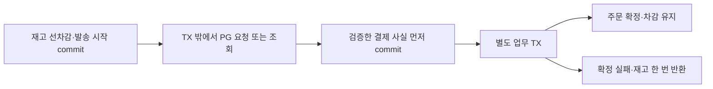

# 결제 응답을 못 받았을 때 재고를 돌려주지 않은 이유

[실제 결과](result.md) · [전체 상태 흐름](../states/total.md) · [재현 방법](verification.md)

## 타임아웃은 결제 실패가 아니었다

이번 서비스는 상품 재고를 먼저 차감하고 DB에 저장한 뒤 테스트 PG에 결제를 요청한다. 성공하면 차감 상태를 유지하고, 확정 실패하면 차감한 수량을 한 번 돌려준다.

문제는 PG의 응답을 못 받았을 때였다. PG가 거래를 만들기 전에 장애가 날 수도 있지만, 거래를 저장한 다음 응답만 유실될 수도 있다. commerce에서 본 현상은 같은 타임아웃이어도 외부에서 일어난 일은 다르다.

실제 실험 주문 55는 생성 응답을 유실시켰다. 최초 요청은 202였지만 PG에는 거래가 한 건 있었다. 자동 조회 두 번 뒤 SUCCESS를 확인해 주문을 확정했다. 주문 56도 응답을 유실시켰지만 나중에 FAILED가 조회됐고, 그때 재고를 3에서 5로 복구했다.

타임아웃 직후 둘 다 실패로 처리했다면 55는 이미 결제된 상품의 재고를 풀어 버리는 문제가 생긴다. 새 결제를 다시 보냈다면 외부 거래가 중복될 수도 있다. 그래서 응답을 못 받으면 기존 거래를 조회하며, 차감 재고와 발송 시작 기록을 유지한다.

## 결제 사실과 우리 업무 완료를 따로 저장했다

PG에서 성공했다는 것과 우리 주문 처리가 끝났다는 것은 다르다. 성공 조회 뒤 주문 기록을 저장하다 실패할 수도 있기 때문이다.

결제 시도는 확인한 PG 결과를 소유하고, 별도의 복구 작업은 실행 ID·사용 회차·후속 처리 상태를 소유한다. 재고 차감·반환 기록은 mall 모델에 둔다. application이 짧은 TX들을 조율하며 PG HTTP와 재시도 대기는 TX 밖에서 실행한다.

주문 67에서는 자동 조회로 SUCCESS를 저장한 다음 주문 기록 삽입만 실패시켰다. 주문은 PAYMENT_PENDING, 기록은 0건, 재고는 3개였지만 성공 사실은 남았다. 장애 주입을 제거하고 PG를 끈 상태에서 수동 대사를 요청하자 추가 조회 없이 저장된 성공으로 주문을 확정했다.

한 TX로 묶어 성공 관찰까지 함께 rollback했다면 확인한 근거를 잃었을 것이다. 특히 거래 생성 전 확정 거절은 원래 PG 거래가 없으므로 빈 조회로 같은 거절을 다시 증명할 수 없다. 확인한 사실을 먼저 보존하는 이유다.

## 결제 실패와 조회 실패를 다른 기준으로 셌다

PG가 정상 형식으로 FAILED를 알려줬다면 결제는 실패했지만 조회 기능은 정상이다. 반대로 timeout·통신 오류·잘못된 응답은 조회 기능의 문제이며 결제 실패의 증거가 아니다.

공유 서킷브레이커는 이 차이를 기준으로 PG 조회만 측정한다. 생성 POST와 DB 처리는 포함하지 않는다. 자동 조회·수동 대사·callback의 권위 조회가 같은 회로를 사용하므로 다른 경로가 장애 중 PG를 우회 호출하지도 않는다.

회로가 열리면 저장 결과와 차감 재고를 유지한다. 포인트로 대신 결제하거나 성공을 만들어 반환하지 않는다. 실제 주문 64·65는 자동 회차 1을 소비했지만 회로 차단으로 PG HTTP는 0회였다. 10초 뒤 수동 조회 두 건으로 HALF_OPEN을 거쳐 CLOSED로 회복했고, 중단된 자동 작업을 다시 시작하지 않았다.

실패율은 최근 최대 10건·최소 5건부터 판단한다. 실패율 또는 1초 초과 느림 비율이 50% 이상이면 차단한다. 다른 4xx와 식별·종결 충돌은 정상 표본으로 섞지 않고 제외한다. 자세한 상태 코드 분류는 [회로 표](trade_off/02-lookup-circuit-breaker.md)에 남겼다.

## 재시도는 라이브러리와 DB가 다른 일을 맡았다

Resilience4j `@Retry`는 반복과 대기를 담당한다. DB는 누가 작업을 맡았는지와 몇 회차를 사용했는지 기록한다. 자동 조회는 최초 포함 최대 4회이고, 앞선 회차가 끝난 뒤 1·3·10초에 지터 ±20%를 적용한다. 최초 실행기 전달부터 큐 대기까지 포함해 30초가 지나면 새 조회를 시작하지 않는다.

회차는 HTTP 전에 DB에 먼저 commit한다. 저장 직후 서버가 꺼져 실제 조회를 못 했다면 한 회를 소비하는 비용을 수용했다. 대신 재시작으로 예산이 늘어나지 않는다.

저장 전 확인만으로도 충분하지 않았다. DB 대기를 하는 사이 예산이 끝나거나 담당자가 작업을 인계할 수 있기 때문이다. 회차 commit 뒤 새 TX에서 실행 ID·확보 회차·완료를 다시 확인하고, HTTP 직전에도 시간을 확인했다. 실제 DB에 35초 대기를 넣은 주문 58·59는 회차 1이 남았지만 PG HTTP를 보내지 않았다.

별도로 주문 68을 조회 빈 진입에서 멈춘 뒤 commerce를 강제 종료했다. 회차 1과 실행 ID는 DB에 남았고 PG GET은 아직 0회였다. 이 지점은 단순히 ‘실행 중 종료’보다 좁은 경계다. 자동 실행의 메모리와 DB 기록이 어디서 갈라지는지 확인하기 위해 디버거로 위치를 고정했다.

내부 업무 반영 재시도도 PG 조회와 구분했다. MySQL 1213·SQLSTATE 40001과 해당 TX의 전체 rollback을 함께 확인한 데드락만 100ms 뒤 새 TX로 한 번 더 시도한다. DB 연결 끊김이나 commit 미확인은 반복하지 않고 저장 상태부터 읽는다. 이 재시도는 PG 호출이나 자동 조회 회차를 늘리지 않는다.

## 학습 범위에서 남긴 한계

정확히 한 번의 HTTP 요청을 보장하는 시스템은 아니다. 반복 조회가 생길 수 있으며, 보호할 대상은 추가 결제와 중복 주문 확정·재고 반환이다. 주문 상태 CAS와 같은 업무 TX의 주문 기록·재고 기록을 통해 이 효과를 한 번만 반영한다.

중단 작업의 자동 lease 회수나 재시작 스캔도 만들지 않았다. 운영 담당자가 미완료 목록을 읽고 명시적인 POST 대사로 인계한다. 전용 실행기는 스레드 2개·대기 2개로 작게 두어 혼잡을 쉽게 재현했다. 충분히 늦게 끝나는 PG 거래는 자동 확인 창을 벗어날 수 있다.

회로는 JVM 메모리 상태이며 재기동하면 표본을 잃는다. Retry-After 헤더도 해석하지 않는다. 조회 전에 읽은 결제 사실과 모순되는 응답은 회로 집계에서 제외하지만, 조회 도중 다른 실행이 저장해 뒤늦게 발견된 충돌을 이미 끝난 표본에 소급 반영하지는 않는다.

마지막으로 이 서비스의 X-USER-ID와 1번 관리자 fixture는 학습용 접근 검사다. 실제 로그인이나 운영 결제 보안 전체를 구현한 것은 아니다. 해결한 경계와 남긴 경계를 구분해 두어야 다음 실험에서도 같은 상태를 올바르게 해석할 수 있다.
