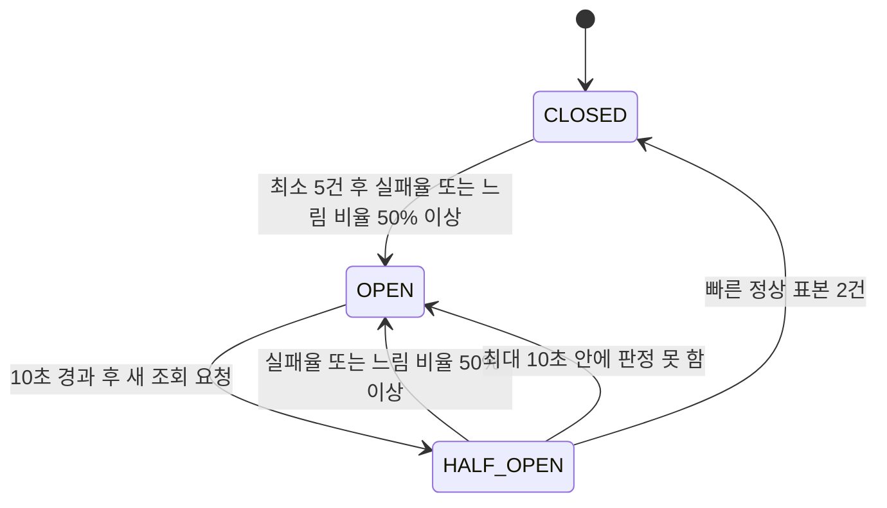

# PG 조회 서킷브레이커와 집계 기준

[결정 목록](total_trade_off.md) · [자동 재확인 정책](01-reconciliation-retry-policy.md) · [실행 방식](06-reconciliation-execution.md) · [횟수 기록](07-retry-attempt-accounting.md)

처음 읽는 개발자는 [현재 구현의 서킷브레이커 안내](../../resilience/circuit-breaker.md)와 [폴백 전략](../../resilience/fallback.md)을 먼저 읽는다. 이 문서는 결정 과정의 기록이며 아래 ‘설정 예정·아직 정할 것·미실행’ 표현은 논의 당시 기준이다. 현재 수치·코드·검증 근거는 새 안내와 결과 문서를 따른다.

상태: **2026-10-23 정책 구현·세 관점 기능 리뷰·최종 검증 완료**. 전체 검사 509건과 실제 PG 장애/재시작 실험 14건의 증거·검증 한계는 [결과](../result.md)를 따른다. 아래 논의는 결정 과정이며 현재 클래스와 완료 범위는 [계획](../plan.md)·[리뷰 기록](../review.md)에 연결한다. 원격 PR은 후속 범위다.

## 먼저 구분할 세 가지

| 질문 | 판단하는 내용 | 예시 |
|---|---|---|
| 결제는 성공했는가? | 주문 확정 또는 실패·재고 복구의 근거 | 검증된 FAILED면 주문 실패와 재고 반환을 공통 TX로 처리 |
| 다시 조회할 것인가? | 자동 작업을 계속할지, 멈추고 수동 확인할지 | PENDING이면 한도 안에서 재조회 |
| PG 조회 기능은 정상인가? | 서킷브레이커의 정상·실패·제외 표본 | FAILED를 정상 조회했다면 회로상 정상 |

**결제 실패와 PG 조회 실패는 다르다.** PG가 유효한 FAILED를 반환했다면 결제는 실패했지만 조회 기능은 정상이다. 반대로 timeout은 조회 실패이며 결제가 실패했다는 증거가 아니다.

## 적용 범위와 회로 차단

- 자동 조회·고객/관리자 수동 대사·callback의 PG 권위 조회가 **같은 회로 하나**를 공유한다. PG 조회 한 번의 결과를 집계하며 자동 작업 전체를 표본 하나로 합치지 않는다.
- 2026-10-22 사용자 답변으로 자동 조회 재시도와 회로 라이브러리는 **모두 Resilience4j**로 확정했다. 기존 Spring Retry @Retryable 선택을 대체하고, 연결은 `@Retry`·`@CircuitBreaker` 애노테이션으로 한다. [03](03-resilience-library-wiring.md)을 따른다.
- 결제 생성 POST에는 이 조회 회로와 자동 재시도를 적용하지 않는다. 고객 주문 GET·운영 미완료 목록 GET도 PG를 호출하지 않는다.
- 회로가 조회를 차단하면 실제 PG HTTP 호출은 하지 않는다. 저장한 결제 사실·주문·차감 재고는 유지한다.
- 자동 작업은 차단을 만나면 **즉시 수동 전환**한다. 남은 1·3·10초 일정으로 회복을 기다리지 않는다. 회차를 먼저 commit한 경우 이번 작업 회차는 소비한 채 유지한다.
- 수동 대사와 callback도 OPEN 동안 PG를 우회 조회하지 않는다. 자동 사용 회차를 소비하지 않는 R02 계약은 유지한다.
- 이미 검증한 종결 근거의 내부 재적용은 PG 조회가 필요 없으므로 회로 OPEN에도 가능하다. 기존 callback은 권위 조회가 필요한 경로이며 OPEN을 이유로 본문을 믿고 적용하지 않는다.
- 회복 뒤 다음 명시적 수동 대사 또는 후속 callback 등 허용된 조회에서 기존 거래를 확인한다. 수동 전환된 자동 작업을 회복 시점에 자동으로 되살리지 않는다.

공유 회로는 진입 경로가 달라도 PG 장애 중 호출을 줄인다. 비용은 OPEN 동안 운영자도 새 PG 결과를 직접 확인하지 못한다는 점이다. 자동 조회에만 회로를 적용해 수동/callback이 우회하는 안은 채택하지 않았다.

## 집계 표

이 표는 **PG 조회 응답**에 적용한다. 재조회 칸은 자동 작업의 정책이며 수동 대사는 계속 요청당 최대 한 번만 조회한다.

| 상황 | 회로 집계 | 자동 작업 | 주문·재고 처리 |
|---|---|---|---|
| 응답 timeout | 실패 | 한도 안에서 재조회 | 저장 사실·차감 유지 |
| 연결 거절·연결 끊김 등 통신 오류 | 실패 | 한도 안에서 재조회 | 저장 사실·차감 유지 |
| HTTP 500·502·503·504 | 실패 | 한도 안에서 재조회 | HTTP 상태만으로 결제 실패 처리 안 함 |
| 나머지 HTTP 5xx(501·505 등) | 실패 | 즉시 수동 전환 | HTTP 상태만으로 결제 실패 처리 안 함 |
| HTTP 408·429 | 실패 | 한도 안에서 재조회 | 저장 사실·차감 유지 |
| 정상 응답이어야 하는데 JSON이 깨짐·필수 필드 누락·알 수 없는 결제 상태 등 | 실패 | 반복이 도움이 안 되는 계약 오류로 즉시 수동 전환 | 임의 종결·반환 없음 |
| 조회 계약 밖 2xx/3xx(202·204·302 등) | 실패 | 즉시 수동 전환 | 성공 추측·redirect 추적·임의 종결/반환 없음 |
| 검증한 SUCCESS | 정상 | 공통 업무 반영 후 종료 | 주문 확정·차감 유지 |
| 검증한 FAILED | 정상 | 공통 업무 반영 후 종료 | 주문 실패·차감량 한 번 반환 |
| 검증한 PENDING | 정상 | 한도 안에서 재조회 | 결제 대기·차감 유지 |
| 거래 키 단건 조회의 404 | 정상 | 한도 안에서 재조회 | 거래 미확인이며 재결제·반환 근거가 아님 |
| 주문별 조회의 200 + 빈 배열 | 정상 | 한도 안에서 재조회 | 거래 미확인·차감 유지 |
| HTTP 401·403 | 제외 | 계정·권한 설정 확인을 위해 즉시 수동 전환 | 저장 사실·차감 유지 |
| 위 계약상 404와 408·429를 제외한 모든 4xx | 제외 | 같은 요청 반복 대신 즉시 수동 전환 | 저장 사실·차감 유지 |
| 주문·금액·계정·거래 키 불일치, 복수 거래, 종결 결과 충돌 | 제외 | 즉시 수동 확인 | 충돌 근거·기존 종결 보존 |
| 우리 DB 저장·주문 반영 실패 | 제외 | PG 재조회와 별도 내부 반영 정책을 따름 | 저장 PG 근거 보존·업무 미완료 구분 |
| 자동 작업 접수 거절·접수 재시도 | 제외 | [실행기 전달 정책](06-reconciliation-execution.md)에 따라 처리 | 결제 대기·차감 유지 |
| 회로 OPEN 등에 따른 조회 차단 | 제외 | 즉시 수동 전환 | 차단 자체로 결제 실패 처리 안 함 |

회로 **실패**라고 반드시 자동 재조회하는 것은 아니다. 예를 들어 잘못된 JSON은 회로 실패로 집계하지만 해당 자동 작업은 즉시 수동으로 넘긴다.
2026-10-22 후속 결정으로 모든 5xx를 회로 실패로 집계하되, 자동 재조회할 5xx는 500·502·503·504로 제한했다. 나머지 5xx는 즉시 수동 전환한다. [HTTP 재조회 정책](01-reconciliation-retry-policy.md#조회-http-오류의-재시도-범위--확정)을 따른다.
회로 **정상**이어도 추가 조회가 필요할 수 있다. PENDING과 거래 없음이 그 예다.

### 이미 저장한 결제 결과와 모순되는 응답

조회 전에 읽은 결제 결과·생성 전 거절 사실도 함께 비교한다. 저장한 SUCCESS에 FAILED가 오거나 저장한 FAILED에 SUCCESS가 오면 종결 충돌이다. 생성 전 확정 거절(NO_EFFECT)이 저장돼 있는데 거래가 조회되면 존재 충돌이다. 이 경우 회로 정상·실패·느림 표본에서 모두 제외한다. 같은 종결 결과나 늦게 도착한 PENDING은 충돌로 만들지 않는다.

집계에서 제외해도 **원래 검증 응답은 그대로 관찰 저장 TX에 전달**한다. 저장 TX가 기존 결제 사실을 보호하면서 정확한 충돌 사유를 남긴다. 회로 차단처럼 단순 확인 불가로 바꾸면 안 된다.

비교에 쓰는 값은 조회 전에 확보한 정보다. PG 조회 중 다른 실행이 새 사실을 저장해 나중에 드러난 충돌은 이미 끝난 회로 표본을 소급 변경하지 않는다. 이는 2026-10-23 사용자가 승인한 학습용 한계다. DB 조회·관찰 저장·업무 반영은 회로 밖을 유지하며, DB에서의 최종 충돌 보존은 그대로 수행한다.

### 나머지 4xx의 구체적인 예

| 상태 | 해석·처리 |
|---|---|
| 400·405·406·413·414·415·431 등 | 요청 형식·메서드·내용·크기 등의 수정이 필요할 수 있으므로 집계 제외·즉시 수동 |
| 401·403 | 계정·권한 설정 확인. 집계 제외·즉시 수동 |
| 409·410·412·422·428 등 | 이번 PG 조회에는 별도 자동 복구 계약이 없으므로 집계 제외·즉시 수동 |
| 정의하지 않은 다른 4xx | 효과나 회복 가능성을 추측하지 않고 집계 제외·즉시 수동 |

404는 경로에 따라 다르다. `GET /api/v1/payments/{transactionKey}`의 404는 계약에 있는 거래 없음이다. 반면 `GET /api/v1/payments?orderId=...`는 200 + 배열을 약속하므로 **이 경로 자체의 404는 집계 제외·즉시 수동**이다.
4xx 오류 본문이 HTML이거나 JSON이 아니더라도 우선 위 상태 코드/경로 계약으로 분류한다. 이를 정상 응답의 JSON 파손과 혼동해 집계 기준을 바꾸지 않는다.

조회의 422는 결제 실패 근거가 아니다. **생성 POST의 422 + 정확한 code + transactionCreated=false + 주문·금액 일치**를 검증한 경우만 생성 전 확정 거절이며, 조회 회로 범위 밖에서 R02의 실패/재고 복구 경계를 사용한다.

## 카운팅을 읽는 방법

정상은 정상 표본, 실패는 실패 표본에 넣는다. **제외는 정상·실패 어느 쪽에도 넣지 않으며 실패율의 분모에서도 뺀다.** 예를 들어 정상 2회·실패 2회·제외 2회라면 집계 대상은 4회, 계산상 실패율은 50%다. 하지만 최소 5건을 채우지 못했으므로 이 표본만으로 실패율/느림 비율에 따른 차단을 결정하지 않는다.

### 집계 범위 · 확정

사용자는 **건수 기준 최근 10건, 최소 5건부터 판단**을 선택했다. CLOSED에서 조회 결과를 쌓는 범위이며 HALF_OPEN은 별도 탐색 표본 2건으로 판단한다.

| 설정 예정 값 | 의미 |
|---|---|
| slidingWindowType = COUNT_BASED | 최근 시간 대신 호출 건수를 기준으로 집계 |
| slidingWindowSize = 10 | 정상/실패로 집계한 최근 최대 10건을 유지 |
| minimumNumberOfCalls = 5 | 집계 대상이 최소 5건 쌓여야 실패율·느림 비율에 따른 차단을 판단 |

처음 1~4건은 모두 실패해도 해당 비율로 회로를 열지 않는다. 5건부터 판단하고 이후에는 새 표본이 들어올 때 가장 오래된 표본부터 밀어내 최대 10건을 본다. 제외 결과는 정상 표본으로 바꾸지 않는다.
이 숫자는 한 주문의 자동 조회 한도 4회와 별개다. 자동/수동/callback의 여러 조회가 공유 회로에 표본을 쌓는다.
시간 기준 최근 30초·최소 5건 안은 채택하지 않았다. 선택한 방식은 적은 호출로 학습하기 쉽지만, 호출이 뜸하면 오래된 오류도 새 표본이 쌓일 때까지 남는 비용이 있다.

### 실패율 차단 기준 · 확정

사용자는 **실패율 50% 이상 차단**을 선택했다. 설정 예정 값은 `failureRateThreshold = 50`이며 최소 5건과 최근 최대 10건 기준을 함께 적용한다.

- 집계 대상 4건: 모두 실패해도 최소 표본 부족으로 실패율 차단을 판단하지 않는다.
- 집계 대상 5건 중 실패 2건: 40%이므로 실패율 기준에는 미달한다.
- 집계 대상 5건 중 실패 3건: 60%이므로 OPEN으로 전환한다.
- 집계 대상 10건 중 실패 5건: 정확히 50%이므로 OPEN으로 전환한다.

위 예시는 실패율 기준만 설명한다. 느림에 따른 별도 차단 기준은 아래와 같다. 검증한 결제 FAILED는 회로상 정상이고 표본 제외는 분모에서도 빠진다.
80% 안보다 장애 호출을 빨리 줄이지만 일부 정상 조회 기회도 함께 차단할 수 있는 비용을 수용했다. 실패율 80% 안은 채택하지 않았다.

아래 숫자는 서로 다르다. 회로 차단을 HTTP 실패 표본으로 다시 더하면 안 된다.

| 사건 | 자동 사용 회차 증가 | 실제 PG HTTP | 회로 표본 |
|---|---:|---:|---|
| 자동 조회 회차 commit 후 정상/오류 응답 수신 | 1 | 1 | 위 분류에 따라 정상/실패/제외 |
| 자동 회차 commit 후 회로가 차단 | 1 | 0 | 제외 |
| 자동 회차 commit 직후 HTTP 전에 서버 종료 | 1 | 0 | 없음 |
| 실행기가 접수를 거절해 100ms 뒤 재접수 | 0 | 0 | 없음 |
| 수동 대사 또는 callback이 PG를 한 번 조회 | 0 | 1 | 위 분류에 따름 |
| 저장한 종결 근거로 내부 업무만 재적용 | 0 | 0 | 없음 |

기존 adapter는 통신/계약 오류도 예외 대신 `PaymentObservation` 결과값으로 반환한다. **메서드가 정상 반환했다는 이유로 모든 결과를 회로 정상으로 세지 않는다.** 반대로 제외할 결과를 정상으로 더해 실패율을 낮추지 않는다. 구체적인 decorator/프록시·결과 분류 연결은 상세 설계에서 확정한다.

## 느린 호출 차단 · 확정

사용자는 **1초를 초과한 조회가 집계 대상의 50% 이상이면 차단**하는 안을 선택했다. 설정 예정 값은 `slowCallDurationThreshold = 1초`, `slowCallRateThreshold = 50`이다. 1.5초 초과/50% 안은 채택하지 않았다.

실패율과 같은 최근 10건·최소 5건을 사용하며 제외 결과는 느림 집계에서도 제외한다. 최소 표본을 채운 뒤 **실패율 50% 이상 또는 느림 비율 50% 이상** 중 하나라도 충족하면 OPEN으로 전환한다.

- 빠른 정상 2건·1초 초과 정상 3건이면 실패율은 0%, 느림 비율은 60%여서 차단한다.
- 정상 성공 결과가 늦게 왔다면 결과는 그대로 저장·업무 반영하고, 회로는 이후 조회를 제한한다. 느림만으로 결제를 UNKNOWN/FAILED로 바꾸지 않는다.
- timeout처럼 실패하면서 느린 조회는 실패와 느림 양쪽에 해당할 수 있지만 호출 표본 자체를 두 건으로 늘리지는 않는다.
- 1초는 호출을 강제로 끊는 시간이 아니다. 진행 중 호출의 취소나 기존 HTTP 응답 대기 2초 설정을 대체하지 않는다.

응답 timeout에 도달하기 전의 지연도 감지하기 쉽지만, 정상적으로 늦은 조회까지 쌓이면 다른 조회도 차단되는 비용을 수용했다.

## OPEN 대기와 회복 확인 시작 · 확정

사용자는 **OPEN 10초 대기**를 선택했다. 설정 예정 값은 `waitDurationInOpenState = 10초`이며, 30초 안은 채택하지 않았다.

1. 회로가 열리면 10초 동안 새 PG 조회를 차단한다. 차단된 자동 작업은 즉시 수동 전환한다.
2. 10초가 지난 뒤 **새 조회 요청이 오면** HALF_OPEN에서 회복 확인용 조회를 허용한다. 별도 자동 탐색 요청을 생성하지 않는다(`automaticTransitionFromOpenToHalfOpenEnabled = false` 예정).
3. 탐색 표본 2건의 결과로 CLOSED 복귀 또는 OPEN 재차단을 판단한다. 집계 제외는 표본에 넣지 않으며 HALF_OPEN 진입 후 최대 10초 안에 판정하지 못하면 OPEN으로 돌아간다.

대기 시간이 끝나도 바로 정상으로 판정하지 않는다. 수동 전환/중단된 자동 작업을 자동 재시작하지 않으며 다음 명시적 대사·후속 callback·다른 허용 조회가 탐색 기회가 된다.
10초는 학습 실험과 회복 확인을 짧게 진행하기 쉽지만, 30초보다 PG에 주는 휴식 시간이 짧아 아직 장애가 남아 있으면 다시 차단될 수 있다.

## HALF_OPEN 탐색 표본 · 확정

사용자는 **탐색 표본 2건**을 선택했다. 설정 예정 값은 `permittedNumberOfCallsInHalfOpenState = 2`이며 1건만 확인하는 안은 채택하지 않았다.
자동·수동·callback이 공유하는 회로 전체에서 집계 대상 2건을 모은다. 한 주문 또는 수동 대사 한 요청에서 두 번 조회하라는 의미가 아니며 수동 요청당 최대 1회는 유지한다.

| 집계 대상 탐색 결과 2건 | 판정 |
|---|---|
| 두 건 모두 회로상 정상이고 각각 1초 이하 | 실패율/느림 비율 모두 0% → CLOSED |
| 한 건 이상 회로 실패 | 실패율 50% 이상 → OPEN |
| 한 건 이상 1초 초과 | 느림 비율 50% 이상 → OPEN |

빠르게 조회한 결제 FAILED/PENDING·계약상 거래 없음도 회로상 정상에 해당한다. 성공 결제 두 건을 요구하는 조건이 아니다.
집계 제외 결과는 탐색의 정상이나 실패로 채우지 않는다. 따라서 실제 HTTP 수와 집계 대상 탐색 표본 수가 다를 수 있다.
CLOSED의 최소 5건을 HALF_OPEN 탐색에 그대로 요구하지 않는다. HALF_OPEN에서는 2건으로 판단한다. 일반 비율 판정은 두 건을 모은 뒤 수행하며 그전에 탐색 최대 대기 10초에 도달하면 아래 정책으로 재차단한다.
한 번의 우연한 정상 응답으로 바로 복귀하는 것보다 확인을 한 번 더 하지만, 조회 요청이 적으면 회복 판정이 늦어지는 비용이 있다.

## HALF_OPEN 최대 대기 · 확정

사용자는 **HALF_OPEN 진입 후 최대 10초, 회복을 판정하지 못하면 OPEN으로 복귀**하는 안을 선택했다. 설정 예정 값은 `maxWaitDurationInHalfOpenState = 10초`다. 시간 제한 없이 표본 2건을 계속 기다리는 안은 채택하지 않았다.

- 조회 요청이 부족하거나 401·403/식별 충돌 같은 제외 결과만 나와도 이를 정상 표본으로 채워 넣지 않는다.
- 최대 10초 안에 집계 대상 2건으로 판정하지 못하면 회복 근거 부족으로 재차단한다. PG 결제가 실패했다는 판단은 아니다.
- 이때 OPEN의 10초 대기를 다시 적용하고, 그 뒤 후속 조회 요청에서 새 HALF_OPEN 탐색을 시작할 수 있다.
- OPEN의 휴식 10초, HALF_OPEN의 최대 체류 10초, HTTP 응답 대기 2초는 서로 다른 제한이다. 탐색 대기 만료가 진행 중 HTTP/DB 처리를 강제로 취소하거나 검증한 결과를 버리는 근거가 되지 않는다.
- HALF_OPEN 대기 만료를 위한 회로 내부 시간 처리는 새 PG 호출을 만들지 않는다. 중단된 결제 작업의 자동 회수/재시작이나 DB 작업의 lease와도 다르다.

탐색 상태가 오래 남지 않아 실험과 운영 상태 해석이 쉽지만, 호출이 적으면 PG가 이미 정상이어도 회복을 입증하지 못해 재차단되는 비용이 있다.

## 확정한 회로 흐름

## 아직 정할 것

- 집계 범위는 최근 10건·최소 5건, 실패율 50% 이상, 1초 초과 조회의 느림 비율 50% 이상 차단으로 확정했다.
- OPEN은 10초·후속 요청 시 탐색, HALF_OPEN은 집계 대상 2건·최대 10초 후 미판정 시 재차단으로 확정했다.
- HTTP 오류의 재조회는 408·429·500·502·503·504로 제한했고, 다른 5xx는 실패 집계·즉시 수동으로 확정했다. Retry-After는 미지원이며 고정 간격·지터·30초 예산을 유지한다.
- 계약 밖 2xx/3xx는 회로 실패 집계·즉시 수동 전환으로 확정했다. 생성 POST의 정상 202에는 적용하지 않는다.
- Retry와 회로 모두 Resilience4j 애노테이션을 사용한다. 버전·구체적인 빈/예외 변환은 상세 설계 대상이다.
- 운영 범위는 기존 조회＋로그＋기본 Prometheus 지표로 확정했다. 사유 타입·예외/지표 연결의 구체적인 계획은 [plan.md](../plan.md)에서 검토한다.

## 필요한 최소 검증 · 미실행

- FAILED/PENDING은 정상 집계, timeout·408·429·잘못된 정상 응답은 실패 집계.
- 거래 키 404·빈 배열과 목록 경로 404의 차이, 다른 4xx·식별 충돌의 집계 제외.
- 자동/수동/callback 공유 회로, OPEN 중 HTTP 0회·자동 회차 보존·즉시 수동 전환.
- 정상 반환 결과값에 대한 분류, 표본 제외와 실패율 분모, 느림/실패 전이.
- HALF_OPEN 탐색 2건의 복귀/재차단, 제외/표본 부족 시 최대 10초 뒤 재차단. 대기 만료로 새 PG 호출/결제 실패를 만들지 않음.
- 모든 경우에 기존 종결·차감 재고를 보존하고 검증한 FAILED만 한 번 반환.

## 참고

- [Resilience4j CircuitBreaker 공식 설명](https://resilience4j.readme.io/docs/circuitbreaker): 상태 전이, 표본 제외, 최소 호출 수와 느린 호출 집계.
- [RFC 9110 · 4xx 상태 코드](https://www.rfc-editor.org/rfc/rfc9110.html#section-15.5), [RFC 6585 · 429](https://www.rfc-editor.org/rfc/rfc6585.html#section-4): HTTP 의미의 근거. 위 자동화/수동/회로 분류는 이 저장소에서 선택한 학습 정책이다.
