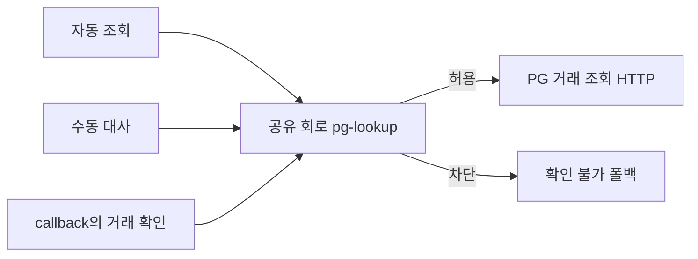
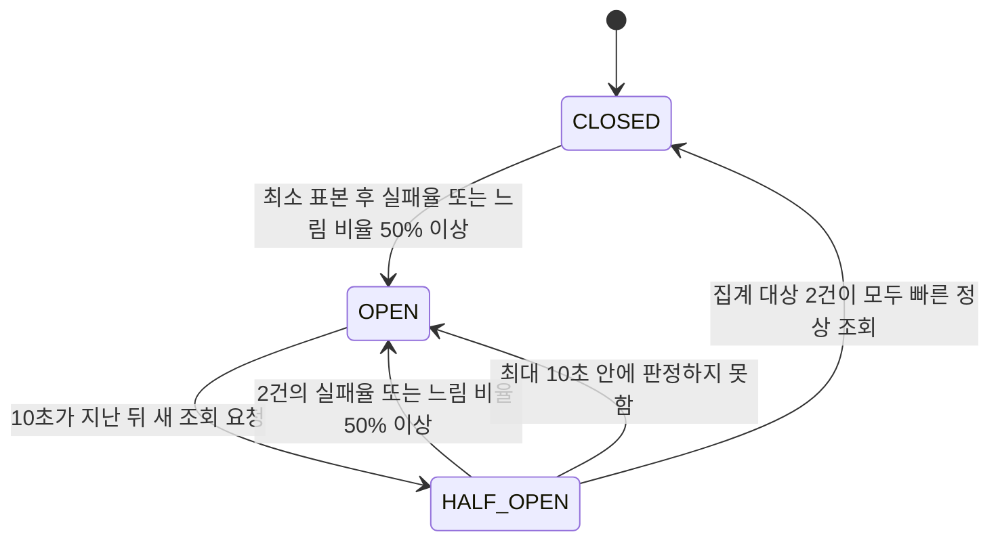

# PG 조회 서킷브레이커 이해하기

[읽기 안내](README.md) · [재시도 전략](retry.md) · [폴백 전략](fallback.md) · [결제 상태 모델](../states/payment.md)

## 왜 필요한가?

PG 조회가 계속 느리거나 실패하면 결제 결과를 기다리는 연결과 스레드가 쌓인다. 서킷브레이커는 최근 조회 결과를 보고 새 PG 조회를 잠시 막아, 장애 중 호출을 줄인다. 이후 적은 수의 조회로 회복을 확인한다.

이 문서에서 **회로의 정상·실패는 PG 조회 기능의 정상·실패**를 뜻한다. PG가 유효한 FAILED를 알려 줬다면 결제는 실패했어도 조회는 정상이다.

## 어디에 적용하는가?

자동 조회, 고객/관리자 수동 대사, callback의 권위 조회가 이름이 `pg-lookup`인 회로 하나를 공유한다. 권위 조회란 callback의 문자열을 그대로 믿지 않고 고정된 PG에 거래 결과를 직접 확인하는 것이다.

| 작업 | 회로 적용 | 이유 |
|---|---|---|
| 기존 거래 PG 조회 | 적용 | 같은 외부 기능에 대한 장애 판단을 공유 |
| PG 결제 생성 POST | 미적용 | 최초 발송 권한으로 한 번만 생성하는 별도 경계. 자동 재발송도 금지 |
| 고객 주문 GET·미완료 목록 GET | 미적용 | 우리 DB만 읽으며 PG에 요청하지 않음 |
| 저장된 SUCCESS/FAILED로 업무 재적용 | 미적용 | 이미 확보한 사실을 사용하므로 PG 조회가 필요 없음 |
| 회차 저장·주문/재고 DB 반영·Retry 대기 | 집계 밖 | PG 한 번의 조회와 우리 DB/대기를 구분 |

따라서 OPEN은 모든 결제 API의 중단을 뜻하지 않는다. 생성 호출은 별도 경로로 진행될 수 있고, 기존 주문 조회와 저장 근거 재적용도 가능하다.

## 세 상태를 읽는 법

| 상태 | 쉬운 설명 | 새 PG 조회 |
|---|---|---|
| CLOSED | 평소처럼 조회하고 결과를 모음 | 허용 |
| OPEN | 장애가 쌓여 잠시 쉬는 중 | 차단, HTTP 0회 |
| HALF_OPEN | 회복했는지 제한된 조회로 확인 중 | 허용량 안에서 탐색 |

CLOSED에서 실패율은 최근 최대 10건으로 계산하고 최소 5건이 모인 뒤 판단한다. 예를 들어 조회 5건 중 3건이 timeout이면 실패율 60%이므로 OPEN이다. 4건만 모였을 때는 모두 실패해도 이 비율 기준으로 열지 않는다.

## 현재 설정과 선택 이유

| 설정 | 값·의미 | 선택의 이득과 비용 |
|---|---|---|
| 집계 방식 | 건수 기준 최근 10건, 최소 5건 | 적은 요청으로 재현하기 쉽다. 호출이 뜸하면 오래된 표본도 남는다 |
| 실패율 | 50% 이상 | 비교적 빨리 보호하지만 일부 정상 조회 기회도 막을 수 있다 |
| 느린 조회 | 1초 **초과**가 50% 이상 | timeout 전에 지연을 감지한다. 늦은 정상 응답도 차단 판단에 영향을 준다 |
| OPEN 대기 | 10초 | 학습 중 회복을 빨리 관찰한다. PG가 아직 장애 중이면 다시 열릴 수 있다 |
| HALF_OPEN 표본 | 집계 대상 2건 | 한 번의 우연한 정상 응답으로 회복을 판단하지 않는다 |
| HALF_OPEN 최대 체류 | 10초 | 표본 부족·제외 결과만 있는 상황에서 계속 머무르지 않는다 |

실패율과 느림 비율 중 하나라도 기준에 도달하면 차단한다. 실패하면서 느린 조회는 두 기준에 해당할 수 있지만 조회 표본 자체를2건으로 세지는 않는다.

OPEN의10초가 지났다고 즉시 CLOSED가 되거나 PG로 자동 탐색 요청을 보내지는 않는다. 새 조회가 들어와야 HALF_OPEN 탐색이 시작된다. HALF_OPEN은 두 건을 모아 비율로 판단하며, 한 건이 실패/느려도 다른 표본을 기다리는 동안은 아직 HALF_OPEN일 수 있다. 두 건 중 한 건이 실패하거나1초를 초과하면 비율50%여서 재차단된다. 표본을 못 채우면 최대10초 규칙으로 재차단된다.

수동 대사 한 요청에서 두 번 조회하라는 뜻은 아니다. 각 요청은 최대1회 조회하고 여러 요청이 공유 표본을 채운다.

## 무엇을 정상·실패·제외로 세는가?

‘표본’은 비율 계산에 사용하는 조회 결과 한 건이다. ‘제외’는 정상과 실패 어느 쪽에도 넣지 않는 것이다. 실패율의 분모와 느림 비율에서도 빠진다. 제외를 정상으로 세면 장애 비율이 실제보다 낮아진다.

| 관찰한 조회 결과 | 회로 집계 | 자동 작업의 다음 행동 |
|---|---|---|
| 검증된 SUCCESS·FAILED | 정상 | 공통 업무 TX로 반영 |
| 검증된 PENDING | 정상 | 남은 횟수·시간 안에서 재조회 |
| 거래 키 단건 GET의404·주문별 GET의200 빈 배열 | 정상 | 거래 미확인으로 재조회. 실패·재결제 근거로 쓰지 않음 |
| timeout·연결 끊김·연결 거절 | 실패 | 한도 안에서 재조회 |
| 408·429·500·502·503·504 | 실패 | 한도 안에서 재조회 |
| 그 외5xx | 실패 | 즉시 수동 확인 |
| 정상 응답이어야 하는데 JSON 파손·필드/타입 오류·알 수 없는 상태 | 실패 | 계약 문제로 즉시 수동 확인 |
| 조회 계약 밖2xx/3xx, 예:202·204·302 | 실패 | 즉시 수동 확인. redirect를 따라가지 않음 |
| 계약상 거래 키404와408·429를 제외한4xx | 제외 | 요청·계정·계약을 확인하도록 수동 전환 |
| 주문·금액·거래 키 불일치·복수 거래·알려진 종결/존재 충돌 | 제외 | 저장 근거를 보호하고 수동 확인 |
| 회로 자체의 차단 | 새 표본 없음 | 즉시 수동 전환 |

**회로 집계와 재시도 여부는 별개다.** PENDING은 정상 표본이어도 다시 조회하고, 깨진 JSON은 실패 표본이어도 자동 반복하지 않는다.

조회 반복의 4회/30초 한도와, DB 반영 데드락의 추가 1회는 서로 다른 예산이다. 내부 반영 Retry는 PG 호출·회로 표본을 늘리지 않는다. 호출 순서와 사례는 [재시도 전략](retry.md)을 따른다.

404도 요청 경로를 함께 봐야 한다. 거래 키 GET은 없는 거래에404를 약속한다. 주문별 목록 GET은200과 배열을 약속하므로 그 경로의404는 정상 ‘거래 없음’이 아니라 위4xx 제외·수동 처리에 해당한다.

이미 저장한 SUCCESS에 FAILED가 오거나, 생성 전 거절을 저장했는데 거래가 발견되면 알려진 충돌로 제외한다. 그래도 원래 응답은 관찰 저장 TX에 전달해 충돌을 기록한다. 조회 중 다른 실행이 저장해 뒤늦게 발견한 충돌은 이미 끝난 회로 표본을 소급 변경하지 않는다.

## 회차·HTTP·표본 수는 서로 다르다

| 사건 | 자동 회차 소비 | PG HTTP | 회로 표본 |
|---|---:|---:|---|
| 자동 회차 commit 후 정상 응답 | 1 | 1 | 정상1 |
| 자동 회차 commit 후 OPEN 차단 | 1 | 0 | 없음 |
| 자동 회차 commit 후 HTTP 전에 종료/예산 만료 | 1 | 0 | 없음 |
| 수동 대사에서 빠른 정상 조회 | 0 | 1 | 정상1 |
| 저장된 성공 사실로 업무만 재적용 | 0 | 0 | 없음 |

DB는 조회 전에 회차를 먼저 저장한다. 그러므로 usedRounds와 실제 HTTP 수를 같은 숫자로 해석하면 안 된다. 연결 실패도 회차를 소비하면서 HTTP 전송 전 끝날 수 있다.

회로는 앱 JVM 메모리에 있어 재시작하면 표본이 초기화된다. DB의 결제 사실·사용 회차는 남는다. 회로가 회복돼도 수동 전환한 자동 작업이 부활하지 않는다.

## 코드와 검증을 따라가기

| 확인할 내용 | 파일 |
|---|---|
| 현재 수치 | [application.yml](../../../apps/commerce-api/src/main/resources/application.yml) |
| @CircuitBreaker와 차단/제외 fallback | [CircuitPaymentLookupGateway](../../../apps/commerce-api/src/main/java/com/loopers/infrastructure/resilience/pay/CircuitPaymentLookupGateway.java) |
| 응답별 분류 | [PaymentLookupPolicy](../../../apps/commerce-api/src/main/java/com/loopers/domain/pay/policy/PaymentLookupPolicy.java) |
| 결과값 집계·제외 예외·전이 로그 | [PaymentLookupCircuitConfig](../../../apps/commerce-api/src/main/java/com/loopers/config/pay/PaymentLookupCircuitConfig.java) |
| 실제 Spring 프록시·OPEN 차단·회복·알려진 충돌 | [PaymentLookupCircuitIntegrationTest](../../../apps/commerce-api/src/test/java/com/loopers/infrastructure/resilience/pay/PaymentLookupCircuitIntegrationTest.java) |

실서버 주문63~65의 OPEN→HALF_OPEN→CLOSED와 차단 시 HTTP 0회는 [실험 결과](../r03-payment-resilience/result.md)에 있다. 지표 확인과 담당자 행동은 [운영 절차](../r03-payment-resilience/operations.md)를 따른다.
