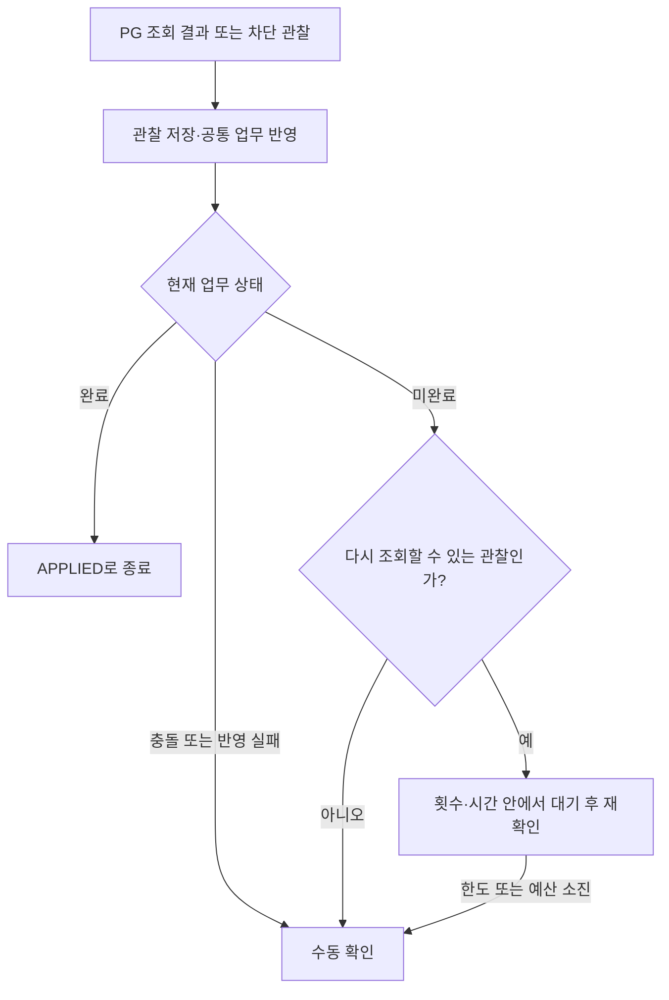

# 결제 조회 실패와 폴백 전략 이해하기

[읽기 안내](README.md) · [서킷브레이커](circuit-breaker.md) · [재시도 전략](retry.md) · [결제 상태 모델](../states/payment.md)

## 이 서비스에서 폴백은 무엇인가?

폴백은 원래 처리를 계속할 수 없을 때 선택하는 후속 행동이다. 이 구현의 기본 행동은 **마지막으로 확인한 결제 사실과 차감 재고를 보존하고, 확인할 수 없는 이유와 다음 확인 경로를 남기는 것**이다.

예를 들어 재고 5개에서2개를 먼저 차감한 뒤 PG 조회가 timeout됐다면 주문은 결제 대기, 재고는 3개를 유지한다. PG에서는 이미 성공했을 수도 있으므로 timeout을 FAILED로 바꾸거나 재고를 5개로 돌리지 않는다. 새 PG 결제나 포인트 대체 결제도 하지 않는다.

설계상 ‘안전한 후속 행동’ 전체와 Resilience4j의 `fallbackMethod`는 범위가 다르다. 아래에서 실제 코드가 각각 어디서 처리하는지 구분한다.

## 응답이 없을 때 어떤 정보가 남는가?

| 정보 | 보관하는 곳 | 예 |
|---|---|---|
| 이번 조회에서 무엇을 관찰했는가? | 일시적인 `PaymentObservation` | UNAVAILABLE＋TIMEOUT 또는 CIRCUIT_BLOCKED |
| 마지막으로 확인한 PG 결과 | DB의 `PaymentAttempt` | UNKNOWN·PENDING·SUCCESS·FAILED |
| 후속 처리를 어디까지 했는가? | DB의 `PaymentRecoveryTask` | RUNNING·MANUAL_REQUIRED·APPLIED, 회차·사유 |

`UNAVAILABLE`은 이번 호출의 관찰 종류이며 결제 결과 enum이 아니다. 예전에 PENDING이나 SUCCESS를 저장했다면 조회 실패가 그 결과를 UNKNOWN으로 덮어쓰지 않는다. 관찰 저장기는 NOT_FOUND/UNAVAILABLE에서 기존 결제 사실을 유지한다.

아직 결과를 한 번도 확인하지 못한 시도라면 UNKNOWN이 그대로 남는다. ‘결과가 처리 중임을 확인한 PENDING’과 ‘결과를 모르는 UNKNOWN’의 차이는 [상태 문서](../states/payment.md)를 따른다.

## 실제 코드에서 처리하는 네 경계

| 발생 지점 | 처리 방식 | 담당 코드 |
|---|---|---|
| HTTP timeout·통신·HTTP/응답 오류 | 예외/응답을 확인 불가 등의 구분된 관찰값으로 변환 | `HttpPaymentProviderGateway` |
| 회로가 조회를 차단 | `unavailable(..., CallNotPermittedException)`이 UNAVAILABLE/CIRCUIT_BLOCKED를 반환 | `CircuitPaymentLookupGateway`의 @CircuitBreaker fallback |
| 회로 집계 제외 대상 | `unavailable(..., IgnoredPaymentLookupException)`이 **원래 관찰을 그대로** 반환 | 같은 회로 fallback의 다른 분기 |
| 자동 조회의 반복 한도·예산·대기 중 인터럽트 | `stopped(...)`가 현재 실행을 확인하고 수동 확인 대상으로 표시 | `RecoverAutomaticPaymentService`의 @Retry fallback |

HTTP 장애를 모두 Java 예외로 던져 회로 fallback 하나에서 처리하는 구조는 아니다. adapter가 결과값으로 반환한 장애도 정책으로 분류해 회로 실패로 집계한다.

집계 제외 fallback은 결과를 잃지 않기 위한 연결이다. 예를 들어 SUCCESS와 FAILED의 충돌 응답을 단순 ‘조회 불가’로 바꾸면 충돌 근거가 사라진다. 원래 관찰을 반환하고, 별도 저장 TX가 기존 결과와 충돌을 보호한다.

위의 구분된 fallback이 모든 DB/코드 예외를 정상 응답으로 바꿔 주는 것은 아니다. 상태 확인까지 실패한 경우 등에는 오류를 반환할 수 있다.

## 자동 작업은 계속할지 멈출지 따로 판단한다



회로 차단 관찰을 받았어도 이미 다른 실행이 업무를 완료했다면 완료 상태가 우선한다. 계속 미완료인 현재 실행만 수동 전환한다.

| 상황 | 자동 작업의 행동 | 결제·재고 |
|---|---|---|
| PENDING·계약상 거래 없음·timeout·통신 오류 | 한도 안에서 기존 거래 재조회 | 마지막 사실·차감 유지 |
| 조회 HTTP 408·429·500·502·503·504 | 한도 안에서 재조회 | HTTP 오류만으로 실패 확정 안 함 |
| 회로 차단 | 즉시 수동 확인 | 새 PG HTTP 0회, 차감 유지 |
| 계약상 거래 키404·408·429를 제외한4xx, 나머지5xx·잘못된 응답·계약 밖2xx/3xx | 즉시 수동 확인 | 자동 종결·재발송·재고 반환 없음 |
| 식별/금액 불일치·복수 거래·종결 충돌 | 충돌을 남기고 수동 확인 | 기존 사실 보호 |
| 검증한 SUCCESS | 성공 업무 반영 | 주문 확정·추가 재고 차감 없음 |
| 검증한 FAILED | 실패 업무 반영 | 주문 실패·차감량 한 번 반환 |

재조회는 최초 포함 최대 4회이며 앞선 회차 뒤 1·3·10초±20%를 기다린다. 최초 실행기 전달부터30초 예산을 사용한다. 그중 먼저 도달한 한도에서 새 자동 조회를 멈춘다. 이미 시작한 조회와 사실 저장/업무 반영은 마무리할 수 있다.

이 조회 반복과 내부 반영의 100ms 재시도는 대상·횟수·DB 기록이 다르다. 언제 다시 시도해도 되는지와 실제 흐름은 [재시도 전략](retry.md)에서 비교한다.

실행 ID·상태·사용 회차가 현재 작업과 맞는지도 확인한다. 담당자가 새 실행 ID로 인계했다면 옛 작업은 새 실행을 수동 실패로 표시하지 않는다. 중단 표시 저장도 실패하면 RUNNING에 남을 수 있으므로 담당자는 MANUAL_REQUIRED만 찾으면 안 된다.

## PG 성공 뒤 우리 DB 반영만 실패한 경우

SUCCESS를 확인한 사실은 짧은 TX로 먼저 저장한다. 이후 주문·재고·작업 완료를 함께 반영하는 업무 TX가 실패해도 SUCCESS는 남는다.

**전체 rollback이 확인된 MySQL 데드락 1213/SQLSTATE40001만** 새 TX로 100ms 뒤 추가1회 반영한다. 이때 PG 생성·조회나 자동 조회 회차를 추가하지 않는다. 다른 오류·재고 반환 overflow는 자동 반복하지 않는다.

commit 성공 여부가 불명확하면 저장 상태부터 읽는다. 이미 APPLIED라면 완료를 반환한다. 미완료라면 당시 실행 정보로 실패 표시를 시도하고 현재 상태를 다시 읽는다. 표식 저장이 실패해도 상태 조회는 시도하며, 상태 조회까지 불가능하면 성공을 추측하지 않고5xx로 응답한다.

실제 주문67은 SUCCESS 저장 뒤 업무 삽입 오류로 미완료가 됐고, 장애 원인을 제거한 뒤 PG를 정지한 상태에서도 저장된 성공으로 주문을 확정했다. 자세한 증거는 [실험 결과](../r03-payment-resilience/result.md)를 따른다.

## 고객과 운영 담당자에게 어떻게 보이는가?

다음은 PENDING을 확인한 뒤 자동 조회 회차 1에서 회로가 차단된 경우의 **응답 필드 일부**다. 전체 응답은 ApiResponse의 data 안에 주문 정보를 담는다.

```json
{
  "status": "PAYMENT_PENDING",
  "paymentMethod": "PG",
  "paymentAttempt": {
    "outcome": "PENDING",
    "recoveryState": "MANUAL_REQUIRED",
    "usedRounds": 1,
    "lastReason": "CIRCUIT_BLOCKED"
  },
  "attentionRequired": true
}
```

자동 작업을 시작하기 전부터 결과를 몰랐다면 outcome은UNKNOWN일 수도 있다. `lastReason`은 후속 처리 사유이며 PG 결제 결과가 아니다.

| 경로 | 읽는 방법 |
|---|---|
| 고객 confirm·고객/관리자 reconcile | 미완료202, 업무 반영 완료200. 본문의 status·paymentAttempt·attentionRequired 확인 |
| 고객/관리자 주문 GET·미완료 목록 GET | 조회 자체가 성공하면200. GET은 PG 조회·작업 재시작을 하지 않음 |
| PG callback | 응답의 completed·attentionRequired와200/202로 업무 완료 여부 표시. 주문 상세는 반환하지 않음 |

고객 confirm/reconcile와 주문 GET 응답에는 `completed` 필드가 없다. 내부 `ConfirmOrderResult.completed`를 controller가 HTTP 200/202 선택에 사용하고, 본문은 OrderView/AdminOrderView로 변환한다. callback은 별도 응답이므로 completed가 노출된다. HTTP 200은 실패에 따른 반환까지 완료됐다는 뜻일 수도 있다.

이미 완료한 주문에 늦은 충돌이 발견되면 기존 완료 상태와200을 유지하며 주의를 표시한다. APPLIED 뒤에도 이전 lastReason이 남을 수 있으므로 주문 종결 상태와 recoveryState를 먼저 본다.

## 다시 확인하는 방법과 한계

담당자는 기존 미완료 GET에서 찾은 뒤 `POST /api-admin/v1/orders/{orderId}/payment/reconcile`을 명시적으로 호출한다. 관리자 경로는 학습용 X-USER-ID=1, 고객 경로는 본인 주문만 허용한다.

저장된 신뢰할 종결 근거가 있으면 PG 조회 없이 재적용하고, 그 외에는 수동 요청당 조회 최대1회다. PG 조회가 필요한 수동 요청과 callback도 공유 회로를 우회하지 않는다. callback 본문만으로 새 결제 사실을 확정하지 않으며 이미 저장된 종결 사실은 공통 업무 반영에서 사용될 수 있다.

회로 회복이나 commerce 재시작이 자동 작업을 다시 시작하지 않는다. 동일 confirm도 자동 예산을 새로 주지 않는다. Retry-After 해석·자동 lease 회수·callback 발송 보장은 추가하지 않았다. 운영 절차·사유별 행동은 [운영 문서](../r03-payment-resilience/operations.md)를 따른다.

## 코드를 따라 읽는 순서

1. [HttpPaymentProviderGateway](../../../apps/commerce-api/src/main/java/com/loopers/infrastructure/gateway/pay/HttpPaymentProviderGateway.java): 실제 HTTP를 관찰값으로 바꾸는 곳.
2. [CircuitPaymentLookupGateway](../../../apps/commerce-api/src/main/java/com/loopers/infrastructure/resilience/pay/CircuitPaymentLookupGateway.java): 회로와 두 fallback 분기.
3. [RecordPaymentObservationService](../../../apps/commerce-api/src/main/java/com/loopers/application/pay/service/RecordPaymentObservationService.java): 마지막 사실을 보존하는 저장 경계.
4. [RecoverAutomaticPaymentService](../../../apps/commerce-api/src/main/java/com/loopers/application/ordering/service/RecoverAutomaticPaymentService.java): 자동 반복/종료와 Retry fallback.
5. [ApplyOrderPaymentFacade](../../../apps/commerce-api/src/main/java/com/loopers/application/ordering/facade/ApplyOrderPaymentFacade.java): 업무 오류 뒤 상태 우선 확인·실패 표시.

관련 검사는 [회로 프록시](../../../apps/commerce-api/src/test/java/com/loopers/infrastructure/resilience/pay/PaymentLookupCircuitIntegrationTest.java), [자동 작업](../../../apps/commerce-api/src/test/java/com/loopers/application/ordering/service/AutomaticPaymentRecoveryIntegrationTest.java), [업무 실패 처리](../../../apps/commerce-api/src/test/java/com/loopers/application/ordering/facade/ApplyOrderPaymentFacadeTest.java), [수동 대사](../../../apps/commerce-api/src/test/java/com/loopers/application/ordering/service/ReconcileOrderPaymentIntegrationTest.java)에 있다. 검증 수와 실서버 실험 범위는 [최종 점검표](../final-audit.md)를 기준으로 한다.
