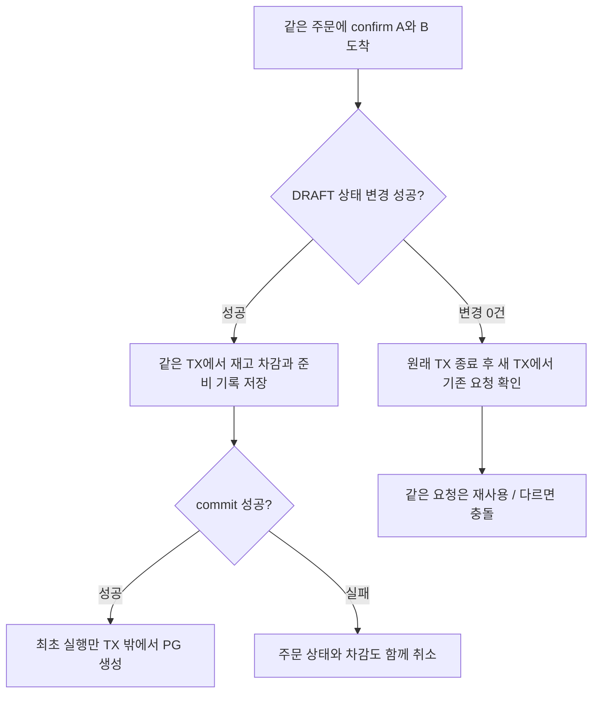

# 결제 멱등성과 동시성 제어 이해하기

[읽기 안내](README.md) · [전체 상태 흐름](../states/total.md) · [결제 요청 상태 모델](../states/payment.md) · [재시도 전략](retry.md)

## 먼저 세 가지 질문을 구분한다

**멱등성**은 같은 요청을 여러 번 받아도 재고 차감이나 주문 확정 같은 업무 효과를 중복으로 만들지 않는 성질이다. **동시성 제어**는 여러 실행이 같은 데이터를 함께 바꾸려 할 때 처리 순서와 변경 권한을 정하는 방법이다. 고객이 결제 버튼을 다시 누르거나, 자동 조회와 담당자의 수동 대사가 겹칠 때 두 가지가 함께 필요하다.

이 구현에서는 한 장치가 모든 중복을 막지 않는다.

| 장치 | 답하는 질문 | 막는 중복·덮어쓰기 |
|---|---|---|
| 요청 키 `paymentAttemptKey`＋DB 유일 제약 | 이미 접수한 같은 결제 요청인가? | 같은 요청의 새 결제 시도 생성, 같은 주문의 두 번째 결제 시도 |
| 주문 상태 CAS | 이 주문의 준비 또는 결과 반영을 내가 맡아도 되는가? | 동시 confirm의 재고 중복 차감, 결과 중복 반영·재고 중복 반환 |
| 복구 작업의 `executionId`＋상태·회차 조건 | 아직 내가 현재 처리를 맡은 실행인가? | 인계 전 작업이 새 작업의 회차·중단 사유·진행 상태를 덮어쓰기 |

예시는 재고 5개 중 2개를 주문하는 상황이다. 준비가 끝나면 재고는 3개, 결제 성공이면 3개 유지, 확정 실패이면 5개로 한 번 복구한다. 응답 유실·timeout만으로 재고를 돌려주지 않는다.

TX(트랜잭션)는 여러 DB 변경을 함께 저장(commit)하거나 함께 취소(rollback)하는 묶음이다. **키와 조건부 갱신뿐 아니라, 관련 변경을 같은 TX에서 commit하는 것까지 합쳐서** 업무 중복을 막는다.

이 문서에서 PG는 별도로 실행하는 학습용 결제 서버, confirm은 고객의 주문 결제 요청, callback은 PG가 보내는 결과 알림이다. 대사는 PG의 실제 결과와 우리 저장 상태를 맞춰 주문·재고 처리를 마무리하는 작업이며, 담당자가 명시적으로 요청하는 것을 수동 대사라고 부른다.

## 1. 요청 키: 같은 결제 요청을 다시 알아본다

고객은 confirm 요청 본문의 `paymentAttemptKey`에 공백 없는 표준 UUID를 보낸다. 서버는 소문자로 정규화한다. 응답을 못 받아 같은 요청을 다시 보내려면 처음 사용한 키를 유지해야 한다.

키의 유일 범위는 전체 결제 시도다. 다른 고객도 이미 사용한 키를 다른 주문에 재사용할 수 없다. DB의 `payment_attempts.attempt_key` 기본 키와 `order_id` 유일 제약이 각각 **키 하나당 한 시도**, **주문 하나당 한 시도**를 보호한다. 먼저 조회해서 중복을 검사하더라도 동시에 새 요청이 들어올 수 있으므로 DB 제약도 필요하다.

### 무엇이 같아야 같은 요청인가?

| 재요청 내용 | 처리 |
|---|---|
| 같은 주문·정규화한 키·저장 금액·실효 PG 테스트 조건 | 기존 시도를 사용한다. 재고를 다시 차감하거나 PG 생성 POST를 다시 보내지 않는다. |
| 같은 주문인데 키가 다름 | 요청 충돌로 거절한다. 실패한 주문이어도 새 키로 두 번째 시도를 만들지 않는다. |
| 같은 키인데 주문이 다름 | 요청 충돌로 거절한다. 고객이 달라도 동일하다. |
| 같은 주문·키인데 금액 또는 실효 테스트 조건이 다름 | 요청 충돌로 거절한다. 최초 요청 조건을 바꾸지 않는다. |
| 카드 입력만 다름 | 학습용 범위에서는 동일 요청 비교에서 제외한다. 카드 형식 검증은 유지한다. |

실효 테스트 조건은 프리셋과 세부 옵션을 해석한 뒤 **실제로 PG에 적용하는 조건**이다. 프리셋 이름만 비교하지 않고 저장된 조건 필드 전체를 비교한다. 금액은 고객이 재요청으로 덮어쓰는 값이 아니라 저장된 주문 금액을 기준으로 한다. 카드 원문은 DB에 저장하거나 로그로 남기지 않는다.

같은 요청을 다시 받았을 때 반환하는 것은 **현재 상태**다. 첫 요청에서 결제 대기였더라도, 재요청 시점에 반영이 끝났으면 완료 상태를 돌려준다. 저장된 PG 결과로 공통 업무 반영을 시도할 수는 있지만 새 결제 생성 권한이나 자동 조회 예산을 다시 주지는 않는다.

소유권 검사는 키 비교보다 먼저 한다. 다른 사람의 주문이면 없는 주문과 같은 404를 반환한다. 요청 키를 알고 있다는 사실이 접근 권한을 주지는 않는다.

### 비슷한 식별자를 혼동하지 않기

| 식별자 | 용도 | 언제 바뀌는가? |
|---|---|---|
| 내부 `orderId` | 우리 주문을 찾음 | 같은 주문에서 유지 |
| `paymentAttemptKey` | 같은 논리적 결제 요청을 식별 | 재요청·조회·수동 인계에서도 유지 |
| PG용 `providerOrderId` | PG에서 우리 주문의 거래를 찾고 검증 | 주문 ID에서 만든 `LP-ORD-…` 값을 유지 |
| PG의 `transactionKey` | 실제 외부 거래를 식별 | PG에서 확인한 뒤 저장 |
| 복구 작업의 `executionId` | 현재 자동/수동 실행을 식별 | 실행 권한 확보·수동 인계 때 새 UUID 사용 |

**이 테스트 PG는 같은 주문의 생성 POST를 중복 제거해 주지 않는다.** 요청 키는 commerce 내부의 계약이다. PG용 주문 ID가 같다는 이유로 생성 POST를 재발송해도 안전한 것은 아니다.

## 2. 주문 상태 CAS: 업무를 맡을 실행을 DB에서 정한다

CAS는 Compare-And-Set의 줄임말이다. 여기서는 **DB의 현재 상태가 예상값일 때만 상태를 바꾸는 UPDATE**를 뜻한다. 먼저 읽은 상태만 믿고 무조건 저장하는 것과 다르다.

아래 SQL은 조건을 설명하기 위해 단순화한 예시다. 실제 구현은 JPA의 조건부 UPDATE이며 결과 행 수가 1이면 변경 성공, 0이면 다른 실행의 변경 등을 다시 확인해야 한다.

```sql
UPDATE orders
SET status = 'PAYMENT_PENDING'
WHERE id = :orderId AND user_id = :userId AND status = 'DRAFT';
```

### 준비 단계: 재고 차감과 최초 PG 발송 권한

1. 같은 주문에 confirm A와 B가 동시에 들어와도 DRAFT→PAYMENT_PENDING 변경에 성공한 실행만 준비를 계속한다.
2. 그 **같은 TX**에서 재고 2개 차감, STARTED 결제 시도, DEDUCTED 재고 기록, READY 복구 작업을 저장한다.
3. commit까지 성공한 뒤에만 파사드가 최초 PG 생성 권한을 받아 TX 밖에서 HTTP를 호출한다.
4. 뒤 실행은 기존 요청을 확인한다. 같은 요청이면 현재 시도를 사용하고, 조건이 다르면 충돌로 응답한다.



재고 부족이나 마지막 복구 작업 저장 실패가 발생하면 주문 상태 변경까지 모두 rollback한다. 한 실행이 상태를 바꿨다는 사실만으로 PG를 보내서는 안 되는 이유다.

서로 다른 주문에 같은 키가 동시에 들어오는 경우에는 각 주문의 CAS가 성공할 수 있다. 이 경합은 요청 키의 DB 유일 제약이 막는다. 패자의 준비 TX를 통째로 취소해 차감도 되돌리고, **새 TX로 다시 읽어** 충돌을 판정한다. 주문 CAS와 키 제약이 서로 다른 중복을 막는 사례다.

### 결과 반영 단계: 주문 확정·재고 반환을 한 번 처리

결제 결과는 짧은 관찰 저장 TX에서 먼저 commit한다. 그다음 별도의 공통 업무 TX에서 저장된 결과와 충돌 여부를 확인하고 아래 상태 변경을 시도한다.

```sql
UPDATE orders
SET status = :terminalStatus  -- 검증된 결과에 따라 CONFIRMED 또는 PAYMENT_FAILED
WHERE id = :orderId AND status = 'PAYMENT_PENDING';
```

변경에 성공한 실행이 다음 변경을 **하나의 업무 TX**로 마친다.

| 저장된 결제 결과 | 같은 TX에서 함께 반영하는 내용 |
|---|---|
| SUCCESS | 주문 CONFIRMED·PG 주문 기록·재고 기록 CONSUMED·복구 작업 APPLIED. 재고 추가 차감 없음 |
| 확정 FAILED | 주문 PAYMENT_FAILED·재고 수량 반환·재고 기록 RESTORED·복구 작업 APPLIED |
| UNKNOWN/PENDING 또는 미반영 충돌 | 종결 CAS를 수행하지 않고 주문·차감 상태 유지 |

예를 들어 callback과 수동 대사가 동시에 FAILED를 확인해도 두 실행이 각각 재고를 더해 7개로 만들지 않는다. 공통 반영은 결제 시도 행의 짧은 잠금과 주문 CAS로 조율하고, 한 TX가 3→5 반환과 완료 기록을 함께 commit한다. 다음 실행은 이미 끝난 상태를 확인한다.

재고 반환 도중 한도 초과 등으로 실패하면 주문 CAS·반환·완료 기록 모두 rollback된다. 먼저 저장한 PG 실패 근거는 남으므로, 원인을 해결한 뒤 같은 근거를 다시 반영할 수 있다. 실패 표시도 원래 확보한 실행 정보로만 갱신한다. 데드락 재시도 조건은 [재시도 문서](retry.md)를 따른다.

## 3. 실행 ID: 인계받기 전 작업의 늦은 갱신을 막는다

주문 상태는 두 작업에서 모두 PAYMENT_PENDING이고, 복구 상태도 RUNNING일 수 있다. **상태 이름만으로는 어느 실행이 최신인지 구분할 수 없다.**

자동 작업은 DB에서 READY·실행 ID 없음·사용 회차 0 조건을 확인해 RUNNING과 새 실행 ID를 저장한 뒤 실행기에 전달한다. 수동 대사가 기존 RUNNING 또는 MANUAL_REQUIRED 작업을 인계받을 때는 읽어 둔 **상태＋기존 실행 ID＋사용 회차**가 여전히 같은 경우에만 새 실행 ID로 바꾼다. 회차는 유지한다.

아래 A와 B는 설명용 실행 이름이다. 실제 실행 ID는 UUID다.

| 순서 | 상황 | DB와 처리 결과 |
|---|---|---|
| 1 | 자동 실행 A가 회차 1을 소비하고 PG 조회 시작 | RUNNING / 실행 A / usedRounds=1 |
| 2 | 조회가 늦어 담당자가 수동 대사로 인계 | 같은 상태·A·회차 1 조건으로 실행 B로 교체. usedRounds=1 유지 |
| 3 | 늦게 돌아온 A가 timeout 사유나 수동 전환을 저장하려 함 | 실행 ID가 달라 조건부 UPDATE 0건. B의 진행을 덮지 못함 |
| 4 | B가 기존 거래를 확인하고 반영 | 새 결제를 만들지 않고 저장된 사실로 공통 업무 처리 |

실행 중 회차 소비·조회 사유·수동 전환을 갱신할 때는 요청 키 외에도 **RUNNING＋현재 실행 ID＋예상 사용 회차**가 일치해야 한다. 업무 rollback 후 실패를 표시할 때도 당시 확보한 상태·실행 ID·회차를 조건으로 쓴다. 다시 읽은 새 담당자의 ID를 가져다 자신의 실패 조건으로 사용하지 않는다.

자동 조회는 회차를 먼저 commit하고 새 TX로 권한·완료 상태를 다시 읽는다. 이어 HTTP 직전에 30초 예산도 재확인한다. 그 사이 인계되었거나 예산이 끝났으면 새 조회를 시작하지 않고 이미 소비한 회차를 유지한다. 상세 횟수·대기는 [PG 조회 재시도](retry.md)에 정리했다.

### 실행 ID가 막는 범위는 진행 갱신이다

인계는 이미 보낸 HTTP를 취소하지 않는다. 마지막 권한 확인 직후 인계되는 짧은 경합도 있으므로, **PG 조회가 항상 한 실행에서만 일어난다고 보장하지 않는다.**

늦은 A가 검증 가능한 PG 성공을 가져왔다면 그 사실을 저장하고 공통 업무 반영까지 할 수 있다. 결제 결과는 A 개인의 결과가 아니라 같은 결제 시도의 사실이기 때문이다. 이때 중복 반영은 결제 시도 잠금·주문 CAS·업무 TX가 막는다. 작업 APPLIED 저장도 실행 ID 일치를 필수로 하지 않는다. 실행 ID는 옛 실행의 진행·실패 표시를 차단하는 장치로 이해해야 한다.

callback도 별도 실행 권한을 인계받거나 자동 조회 회차를 소비하지 않는다. PG를 직접 조회해 확인한 사실을 저장하고 같은 공통 반영을 사용한다. callback 실패 표시에는 처음 확보한 실행 비교값을 사용한다.

## 4. 함께 필요한 짧은 DB 잠금과 경계

| 보호 대상 | 사용 방식 | 필요한 이유 |
|---|---|---|
| 서로 다른 주문이 공유하는 상품 재고 | 상품 ID 오름차순으로 짧은 비관적 행 잠금 | 주문별 CAS만으로는 같은 상품의 수량 경합을 막을 수 없음. 관리자 수량 변경도 같은 상품 잠금 사용 |
| 결제 관찰 저장·공통 반영의 결제 시도 | 해당 시도 행을 짧게 잠금 | 동시 관찰이 확정 결과를 덮거나 충돌 근거를 놓치지 않도록 조율 |
| 복구 작업 실행 권한 | 상태·실행 ID·회차의 조건부 UPDATE | 명시적 SELECT FOR UPDATE 없이 현재 실행과 진행을 비교해 변경 |

조건부 UPDATE도 DB 내부에서 쓰기 잠금을 사용한다. 이 설계는 모든 잠금을 제거한 구조가 아니다. JPA 조건부 갱신 뒤에는 관리 중인 객체를 비워 이전 값이 다시 저장되지 않게 한다. 준비 경합이나 반영 실패 뒤 현재 상태를 확인할 때는 새 TX를 사용해 이전 조회 결과를 계속 믿지 않는다.

PG HTTP와 재시도 대기 동안에는 DB TX나 행 잠금을 유지하지 않는다. 외부 통신과 DB를 하나의 분산 TX로 묶는 대신 **준비 commit→PG 호출→관찰 commit→업무 반영 commit** 경계를 사용한다.

## 5. 중단되었을 때 보장하는 것과 담당자가 할 일

| 중단 시점 | 남을 수 있는 상태 | 후속 처리 |
|---|---|---|
| 준비 commit 전 실패 | 준비 변경 모두 rollback | 최초 준비가 저장되지 않았다면 다시 준비 가능 |
| STARTED 저장 후 PG 발송 전 서버 종료 | 결제 대기·차감 유지, PG 거래는 없을 수도 있음 | 생성 POST 재발송 금지. 미완료 목록과 명시적 수동 대사로 확인. 빈 거래 목록만으로 실패·반환 처리하지 않음 |
| PG 성공 뒤 응답 유실 | 우리 결과는 UNKNOWN/PENDING일 수 있음 | 같은 거래 조회로 확인. 새 결제 생성 없음 |
| PG 결과 commit 후 업무 TX 실패 | 확정 결과는 저장, 주문·재고 반영은 미완료 | 저장한 결과로 재적용. 조건에 맞는 데드락만 제한 재시도 |
| 자동 작업 도중 commerce 종료 | RUNNING이 남을 수 있음 | 자동 회수·재시작 스캔 없음. 담당자가 미완료 조회 후 POST 대사로 인계 |

주문·재고 업무 효과의 중복을 막는 것과 모든 작업의 자동 완료를 보장하는 것은 다르다. 재고 차감 상태가 오래 남은 주문은 [운영 절차](../r03-payment-resilience/operations.md)를 따른다. 이미 완료한 주문에 뒤늦은 모순된 결과가 오면 충돌·주의를 남기고 완료 상태나 재고를 되돌리지 않는다. 재결제·환불·취소는 이번 범위에 포함하지 않는다.

## 코드와 기존 검증을 찾아 읽기

| 확인할 내용 | 구현 | 기존 검증 |
|---|---|---|
| 키 정규화·같은 요청 비교·DB 유일 제약 | [PaymentAttempt](../../../apps/commerce-api/src/main/java/com/loopers/domain/pay/model/PaymentAttempt.java), [결제 시도 SQL](../../../docker/payment-lab/003-payment-attempts.sql) | [준비 경합·키 충돌·rollback](../../../apps/commerce-api/src/test/java/com/loopers/application/ordering/service/PrepareOrderPaymentIntegrationTest.java) |
| 준비 CAS·commit 후 발송 권한 | [PrepareOrderPaymentService](../../../apps/commerce-api/src/main/java/com/loopers/application/ordering/service/PrepareOrderPaymentService.java), [준비 파사드](../../../apps/commerce-api/src/main/java/com/loopers/application/ordering/facade/PrepareOrderPaymentFacade.java), [ConfirmOrderFacade](../../../apps/commerce-api/src/main/java/com/loopers/application/ordering/facade/ConfirmOrderFacade.java) | 위 준비 경합 검사 |
| 종결 CAS·한 번 반환·원자적 반영 | [OrderJpaRepository](../../../apps/commerce-api/src/main/java/com/loopers/infrastructure/persistence/ordering/jpa/OrderJpaRepository.java), [ApplyOrderPaymentService](../../../apps/commerce-api/src/main/java/com/loopers/application/ordering/service/ApplyOrderPaymentService.java) | [동시 실패 반영·업무 rollback·옛 실패 표시](../../../apps/commerce-api/src/test/java/com/loopers/application/ordering/service/ApplyOrderPaymentIntegrationTest.java) |
| 인계·실행 ID·예상 회차 조건 | [PaymentRecoveryTaskRepositoryImpl](../../../apps/commerce-api/src/main/java/com/loopers/infrastructure/persistence/pay/repository/PaymentRecoveryTaskRepositoryImpl.java) | [실행 권한·인계 경합](../../../apps/commerce-api/src/test/java/com/loopers/infrastructure/persistence/pay/repository/PaymentRecoveryTaskRepositoryTest.java), [늦은 수동 실행의 진행 보호](../../../apps/commerce-api/src/test/java/com/loopers/application/ordering/service/ReconcileOrderPaymentIntegrationTest.java) |
| 회차 commit 뒤 재확인 | [RecoverAutomaticPaymentService](../../../apps/commerce-api/src/main/java/com/loopers/application/ordering/service/RecoverAutomaticPaymentService.java) | [commit 뒤 인계·예산 만료](../../../apps/commerce-api/src/test/java/com/loopers/application/ordering/service/RecoverAutomaticPaymentServiceTest.java) |

이 문서는 현재 구현과 기존 검사 근거를 설명한다. 기능 변경이나 새로운 검증 결과를 추가한 문서가 아니다.
