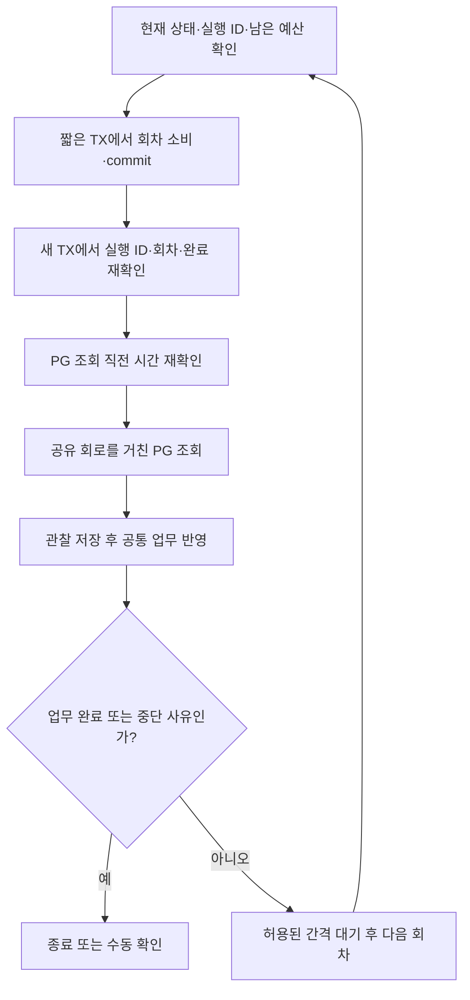
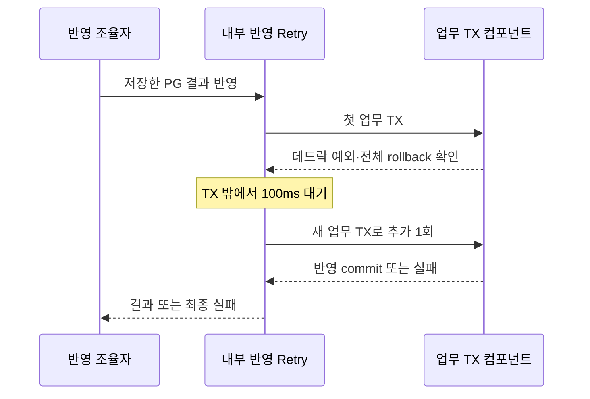

# PG 조회 재시도와 내부 반영 재시도 이해하기

[읽기 안내](README.md) · [결제 요청 상태 모델](../states/payment.md) · [멱등성과 동시성 제어](idempotency-and-concurrency.md) · [서킷브레이커](circuit-breaker.md) · [폴백 전략](fallback.md)

## 먼저 두 작업을 구분한다

재시도는 앞선 작업이 끝나지 않았을 때 다시 수행하는 것이다. 이 서비스에는 목적이 다른 두 재시도가 있다.

- **PG 조회 재시도:** “PG에서 결제가 어떻게 됐는지 다시 확인한다.” 외부 HTTP로 기존 거래를 읽는다.
- **내부 반영 재시도:** “이미 확인한 결과로 우리 주문·재고 처리를 다시 한다.” 저장된 근거를 사용해 DB 트랜잭션을 실행한다.

PG는 별도로 실행하는 학습용 결제 서버다. TX(트랜잭션)는 여러 DB 변경을 함께 저장(commit)하거나 함께 취소(rollback)하는 묶음이다. 두 재시도 모두 **새 결제를 생성하는 작업은 아니다.**

| 비교 | PG 조회 재시도 | 내부 반영 재시도 |
|---|---|---|
| 목적 | 외부 결제 결과 확인 | 확인한 결과로 주문·재고 업무 완료 |
| 반복하는 대상 | 상태 확인·회차 저장을 포함한 기존 거래 조회의 한 회차 | 주문 확정 또는 실패·재고 반환을 함께 처리하는 업무 TX |
| 대표 상황 | PENDING, timeout, 일시적인 조회 장애 | 업무 TX 전체가 MySQL 데드락으로 rollback됨 |
| 자동 시도 한도 | 최초 1회＋추가 3회, 최대 4회차 | 최초 1회＋추가 1회, 한 반영 호출당 최대 2회 |
| 재시도 대기 | 1·3·10초, 각 간격에 지터 ±20% | 100ms, 지터 없음 |
| 시간 경계 | 최초 실행기 전달부터 30초 뒤 새 조회 중단 | 별도의 전체 시간 예산은 두지 않음. 진행 중 반영은 마무리 가능 |
| PG HTTP | 회로가 허용할 때 기존 거래 GET | 추가하지 않음 |
| 조회 usedRounds | 조회 전에 DB에서 소비 | 증가시키지 않음 |
| Resilience4j 이름 | `payment-auto-lookup` | `payment-application` |

지터는 여러 요청이 같은 순간 다시 몰리지 않도록 대기 시간을 조금씩 다르게 주는 것이다. `max-attempts`는 **최초 실행을 포함한 수**이므로 설정의 4와 2를 ‘추가 재시도 수’로 읽지 않는다.

## 결제 생성 POST를 다시 보내지 않는 이유

PG에서 거래를 저장한 뒤 응답만 유실될 수 있다. 이 테스트 PG는 같은 주문의 POST를 중복 제거해 주지 않으므로, 응답을 못 받았다고 다시 생성하면 외부 거래가 두 건 생길 수 있다.

따라서 발송 시작을 DB에 기록한 뒤에는 create를 자동 재발송하지 않는다. 거래 키를 이미 알면 그 키로 조회하고, 아직 모르면 저장된 PG용 주문 ID로 거래 목록을 조회한다. 빈 목록도 영구적인 거래 부재나 결제 실패의 증거로 사용하지 않는다.

하위 Apache HTTP client의 자동 재시도·redirect도 꺼져 있다. 애플리케이션 Retry와 하위 client 반복이 겹쳐 숨은 호출이 늘지 않게 한 선택이다.

## 1. PG 조회 재시도

### 누가 언제 시작하는가?

최초 confirm에서 발송 권한을 얻은 실행만, PG 생성 처리 뒤에도 결과가 미확인/처리 중이며 시작 가능한 작업에 자동 조회를 연결한다. 같은 confirm 재요청은 저장 상태를 반환하고 자동 작업을 새로 시작하지 않는다. callback·수동 대사도 새 자동 조회 예산을 만들지 않는다.

짧은 DB TX에서 복구 작업을 READY→RUNNING으로 바꾸고 실행 ID를 저장한 뒤 전용 실행기에 전달한다. 실행기는 동시 2개·대기 2개이며 대기 중도 RUNNING이다.

명확한 접수 거절이면 100ms 뒤 **작업 전달만** 추가 1회 시도한다. 다시 거절되면 EXECUTOR_REJECTED로 수동 전환한다. 접수됐는지 불명확하면 중복 실행을 피하려고 재전달하지 않는다. 이 접수 처리는 PG 조회 회차나 HTTP 호출로 세지 않는다.

### 언제 다시 조회하는가?

아래 표는 자동 조회 정책이다. 서킷브레이커가 허용하고 현재 실행 권한·남은 회차·시간도 유효해야 실제 재조회할 수 있다.

| 이번 관찰 | 다음 행동 | 이유 |
|---|---|---|
| 검증된 PENDING | 한도 안에서 재조회 | PG가 아직 처리 중임을 확인함 |
| 거래 키 GET의 404 또는 주문별 GET의 200 빈 배열 | 한도 안에서 재조회 | 지금 거래를 확인하지 못했지만 확정 실패는 아님 |
| timeout·연결 거절·끊김 등 통신 오류 | 한도 안에서 재조회 | 기존 거래를 읽는 작업이 일시적으로 실패함 |
| 조회 HTTP 408·429·500·502·503·504 | 한도 안에서 재조회 | 이 저장소에서 정한 재조회 대상 HTTP 오류 |
| 검증된 SUCCESS·FAILED | 결과 저장·업무 반영 후 종료 | 결제 결과를 확인했으므로 추가 조회가 필요 없음 |
| 회로 차단 | 즉시 수동 확인 | 회로 회복까지 자동 반복하며 기다리지 않음 |
| 그 외 HTTP 오류·잘못된 응답·식별/금액/종결 충돌 | 즉시 수동 확인 | 같은 요청 반복보다 요청·계약·충돌 확인이 필요함 |
| 관찰 저장·회차/상태 확인 등 우리 DB 처리 실패 | PG 재조회 반복을 중단 | DB 실패를 외부 조회 실패로 바꾸지 않음 |

PG가 정상 형식으로 FAILED를 알려준 것은 조회 기능의 성공이다. 이를 조회 장애로 다시 시도하지 않고 확정 실패를 반영한다. 회로의 집계와 재조회 여부가 다른 사례는 [서킷브레이커 분류표](circuit-breaker.md)를 참고한다.

### 몇 번, 얼마나 기다리는가?

| 회차 | 시작 전 대기 | 의미 |
|---|---|---|
| 1 | worker가 작업을 시작하면 즉시 | 최초 조회 |
| 2 | 앞 회차 종료 뒤 0.8~1.2초 | 기준 1초＋지터 |
| 3 | 앞 회차 종료 뒤 2.4~3.6초 | 기준 3초＋지터 |
| 4 | 앞 회차 종료 뒤 8~12초 | 기준 10초＋지터 |

간격은 최초 요청 시각에서 계산하는 고정 예약 시각이 아니다. 실제 경과 시간에는 큐·조회·DB 처리 시간도 더해진다. 중간에 완료·인계·충돌·차단이 생기면 남은 회차를 실행하지 않는다.

전체 예산은 PG 생성 처리가 끝난 뒤 **실행기에 처음 전달하는 시점부터 30초**다. 큐 대기·100ms 재접수·회차/상태 DB 처리·조회·재시도 대기를 포함한다. 다음 대기가 남은 예산보다 길면 남은 시간까지만 기다리고 새 조회를 중단한다. 시작 시 이미 만료된 작업은 조회 회차도 소비하지 않는다.

이 30초는 진행 중인 HTTP나 사실 저장·업무 TX를 강제 취소하는 장치가 아니다. 이미 시작한 조회의 결과를 저장·반영하는 동안 30초를 넘길 수 있다. 내부 반영의 100ms 재시도도 이 예산을 이유로 강제 취소하지 않는다.

### 왜 회차를 HTTP 전에 저장하는가?

DB가 회차를 먼저 기억하면 서버 재시작으로 자동 조회 예산이 늘어나지 않는다. 대신 commit 직후 서버가 꺼지면 실제 조회 없이 한 회를 소비할 수 있다.

| 사건 | usedRounds 증가 | PG HTTP |
|---|---:|---:|
| 자동 회차 확보 후 회로가 허용해 조회 | 1 | 1 |
| 자동 회차 확보 후 회로 차단 | 1 | 0 |
| 회차 commit 후 DB 대기 동안 예산 만료·수동 인계 확인 | 1 | 0 |
| 큐에서 이미 예산 만료 후 실행 시작 | 0 | 0 |
| 저장된 종결 결과가 있어 업무만 반영 | 0 | 0 |

회차 commit 뒤에도 다시 확인하는 이유는 DB 대기 중 담당자가 인계하거나 다른 실행이 업무를 끝낼 수 있기 때문이다. 조회 직전 재확인 직후의 경합까지 HTTP 취소로 막는 구조는 아니다. 이미 시작한 조회의 사실 저장과 옛 진행 갱신 차단은 기존 규칙을 따른다.

### 한도를 다 쓰거나 서버가 종료되면?

회차 소진은 RETRY_EXHAUSTED, 시간 소진은 TIME_BUDGET_EXHAUSTED로 현재 작업을 수동 확인 대상으로 남긴다. 주문은 결제 대기이며 재고는 차감 상태를 유지한다. 사유는 결제 실패 근거가 아니다. DB 장애로 표식도 저장하지 못하면 RUNNING에 남을 수 있다.

자동 실행의 사용 회차와 실행 ID는 DB에 남지만 지터·다음 예약·남은 대기를 재시작 후 이어가는 스케줄러는 없다. 담당자가 미완료 GET에서 찾아 명시적 POST로 인계한다. 수동 요청은 저장 종결 근거가 없을 때 PG 조회 최대 1회이며 자동 usedRounds를 늘리거나 초기화하지 않는다.

## 2. 내부 반영 재시도

### 어떤 작업을 다시 하는가?

PG 결과를 먼저 별도 TX로 저장한 다음, 공통 업무 TX에서 주문 종결·확정 기록 또는 재고 반환·차감 기록·작업 APPLIED를 함께 반영한다.

예를 들어 SUCCESS 사실은 저장했지만 주문 확정 TX가 실패했다면 결제 시도는 SUCCESS, 주문은 PAYMENT_PENDING일 수 있다. FAILED의 반환 TX가 실패했다면 FAILED 사실은 남되 주문과 재고 반환은 함께 취소된다.

이때 재시도하는 대상은 **같은 저장 결과에 대한 업무 TX**다. 새 PG 생성·조회, 관찰 저장 TX, 회차 저장 TX를 내부 반영 Retry에 포함하지 않는다.

### 어떤 오류만 허용하는가?

데드락은 여러 TX가 서로 가진 잠금을 기다려 진행할 수 없어 DB가 한 TX를 취소하는 상황이다. 이 구현은 아래 두 근거를 모두 확인한 경우만 다시 반영한다.

1. 예외 원인에서 **MySQL 오류 번호 1213과 SQLSTATE 40001**을 함께 확인한다.
2. 이번 업무 TX의 완료 통지에서 **전체 rollback**을 확인한다.

오류 이름이나 메시지에 ‘일시적’·‘잠금’이 있다는 것만으로 판단하지 않는다. 잠금 대기 timeout, DB 연결 끊김, 무결성 문제, 재고 반환 overflow는 자동 재시도 대상이 아니다. 데드락 코드가 있어도 rollback을 확인하지 못하면 재시도하지 않는다.

### 왜 새 TX에서 한 번만 더 하는가?

취소된 TX를 그대로 재사용하지 않고 별도 빈의 REQUIRES_NEW 진입점으로 새 TX를 시작한다. 대기는 TX 밖에서 한다. 추가 시도도 실패하면 자동으로 더 반복하지 않는다.

한 번의 반영 호출에 최초 포함 최대 2회를 허용하며 이 Retry 횟수 자체는 DB에 영속화하지 않는다. 나중에 담당자가 명시적으로 저장 결과를 재적용하는 것은 별도 호출이다. 그때도 주문 상태 조건·동일 업무 TX가 중복 확정과 중복 반환을 막는다.

### commit 여부를 모르면 어떻게 하는가?

연결이 끊겨 응답을 못 받았더라도 DB는 이미 commit했을 수 있다. 이 경우 자동 재반영부터 하지 않고 새 TX에서 저장 상태를 먼저 읽는다.

- 이미 주문 종결＋APPLIED면 완료 상태를 반환한다.
- 미완료면 처음 확보한 상태·실행 ID·회차로 실패 표시를 시도하고 현재 상태를 다시 읽는다.
- 표식 저장만 실패해도 상태 조회는 시도한다. 상태 조회까지 불가능하면 성공·실패를 추측하지 않고 오류를 반환한다.

담당자가 인계한 새 실행의 ID를 읽어 와서 옛 실패의 비교값으로 쓰지 않는다. 이미 완료한 작업도 늦은 실패 표시로 되돌리지 않는다. 수동 확인 이후의 행동은 [폴백 전략](fallback.md)을 따른다.

## 두 재시도가 함께 일어나는 예

재고 5개 중 2개를 차감했고 PG 생성은 한 번만 수행했다고 가정한다.

1. 자동 조회 1회차에서 PENDING을 확인한다. 재고는 3개를 유지한다.
2. 대기 뒤 2회차에서 SUCCESS를 확인하고 그 사실을 먼저 저장한다.
3. 이 SUCCESS를 반영하는 첫 업무 TX가 데드락으로 완전히 rollback된다.
4. 100ms 뒤 새 업무 TX가 성공해 주문은 CONFIRMED·작업은 APPLIED가 된다. 재고는 여전히 3개다.

이 사례의 PG 조회 HTTP와 usedRounds는 각각 2다. **2회차의 SUCCESS 반영 TX만** 최초＋추가로 2번 수행했으며 내부 반영 때문에 PG 조회가 한 번 더 생기지 않았다. 회로 표본에도 DB 재시도는 추가되지 않는다. ‘조회 4회×반영 2회＝PG 호출 8회’로 계산하지 않는다.

## 왜 Resilience4j와 DB 기록을 함께 쓰는가?

Resilience4j의 `@Retry`는 반복 횟수와 대기를 제어한다. DB는 결제 사실·업무 완료·조회 사용 회차와 실행 권한을 보존한다. 라이브러리의 메모리 카운터가 DB의 중복 방지 조건을 대신하지 않는다.

조회용 `RecoverAutomaticPaymentService.execute`는 한 회차의 상태 확인→회차 commit→회로 조회→관찰 저장→업무 반영까지 수행한다. 계속 조회할 관찰이고 진행 저장도 성공한 경우에만 `RepeatPaymentLookupException`으로 다음 회차를 요청한다. DB 저장 실패를 같은 재조회 신호로 바꾸지 않는다.

반영용 `RetryOrderPaymentService.apply`는 전체 rollback과 데드락 코드를 함께 확인한 경우에만 `RolledBackPaymentDeadlockException`을 만든다. 서로 다른 두 예외를 설정에 명시해 모든 오류가 무조건 반복되지 않게 했다.

두 Retry와 조회 CircuitBreaker는 별도 Spring 빈의 공개 메서드로 호출해 실제 프록시를 통과한다. 조회 회로는 매 PG 조회를 측정하고 Retry 대기·DB 처리는 집계 밖이다. Retry-After 헤더는 지원하지 않으며 장기 미확인은 수동 확인이 필요하다.

## 코드와 검증을 따라가기

| 확인할 내용 | 파일 |
|---|---|
| 두 Retry의 max-attempts·대상 예외·내부 대기 | [application.yml](../../../apps/commerce-api/src/main/resources/application.yml) |
| 자동 한 회차와 반복/중단 조건 | [RecoverAutomaticPaymentService](../../../apps/commerce-api/src/main/java/com/loopers/application/ordering/service/RecoverAutomaticPaymentService.java) |
| 최초 시작·실행기 전달·재접수 | [StartAutomaticPaymentRecoveryService](../../../apps/commerce-api/src/main/java/com/loopers/application/ordering/service/StartAutomaticPaymentRecoveryService.java) |
| 지터·30초·예정 회차 비교값 | [AutomaticPaymentExecution](../../../apps/commerce-api/src/main/java/com/loopers/application/ordering/support/AutomaticPaymentExecution.java) |
| 지터를 실제 Retry 간격에 연결 | [AutomaticPaymentRecoveryConfig](../../../apps/commerce-api/src/main/java/com/loopers/config/pay/AutomaticPaymentRecoveryConfig.java) |
| 내부 반영 Retry | [RetryOrderPaymentService](../../../apps/commerce-api/src/main/java/com/loopers/application/ordering/service/RetryOrderPaymentService.java) |
| 전체 rollback 완료 확인 | [PaymentApplicationTransaction](../../../apps/commerce-api/src/main/java/com/loopers/application/ordering/support/PaymentApplicationTransaction.java) |
| 정확한 MySQL 코드 판별 | [MySqlPaymentApplicationFailureClassifier](../../../apps/commerce-api/src/main/java/com/loopers/infrastructure/resilience/ordering/MySqlPaymentApplicationFailureClassifier.java) |
| commit 미확인·최종 실패 후 처리 | [ApplyOrderPaymentFacade](../../../apps/commerce-api/src/main/java/com/loopers/application/ordering/facade/ApplyOrderPaymentFacade.java) |

기존 검증은 [자동 조회 통합 검사](../../../apps/commerce-api/src/test/java/com/loopers/application/ordering/service/AutomaticPaymentRecoveryIntegrationTest.java), [지터·예산 검사](../../../apps/commerce-api/src/test/java/com/loopers/application/ordering/support/AutomaticPaymentExecutionTest.java), [rollback 미확인 검사](../../../apps/commerce-api/src/test/java/com/loopers/application/ordering/service/RetryOrderPaymentServiceTest.java), [업무 반영 통합 검사](../../../apps/commerce-api/src/test/java/com/loopers/application/ordering/service/ApplyOrderPaymentIntegrationTest.java)에 있다.

MySQL 데드락 코드를 SQL 이후 주입해 실제 rollback·새 TX를 확인한 검사이며 실제 DB 경합의 victim 선정을 재현한 실험은 아니다. 자동 조회 소진·회차 commit 뒤 재시작 등의 실서버 증거는 [R03 결과](../r03-payment-resilience/result.md), 최종 검사 범위는 [점검표](../final-audit.md)를 따른다. 이 문서는 현재 구현과 기존 근거를 설명하며 기능·설정 변경이나 새 검사 결과를 추가하지 않는다.
