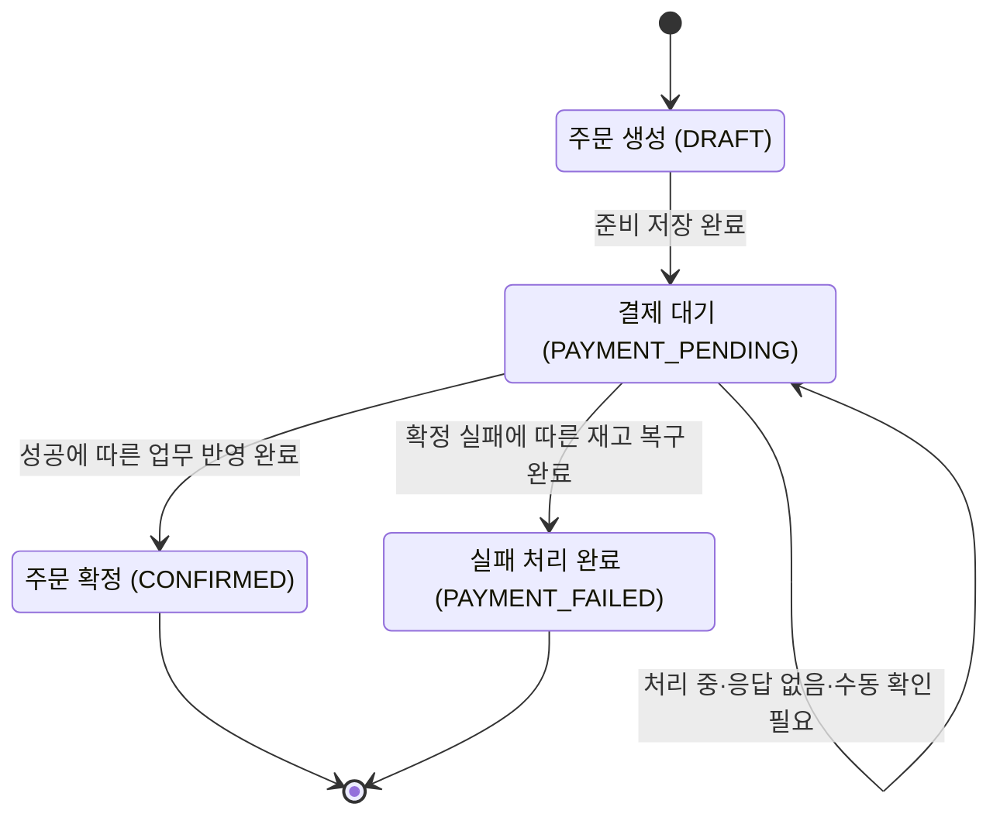

# 주문 상태

[전체 흐름](total.md) · [재고 상태](stock.md) · [결제 상태](payment.md)

**주문 상태는 주문 처리가 어디까지 끝났는지를 나타낸다.** PG가 성공했다고 응답해도, 우리 DB의 주문 확정까지 끝나야 주문 완료다.

이 문서는 R02의 흐름을 설명한다. 고객 confirm은 재고 선차감·실제 PG 요청·결과 저장·공통 업무 반영으로 연결했다. 생성 응답이 처리 중이면 202·결제 대기로 남고, 생성 전 확정 거절은 재고 복구 후 200·실패 처리 완료로 응답한다. PG에서 나중에 완료된 결과는 명시적인 수동 대사로 한 번 조회해 반영할 수 있다. callback도 PG 권위 조회 후 같은 공통 반영을 사용한다. 알림 본문만으로 상태를 바꾸지 않는다.

## 상태의 의미

| 상태 | 쉬운 이름 | 의미 |
|---|---|---|
| `DRAFT` | 주문 생성 | 주문만 만들어진 상태. 아직 PG 결제를 시작하지 않음 |
| `PAYMENT_PENDING` | 결제 대기 | 재고를 차감하고 결제를 시작했지만, 주문의 성공·실패 처리는 끝나지 않음 |
| `CONFIRMED` | 주문 확정 | 확인한 결제 성공을 바탕으로 주문 확정까지 DB에 저장함 |
| `PAYMENT_FAILED` | 결제 실패 처리 완료 | 확정 실패를 근거로 주문 실패와 재고 복구까지 함께 저장함 |

`PAYMENT_PENDING`은 우리 주문의 상태다. PG에서 아직 처리 중일 수도 있고, PG는 이미 성공했지만 우리 주문 확정만 남았을 수도 있다.

## 상태 전이

화살표는 해당 변경이 DB에 확정 저장된 시점을 뜻한다. 준비·결과 저장·업무 반영을 나누는 이유는 [전체 흐름](total.md#왜-db-저장을-나누는가)에서 설명한다.

## 언제 상태가 바뀌는가?

| 변경 | 필요한 조건 | 함께 처리할 일 |
|---|---|---|
| 생성 → 결제 대기 | 주문·상품·재고 검사를 통과하고 준비 TX가 저장됨 | 실제 재고 차감, 결제 시도와 차감 기록 저장 |
| 결제 대기 → 주문 확정 | 검증한 `SUCCESS`가 저장되어 있고 업무 반영 TX가 저장됨 | 주문 확정 기록, 재고 처리 완료, 관련 결제/복구 작업 완료 기록 |
| 결제 대기 → 실패 처리 완료 | 검증한 `FAILED` 또는 정확한 거래 생성 전 거절이 저장되어 있고 업무 반영 TX가 저장됨 | 차감한 재고를 한 번 복구하고 관련 처리 기록 완료 |

## 실패하거나 결과를 모를 때

- **준비 저장 실패:** 변경을 모두 취소하고 `DRAFT`를 유지한다. PG 호출 전이라면 호출하지 않는다.
- **PG 응답 지연·timeout·빈 조회:** `PAYMENT_PENDING`을 유지한다. 이 정보만으로는 실패를 확정할 수 없다.
- **성공 확인 후 주문 저장 실패:** 결제 결과 `SUCCESS`는 남기고 주문은 `PAYMENT_PENDING`으로 유지한다. 저장된 성공을 다시 반영한다.
- **실패 확인 후 재고 복구 실패:** 주문 실패 변경도 함께 취소한다. 저장된 실패 근거로 재고 복구와 주문 실패 처리를 다시 한다.
- **조회 횟수 소진·수동 확인 전환:** 주문 실패를 뜻하지 않는다. 주문과 재고를 유지한 채 확인을 이어간다.

예를 들어 PG 결제는 성공했지만 주문 확정 중 DB 오류가 났다면, 사용자에게 주문 완료로 표시할 근거는 아직 없다. 결제 결과와 주문 상태를 따로 보존하는 이유다.

이번 범위에서는 `CONFIRMED`나 `PAYMENT_FAILED`에서 새 결제를 시작하거나 취소·환불 상태로 바꾸지 않는다.
