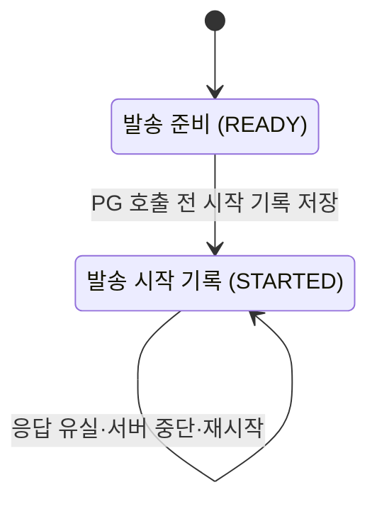
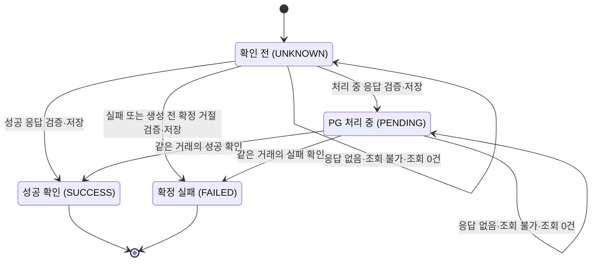
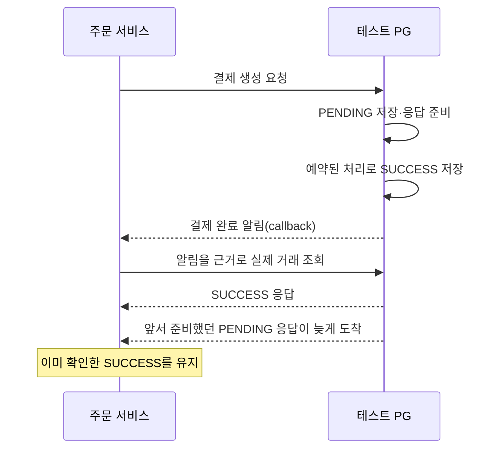
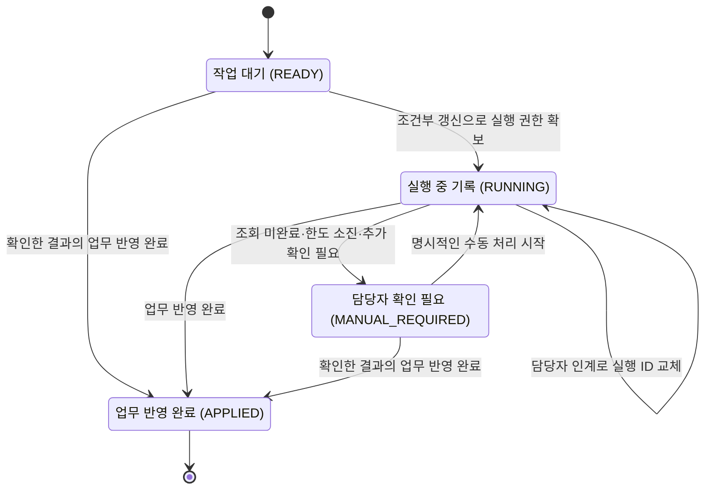

# 결제 요청 상태 모델

[전체 흐름](total.md) · [주문 상태](order.md) · [재고 상태](stock.md) · [장애 대응 읽기 안내](../resilience/README.md) · [멱등성과 동시성 제어](../resilience/idempotency-and-concurrency.md) · [재시도 전략](../resilience/retry.md)

## 처음 읽는 개발자를 위한 상태 구분

이 문서의 ‘결제 요청’은 고객이 confirm을 호출하면서 시작한 한 번의 논리적 결제 시도다. 같은 주문·키로 다시 요청하거나 PG를 여러 번 조회해도 새 결제를 뜻하지 않는다. 이 시도를 발송 기록·확인한 결과·후속 처리로 나눠 저장한다.

| 궁금한 것 | 확인할 모델·필드 | 쉬운 뜻 |
|---|---|---|
| 주문 처리가 끝났는가? | Order.status | 주문 생성·결제 대기·확정·실패 |
| PG 요청을 보내기 시작했는가? | PaymentAttempt.dispatchState | READY 또는 STARTED. STARTED만으로 PG 도착을 보장하지 않음 |
| PG 결과를 어디까지 확인했는가? | PaymentAttempt.outcome | UNKNOWN·PENDING·SUCCESS·FAILED |
| 후속 작업은 어디까지 끝났는가? | PaymentRecoveryTask.state | READY·RUNNING·MANUAL_REQUIRED·APPLIED |
| 차감한 재고는 어떻게 마무리됐는가? | StockAdjustment.state | DEDUCTED·CONSUMED·RESTORED |

예를 들어 같은 주문에서 다음 조합이 가능하다.

| 상황 | 주문 | 확인한 PG 결과 | 복구 진행 | 재고 처리 기록 |
|---|---|---|---|---|
| PG가 처리 중임을 확인하고 자동 조회 중 | PAYMENT_PENDING | PENDING | RUNNING | DEDUCTED |
| 조회 회로 차단으로 수동 확인 필요 | PAYMENT_PENDING | 마지막 UNKNOWN/PENDING 유지 | MANUAL_REQUIRED | DEDUCTED |
| PG 성공은 저장했지만 주문 반영이 rollback됨 | PAYMENT_PENDING | SUCCESS | MANUAL_REQUIRED | DEDUCTED |
| 성공 업무 반영까지 완료 | CONFIRMED | SUCCESS | APPLIED | CONSUMED |
| 확정 실패와 반환까지 완료 | PAYMENT_FAILED | FAILED | APPLIED | RESTORED |

위 조합은 대표 사례이며 모든 중간 상태를 나열한 것은 아니다. 회로의 CLOSED/OPEN/HALF_OPEN은 이 표와 별개로 여러 주문이 공유하는 **PG 조회 허용 상태**다. 이번 호출의 `PaymentObservation.Kind.UNAVAILABLE`도 DB 결제 결과 enum과 다르다. 자세한 대응은 [서킷브레이커](../resilience/circuit-breaker.md)와 [폴백 전략](../resilience/fallback.md)을 함께 읽는다.

## 구현된 연결

R01에서 아래 결제 시도·복구 작업 모델과 저장 기반을 구현했다. R02 고객 confirm은 준비 저장 후 실제 PG를 한 번 호출하고, 관찰 저장 후 공통 업무 TX로 주문·재고·작업 APPLIED를 함께 처리한다. 업무 실패는 당시 실행 정보로만 수동 표시한다. 고객/관리자 GET에는 저장한 결과·복구 상태·주의를 연결했고, GET으로 다시 결제하거나 PG를 조회하지 않는다. 수동 대사는 단일 조회·저장 근거 재적용·실행 인계에 연결했다. callback도 동기 권위 조회·관찰 저장·공통 반영에 연결했다. callback은 작업을 인계하거나 조회 회차를 소비하지 않는다. 제한된 자동 재조회도 연결했다. 최초 confirm만 시작하고 서버 중단 뒤 자동 재개하지 않는다. 실제 PG 장애/재시작 실험 14건과 전체 검사 509건의 [검증 결과](../r03-payment-resilience/result.md), [담당자 처리 절차](../r03-payment-resilience/operations.md)를 함께 읽는다.

## PG 조회가 차단되면 어떻게 보이는가?

2026-10-23 R03 첫 기능으로 수동 대사와 callback이 같은 조회 회로를 사용한다. PG 조회 장애가 쌓이면 잠시 새 조회를 차단한다. 이때 **결제가 실패했다고 판단하지 않는다.** 마지막으로 확인한 결제 결과와 차감 재고를 유지한다. 수동 대사의 미완료 작업에는 다음 사유를 구분해 남긴다.

| 사유 | 쉬운 설명 |
|---|---|
| `CIRCUIT_BLOCKED` | 회로가 막혀 이번에는 PG에 요청하지 못함 |
| `LOOKUP_UNAVAILABLE` | timeout 등으로 결과를 확인하지 못함 |
| `LOOKUP_REQUEST_ERROR` | 권한·요청 오류 등으로 같은 조회를 반복하기 전에 확인이 필요함 |
| `LOOKUP_CONTRACT_ERROR` | 응답 형식·상태 코드가 약속과 달라 확인이 필요함 |
| `RETRY_EXHAUSTED` | 최대 4회까지 확인했지만 자동 처리를 마치지 못함 |
| `TIME_BUDGET_EXHAUSTED` | 최초 전달부터 30초 예산이 끝나 새 자동 조회를 시작하지 않음 |
| `EXECUTOR_REJECTED` | 실행기와 대기열이 가득 차 재접수까지 거절됨 |
| `DISPATCH_UNCERTAIN` | 실행기에 접수됐는지 알 수 없어 중복 전달하지 않음 |
| `RECOVERY_STATE_ERROR` | 상태 확인·회차 저장·관찰 저장 등의 오류로 자동 반복을 중단함 |
| `RECOVERY_INTERRUPTED` | 종료/인터럽트로 작업이 중단됨. 표시 저장도 실패하면 기존 미완료 기록으로 확인 |

이미 저장한 종결 근거가 있으면 수동 대사는 PG를 다시 조회하지 않고 업무 반영을 시도한다. callback은 계속 PG 조회로 확인해야 하므로 회로 차단 시 알림 본문만 믿고 완료하지 않는다. 자동 재조회·회차 소비도 연결했으며 최초 confirm의 발송 승자만 시작한다. 대기열에서 기다릴 때도 RUNNING이며 실제 HTTP 실행 중이라는 뜻은 아니다.

PG가 FAILED를 정확히 알려준 것은 정상 조회다. 이때는 기존 공통 처리로 주문 실패와 한 번의 재고 복구를 진행한다. 반면 저장한 SUCCESS와 조회 FAILED가 서로 모순되면 충돌을 남기며, 기존 완료 주문·재고를 되돌리지 않는다. 자세한 집계와 한계는 [회로 문서](../r03-payment-resilience/trade_off/02-lookup-circuit-breaker.md)를 참고한다.

## PG 결과를 저장했는데 주문 처리가 실패하면?

이미 확인한 PG 결과는 그대로 남긴다. 주문·재고 처리 TX가 MySQL 데드락으로 **완전히 취소됐음을 확인한 경우에만** 100ms 뒤 새 TX로 한 번 더 반영한다. 이 재시도는 PG에 새 결제를 요청하거나 거래를 다시 조회하지 않으며, 자동 조회의 사용 회차도 늘리지 않는다.

그 밖의 오류는 자동으로 반영을 반복하지 않는다. 저장이 끝났는지 불명확하면 새 TX로 현재 상태부터 읽는다. 이미 업무 반영이 끝났으면 완료 상태를 반환하고, 미완료라면 처음 확보한 실행 정보로 수동 확인이 필요함을 표시한다. 상태 조회도 실패하면 성공/실패를 추측하지 않고 오류를 반환한다. 재시도 도중 담당자가 인계받았다면 옛 실행의 실패 표시가 새 실행을 덮지 않는다.

새로운 결제 상태는 추가하지 않는다. **PG 성공 + 주문 미반영**은 계속 `SUCCESS`와 미완료 복구 상태의 조합으로 표현한다. [내부 반영 재시도 설명](../r03-payment-resilience/trade_off/01-reconciliation-retry-policy.md#2026-10-23--내부-반영-재시도의-실제-연결)에 실제 연결과 판별 기준을 기록했다.

처음 읽는다면 [PG 조회 Retry와 내부 반영 Retry 비교](../resilience/retry.md)를 먼저 본다. 조회 회차는 DB에 보존하고 내부 반영의 추가 시도는 한 반영 호출의 메모리 한도로 관리하는 차이도 설명한다.

## 왜 상태를 세 가지로 나누는가?

결제 요청을 보낸 것, PG에서 성공한 것, 우리 주문 처리까지 끝난 것은 서로 다른 일이다.

예를 들어 PG 성공은 확인했지만 주문 저장이 실패할 수 있다. 이때 결제 결과는 `SUCCESS`로 남겨야 하고, 후속 처리는 아직 완료되지 않았다고 표시해야 한다.

| 구분 | 답하려는 질문 | 저장 위치 |
|---|---|---|
| 발송 상태 | 결제 요청을 보내기 시작했는가? | pay의 결제 시도 모델 |
| 확인한 결제 결과 | PG 결과를 어디까지 확인했는가? | pay의 결제 시도 모델 |
| 복구 진행 | 조회와 주문·재고 후속 처리가 어디까지 끝났는가? | pay의 별도 복구 작업 모델 |

아래의 `READY`는 발송 상태와 복구 진행 양쪽에 등장하지만 **서로 다른 필드**다.

## 1. 발송 상태 — 요청을 보내기 시작했는가?

| 상태 | 의미 |
|---|---|
| `READY` | 결제 시도는 저장했지만 아직 발송 시작으로 기록하지 않음 |
| `STARTED` | 발송할 권한을 확보하고 시작 기록을 DB에 저장함 |

`STARTED`는 PG가 요청을 받았다는 증거가 아니다. 시작 기록 직후, 실제 HTTP 호출 전에 서버가 꺼질 수도 있다.

그렇다고 `READY`로 되돌려 결제 생성 요청을 다시 보내지 않는다. 이미 PG에 도착한 요청이라면 중복 결제가 생길 수 있기 때문이다. 이후에는 기존 거래 조회나 수동 확인으로 해결한다.

같은 주문에 새 멱등성 키를 보내더라도 두 번째 결제 시도를 만들지 않는다. 멱등성 키는 같은 요청을 다시 보내는지 구분하는 값이며, 주문당 한 번의 시도 제약은 별도로 유지한다.

## 2. 결제 결과 — PG 결과를 어디까지 확인했는가?

여기에는 **우리 서비스가 검증해서 저장한 마지막 결과**를 기록한다.

| 상태 | 쉬운 이름 | 의미 |
|---|---|---|
| `UNKNOWN` | 확인 전 | 신뢰할 결과가 아직 없음. PG 거래가 없다는 뜻은 아님 |
| `PENDING` | PG 처리 중 | PG 거래가 존재하며 아직 처리 중임을 확인함 |
| `SUCCESS` | 결제 성공 확인 | 주문·금액·거래 정보가 맞는 성공 결과를 확인함 |
| `FAILED` | 확정 실패 확인 | 거래 실패 또는 거래 생성 전 확정 거절을 확인함 |

PG 서버 자체의 거래 상태는 `PENDING` / `SUCCESS` / `FAILED`다. `UNKNOWN`은 우리 서비스가 결과를 모르는 상태를 나타낸다.

### 무엇을 확정 실패로 보는가?

두 경우를 구분해서 저장한다.

- **PG 거래 실패:** 생성된 거래의 최종 결과가 `FAILED`임을 확인한 경우.
- **거래 생성 전 거절:** PG가 거래를 만들지 않았다고 계약에 맞게 확실히 응답한 경우. 내부 관찰 종류는 `REJECTED_NO_EFFECT`이며 거래 키가 없다.

두 번째는 단순 오류 응답이면 충분하지 않다. 정확한 HTTP `422`, 약속한 코드 `TEST_PG_REJECTED_BEFORE_CREATE`, 거래 생성 여부 `false`, 요청과 일치하는 주문·금액을 모두 확인해야 한다.

일반적인 4xx·5xx, 깨진 응답, timeout, 404, 빈 조회만으로 실패를 확정하지 않는다. 실패 근거가 없으면 기존 결과를 유지하고 조회나 수동 확인을 이어간다.

### 늦게 오거나 모순된 응답은 어떻게 처리하는가?

| 기존 기록 + 새로 받은 정보 | 처리 |
|---|---|
| `SUCCESS` + 같은 거래의 늦은 `PENDING` | `SUCCESS` 유지. 과거 상태로 되돌리지 않음 |
| `SUCCESS` + 같은 거래의 `FAILED` | 기존 결과 유지. 서로 모순된다는 사실을 남김 |
| 거래 키 K가 있는 `PENDING` + 거래 생성 전 거절 | 거래가 있다는 기록과 없다는 응답이 충돌하므로 기존 키·결과 유지 |
| 거래 생성 전 거절 + 거래 키 K의 성공 | 기존 거절을 덮거나 K를 연결하지 않고 충돌 기록 |
| 같은 거래 생성 전 거절 반복 | 기존 기록 유지. 새 결제나 중복 업무 처리 없음 |
| 다른 주문·금액·계정·거래 키의 응답 | 이 결제의 결과로 반영하지 않음 |

여기서 K는 PG가 발급한 거래 식별자를 뜻한다. 거절 기록은 `FAILED`의 사유로 보존하며, 별도의 결제 결과 enum으로 추가하지 않는다.

### 성공 응답보다 처리 중 응답이 늦게 올 수도 있다

PG가 결제 요청을 받은 시점에는 `PENDING`이었지만, 그 응답을 보내는 동안 결제가 끝날 수 있다.

callback은 PG가 보내는 완료 알림이다. 알림 본문만 믿고 결제를 성공 처리하지 않고, PG 거래 조회로 확인한다. 알림은 유실될 수 있으므로 기존 거래 조회로도 결과를 확인할 수 있어야 한다.

## 3. 복구 진행 — 후속 처리는 어디까지 끝났는가?

복구 작업은 결제를 다시 생성하는 작업이 아니다. 기존 결제 결과를 조회하거나, 이미 저장한 결과로 주문·재고 처리를 마무리하는 작업이다.

| 상태 | 쉬운 이름 | 의미 |
|---|---|---|
| `READY` | 작업 대기 | 후속 처리를 시작하기 전 |
| `RUNNING` | 실행 중으로 기록됨 | 특정 실행자가 작업을 맡음. 서버 중단으로 이 상태에 남을 수도 있음 |
| `MANUAL_REQUIRED` | 담당자 확인 필요 | 최근 수동 조회가 미완료이거나, 조회 한도·오류 때문에 다시 확인해야 함 |
| `APPLIED` | 업무 반영 완료 | 주문 확정 또는 실패·재고 처리가 함께 저장됨 |

### 자동 조회는 최대 네 회차다

자동 조회는 최초 조회 후 최대 3회 더 조회한다. 앞 회차가 끝난 뒤 1초·3초·10초를 기다리며, 각 대기 시간에 ±20%의 무작위 차이를 준다. 이를 지터라고 하며, 여러 요청이 동시에 다시 몰리는 것을 줄이기 위한 설정이다. 큐 대기부터 포함한 30초 예산이 끝나면 회차가 남아도 새 조회를 시작하지 않는다.

조회 직전에 사용 회차를 DB에 먼저 저장한다. 저장 직후 서버가 꺼져 실제 조회를 못 했더라도 그 회차는 사용한 것으로 남는다. 재시작했다고 자동 조회 기회를 새로 주지 않는다. 한 회차는 조회 작업의 단위이며 HTTP 호출 수와 항상 같은 뜻은 아니다.

예를 들어 회차 1을 저장했지만 회로가 조회를 차단했다면 사용 회차는 1, 실제 PG HTTP는 0이다. 주문은 계속 결제 대기이고 재고는 차감된 상태다. 저장된 종결 결과만 반영해 APPLIED가 되면 그 상태가 완료 기준이며, lastReason에 앞선 PENDING 같은 기록이 남아 있어도 새 결제를 하거나 완료를 취소하는 근거가 아니다.

### 서버가 중단되면 담당자가 이어받는다

현재 수동 대사는 한 번 요청할 때 최대 한 번 PG를 조회한다. 결과가 처리 중이거나 확인 불가면 `MANUAL_REQUIRED`로 남기고, 다음 확인은 별도 POST로 요청한다. 이미 저장한 성공·확정 실패는 PG 조회 없이 주문·재고에 반영한다. 이미 업무가 끝난 주문은 조회와 실행 ID 교체 없이 저장 상태를 반환한다.

수동 조회는 자동 조회의 사용 회차를 늘리거나 초기화하지 않는다. 사용 회차가 4여도 명시적인 수동 확인은 가능하며 최근 조회 시작 시각만 갱신한다. 제한된 자동 재조회도 연결했다. 최초 confirm만 시작하고 서버 중단 뒤 자동 재개하지 않는다.

commerce가 재시작해도 중단된 작업을 자동 재개하지 않는다. 담당자가 미완료 목록을 조회하고, 명시적인 수동 처리 요청으로 이어받는다. 목록을 읽는 것만으로 작업이 실행되지는 않는다.

중단된 `RUNNING`이 자동으로 `MANUAL_REQUIRED`로 바뀌는 것도 아니다. 담당자는 `RUNNING`에 남은 작업도 확인해야 한다.

인계할 때는 **현재 상태와 실행 ID가 예상과 일치할 때만 새 실행 ID로 바꾼다.** 이후 옛 실행은 진행 상태나 사용 회차를 저장할 수 없다. 이미 보낸 PG 조회가 취소됐다고 가정하지 않으며, 늦게 온 결과도 앞의 결과 검증 규칙을 따른다.

commerce의 지터 값과 다음 실행 예약 시각은 DB에 저장하지 않는다. 반면 테스트 PG는 자신의 거래 완료 예정 시각과 결과를 저장해 PG 재시작 뒤에도 처리를 이어간다.

### 결제 결과를 저장한 것과 APPLIED는 다르다

`SUCCESS`나 `FAILED`를 먼저 저장하고, 주문·재고의 업무 반영은 별도 트랜잭션에서 처리한다. 업무 반영이 실패하면 결과는 유지하고 해당 처리를 다시 한다. 저장된 확정 결과가 있으면 PG를 다시 조회하지 않고 재적용할 수 있다.

특히 거래 생성 전 거절은 원래 PG 거래가 없으므로 빈 조회로 다시 증명할 수 없다. 이미 저장한 정확한 거절 근거를 사용한다. 거절 근거를 저장하기 전에 서버가 중단됐다면 미확인으로 남을 수 있으며, 빈 조회만으로 실패 처리하지 않는다.

`APPLIED`는 PG 결과를 받은 순간이 아니라 **주문·재고 업무 반영이 DB에 확정된 순간**이다. callback으로 시작한 처리도 같은 업무 반영 경로를 사용한다.
