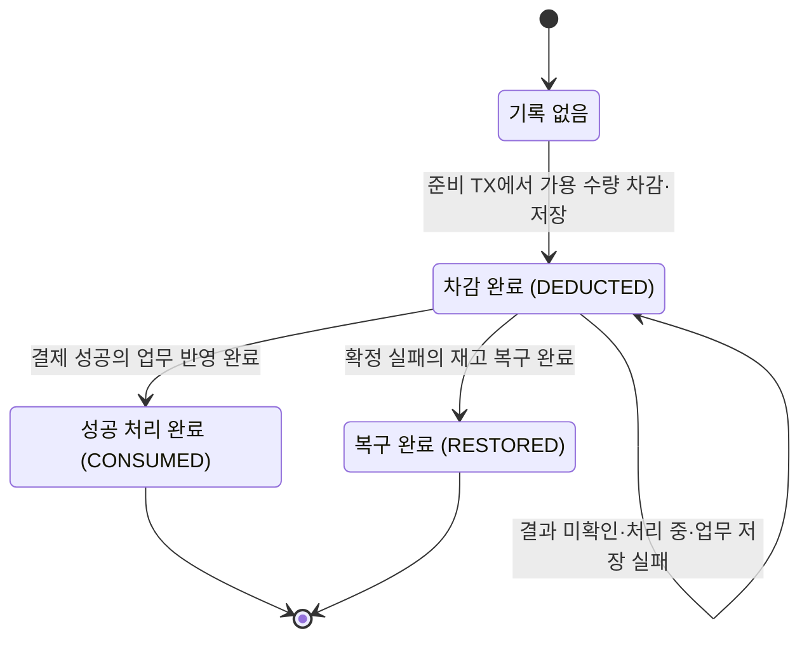

# 재고 상태

[전체 흐름](total.md) · [주문 상태](order.md) · [결제 상태](payment.md)

**상품의 가용 수량과, 주문별 재고 처리 상태를 구분한다.** 가용 수량은 지금 판매할 수 있는 개수다. 재고 처리 상태는 특정 주문에서 몇 개를 차감했고, 그 처리가 끝났는지를 기록한다.

R01에서 mall의 별도 기록 모델과 저장소를 구현했고 R02 내부 준비 TX에서 실제 차감과 DEDUCTED 기록을 연결했다. 공통 업무 TX는 성공이면 CONSUMED, 확정 실패면 실제 반환과 RESTORED·주문 실패·작업 완료를 함께 저장한다. 상품 변경은 기존 commit 이후 캐시 무효화 이벤트를 재사용한다.
반환은 양수·int 한도를 검사하고 삭제 상품의 삭제 상태를 유지한다. 반환 실패 시 공통 업무 TX를 모두 취소하며 먼저 저장한 PG 실패는 유지한다. 고객 confirm과 실제 PG 요청까지 연결했고 생성 전 확정 거절의 재고 복구도 실제 HTTP로 확인했다. 수동 대사와 callback도 같은 공통 반영을 사용하며 중복 알림·동시 대사가 재고를 추가 차감/반환하지 않는다.

## 상태의 의미

| 상태 | 쉬운 이름 | 의미 |
|---|---|---|
| 기록 없음 | 차감 전 | 이 주문으로 재고를 차감한 적이 없음. 실제 enum 값이 아님 |
| `DEDUCTED` | 차감 완료·결과 대기 | 재고를 먼저 줄였고 성공·실패에 따른 업무 처리는 아직 끝나지 않음 |
| `CONSUMED` | 성공 처리 완료 | 결제가 성공해 차감한 재고를 그대로 유지하는 것으로 처리 완료 |
| `RESTORED` | 복구 완료 | 확정 실패로 차감한 수량을 한 번 돌려놓음 |

주문당 하나의 재고 처리 기록에 품목별 차감 수량을 고정해 둔다. 복구할 때는 그 수량을 사용한다.

## 상태 전이

## 예시: 5개 중 2개를 주문한다면

| 상황 | 가용 수량 | 재고 처리 상태 |
|---|---|---|
| 결제 시작 전 | 5 | 기록 없음 |
| 재고 선차감 저장 완료 | 5 → 3 | `DEDUCTED`, 차감 수량 2 기록 |
| PG 처리 중 또는 응답 없음 | 3 유지 | `DEDUCTED` 유지 |
| 결제 성공의 업무 반영 완료 | 3 유지 | `CONSUMED` |
| 결제 확정 실패의 업무 반영 완료 | 3 → 5 | `RESTORED` |
| 같은 실패 결과가 다시 도착 | 5 유지 | `RESTORED` 유지. 추가 복구 없음 |

성공할 때 `CONSUMED`로 바꾸는 것은 **기록을 완료한다는 뜻**이다. 수량을 다시 차감하지 않는다.

## 복구할 때 지킬 규칙

### 실제 수량과 복구 기록을 함께 저장한다

재고를 늘리는 변경과 `RESTORED` 변경은 같은 업무 반영 트랜잭션에 둔다. 주문 실패와 관련 결제/작업 기록도 함께 처리한다.

중간에 실패하면 해당 변경을 모두 취소한다. 그래야 수량만 늘었는데 복구 기록은 없어 다음 요청에서 또 늘리는 일을 막을 수 있다. 앞서 별도로 저장한 결제 실패 근거는 유지한다.

### 과거 재고 값으로 덮어쓰지 않는다

복구는 **현재 가용 수량에 이 주문이 차감한 수량을 더하는 것**이다.

예를 들어 5개에서 2개를 차감한 뒤 관리자가 가용 수량을 10개로 바꿨다면, 결제 실패 시 **10 + 2 = 12개**가 된다. 최초 수량인 5개로 되돌리지 않는다.

### 복구 수량을 저장할 수 없다면 수동 처리한다

재고는 현재 int 범위다. 관리자 설정 후 주문 수량을 더할 때 한도를 넘으면 **업무 반영 전체를 취소하고 수동 확인 대상으로 남긴다**.
PG에서 확인한 실패는 유지하지만 재고 기록은 `DEDUCTED`로 남는다. 실제 수량 복구 전에는 `RESTORED`나 주문 실패 처리 완료로 바꾸지 않는다.
담당자가 원인을 해소하면 저장된 실패 근거를 다시 반영한다. [2026-10-22 결정](../r02-pg-order-payment/trade_off/02-stock-restore-and-admin-update.md)이며 실제 연결은 R02 구현 대상이다.

### 결과를 모르면 복구하지 않는다

timeout, 조회 실패, 조회 결과 0건, 재조회 횟수 소진만으로는 재고를 복구하지 않는다. PG에서 성공했을 가능성이 남아 있기 때문이다.

삭제된 상품의 재고를 복구하더라도 상품의 삭제 상태를 해제하지 않는다. 재고 복구와 상품 재판매는 별개다.
