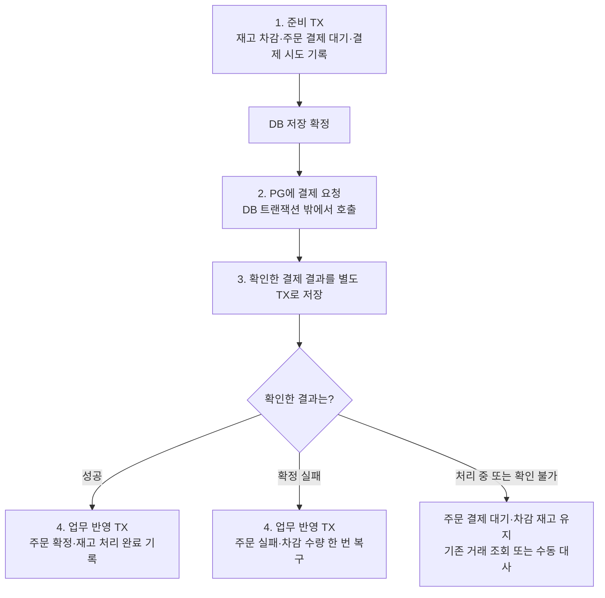

# 주문·재고·결제 전체 흐름

처음 읽는다면 **이 문서 → 주문 → 재고 → 결제** 순서로 보면 된다.

[주문 상태](order.md) · [재고 상태](stock.md) · [결제 상태](payment.md) · [5주차 요구사항](../total_requirement.md) · [R02 실제 결과](../r02-pg-order-payment/result.md)

상태 모델을 읽은 뒤 장애 대응을 연결하려면 [읽기 안내](../resilience/README.md) → [서킷브레이커](../resilience/circuit-breaker.md) → [폴백 전략](../resilience/fallback.md) 순서로 이어 간다. 상태 정의는 이 폴더, 조회 허용 판단과 실패 후 행동은 resilience 폴더에서 설명한다.

## 이 문서의 범위

이 문서는 R01/R02에서 구현한 흐름과 R03에서 연결한 제한된 자동 회복을 함께 설명한다. R02까지 주문·상품·PG·수동 대사·callback 연결과 검증을 마쳤다. 2026-10-23 R03 첫 기능으로 수동 대사·callback이 공유하는 조회 회로·fallback을 연결했다. 내부 반영 데드락 Retry도 연결했다. 제한된 자동 PG 재조회·실행기도 연결했다. 실제 PG 장애/재시작 실험 14건과 필수 전체 검사 509건도 완료했다. 실제 상태·효과 수와 한계는 [R03 결과](../r03-payment-resilience/result.md)를 따른다.

R02는 고객 confirm을 실제 PG 호출에 연결했다. 재고를 먼저 차감해 저장하고, PG 요청 후 확인한 결과를 저장한 다음 주문·재고를 처리한다. 같은 요청은 결제를 다시 만들지 않는다. 미완료면 202, 성공 또는 실패에 따른 업무 처리가 끝났으면 200을 반환한다. 고객/관리자 조회는 저장한 결제·복구 상태와 주의 표시를 보여주고 미완료 목록을 제공한다. 고객은 본인 주문, 관리자는 1번 fixture로 접근한다. 수동 대사는 기존 거래를 한 번 조회하거나 저장 결과를 재적용한다. callback은 요청 안에서 PG를 권위 조회하고 같은 공통 업무 반영을 사용한다. 조회 회로는 공유하되 생성 요청에는 적용하지 않는다. 자동 조회는 최초 confirm의 발송 승자만 시작하며, 미확인이면 최대4회·30초 안에서 확인한다. 같은 confirm 재요청은 새 자동 작업을 시작하지 않는다.

현재 테스트 PG는 거래를 생성하면 `PENDING`을 반환한다. PG에서 나중에 성공해도 commerce가 아직 확인하지 않았다면 우리 주문은 `PAYMENT_PENDING`으로 남는다. 자동 조회·수동 대사·callback의 권위 조회로 확인하기 전까지 이 상태를 유지한다. 알림 본문이 성공이어도 실제 조회 결과가 처리 중이면 결제 대기로 남는다. 생성 전 확정 거절은 즉시 저장해 실패 처리와 재고 복구까지 수행한다.

## 먼저 알아둘 용어

| 용어 | 쉬운 설명 |
|---|---|
| commerce | 우리가 만드는 주문 서비스 |
| PG | 결제를 처리하는 별도 서버. 이번에는 직접 만든 학습용 서버를 사용 |
| 트랜잭션(TX) | 여러 DB 변경을 모두 저장하거나, 실패하면 모두 취소하는 묶음 |
| commit | 해당 트랜잭션의 변경을 DB에 확정 저장하는 것 |
| rollback | 해당 트랜잭션의 변경을 취소하는 것 |
| 결제 결과 확인 | PG 응답의 주문·금액·거래 정보가 맞는지 검사해 결과를 저장하는 것 |
| 업무 반영 | 확인한 결과에 따라 주문을 확정하거나 재고를 복구하는 것 |
| 수동 대사 | 운영 담당자가 미완료 결제를 찾아 PG 결과와 우리 기록을 맞추는 작업 |

## 핵심 규칙

**재고를 먼저 차감하고 결제를 요청한다. 결제가 성공하면 차감한 수량을 유지하고, 확실히 실패했을 때만 한 번 복구한다.**

응답이 없다는 이유만으로 실패로 처리하지 않는다. PG에서는 이미 성공했을 수도 있기 때문이다. 결과를 모르는 동안 주문은 결제 대기로 두고, 차감한 재고도 유지한다.

## 전체 처리 순서

발송 시작 기록은 PG 호출 전에 저장한다. 이 기록이 있어도 실제로 PG에 도착했는지는 모를 수 있다. 세부 내용은 [결제의 발송 상태](payment.md#1-발송-상태--요청을-보내기-시작했는가)를 참고한다.

R02 준비 진입은 `DRAFT → PAYMENT_PENDING` 조건부 갱신(CAS)에 성공한 실행이 맡는다. 같은 준비 TX에서 재고 차감·기록을 함께 저장하고 commit 후 PG를 호출한다.
실패한 다른 실행은 최신 주문·시도를 확인하며 추가 차감·PG 생성을 하지 않는다. 이 흐름은 고객 confirm에 연결했다.

결과 반영도 `PAYMENT_PENDING → CONFIRMED/PAYMENT_FAILED` CAS에 성공한 실행이 맡는다.
이 상태 변경과 주문 기록·재고·차감 기록·작업 완료는 같은 TX에서 저장한다. 하나라도 실패하면 상태 변경까지 함께 취소된다.
실제 결과/충돌을 확인하는 결제 시도 행과 변경할 상품 재고는 짧게 보호한다. CAS를 선택했다고 모든 잠금을 없애는 것은 아니다.

### 왜 DB 저장을 나누는가?

PG 응답을 기다리는 동안 DB 트랜잭션을 열어두지 않기 위해 준비 저장과 외부 호출을 나눈다.

또한 **결제 성공을 확인한 것과 주문 처리가 끝난 것은 다른 사실**이다. 성공 결과를 먼저 저장하면, 뒤의 주문 확정이 실패해도 성공 사실은 남는다. 이후 새 결제를 만들지 않고 저장된 결과로 주문 처리를 다시 할 수 있다.

실패도 같다. PG가 거래를 만들기 전에 확실히 거절한 결과를 저장했다면, 재고 복구가 실패해도 거절 근거를 유지하고 복구를 다시 시도할 수 있다.

| 저장 구간 | 함께 확정하는 내용 | 해당 구간이 실패하면 |
|---|---|---|
| 준비 TX | 주문 결제 대기·실제 재고 차감·결제 시도·차감 기록 | 해당 변경을 모두 취소. PG 호출 전이라면 호출하지 않음 |
| 결과 저장 TX | 검증한 PG 결과 또는 거래 생성 전 확정 거절 근거 | 근거 없이 성공·실패를 확정하지 않고 DB 저장 여부부터 확인 |
| 업무 반영 TX | 주문 확정 또는 실패·재고 처리·관련 결제/작업 기록 | 업무 변경을 모두 취소. 앞서 저장한 결제 결과는 유지 |

## 상황별로 상태를 함께 읽기

`PG 결과`는 **우리 서비스가 마지막으로 확인해서 저장한 결과**다. PG 서버의 최신 상태와 잠시 다를 수 있다.

| 상황 | 주문 | 저장한 PG 결과 | 재고 기록 | 가용 재고 |
|---|---|---|---|---|
| 결제 시작 전 | `DRAFT` | 결제 시도 없음 | 차감 기록 없음 | 변경 없음 |
| 재고 차감 후 응답 대기 | `PAYMENT_PENDING` | `UNKNOWN` | `DEDUCTED` | 차감 유지 |
| PG가 처리 중이라고 응답 | `PAYMENT_PENDING` | `PENDING` | `DEDUCTED` | 차감 유지 |
| 성공은 저장했지만 주문 확정 실패 | `PAYMENT_PENDING` | `SUCCESS` | `DEDUCTED` | 차감 유지 |
| 성공 업무 반영 완료 | `CONFIRMED` | `SUCCESS` | `CONSUMED` | 추가 차감 없음 |
| 실패는 저장했지만 재고 복구 실패 | `PAYMENT_PENDING` | `FAILED` | `DEDUCTED` | 복구 변경 취소 |
| 실패 업무 반영 완료 | `PAYMENT_FAILED` | `FAILED` | `RESTORED` | 차감한 수량 복구 |
| 조회 실패·조회 횟수 소진·서버 중단 | `PAYMENT_PENDING` | 마지막 확인 결과 유지 | `DEDUCTED` | 차감 유지 |

업무 반영이 완료되면 별도 복구 작업은 `APPLIED`가 된다. 조회 횟수를 다 쓴 경우와, 서버가 중단되어 `RUNNING`에 남은 경우의 차이는 [결제 복구 진행](payment.md#3-복구-진행--후속-처리는-어디까지-끝났는가)을 참고한다.

## 예시: 재고 5개에서 2개를 주문한다면

1. 결제를 시작하면서 가용 재고를 **5 → 3**으로 줄인다.
2. PG 성공을 확인하면 주문을 확정한다. 가용 재고는 **3**으로 유지한다.
3. PG의 확정 실패를 확인하면 주문을 실패로 처리하고 재고를 **3 → 5**로 복구한다.
4. timeout으로 결과를 모르면 재고는 **3**으로 유지하고 기존 거래를 조회한다.

같은 실패 결과가 다시 와도 재고를 7개로 늘리지 않는다. 한 주문의 차감·복구 기록으로 중복 반영을 막는다.

## 구현 범위

- **R01:** 테스트 PG, 결제 시도·복구 작업·재고 처리 기록, HTTP 연동과 결과 저장 기반.
- **R02:** 실제 주문의 PG 전환, 재고 증감, callback 처리, 미완료 목록과 수동 대사.
- **R03:** 최초 조회 후 추가 3회 재조회, 서킷브레이커와 장애 대응 검증.

실패한 주문에 새 결제를 시작하는 기능, 결제 취소·환불은 이번 범위에 포함하지 않는다.
