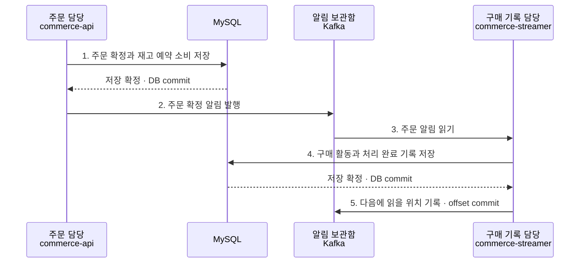
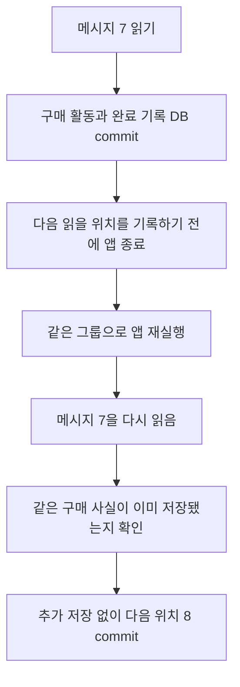
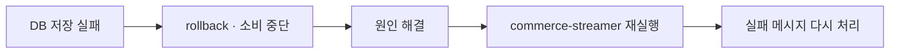

# W6: 주문 소식을 전달하고 구매 기록 남기기

이번 기능은 주문을 확정하는 일과 구매 기록을 남기는 일을 나눈다. 주문 담당은 주문을 확정한 뒤 Kafka에 소식을 남기고, 구매 기록 담당은 그 소식을 읽어 상품별 구매 수량을 저장한다. 구매 기록 담당이 결제하거나 재고를 다시 차감하지는 않는다.

## 세 담당자의 역할

| 실제 구성 | 쉬운 설명 |
| --- | --- |
| `commerce-api` | 결제 결과를 확인하고 주문을 확정하는 담당자 |
| Kafka `order-events` | 주문 확정 알림을 보관하는 곳 |
| `commerce-streamer` | 알림을 읽고 구매 활동을 기록하는 담당자 |

주문 DB의 저장이 확정된 뒤 알림을 보내도록 `AFTER_COMMIT`을 사용했다. 구매 기록 담당도 자신의 DB 저장이 확정된 뒤에만 Kafka에 다음 읽을 위치를 기록한다. 두 번의 DB commit은 각각의 업무를 끝낸 것이고, offset commit은 소비자 그룹의 읽기 재개 위치를 저장한 것이다.

## 같은 알림을 또 받으면

아래는 이해를 위한 메시지 번호 7의 예시다. Kafka의 메시지 번호(offset)와 주문 번호(orderId)는 서로 다르다.

예를 들어 한 주문에서 사과 2개, 빵 1개를 샀다면 구매 활동은 상품별 2행이다. 같은 알림을 다시 받았다고 사과 4개, 빵 2개로 늘리지 않는다. DB 유일 제약으로 동시에 같은 알림을 처리하는 경우도 막는다. 다만 같은 이벤트 ID에 다른 수량이 오면 정상 중복으로 숨기지 않고 오류로 드러낸다.

## DB에 저장할 수 없으면

현재 선택한 A 정책은 오류가 나면 해당 listener의 소비를 멈춘다. 실패한 메시지의 offset을 완료 처리하지 않는다. 일부 품목만 저장하다 실패해도 완료 기록과 전체 품목을 함께 rollback한다.

재실행하는 대상은 소비용 Spring 앱이다. 컴퓨터나 Kafka 서버를 재부팅하거나 토픽을 다시 만드는 것이 아니다. 실행 중인 앱에서 멈춘 listener만 시작하는 방법도 있으며 복구 테스트는 이 방법을 사용했다. 자동 재시도와 DLQ는 이번 구현에 포함하지 않았다.

## 아직 남아 있는 빈틈

주문 저장은 끝났는데 Kafka로 알림을 보내기 전에 실패할 수 있다. 이때 주문은 확정돼 있지만 구매 활동이 없을 수 있다. Kafka에 알림 자체가 없으므로 Consumer를 재시작해도 해결되지 않는다. 이 사례를 실제 테스트로 남겼고 다음 주 Outbox에서 개선한다.

## 어디부터 읽을까

1. [주문 확정 후 발행 테스트](../../apps/commerce-api/src/test/java/com/loopers/application/payment/OrderConfirmedPublicationTest.java): 저장 전에는 알림이 없고 commit 후에는 생기는지 확인한다.
2. [구매 활동 DB 테스트](../../apps/commerce-streamer/src/test/java/com/loopers/purchaseactivity/PurchaseActivityIntegrationTest.java): 처음 저장·중복·충돌·전체 rollback을 확인한다.
3. [재전달과 복구 테스트](../../apps/commerce-streamer/src/test/java/com/loopers/purchaseactivity/KafkaDeliveryTest.java): 읽은 위치와 커밋한 위치가 다를 때 다시 읽는 과정을 본다.
4. [주문부터 소비까지 통합 테스트](../../apps/commerce-streamer/src/test/java/com/loopers/week6/Week6DirectPublicationFlowTest.java): 정상 주문과 알림이 누락된 주문을 함께 비교한다.

이벤트 계약과 실패 처리는 [설계](design.md), 로컬 포트·테스트 명령·스키마 적용은 [실행 방법](reproduce.md)에 정리했다.
