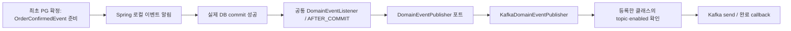

# W6 공통 도메인 이벤트 발행 리팩터링 TDD 기록

## 요청과 완료 범위

2026-10-30 멘토링을 반영해 주문 전용 listener·publisher를 **공통 DomainEventListener와 Kafka 발행기**로 변경했다. 이벤트마다 commit 경계와 전송·오류 관찰 코드를 복제하지 않도록 책임을 모았다. 현재 실제 업무 이벤트는 여전히 `OrderConfirmedEvent` 하나이며, 두 번째 종류는 확장 동작을 확인하는 테스트용 합성 이벤트다.

관련 검사 **15개 스위트·359개 테스트가 통과**했다. 실패·오류·skip은 모두 0이다. 사용자 DB·기존 topic/group·볼륨은 사용하거나 변경하지 않았고 커밋하지 않았다. 이전 [주문 전용 발행 기록](order-confirmed-publication-tdd-log.md)과 [고정 Clock 기록](fixed-clock-w7-reproduction.md)의 실행 결과는 당시 증거로 보존한다.

## 변경한 책임

| 파일 | 책임 |
| --- | --- |
| [DomainEvent](../../apps/commerce-api/src/main/java/com/loopers/domain/event/DomainEvent.java) | 외부 발행에 참여할 불변 사건의 공통 타입. eventType·eventId·key만 요구하며 Spring·Kafka·topic을 알지 않는다. 일반 로컬 이벤트는 구현할 필요가 없다. |
| [DomainEventPublisher](../../apps/commerce-api/src/main/java/com/loopers/domain/event/DomainEventPublisher.java) | 공통 발행 포트. application은 이 약속에 의존하고 Kafka 구현을 직접 참조하지 않는다. |
| [OrderConfirmedEvent](../../apps/commerce-api/src/main/java/com/loopers/domain/order/OrderConfirmedEvent.java) | 기존 record가 DomainEvent를 구현한다. 주문별 검증·품목 정규화·식별자·시각은 변경하지 않았다. |
| [DomainEventListener](../../apps/commerce-api/src/main/java/com/loopers/application/event/DomainEventListener.java) | AFTER_COMMIT에서 공통 발행 포트에 위임한다. TX가 없는 이벤트는 실행하지 않고, 발행 예외가 완료된 업무나 다음 이벤트의 전달을 막지 않게 격리한다. |
| [KafkaDomainEventPublisher](../../apps/commerce-api/src/main/java/com/loopers/infrastructure/event/KafkaDomainEventPublisher.java) | 등록된 이벤트의 topic을 찾아 한 번 send하고 완료 callback으로 성공 위치·실패를 기록한다. 별도 업무 재시도·PG 재생성은 하지 않는다. |
| [KafkaEventRoute](../../apps/commerce-api/src/main/java/com/loopers/infrastructure/event/KafkaEventRoute.java) | 정확한 이벤트 클래스·topic·활성화 설정의 명시적 등록. 같은 클래스의 중복 route는 초기화 시 거절한다. |
| [DomainEventKafkaConfiguration](../../apps/commerce-api/src/main/java/com/loopers/infrastructure/event/DomainEventKafkaConfiguration.java) | 공통 typed producer/template과 주문 route를 연결한다. 기존 설정 이름과 JSON serializer를 유지한다. |

이전 `OrderConfirmedEventListener`·`OrderConfirmedEventPublisher`·`KafkaOrderConfirmedEventPublisher`·`OrderEventKafkaConfiguration`은 공통 경로로 대체했다. 병행 리스너를 남겨 같은 사건을 두 번 보내지 않는다.



## 선택 이유와 보존한 계약

- **공통 타입 + 명시적 route:** 모든 Spring 이벤트를 외부로 보내지 않는다. DomainEvent 구현과 정확한 클래스 route 등록을 통해 발행 대상을 정한다. 미등록 타입은 실패 로그·send 0, 비활성 route는 비활성 로그·send 0으로 구분한다. 등록 누락에 임의 기본 topic을 사용하지 않는다.
- **미채택 대안:** 이벤트마다 listener·Kafka 발행기를 복제하거나 공통 listener 안에 업무별 switch를 늘리는 방법. 이번에는 공통 전달 절차를 재사용하고 event/topic 차이는 등록 정보로 분리했다.
- **기존 호출 시점:** OrderPaymentStockService의 최초 확정 판단·불변 snapshot 준비 위치를 바꾸지 않았다. 실제 commit 전에는 send하지 않고 rollback이면 발행하지 않는다. 외부 TX 참여·격리·락·재고·PG·POINT 계약을 바꾸지 않았다.
- **기존 wire:** JSON은 eventType/schemaVersion/eventId/orderId/confirmedAt/items의 6개 필드다. envelope·key 필드·타입 header를 추가하지 않는다. eventId는 `order-confirmed:v1:{orderId}`, Kafka key는 orderId 문자열, 시각은 저장된 최초 확정 시각이다.
- **기존 설정:** `commerce.order-events.enabled`·`commerce.order-events.topic`, producer bootstrap·acks·idempotence·timeout·retries를 유지했다. streamer의 consumer 설정·DB 모델·처리 코드는 변경하지 않았다.
- **관찰 필드:** 로그 이름은 `domain_event_published`, `domain_event_publication_failed`, `domain_event_dispatch_failed`, `domain_event_publication_disabled`로 공통화했다. 단계에 맞는 eventType/eventId/key/topic/partition/offset/errorType만 남기며 payload·예외 원문을 기록하지 않는다. 주문 이벤트의 key는 기존 orderId에 해당한다.
- **실패 경계:** send 완료는 기다리지 않고 동기 오류·비동기 실패를 관찰한다. 공통화는 DB commit과 Kafka 발행의 원자성을 보장하지 않는다. Outbox·누락 복구는 추가하지 않았다.

## Red → Green

| 단계 | 실제 실행과 결과 |
| --- | --- |
| Red 1: 계약 테스트 먼저 | 공통 listener 테스트와 기존 통합 테스트의 새 포트 참조를 작성했다. 아직 없는 공통 타입 때문에 compileTestJava에서 오류 23개, BUILD FAILED 2초·종료 1. 이 단계는 동작 검증 전의 컴파일 실패다. |
| Red 2: 구조 이동 후 동작 확인 | 공통 클래스·발행기를 만들고 기존 주문 수신 타입을 그대로 둔 상태에서 16개 실행. 두 번째 종류 이벤트가 전달되지 않아 listener 테스트 2개 실패, BUILD FAILED 4초·종료 1. 이름 변경만으로 공통 전달이 되지 않음을 확인했다. |
| Green | listener 수신 인자를 DomainEvent로 변경했다. 공통 경로·실제 serializer/config의 20개 통과, 실패/오류/skip 0. BUILD SUCCESSFUL 3초·종료 0. |
| 관련 회귀 | 실제 DB·PG HTTP·Kafka·별도 streamer JVM/DB, 모델·잠금/롤백·parser·ArchUnit·Checkstyle 검증. 15개 스위트·359개 통과, BUILD SUCCESSFUL 58초·종료 0. 2026-10-30 15:17 KST 완료. |

공통 경로 20개는 **기존 adapter 테스트 5개를 이전하고 신규 15개를 추가**한 수다. Green과 회귀에 같은 테스트가 포함되므로 합산하지 않는다.

| 테스트 | 검증 내용 |
| --- | --- |
| [DomainEventListenerTest](../../apps/commerce-api/src/test/java/com/loopers/application/event/DomainEventListenerTest.java) · 6개 | 실제 Spring 이벤트 동기화에서 주문/합성 이벤트의 commit 뒤 전달, 예외 rollback·rollbackOnly, TX 없음, 일반 로컬 이벤트 제외, 발행 예외 격리 후 다른 이벤트 전달. DB 없는 transaction manager이며 실제 SQL 검증과 구분한다. |
| [KafkaDomainEventPublisherTest](../../apps/commerce-api/src/test/java/com/loopers/infrastructure/event/KafkaDomainEventPublisherTest.java) · 10개 | 기존 즉시/지연 성공·실패·비노출·추가 send 금지 5개 유지. 추가로 두 타입의 다른 topic, 미등록·비활성 send 0, 중복 route·빈 topic 거절 검증. |
| [DomainEventKafkaConfigurationTest](../../apps/commerce-api/src/test/java/com/loopers/infrastructure/event/DomainEventKafkaConfigurationTest.java) · 4개 | 실제 설정 serializer의 정확한 주문 JSON·시각·문자열 key·header 없음, 두 번째 타입 고유 필드 보존, 공통 빈 연결, 기존 topic/비활성 설정 반영. broker·DB 연결 없이 실행. |
| [OrderConfirmedPublicationIntegrationTest](../../apps/commerce-api/src/test/java/com/loopers/application/order/OrderConfirmedPublicationIntegrationTest.java) · 12개 | 기존 실제 SQL 후 rollback, 외부 TX commit·독립 연결 가시성, 중복/경합, 실패/미확정/POINT 비발행. 공통 포트로 대역만 교체하고 기대값 유지. |
| [PgOrderEventKafkaIntegrationTest](../../apps/commerce-api/src/test/java/com/loopers/application/order/PgOrderEventKafkaIntegrationTest.java) · 6개 | 실제 생성/조회 PG HTTP·DB commit·Kafka record/metadata·정확한 6개 필드·설정과 send 실패 보존. |
| [PgOrderPurchaseActivityEndToEndTest](../../apps/commerce-api/src/test/java/com/loopers/application/order/PgOrderPurchaseActivityEndToEndTest.java) · 1개 | 정상 전체 경로와 commit 뒤 send 직전 누락을 같은 고정 Clock으로 대조. 실제 소비 DB/offset·세 HTTP 재요청의 추가 효과 0 유지. |

## 관련 검사 명령과 범위

```shell
./gradlew :apps:commerce-api:test \
  --tests 'com.loopers.application.event.DomainEventListenerTest' \
  --tests 'com.loopers.infrastructure.event.*' \
  --tests 'com.loopers.domain.order.OrderConfirmedEventTest' \
  --tests 'com.loopers.application.order.OrderConfirmedPublicationIntegrationTest' \
  --tests 'com.loopers.application.order.PgOrderEventKafkaIntegrationTest' \
  --tests 'com.loopers.application.order.PgOrderPurchaseActivityEndToEndTest' \
  --tests 'com.loopers.application.order.OrderPaymentStockIntegrationTest' \
  --tests 'com.loopers.application.order.OrderPaymentStockRollbackTest' \
  --tests 'com.loopers.application.order.OrderPaymentStockConcurrencyTest' \
  --tests 'com.loopers.domain.order.OrderPaymentStateTest' \
  --tests 'com.loopers.domain.payment.PaymentAttemptTest' \
  --tests 'com.loopers.architecture.ArchitectureTest' \
  :apps:commerce-streamer:test \
  --tests 'com.loopers.interfaces.consumer.OrderConfirmedEventParserTest' \
  --tests 'com.loopers.architecture.ArchitectureTest' \
  :apps:commerce-api:checkstyleMain :apps:commerce-api:checkstyleTest \
  :apps:commerce-streamer:checkstyleMain :apps:commerce-streamer:checkstyleTest \
  --offline --console=plain
```

| 검사 묶음 | 테스트 수 |
| --- | ---: |
| 공통 listener·Kafka publisher·설정 | 20 |
| 주문 이벤트 모델 | 40 |
| 실제 commit 경계·PG Kafka·정상/누락 전체 흐름 | 19 |
| 재고 통합·SQL 뒤 rollback·동시성/잠금 | 56 |
| 주문 결제 상태·결제 시도 모델 | 170 |
| streamer parser | 52 |
| API·streamer ArchUnit | 2 |
| 합계 | **359** |

API 13개 스위트·306개, streamer 2개 스위트·53개다. 전체 저장소 검사를 새로 수행했다고 표현하지 않는다. API Checkstyle main/test는 이번에 실행했고, 변경 없는 streamer main/test는 UP-TO-DATE였다. 네 XML 보고서의 위반은 모두 0이다. 기존 규칙이나 기대값을 삭제·완화하지 않았다.

## 이번 전체 흐름의 실제 사건 값

사용한 topic은 `order-events-e2e-6944837f-00bb-4999-98d7-e254bd23c3fc`, group은 `purchase-activity-e2e-7fad8e28-ba2f-4a0d-9e61-51a6b317242d`다. 과거 재현 문서의 사건과 별도 격리 실행이며 이번 자원도 검증 뒤 정리했다.

| 항목 | 정상 발행·소비 | commit 뒤 발행 누락 |
| --- | --- | --- |
| orderId / eventId | `1` / `order-confirmed:v1:1` | `2` / `order-confirmed:v1:2` |
| providerOrderId / transactionKey | `LP-ORD-0000000001` / `TEST-TX-1` | `LP-ORD-0000000002` / `TEST-TX-2` |
| confirmedAt | `2026-10-29T00:00:00.123456Z` | 같은 고정 시각 |
| 품목 | 상품 1×3, 2×2 | 상품 3×3, 4×2 |
| 주문/예약 | CONFIRMED / CONSUMED | CONFIRMED / CONSUMED |
| 해당 주문 PG 생성 | 1회 | 1회 |
| Kafka | partition 1·offset 0 | 대상 record 0 |
| 완료 기록/구매 활동 | 1건/2건 | 0건/0건 |
| 재요청 | 같은 confirm 추가 효과 0 | confirm·callback·reconcile 추가 효과 0 |

정상 record의 committed offset은 1이고 이후 누락·재요청에서 변경되지 않았다. 누락 hook은 writer connection 40과 독립 reader connection 41에서 확정 commit을 확인했다. 누락 주문의 상품 재고 7/3·포인트 1,000원·최초 시각은 보존됐다. 이 실험은 통제한 send 직전 예외이며 모든 네트워크 장애나 OS 강제 종료를 재현한 것은 아니다.

## 격리·정리와 남은 범위

API DB는 기존 MySqlTestContainersConfig가 만든 임시 MySQL이다. 테스트가 설정한 JDBC 주소·계정으로만 접근한다. 실제 Kafka 검증은 소유한 Kafka container와 UUID topic/group을 사용하며, 전체 흐름은 별도 streamer MySQL·자식 JVM을 사용한다. 자식 JVM 종료 확인·consumer/admin/PG 종료·컨테이너 정리를 기존 fixture로 유지했다. 실행 전후 Docker 컨테이너 ID 목록이 같아 추가 실행 자원이 남지 않았음을 확인했다.

이번 변경에 DB 스키마/이행 작업은 없다. 사용자 DB·기존 topic/group·볼륨을 변경하지 않았다. 작업은 기존 W6 미커밋 변경 위에서 수행했으며 커밋하지 않았다. 당시 후속이었던 실제 W6 구현 commit 연결은 [2026-10-30 C09 재검증](fixed-clock-w7-reproduction.md#2026-10-30-c09-revision-연결과-재검증)에서 완료했다. 이 절의 미커밋 사실·359개 검사는 당시 기록으로 보존하며 최종 제출 정리는 별도다.

## 후속 설명·문서 점검

2026-10-30 공통 경로의 실제 호출 순서와 확장 영향을 다시 점검했다. 현재 구조와 주요 설계·정책·API·TDD 문서가 일치하고, AGENTS·week2·week6의 38개 문서에서 깨진 파일 링크는 발견하지 않았다. 과거 주문 전용 클래스명·로그·측정값은 당시 실행 증거로 보존한다.

[전체 설계의 새 이벤트 작성 안내](../week2/commerce-erd-draft.md#다른-외부-이벤트를-추가할-때의-작성-위치와-영향)에 업무 TX 안의 로컬 발행, 정확한 클래스 route, 별도 topic 준비·소비 계약을 보완했다. 현재 streamer는 주문 확정 전용이므로 다른 사건을 같은 topic에 보낼 때의 검증 오류·listener 중단 영향을 명시했다. 이는 문서 보완이며 새 이벤트·소비자·운영 설정을 구현한 작업이 아니다. 이 후속 점검에서는 테스트를 재실행하지 않았고 위 359개는 선행 리팩터링 검증 결과다.
