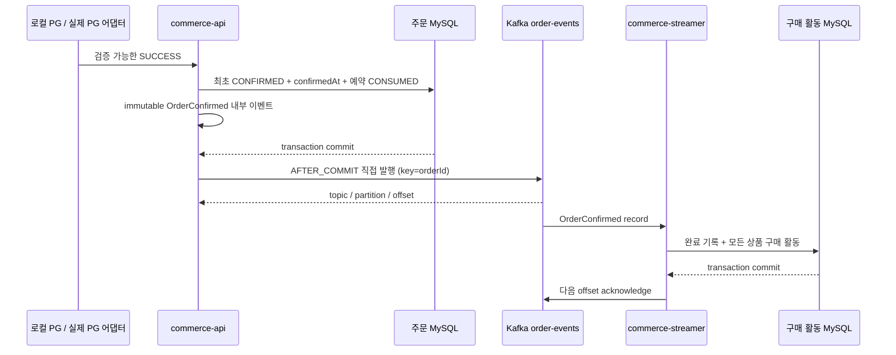
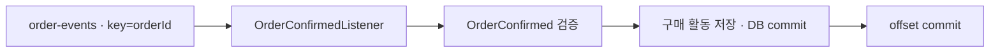
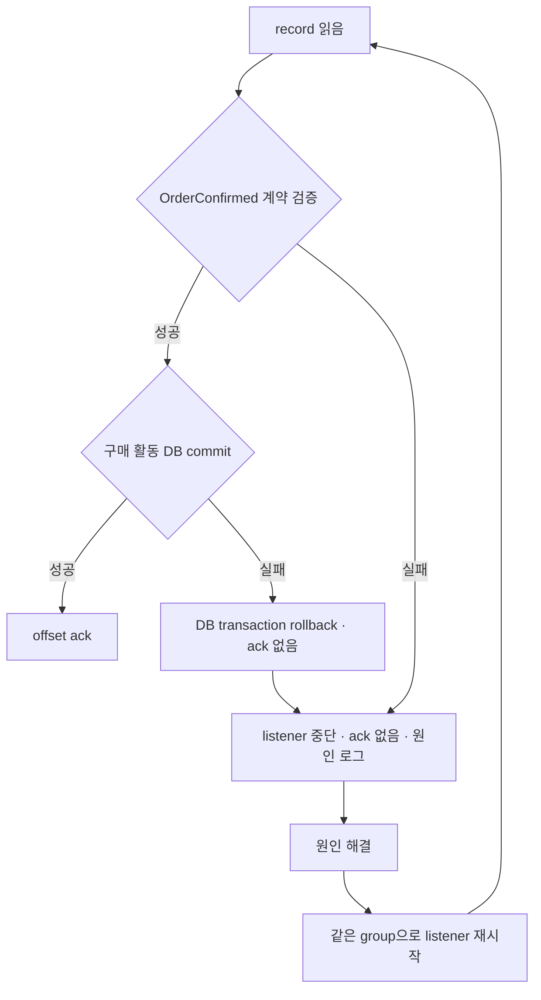

# 주문 확정과 구매 활동의 경계

주문 확정은 PG 결과를 검증해 주문과 재고 예약에 반영하는 일이다. 구매 활동은 확정 주문의 상품별 수량과 최초 확정 시각을 기록하는 후속 기능이다. 구매 활동 Consumer는 결제하거나 재고를 다시 차감하지 않는다.

Spring 내부 이벤트는 같은 프로세스의 실행 연결이다. Kafka는 별도 broker에 보존되는 로그다. 내부 이벤트를 알렸다는 것, Kafka가 저장했다는 것, 구매 활동 DB가 commit됐다는 것은 서로 다른 성공이다.

## 이벤트 계약

| 필드 | 의미 |
| --- | --- |
| topic | `order-events`; 테스트는 고유 suffix |
| key | 내부 orderId의 문자열, payload와 반드시 일치 |
| eventType / schemaVersion | `OrderConfirmed` / `1` |
| eventId | `order-confirmed:v1:{orderId}`; 발행 시도마다 바뀌지 않음 |
| confirmedAt | 최초 PG 성공을 내부 확정으로 반영한 시각; 주문 DB와 동일 |
| items | 상품별 productId·quantity; 동일 상품 합산, productId 정렬, 양수 수량 |

`OrderConfirmed`는 생성 시 계약을 검증하고 불변 품목 목록을 만든다. JSON 속성 순서나 품목 배열 순서는 새 사실의 기준이 아니다. 중복 상품 수량을 합칠 때 정수 범위를 넘으면 거절한다. 카드 정보나 PG 비밀은 이벤트에 포함하지 않는다.

버전·주문 ID·상품 ID·수량은 JSON 정수여야 한다. 소비 parser는 소수를 잘라 정수로 바꾸거나 문자열 숫자를 정수로 바꾸지 않는다. 이 엄격한 설정은 이벤트 parser의 ObjectMapper 복사본에만 적용한다.

이번 실습은 `order-events` 토픽의 `OrderConfirmed / 1` 계약만 처리한다. `OrderConfirmedListener`가 record를 받아 `OrderConfirmedParser`로 검증하고, `PurchaseActivityHandler`를 직접 호출한다. 구매 활동 DB commit이 끝나 반환한 뒤에만 offset을 커밋한다. 이벤트별 dispatcher나 범용 처리기 인터페이스는 두지 않는다.

깨진 JSON, 여러 JSON 값이 이어진 메시지, `OrderConfirmed`가 아닌 eventType, 지원하지 않는 버전 등 계약 오류와 DB 저장 실패는 기존 A 정책대로 중단하고 ack하지 않는다. 취소·환불 업무와 해당 종류의 분기는 이번 과제 범위에 포함하지 않는다.

기존 listener ID와 group ID `purchase-activity`를 유지한다. consumer 스레드에서 동기적으로 처리하므로 하나의 파티션에서는 앞 record의 처리가 완료되어야 다음 record를 처리한다. 처리기 내부에서 비동기 작업만 시작하고 반환하면 DB commit 이후 ack한다는 계약을 어기게 된다.

이는 Kafka에 기록된 순서를 따르는 구조다. 같은 key라도 파티션 수나 partitioner가 달라지면 배치 위치가 바뀔 수 있고, 여러 Producer가 뒤바뀐 순서로 발행한 업무 사실을 재정렬해 주지는 않는다. 리밸런싱 때 이전 Consumer의 진행 중 DB 작업과 새 Consumer의 작업이 겹치는 문제도 동기 호출만으로 해결되지 않는다.

MySQL의 `datetime(6)`에 맞춰 생산자는 Clock 값을 마이크로초로 맞춘 뒤 DB와 이벤트에 동일하게 사용한다. 소비자는 마이크로초보다 세밀한 시각을 조용히 잘라 저장하지 않고 계약 오류로 거절한다. 과거 POINT 주문에는 확인할 수 없는 최초 시각을 새로 만들어 넣거나 이벤트를 소급 발행하지 않는다.

## Producer

callback과 reconcile은 기존 `OrderPaymentTransactions.recordLookup`의 동일한 결과 반영 경계를 사용한다. 최초 SUCCESS 전이에만 주문 확정·예약 소비·결제 결과를 저장하고 내부 이벤트를 알린다. 반복 적용은 새 논리 이벤트를 만들지 않는다.

`PublishOrderConfirmedAfterCommit`는 실제 commit 이후에만 `OrderConfirmedPublisher`를 호출한다. 발행용 DTO는 트랜잭션 안에서 완성되므로 listener가 lazy entity를 읽지 않는다. Kafka adapter는 유한한 시간 안에 send 결과를 기다리고 성공 위치 또는 실패 원인을 드러낸다.

주문 commit 뒤 전송 실패는 주문을 PENDING/UNKNOWN으로 되돌릴 이유가 아니다. 이미 저장된 주문 상태로 응답하고 발행 실패를 별도 오류 로그로 남긴다. 시간 초과만으로 broker에 없다고 단정하지 않는다. 이번 누락 실험은 **실제 commit 이후, send 호출 이전**의 통제된 오류를 사용한다.

`acks=all`, idempotent producer를 사용한다. 단일 broker, replication factor 1인 실험은 복제 장애의 내구성을 증명하지 못한다. Producer의 멱등성도 애플리케이션이 같은 사건을 두 번 send하거나 외부 MySQL이 두 번 변경되는 문제를 대신 해결하지 않는다.

## Consumer의 DB 경계

| 저장소 | 유일성 |
| --- | --- |
| `processed_order_confirmation` | eventId 각각 유일, orderId 각각 유일 |
| `product_purchase_activity` | (orderId, productId) 유일 |

완료 기록과 모든 상품 활동을 **하나의 DB 트랜잭션**으로 저장한다. 동일 ID·최초 시각·정규화 품목이면 정상 no-op이다. 같은 eventId에 다른 주문·수량·시각이 오거나 같은 주문에 다른 eventId가 오면 충돌로 드러낸다.

조회만으로 동시 중복을 막지 않는다. DB 유일 제약의 경쟁에서 실패한 트랜잭션은 먼저 rollback하고, 별도 트랜잭션에서 기존 사실과 일치하는지 확인한다. 다른 DB 오류를 중복으로 취급하지 않는다. 중간 품목 저장이 실패하면 앞 품목과 완료 기록도 모두 rollback한다.

활동은 이벤트가 전달한 과거 구매 사실이다. 현재 상품의 존재·가격·노출 상태를 다시 조회해 덮어쓰지 않는다.

## A 정책: 중단, 복구, 같은 그룹으로 재시작

전용 record listener factory를 사용한다. 기존 demo batch factory의 처리 방식은 유지한다.

- 실제 ConsumerConfig의 `enable.auto.commit=false`
- record listener, `MANUAL_IMMEDIATE`, consumer 스레드에서 handler 호출 후 ack
- `CommonContainerStoppingErrorHandler`: 실패 record를 업무 완료로 넘기지 않고 listener 중단
- 신규 구매 활동 그룹은 `earliest`; 기존 유효 committed offset이 있으면 그 위치로 이어감
- 작은 실험에 맞춘 fetch 대기; 긴 sleep으로 준비·배정을 추측하지 않음

여기서 재시작은 **컴퓨터 재부팅이 아니다**. 로컬에서는 commerce-streamer 애플리케이션을 다시 실행해도 되고, 실행 중인 애플리케이션 내부에서 `KafkaListenerEndpointRegistry`의 `purchase-activity` listener 컨테이너를 `start()`할 수도 있다. 복구 API를 공개적으로 추가하지 않는다. 테스트는 실제 listener 컨테이너만 재시작한다.

이 정책은 자동 재시도나 DLQ가 아니다. 원인을 고치기 전 다시 실행하면 같은 오류로 또 멈춘다. 중단된 컨테이너가 맡은 후속 메시지도 기다린다. 다른 컨테이너/그룹 전체를 일괄 중단시키는 분산 제어는 포함하지 않는다. 메시지가 retention으로 삭제되기 전에 복구해야 Kafka에서 재전달할 수 있다.

## 테스트 범위와 남은 한계

실제 Kafka·MySQL을 Docker Testcontainers로 시작한다. host의 mapped bootstrap 주소를 producer·consumer·admin에 동일하게 주입한다. 기존 사용자의 localhost broker/DB를 테스트 대상으로 쓰지 않는다. 테스트에서 사용하는 API 클래스와 PG fixture는 테스트 전용 artifact로만 streamer에 연결되며, production 앱 간 의존은 추가하지 않는다.

1. 최초 PG 확정, rollback, 반복 callback/reconcile, commit 전후 DB 상태와 발행 여부.
2. 같은 사실 재전달·동시 중복·payload 충돌·중간 품목 실패의 DB 원자성.
3. 같은 broker/topic/group/DB를 유지한 consumer 교체: committed offset `n → n → n+1`. 새 consumer에서 seek/reset하지 않음.
4. 실제 listener DB 실패 → 미커밋 offset과 전체 rollback → 중단 → 오류 제거 → 같은 그룹 재시작 → 저장·ack.
5. 파티션 2개, 같은 그룹의 member 1/2/3 실제 배정 및 양쪽 파티션 record 수신.
6. 실제 주문 API와 PG를 통한 미발행 1건·정상 발행/소비 1건의 재현 코드와 DB·broker 상태 확인.

DB와 Kafka는 하나의 원자적 트랜잭션이 아니다. **주문 확정 후 발행 전 공백은 남아 있다.** 이를 숨기지 않고 다음 주 Outbox 실험으로 넘긴다. OS 강제 종료·네트워크 분할·다중 broker 장애를 전부 시험했다고 주장하지 않는다.

참고: [Kafka 3.8 운영 문서](https://kafka.apache.org/38/operations/basic-kafka-operations/), [Spring Kafka의 오류 처리](https://docs.spring.io/spring-kafka/reference/3.3/kafka/annotation-error-handling.html), [Testcontainers Kafka 모듈](https://java.testcontainers.org/modules/kafka/).
