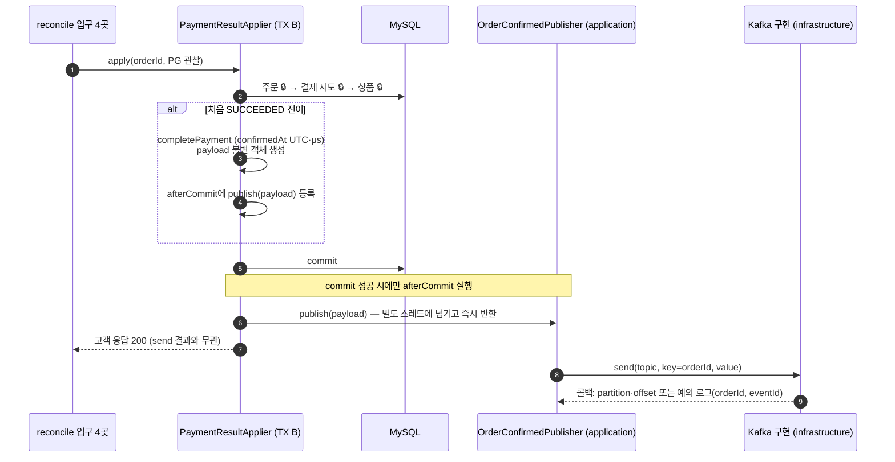
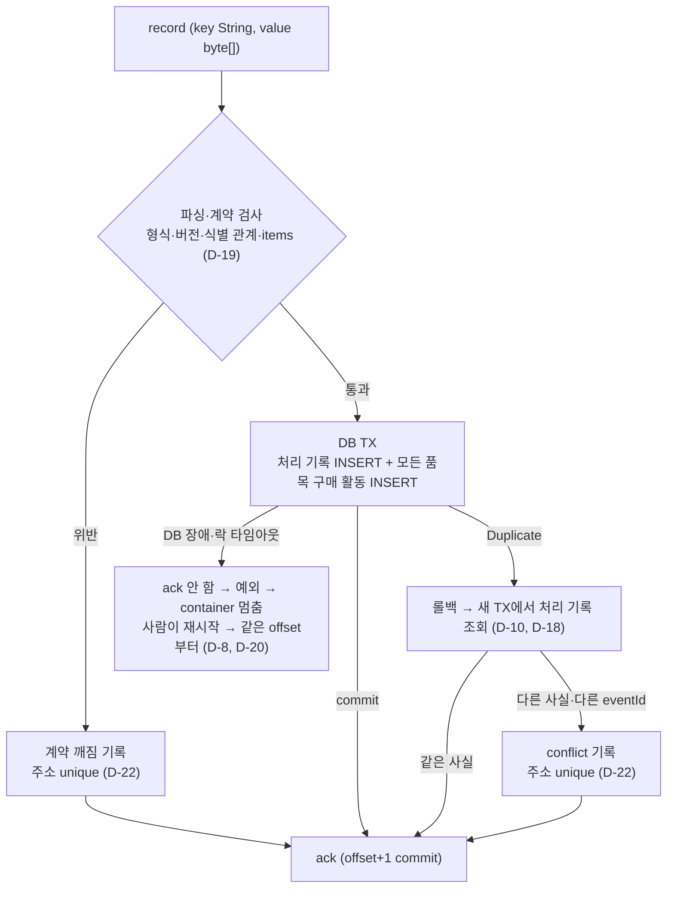

# 6주차 설계 — 받았다는 사실과 끝냈다는 사실

PG로 확정된 주문을 `OrderConfirmed` 이벤트로 Kafka에 보내고, commerce-streamer가 받아 상품 구매 활동으로 남긴다. 5주차까지의 설계(`docs/week2~5/design.md`)를 이어받고, 이번 주에 새로 정한 것만 적는다.

| 문서 | 내용 |
|---|---|
| `design.md` (이 문서) | 한 장 요약. 범위, 계약, 경계, 불변식, 유스케이스, 결정 목록, 실험, 보류 |
| [`decisions.md`](decisions.md) | 결정마다 **근거와 버린 대안**, 확인한 사실 |

## 1. 범위

- **요구 (과제)**
  - 검증된 PG SUCCESS를 처음 CONFIRMED로 반영한 commit 뒤에만 `OrderConfirmed`를 직접 발행한다. 발행 실패는 주문을 되돌리지 않는다.
  - commerce-streamer의 실제 consumer가 구매 활동을 저장한다. 재전달돼도 한 번만 남기고, 같은 사실과 충돌을 구분한다.
  - listener는 record 단위, concurrency 1, `MANUAL_IMMEDIATE`, `CommonContainerStoppingErrorHandler`다. 실패 기록을 처리 완료로 건너뛰지 않는다.
  - 실험: partition 2개에서 같은 group의 consumer를 1→2→3개로 늘릴 때의 배정, DB commit 뒤 미커밋 offset 재전달, 실제 listener 실패와 재시작, 누락 구간 재현.
- **이번 주에 하지 않는 것**: Outbox(7주차), 랭킹 API(9주차), 이전 POINT 확정 주문의 소급 발행, 멈춘 consumer의 자동 재시작(D-20), DLT(D-9).

## 2. 이벤트 계약

| 항목 | 값 |
|---|---|
| topic | `order-events` (테스트는 고유 suffix) |
| key | orderId의 문자열. payload의 orderId와 같아야 한다 |
| eventType / schemaVersion | `OrderConfirmed` / `1` |
| eventId | `order-confirmed:v1:{orderId}`. 최초 확정에 고정, 재발행·재전달·형식 변경에도 그대로(D-18) |
| orderId / confirmedAt | 확정 주문 ID / 최초 확정 시각. UTC, 마이크로초(D-6) |
| items | `productId`, `quantity`. 상품당 한 줄, 수량 1 이상 |
| consumer group | `purchase-activity` |

```json
{
  "eventType": "OrderConfirmed", "schemaVersion": 1,
  "eventId": "order-confirmed:v1:42", "orderId": 42,
  "confirmedAt": "2026-09-07T01:00:00.123456Z",
  "items": [ {"productId": 7, "quantity": 2}, {"productId": 8, "quantity": 1} ]
}
```

카드·PG 비밀·개인정보는 넣지 않는다. 고객이 이벤트를 발행하는 공개 endpoint는 없다.

## 3. 경계

### 발행 (commerce-api)



- commit 전 send는 없다. commit과 send 사이에서 끊기면 누락이고, 이번 주에는 막지 않고 실험으로 드러낸다(D-1, D-4).
- 모든 결과 입구가 `apply`를 지나므로 발행 조건은 한 곳에 있다(D-2).

### 소비 (commerce-streamer)



## 4. 불변식

| | 규칙 | 지키는 곳 | 반례 (깨지면) |
|---|---|---|---|
| INV-601 | `OrderConfirmed`는 검증된 SUCCESS를 처음 CONFIRMED로 반영한 TX가 commit된 경우에만 나간다 | `PaymentResultApplier`: SUCCEEDED 전이일 때만 afterCommit 등록 | commit 전에 send하고 TX가 롤백되면 확정되지 않은 주문의 이벤트가 남는다. consumer는 이미 쌓았다 |
| INV-602 | 이벤트의 사실은 DB의 사실과 글자 그대로 같다 | `Order.completePayment`·`confirm`(시각 모양), TX 안의 payload 생성, 고정 eventId | 메모리 시각(7자리, 서울)으로 보내고 DB 값(6자리, UTC)으로 재발행하면 같은 eventId가 conflict가 된다 |
| INV-603 | 발행 실패와 지연은 확정된 주문과 고객 응답을 바꾸지 않는다 | afterCommit은 넘기기만, send는 별도 스레드 | broker 장애에서 `send()`가 요청 스레드를 60초 붙잡거나, afterCommit 예외로 확정 주문에 500 |
| INV-604 | 처리 기록과 그 이벤트의 모든 구매 활동은 한 TX에서 함께 남거나 함께 사라진다 | 구매 활동 handler의 단일 TX | 처리 기록을 먼저 commit하고 죽으면 재전달이 "이미 처리"로 건너뛰어 활동이 빠진다 |
| INV-605 | 한 확정 사실은 구매 활동을 (주문, 상품)마다 한 행만 만든다 | DB unique: `event_id`, `order_id`, `(order_id, product_id)` | 조회 후 insert만 하면 좀비 consumer와 경합할 때 두 행이 생긴다 |
| INV-606 | offset은 DB commit 뒤에만 넘어간다. 다시 하면 풀리는 실패는 ack하지 않는다 | listener: 성공·기록 뒤에만 ack, 그 외 예외 전파 | DB 오류를 catch하고 ack하면 broker는 처리 완료로 믿고 활동이 영영 빠진다 |
| INV-607 | 다시 해도 안 풀리는 실패는 조용히 버려지지 않고 기록된 뒤 넘어간다 | conflict·계약 깨짐 테이블 | `INSERT IGNORE`로 숨기면 같은 eventId의 다른 수량이 묻힌다. 반대로 멈추면 poison pill이 group 전체를 세운다 |

## 5. 유스케이스 — consumer가 받은 record 하나의 결말

| 받은 것 | DB | ack | 근거 |
|---|---|---|---|
| 처음 보는 확정 | 처리 기록 1 + 품목 수만큼 활동 | O | INV-604 |
| 같은 eventId·같은 사실(재전달) | 변화 없음 | O | D-7 |
| 같은 eventId·다른 사실 | conflict 1 | O | D-7, D-8 |
| 같은 orderId·다른 eventId | conflict 1 (내용이 같아도) | O | D-18 |
| JSON 깨짐, 형식·식별·items 약속 위반 | 계약 깨짐 1 (원본 바이트) | O | D-14, D-19 |
| DB 장애·락 타임아웃 | 롤백, 아무것도 없음 | **X**, container 멈춤 | D-8, D-20 |
| 기록 뒤 ack 전에 죽어 재전달 | 기록은 주소 unique로 한 번 | O | D-22 |

예: 주문 42가 상품 7을 2개, 8을 1개 → 활동 2행. 같은 이벤트를 다시 받아도 2행. 주문 43이 상품 7을 3개 → 활동 3행, 상품 7의 합 5.

## 6. 저장 모델 (commerce-streamer)

이름은 구현 때 기존 구조에 맞춰 확정한다.

| 테이블 | 칸 | 제약 |
|---|---|---|
| `processed_order_confirmation` | event_id, order_id, fact(정규 형식 문자열), processed_at | `event_id` UK, `order_id` UK |
| `product_purchase_activity` | order_id, product_id, quantity, confirmed_at | `(order_id, product_id)` UK |
| conflict | topic, partition, offset, order_id, event_id, 처음 사실, 새 사실, 사유, 기록 시각 | 주소 UK, 주문·두 사실 NOT NULL |
| 계약 깨짐 | topic, partition, offset, record_key(읽힌 경우), raw_value(바이트), 사유, 기록 시각 | 주소 UK, 원본 NOT NULL |

productId는 과거 사실의 식별자로 보존한다. 상품 행의 존재나 현재 가격을 조회하지 않는다.

## 7. listener 설정

| 설정 | 값 | 근거 |
|---|---|---|
| factory | 우리 전용 record factory. 공용 `BATCH_LISTENER`는 그대로 | D-15 |
| batch / concurrency / ack | false / 1 / `MANUAL_IMMEDIATE` | 과제, D-11 |
| error handler | `CommonContainerStoppingErrorHandler` | 과제, D-8 |
| deserializer | key `StringDeserializer`, value `ByteArrayDeserializer`. 파싱은 listener에서 | D-14 |
| `enable.auto.commit` | false (실제 `ConsumerConfig` 값을 테스트로 확인) | D-15 |
| `auto.offset.reset` | earliest | D-12 |
| `fetch.min.bytes` / `fetch.max.wait.ms` | 1 / 작은 값 | D-15 |

## 8. 결정 목록

**발행**
- [D-1](decisions.md) commit 먼저, send 나중 · [D-2](decisions.md) afterCommit에 등록 · [D-3](decisions.md) 고객 응답과 send 분리 · [D-4](decisions.md) 누락은 이번 주에 드러내기만
- [D-5](decisions.md) payload는 TX 안에서 불변 객체로 · [D-6](decisions.md) 확정 시각은 UTC·μs로 정해지는 순간에
- [D-16](decisions.md) application 인터페이스 + infrastructure Kafka 구현 · [D-17](decisions.md) 별도 스레드는 application 책임

**소비**
- [D-7](decisions.md) 처음 사실을 정규 형식 문자열로 · [D-8](decisions.md) 실패를 "다시 하면 바뀌는가"로 분류 · [D-9](decisions.md) DLT 대신 DB 테이블
- [D-10](decisions.md) unique 경합은 롤백 후 새 TX에서 비교 · [D-18](decisions.md) eventId·orderId 각각 unique, 같은 주문의 다른 eventId는 conflict
- [D-19](decisions.md) 이벤트 안의 약속은 insert 전에 검사 · [D-22](decisions.md) conflict와 계약 깨짐 테이블 분리, 주소 unique

**listener**
- [D-11](decisions.md) `MANUAL_IMMEDIATE`, record 단위 · [D-12](decisions.md) `earliest` · [D-13](decisions.md) 테스트마다 고유 주문·상품 ID
- [D-14](decisions.md) 바이트로 받고 listener에서 파싱 · [D-15](decisions.md) fetch 값 명시 · [D-20](decisions.md) 멈춘 consumer는 사람이 재시작

**실험**
- [D-21](decisions.md) A 배정 · B 저수준 재전달 · C 실제 listener 실패(이음매 가짜 / 락 타임아웃 / DB 멈춤)

**구현 기반**
- [D-23](decisions.md) 발행 executor 1스레드·큐 1000·넘치면 기록하고 버림, `max.block.ms` 5초 · [D-24](decisions.md) 테스트·검사 기반 · [D-25](decisions.md) 전용 String producer, 시각 소수 6자리 고정 · [D-26](decisions.md) commit 전 발행 준비 실패는 확정 유지 + 미발행 Counter
- [D-27](decisions.md) 정규 형식 문자열 · [D-28](decisions.md) 락 대기 단축은 테스트만 · [D-29](decisions.md) 모르는 예외는 멈춤 · [D-30](decisions.md) conflict·계약 깨짐 Counter

## 9. 실험

| 실험 | 증명하는 것 | 증명하지 못하는 것 |
|---|---|---|
| 누락 구간 (D-16) | commit 뒤 send 직전에 멈추면 주문은 CONFIRMED인데 broker 기록·활동이 없다. DB와 broker는 원자적이지 않다 | OS 강제 종료 자체 |
| A. 배정 (D-21) | partition 2개, 같은 group의 consumer 1→2→3 실제 assignment, 같은 key → 같은 partition | 다른 key가 다른 partition으로 간다는 것 |
| B. 재전달 (D-21) | DB commit 뒤 미커밋이면 같은 record가 다시 오고, 효과는 한 번, committed n → n → n+1 | broker 장애, 네트워크 분할 |
| C. listener 실패 (D-21) | DB 실패 시 전체 롤백, offset 정지, container 멈춤, 재시작 후 같은 offset부터 재개 | 자동 재시작(보류) |

C-3(DB 자체 멈춤)은 `check`에서 빼고 따로 돌린다. 모든 실험은 단일 broker다. `acks=all`이어도 복제 장애에 대한 내구성은 증명하지 못한다.

## 10. 보류

| 항목 | 다시 꺼낼 조건 |
|---|---|
| 누락 이벤트 자동 복구 (Outbox) | 7주차 |
| 멈춘 consumer 자동 재시작(지수 백오프)과 lag 알림 | 앱이 여러 대가 되고 lag 지표·알림이 갖춰질 때 |
| conflict·계약 깨짐 처리 화면과 재발행 도구 | 운영 도구를 만들 때 |
| ack 모드 `MANUAL` 전환(처리량) | 처리량이 문제로 관측될 때 (멘토링 질문) |

## 11. 한계

- `kill -9`, OOM 같은 갑작스러운 종료에서 생기는 누락은 막지 않는다. 정상 종료에서는 flush와 executor 종료 대기로 좁힌다.
- 멈춘 consumer는 HTTP health check에 드러나지 않는다. lag로만 알 수 있다.
- 단일 broker 실험이라 복제·ISR 관련 보장은 설명만 하고 증명하지 않는다.
