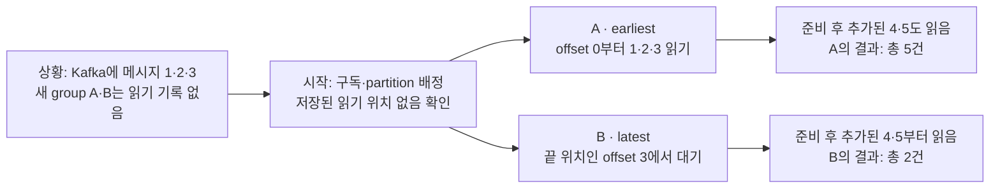
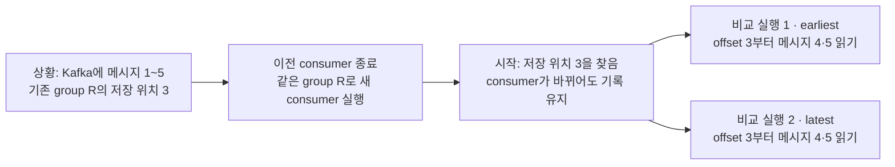
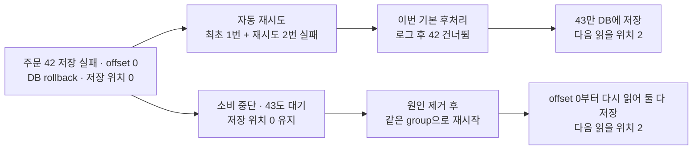
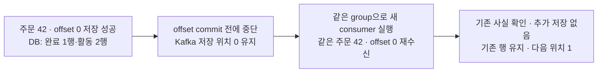

# Kafka 설정 비교 실험

Kafka 설정을 하나씩 바꿨을 때 실제 동작이 어떻게 달라지는지 확인하는 문서다. 조건·흐름도·관찰 결과·검증 범위와 아직 고르지 않은 값을 함께 둔다.

비교 결과를 보고 사용자가 업무용 값을 선택한다. 실제로 채택한 설정·이유·대안은 ADR에 기록하고 이 문서를 근거로 연결한다. 기본값·test profile의 자동 구독 없는 상태는 [ADR 0040](../adr/0040-prepare-order-event-receiving-without-auto-subscription.md), local profile 활성화는 [ADR 0050](../adr/0050-create-order-topics-in-compose-and-enable-local-events.md), 현재 설계는 [design.md](design.md#consumer-error-handler)를 따른다.

| 비교 항목 | 실제로 확인한 것 | 업무용 선택 상태 |
| --- | --- | --- |
| [첫 읽기 위치](#initial-offset-experiment) | 새 group의 earliest/latest와 기존 group의 저장 위치 우선 | earliest를 주문용 factory에 반영 |
| [같은 group의 consumer 수](#consumer-count-experiment) | partition 2개에서 consumer 1·2·3개 배정. 이후 [3개·3개 실제 저장](#three-consumer-purchase-experiment)도 검증 | `order-events` partition 3개, 로컬 streamer 1대·concurrency 3으로 적용 |
| [DB 저장 실패 처리](#failure-handling-experiment) | 기존 방식 비교 뒤 [선택한 2회·1초/2초·중단 조합](#selected-db-retry-experiment) 검증 | 당시 2회·1초/2초를 채택했다가 ADR 0053에서 1초부터 2배·최대 30초·합 5분으로 바꿔 업무용 오류 처리기에 연결 |
| [DB 저장 완료 후 재전달](#db-commit-replay-experiment) | 저장 성공 뒤 offset commit 전 중단·같은 record 재수신·추가 저장 없음 | 당시 RECORD·MI 검증을 보존. 현재 BATCH·동일 사실 no-op으로 연결([13절](#batch-adoption-verification)) |
| [메시지 오류 DLQ](#dlq-delivery-experiment) | 실제 DLQ 발행 성공·거절·복구와 원본 offset 보호 | `order-events-dlt`로 업무용 오류 처리기에 연결, 전송 실패 시 중단 |
| [복제와 broker 장애](#replication-failure-experiment) | 데이터 broker 1대 중단·리더 교체·ISR 1 쓰기 거절·복구·내부 offset 복제 | 로컬 Compose에 적용(ADR 0050). `min.insync` 1·2의 유실 비교는 [구현 기록 33절](implementation-log.md#min-isr-loss-experiment) |
| [consumer ack](#manual-ack-experiment) | MANUAL/IMMEDIATE의 ack 직후 위치, DB 실패·복구, IMMEDIATE의 no-op 재전달 | 당시 MI 채택·연결 기록. 현재 BATCH로 대체(ADR 0054) |
| [BATCH / MANUAL_IMMEDIATE](#batch-ack-experiment) | 한 poll의 첫 주문 DB commit 뒤 중단, 재시작 시 재전달 범위와 최종 구매 활동 비교 | 사용자 선택으로 BATCH 적용. [ADR 0054](../adr/0054-commit-order-consumer-offsets-per-poll.md)·[업무용 검증](#batch-adoption-verification) |
| [DLT 지연 실패](#dlt-timeout-experiment) | 재시도 가능한 실제 거절로 약 120.1초 대기·원본 위치 보호·중단·복구 확인 | 실효값 확인 완료. 기본 대기를 받아들임([ADR 0055](../adr/0055-accept-default-delivery-timeout-for-dead-letter-publishing.md)) |
| [같은 이벤트의 사실 충돌](#conflicting-fact-experiment) | 기존 수량 유지, DLQ 후 정상 주문 진행 / 중단·같은 충돌 재수신 비교 | DLQ 분리 후 계속 처리, 업무용 오류 처리기에 연결 |

실험은 업무용 클러스터와 분리한 Testcontainers 환경에서 했다. 실험용 partition 수·consumer 수·timeout을 업무용 설정으로 채택한 것은 아니다. 새 비교도 한 번에 한 항목만 진행한다.

<a id="selected-verification-status"></a>

## 선택 완료와 검증 상태

선택한 설정이 있다는 것, 격리 실험에서 실행한 것, 업무용 설정에 적용한 것은 구분한다. 아래는 새 실험을 포함한 현재 검증 범위다. 과거 실험의 조건·결과는 각 절에 보존한다.

| 선택한 내용 | 실제 검증한 범위 | 남은 적용·검증 |
| --- | --- | --- |
| earliest | 실제 Kafka의 reset 비교와 실제 주문용 factory의 실효 earliest 설정 확인 | 운영 배포. 로컬 활성화·실패 정책 연결은 완료 |
| partition 3개·같은 group 전체 consumer 3개 | [3개 멤버가 partition을 하나씩 맡고 실제 DB 저장·같은 group 재시작](#three-consumer-purchase-experiment) | 처리량·lag·부하 측정, 운영 배포 구성 |
| (당시) DB 재시도 2회·1초/2초·소진 시 중단 → (현재, ADR 0053) 1초부터 2배·최대 30초·합 5분 뒤 중단 | 당시 값: [세 번째 시도 성공 / 세 번 실패 뒤 중단](#selected-db-retry-experiment). 현재 값의 동작은 짧은 값으로 실제 listener에서 검증([구현 기록 34절](implementation-log.md#long-consumer-retry)) | 실제 DB 서버 중단, 운영 값(5분) 그대로의 실행 |
| 메시지 자체 오류는 DLQ | [실제 broker의 발행 성공·거절, 미확인 시 offset 보호, 원문·출처 보존, 업무 완료 미생성](#dlq-delivery-experiment) | 보존·관찰·운영 재처리. 현재 BATCH와 업무용 handler 결합은 [13절](#batch-adoption-verification), 당시 MI 결과는 26절에 보존 |
| group.id=purchase-activity | [격리 멤버 3개의 재시작](#three-consumer-purchase-experiment), 실제 annotation listener의 동일 group 정상/논리적 중복 처리 | 운영 배포. 이름 자체의 성능 비교는 필요 없음 |
| 복제 수 3·min ISR 2·acks=all | [실제 데이터 broker 3대에서 1대 장애·리더 교체 후 성공, ISR 1 거절·복구 후 기존 기록 유지](#replication-failure-experiment) | 로컬 Compose 반영 완료. KRaft controller quorum 장애는 미검증 |
| broker 자동 생성 끔·내부 offset 복제 수 3 | [격리 broker 3대의 실효값 조회, 실제 __consumer_offsets의 모든 partition RF3·ISR3 및 복구 후 commit 1 유지](#replication-failure-experiment) | 로컬 Compose·init 적용 완료, 실제 `__consumer_offsets` RF3 확인 |
| 완료 기록·활동의 같은 DB TX와 동일 사실 no-op | 실제 MySQL rollback·유일 제약 경쟁과 실제 Kafka의 DB commit 뒤 재전달·기존 행 유지 | 업무용 listener·ack·오류 처리기에 연결 완료 |
| 주문용 BATCH | [BATCH/MI 비교](#batch-ack-experiment), 실제 listener의 정상·논리적 중복·같은 offset 재전달과 업무용 오류 처리기의 실패·복구([13절](#batch-adoption-verification)) | 코드·설정 적용 완료. 운영 다중 consumer 배포·성능은 미검증 |

같은 eventId로 다른 수량이 온 충돌은 [10절](#conflicting-fact-experiment)의 비교 후 DLQ 분리·정상 주문 계속 처리로 선택했다([ADR 0047](../adr/0047-quarantine-conflicting-order-confirmation-facts.md)). 기존 사실을 덮어쓰지 않는 DB 규칙은 유지하며 업무용 오류 처리기에서 DLQ로 분류한다(ADR 0049). 비교 결과와 이후 채택을 구분한다.

group 이름은 [ADR 0045](../adr/0045-use-purchase-activity-consumer-group.md)의 purchase-activity이며 실제 주문용 listener에도 연결했다. 기본값·test profile은 자동 구독 0개이고, local profile에서만 켠다. 업무용 오류 처리기·topic 생성은 적용했다. 기존 실험의 topic/group 이름과 수치는 당시 격리 조건으로 보존한다. 실제 annotation listener의 현재 BATCH 연결 검사는 [구현 기록 37절](implementation-log.md#batch-adoption)에 둔다. 23절의 기존 MI 실행은 당시 기록이다.

<a id="initial-offset-experiment"></a>

## 1. 첫 읽기 위치: earliest / latest

earliest/latest에 따라 처음 읽는 메시지가 어떻게 달라지는지 비교했다. 업무용 소비는 아직 활성화하지 않았으며, 공통 kafka.yml의 latest는 기존 값일 뿐 사용자가 새로 채택한 구매 활동 정책이 아니다.

**비교한 업무 질문은 “읽기 위치 기록이 없는 새 consumer group으로 처음 구독할 때, 그 전에 Kafka에 쌓인 주문 확정 메시지도 구매 활동에 반영할 것인가?”다.** DB의 처리 완료 이벤트 기록과는 별개로 Kafka consumer group의 첫 읽기 위치를 정하는 선택이다. 기존 group이 저장된 위치부터 재시작하는 경우와 구분한다.

### 선택 상태 — 최초 비교 뒤 earliest 채택·factory 반영

사용자는 보존 중인 기존 주문도 반영하도록 earliest를 선택했다([ADR 0044](../adr/0044-adopt-earliest-and-three-order-consumers.md)). 이후 실제 주문용 factory에 반영했다. 이후 업무용 오류 처리기를 연결하고 local profile에서 켰다.

### 실험 조건

- 실제 Kafka 3.5.1 Testcontainers broker 1개. 각 실험은 고유 이름의 topic을 partition 1·복제 수 1로 명시적으로 만든다. 이 수치는 offset 관찰을 위한 격리 조건이며 업무용 토픽 설정이 아니다.
- 첫 실험은 같은 topic에 서로 다른 새 consumer group 두 개를 붙여 각각 earliest/latest로 읽는다. 자동 commit은 끄고 시작 시 committed offset이 없는 것을 실제 조회한다.
- 먼저 producer가 기존 메시지 3건의 저장을 확인한다. 두 그룹을 구독·배정하고 latest의 position이 3으로 초기화된 것을 확인한 **뒤에** 새 메시지 2건을 보낸다.
- 메시지는 before-1 등 실험용 문자열이다. 실제 PG 주문·JSON parser·DB handler·Spring listener는 사용하지 않는다. broker와 client는 실험 종료 때 정리한다.

### 실험 1: 읽기 위치 기록이 없는 새 consumer group의 첫 구독

**상황:** Kafka에는 메시지 1·2·3이 이미 있지만, 이번에 만들 group A와 B는 이 topic을 읽은 기록이 전혀 없다. 각 group에 consumer 한 개씩을 실행해 비교한다. A/B는 설명용 이름이며 실제 테스트에서는 매번 새 group.id를 만든다.

**시작 동작:** consumer가 구독하고 partition을 배정받으면 자기 group의 저장된 읽기 위치를 찾는다. 이 실험에서는 둘 다 없으므로 A는 earliest, B는 latest로 첫 위치를 정한다.



그림의 메시지 1·2·3은 테스트의 before-1·before-2·before-3, 메시지 4·5는 after-4·after-5다. **메시지 번호 4의 offset은 3**이다. offset은 이 partition에서 0부터 시작하므로 메시지 번호와 구분한다.

**새 consumer 프로그램인지보다 그 group의 해당 partition에 유효한 저장 위치가 있는지가 기준이다.** 기존 group.id를 쓰고 유효한 기록이 남아 있다면 아래 실험 2처럼 이어 읽는다. 재시작하더라도 기록이 없거나 유효하지 않으면 reset이 적용될 수 있다.

| 설정 | 미리 쌓인 3건에서 실제 읽은 것 | 나중에 보낸 2건에서 실제 읽은 것 | 총 읽은 수 |
| --- | --- | --- | --- |
| earliest | before-1·before-2·before-3, offset 0·1·2 | after-4·after-5, offset 3·4 | 5건 |
| latest | 없음 | after-4·after-5, offset 3·4 | 2건 |

latest는 이 실험에서 기존 마지막 메시지 before-3도 읽지 않고 끝 위치 3에서 기다렸다. 이후 메시지가 오자 읽었다. earliest는 남아 있는 기존 메시지부터 읽은 뒤 새 메시지도 이어 읽었다.

두 consumer가 읽은 뒤에도 Kafka의 end offset은 5였고 5건 모두 남아 있었다. latest가 기존 3건을 읽지 않은 이유는 메시지 삭제가 아니라 해당 그룹의 시작 위치다. “켜진 뒤”라는 설명의 기준을 분명히 하려고 실험에서는 latest의 배정·position 초기화를 확인한 뒤 새 메시지를 보냈다.

### 실험 2: 같은 그룹에 유효한 committed offset이 있는 경우

**상황:** 별도 topic에 메시지 1~5가 모두 있고, 기존 group R에는 **다음에 읽을 offset 3**이 저장되어 있다. 따라서 이어 읽을 메시지는 offset 3에 있는 **메시지 4**다. R은 설명용 이름이며 실험 1의 A/B와 다른 group이다.

**시작 동작:** 이전 consumer를 종료하고 새 consumer를 **같은 group.id인 R**로 실행한다. Kafka에 남아 있는 R의 읽기 위치 3을 찾아 거기서 이어 읽는다. consumer 객체가 새로 만들어졌어도 group의 기록은 남는다.



두 갈래는 **순서대로 따로 실행한 비교**다. earliest consumer를 종료한 뒤 latest consumer를 같은 group으로 실행했다. 둘 다 새 위치를 commit하지 않아 비교 중 저장 위치는 계속 3이다.

실제 테스트에서는 message-1~message-5를 offset 0~4로 저장하고, 준비용 consumer가 5건을 읽은 뒤 다음 읽을 위치 **3을 명시적으로 commit**해 이 조건을 만들었다. 업무 처리나 DB 저장을 3건 완료했다는 뜻은 아니다. 이후 새 consumer들이 실제로 어디부터 읽는지 확인했다.

| 재시작 설정 | 이미 저장된 다음 읽을 위치 | 실제 읽은 결과 |
| --- | --- | --- |
| earliest | offset 3 | message-4·message-5, offset 3·4 |
| latest | offset 3 | message-4·message-5, offset 3·4 |

**earliest를 쓴다고 재시작할 때마다 처음부터 읽는 것은 아니다.** 이 실험에서는 두 설정 모두 저장된 위치부터 이어 읽었다. `auto.offset.reset`은 초기 offset이 없거나 현재 기록된 offset이 서버에 더 이상 없는 경우에 적용된다. [Kafka 공식 consumer 설정](https://kafka.apache.org/38/generated/consumer_config.html#auto.offset.reset)

### 업무 의미와 선택 기준

| 원하는 동작 | 선택 후보 | 주문 예시에 적용하면 |
| --- | --- | --- |
| 읽기 위치 기록이 없는 새 group의 첫 구독에서 기존 주문까지 구매 활동에 반영 | earliest | 먼저 확정된 주문 3건과 나중 주문 2건을 모두 읽는 시작점 |
| 새 그룹의 시작 위치 초기화 이후 들어오는 주문부터 수집 | latest | 기존 주문 3건은 이 그룹에서 읽지 않고 새 주문 2건부터 읽는 시작점 |

읽기 위치 기록이 없는 새 group에서도 기존 확정 주문을 읽으려면 earliest가 그 목적에 맞는다. latest를 선택한다면 그 group의 첫 시작 위치 초기화 전에 Kafka에 쌓인 주문을 이 그룹이 읽지 않는다는 업무 의미를 받아들여야 한다. 기존 group의 유효한 committed offset을 이 설정으로 덮어쓰는 선택은 아니다. **사용자는 earliest를 선택했고 주문용 factory에 반영했다. 기본 구독은 비활성이며 업무용 error handler·배포·활성화는 후속이다.**

### 검증 범위와 한계

- 실제 subscribe·partition 배정·poll·position·committed offset을 조회했다. seek나 테스트의 강제 assign으로 첫 reset 동작을 대신하지 않았다.
- 첫 실험의 새 그룹은 committed offset이 없었다. 두 번째 실험은 유효한 committed offset이 우선하는 조건이며, retention 이후 범위 밖 offset은 재현하지 않았다.
- earliest는 Kafka에 **현재 남아 있는** 가장 오래된 위치다. 보존 기간이 지나 삭제된 데이터나 DB commit 후 Kafka로 보내지 못한 이벤트까지 복구하는 설정은 아니다.
- 업무용 listener·ack/error handler·DB commit과 offset의 경계·구매 활동 멱등 재전달·다중 broker 장애를 검증한 실험이 아니다.

### Evidence

- [재현 가능한 실제 Kafka 실험 코드](../../apps/commerce-streamer/src/test/java/com/loopers/kafka/KafkaOffsetResetExperimentTest.java)
- [실행 기록과 검사 결과](implementation-log.md#initial-offset-experiment)
- 새 실험 2건·ArchUnit 1건 통과, 실패·오류·skip 0. test Checkstyle 위반 0. 합친 명령 32초.

```shell
JAVA_HOME=/opt/homebrew/opt/openjdk@21/libexec/openjdk.jdk/Contents/Home \
PATH=/opt/homebrew/opt/openjdk@21/bin:$PATH \
JAVA_TOOL_OPTIONS=-Dapi.version=1.44 \
./gradlew :apps:commerce-streamer:test --tests '*KafkaOffsetResetExperimentTest' \
  :apps:commerce-streamer:checkstyleTest --offline
```

<a id="consumer-count-experiment"></a>

## 2. 같은 group의 consumer 수: 1개 / 2개 / 3개

사용자는 앞으로도 비교 결과를 확인한 뒤 설정을 직접 고르되 한 번에 한 항목만 진행하도록 요청했다. 이번 비교 항목은 **같은 consumer group 안에서 동시에 실행하는 consumer 수**다. group의 분리 방식·ack/error handler 등 다른 설정은 이번에 비교하거나 선택하지 않는다.

과제의 group 배정 실험 조건에 맞춰 partition 2개인 격리 topic에서 consumer 1→2→3개의 안정된 배정을 관찰한다. 업무용 partition 3개 계획과는 별도 조건이며, 공통 batch factory에 원래 적힌 concurrency=3도 구매 활동용으로 새로 채택한 값이 아니다.

### 선택 상태 — 선택 완료·로컬 적용

사용자는 업무용 partition 3개·같은 group 전체 consumer 3개를 시작 구성으로 선택했다([ADR 0044](../adr/0044-adopt-earliest-and-three-order-consumers.md)). 아래 실험은 partition 2개의 관찰이며 새 구성의 최적 처리량을 증명한 것은 아니다. 조건부 주문용 factory/listener는 구현했고 earliest도 반영했다. 로컬은 streamer 1대에 concurrency 3으로 적용했고(ADR 0050), 운영 배포 구성은 정하지 않았다.

### 실험 조건

- 실제 Kafka 3.5.1 Testcontainers broker 1개, 고유 topic의 partition 2개·복제 수 1. 업무 클러스터와 분리한다.
- 한 group에 C1을 먼저 붙이고 C2, C3을 차례로 추가한다. 각각 별도의 KafkaConsumer와 poll 스레드를 사용한다.
- 실제 subscribe·poll로 자동 배정을 사용한다. assign/seek로 배정을 만들어 넣지 않는다.
- 매 단계 broker의 group 상태가 STABLE이고 멤버 수가 기대값과 같아야 한다. AdminClient의 배정과 각 consumer가 자기 poll 스레드에서 읽은 assignment가 일치하는 것도 확인한다.
- 각 단계에서 P0·P1이 중복·누락 없이 정확히 한 번씩 배정되는 것을 검증한다. topic은 비어 있고 offset commit은 수행하지 않는다. 처리 속도나 DB 결과를 비교하는 실험이 아니다.

### 실제 관찰 결과

| 같은 그룹의 consumer 수 | C1 담당 | C2 담당 | C3 담당 | 파티션을 받은 consumer 수 |
| --- | --- | --- | --- | --- |
| 1개 | P0·P1 | 미실행 | 미실행 | 1개 |
| 2개 | P0 | P1 | 미실행 | 2개 |
| 3개 | P0 | P1 | 할당 없음·대기 | 2개 |

```text
consumer 1개
  C1 → P0, P1

consumer 2개
  C1 → P0
  C2 → P1

consumer 3개
  C1 → P0
  C2 → P1
  C3 → 할당 없음
```

C3가 고장 나서 비어 있는 것이 아니라, 같은 그룹에서 나눠 맡을 partition이 2개이기 때문에 한 멤버의 할당이 비어 있었다. 구체적으로 C1이 P0를 받았다는 것은 이 실행의 관찰값이며 어떤 멤버가 어떤 partition을 받는지 고정한 계약은 아니다.

Kafka는 같은 그룹의 각 partition을 한 consumer에게 배정하고 멤버가 추가되면 재배정한다. [KafkaConsumer 공식 문서](https://kafka.apache.org/38/javadoc/org/apache/kafka/clients/consumer/KafkaConsumer.html)

### 이 비교로 정할 수 있는 것과 아직 모르는 것

- 한 consumer가 여러 partition을 맡을 수 있다는 것과, partition 2개에서는 3번째 consumer에 배정할 partition이 없다는 것을 확인했다.
- consumer 2개가 실제로 2배 빠르다는 결과는 아니다. 메시지 처리량·lag·DB 부하·실패 시 복구 속도는 측정하지 않았다.
- 비교한 질문은 “구매 활동 group에서 몇 개의 consumer를 동시에 돌릴 것인가?”였고 사용자는 전체 3개를 시작 구성으로 선택했다. 업무용 partition 수와 실제 처리량 요구를 함께 봐야 한다.
- 업무용 topic의 계획은 partition 3개이므로 이번 2개 조건에서 본 대기 상태를 그대로 업무 환경에 적용하지 않는다. 이 실험만으로 2개가 최적이라고 확정하지 않는다.
- 실제 Spring listener factory의 concurrency를 바꾸는 실험이 아니라 KafkaConsumer 멤버 수의 비교다. 업무용 factory·group id·첫 읽기 위치·ack/error handler와 기본 비활성은 유지한다.

### Evidence

- [실제 Kafka 배정 실험](../../apps/commerce-streamer/src/test/java/com/loopers/kafka/KafkaConsumerCountExperimentTest.java)
- [실행 기록](implementation-log.md#consumer-count-experiment)
- 실험 1건(세 단계)·ArchUnit 1건 통과. 실패·오류·skip 0, test Checkstyle 위반 0, 합친 명령 23초. client·poll 스레드·broker는 종료했다.

```shell
JAVA_HOME=/opt/homebrew/opt/openjdk@21/libexec/openjdk.jdk/Contents/Home \
PATH=/opt/homebrew/opt/openjdk@21/bin:$PATH \
JAVA_TOOL_OPTIONS=-Dapi.version=1.44 \
./gradlew :apps:commerce-streamer:test --tests '*KafkaConsumerCountExperimentTest' \
  :apps:commerce-streamer:checkstyleTest --offline
```

<a id="failure-handling-experiment"></a>

## 3. DB 저장 실패 처리: 자동 재시도 / 소비 중단

**비교한 질문은 “주문 확정 메시지의 DB 저장이 실패하면, consumer가 어떤 방식으로 다시 처리하게 할 것인가?”였다.** DB 성공 뒤 읽기 위치를 commit한다는 순서는 유지하고, 실패를 처리하는 방식만 비교한다.

### 선택 상태 — 오류 분기 채택·업무용 오류 처리기 연결

사용자는 이후 **메시지 자체 오류는 DLQ, 재시도 대상 DB 오류는 제한 재시도 후 소진 시 소비 중단·같은 group 재시작**을 채택했다([ADR 0041](../adr/0041-separate-invalid-messages-from-db-retry-exhaustion.md)). DB 재시도 소진만을 이유로 정상 메시지를 DLQ로 보내지 않는다. 횟수는 [ADR 0042](../adr/0042-use-two-db-retries-before-stopping-consumer.md)에서 최대 2회로 선택했다. 최초 시도 포함 최대 3번이며 그 전에 성공하면 정상 처리를 이어간다. 같은 이벤트로 DB 저장을 다시 시도하는 횟수이며 매번 Kafka에서 새로 읽어야 한다는 뜻은 아니다. 간격은 [ADR 0043](../adr/0043-increase-db-retry-delays-from-one-to-two-seconds.md)에서 첫 재시도 전 1초·둘째 전 2초로 선택했다. 상세 오류 분류·중단 범위·재시작 주체와 DLQ의 전송 실패·관찰·재처리 경로는 미정이다.

아래 결과는 실험용 container에 연결한 재시도 후 기본 skip과 즉시 중단을 비교한 당시 관찰이다. 당시에는 선택한 제한 재시도 후 중단 조합과 DLQ를 검증하지 않았으며, 후속 검증은 [5절](#selected-db-retry-experiment)·[6절](#dlq-delivery-experiment)에 추가했다. 업무용 listener·factory·ack mode는 아직 연결하지 않았다. 실험의 200ms·기본 skip은 업무용으로 채택하지 않았다.

### 실험 조건

- 실제 Kafka 3.5.1·MySQL 8.0과 프로젝트의 Spring Kafka 3.3.4를 사용했다. 각 방식은 고유 topic·group, partition 1개·복제 수 1로 격리했다.
- 먼저 **주문 42를 offset 0**, **주문 43을 offset 1**에 저장했다. 두 주문 모두 상품 7: 5개·상품 8: 3개다. 정상 결과는 완료 기록 2행·구매 활동 4행이다.
- 두 방식 모두 Kafka에 다음 읽을 위치 **0**을 AdminClient로 미리 저장했다. 첫 읽기 위치 설정의 영향을 분리하기 위한 준비이며, 복구 과정에서 offset을 강제로 바꾸지 않았다.
- 테스트에서만 record listener·AckMode.RECORD·자동 commit 끔·동기 offset commit을 공통으로 사용했다. listener는 기존 parser→handler→실제 MySQL TX가 성공한 뒤 반환한다. 두 방식의 공통 실험 조건이며 업무용 ack mode 채택이 아니다.
- 주문 42의 **상품 8 저장 직전**에 repository spy로 예외를 주입했다. 상품 7과 완료 기록이 TX 안에 각각 1행 존재하는 것을 확인하고 실패시켰다. 실제 DB를 끄거나 SQL 장애를 발생시킨 것은 아니며, 실제 MySQL 트랜잭션의 rollback을 확인하는 저장 경로의 오류 주입이다. 주문 43에는 오류를 주입하지 않았다.
- 오류는 **한 번만 발생**하는 조건과 **주문 42를 처리할 때마다 계속 발생**하는 조건으로 나눴다. 두 조건마다 아래 두 방식을 각각 실행해 총 네 흐름을 비교했다.

| 비교 방식 | 실험에서 연결한 설정 | 끝까지 실패하면 |
| --- | --- | --- |
| 자동 재시도 + 기본 후처리 | DefaultErrorHandler, 200ms 간격·최대 2회 재시도 | 기본 recoverer가 로그를 남긴 뒤 실패 record를 건너뜀 |
| 소비 중단 | CommonContainerStoppingErrorHandler | 해당 listener container 중단. 실험자가 원인을 제거하고 같은 group으로 재시작 |

여기서 **최대 2회 재시도는 최초 시도까지 합쳐 총 3번**이다. `recoverer`는 재시도를 다 쓴 뒤 호출되는 후처리다. 이번 기본 후처리의 `recovered`는 **DB 저장 성공이라는 뜻이 아니다.** 별도 실패 topic으로 보내지도 않았다. 이 설정의 동작은 [Spring Kafka 공식 오류 처리 문서](https://docs.spring.io/spring-kafka/reference/3.3/kafka/annotation-error-handling.html)와 실제 실행 결과를 함께 대조했다.

### 두 방식의 첫 실패 직후 — 공통으로 확인한 것

listener에서 DB 예외가 돌아온 뒤, error handler로 넘기기 전에 잠시 대기시키고 별도 스레드에서 조회했다.

| 확인한 것 | 실제 값 |
| --- | --- |
| 주문 42의 상품 7·8 구매 활동 | 0행 — 앞서 넣은 상품 7도 rollback |
| 주문 42의 완료 기록 | 0행 — 활동과 함께 rollback |
| 주문 43의 처리 | 아직 시작하지 않음 |
| Kafka에 저장된 다음 읽을 위치 | 0 — 실패한 주문 42를 지나가지 않음 |

### 실험 A: 한 번만 실패하면

| 확인한 것 | 자동 재시도 + 기본 후처리 | 소비 중단 |
| --- | --- | --- |
| 첫 실패 다음 행동 | 주문 42를 자동 재시도해 성공, 이어 주문 43 저장 | container 중단. 직접 재시작하기 전까지 두 주문 모두 미저장 |
| 원인 제거·재시작 필요 | 이 조건에서는 없음 | 실험자가 같은 group으로 명시적으로 재시작 |
| 최종 읽은 순서 | 주문 42 (offset 0) → 같은 메시지 재수신 → 주문 43 (offset 1) | 중단 전 주문 42 (offset 0), 재시작 후 같은 메시지부터 읽고 주문 43 (offset 1) 처리 |
| 최종 DB | 완료 기록 2행·구매 활동 4행 | 재시작 후 완료 기록 2행·구매 활동 4행 |
| 최종 다음 읽을 위치 | 2 | 재시작 후 2 |

`주문 42 (offset 0)`은 **partition 0 안의 offset 0에 저장된 주문 42의 메시지**다. offset은 Kafka partition 안의 위치이며 DB 행 번호가 아니다. 같은 주문을 producer가 새로 보낸 것이 아니라 consumer가 같은 topic·partition·offset의 record를 다시 받은 것이다. 중단 방식은 오류가 한 번으로 끝나도 스스로 소비를 재개하지 않았다.

### 실험 B: 주문 42의 저장이 계속 실패하면

| 원인을 제거하기 전 확인한 것 | 자동 재시도 + 기본 후처리 | 소비 중단 |
| --- | --- | --- |
| 주문 42 시도 횟수 | 최초 1번 + 재시도 2번 = 3번 | 1번 |
| 그 다음 행동 | 주문 42를 건너뛰고 주문 43 저장 | container 중단, 주문 43도 미처리 |
| 주문 42의 DB 결과 | 완료 기록 0행·구매 활동 0행 | 완료 기록 0행·구매 활동 0행 |
| 주문 43의 DB 결과 | 완료 기록 1행·구매 활동 2행 | 완료 기록 0행·구매 활동 0행 |
| Kafka의 다음 읽을 위치 | **2 — 저장되지 않은 주문 42를 이미 지나감** | **0 — 주문 42에서 유지** |



중단한 쪽은 오류 주입을 해제하고 같은 group으로 다시 시작했다. 별도 seek나 offset 재설정 없이 **주문 42 (offset 0) → 주문 43 (offset 1)**을 읽었고 완료 기록 2행·구매 활동 4행이 저장됐다. 실패 기록을 건너뛴 retry 쪽은 이 복구 과정을 실행하지 않았다.

### 이 결과로 판단할 것과 한계

- 잠깐의 오류는 자동 재시도로 넘길 수 있었다. 중단 방식은 이 경우에도 복구·재시작 작업이 필요했다.
- 계속 실패할 때 **이번 재시도 횟수와 기본 후처리의 조합**은 미저장 주문을 지나갔다. 모든 재시도 방식이 실패 메시지를 건너뛴다는 뜻은 아니다. 횟수를 정하는 것과 끝까지 실패했을 때의 처리를 함께 결정해야 한다.
- 중단은 이 실험의 consumer 한 개가 담당한 partition 전체를 멈췄다. 뒤의 정상 주문 43도 기다렸다. 다른 group·partition까지 모두 멈추는지 실험한 것은 아니다.
- 실제 Spring Kafka container의 오류 처리·중단·재시작과 Kafka committed offset, 실제 MySQL rollback·재저장을 검증했다. 업무용 `@KafkaListener`를 등록하거나 로컬 3대 클러스터의 설정을 바꾸지 않았다.
- 이 절의 실패한 주문은 DB가 rollback된 상태에서 다시 읽었다. DB commit 뒤 offset 미커밋 중단은 [다음 실험](#db-commit-replay-experiment)에서 별도로 확인했다. 영구 오류 분류·재시도 소진 후 중단·별도 실패 topic·운영 경보·실제 DB 서버 중단은 이 비교에서 검증하지 않았다.

### Evidence

- [재현 가능한 실패 처리 비교 실험](../../apps/commerce-streamer/src/test/java/com/loopers/kafka/KafkaFailureHandlingExperimentTest.java)
- [실행 기록과 검사 범위](implementation-log.md#failure-handling-experiment)
- 실험 2건(일시·지속 오류 각각 두 방식)·ArchUnit 1건 통과. 실패·오류·skip 0, test Checkstyle 위반 0. 합친 명령 57초. 이전 전체 58건·reset 실험·consumer 수 실험을 다시 실행한 결과는 아니다.
- container·consumer·producer·AdminClient·테스트 broker를 정리하고 DB fixture의 연결 풀도 종료했다.

```shell
JAVA_HOME=/opt/homebrew/opt/openjdk@21/libexec/openjdk.jdk/Contents/Home \
PATH=/opt/homebrew/opt/openjdk@21/bin:$PATH \
JAVA_TOOL_OPTIONS=-Dapi.version=1.44 \
./gradlew :apps:commerce-streamer:test --tests '*KafkaFailureHandlingExperimentTest' \
  :apps:commerce-streamer:checkstyleTest --offline
```

<a id="db-commit-replay-experiment"></a>

## 4. DB 저장 완료 후 offset 미커밋 상태에서 재시작

**상태: 당시 RECORD 조건의 실험 완료. 후속으로 MANUAL_IMMEDIATE 선택·검증, 업무용 listener에 연결.** 이미 채택한 동일 사실 no-op 결정([ADR 0039](../adr/0039-record-order-confirmation-and-purchases-atomically.md))은 유지한다. 아래 실험을 ack mode·error handler 채택으로 취급하지 않으며 후속 결과는 [9절](#manual-ack-experiment)에 둔다.

앞의 실패 처리 실험은 **DB에 저장되지 않은 메시지**를 다시 받았다. 이번에는 **저장이 끝난 메시지**를 Kafka에서 다시 받아 기존 기록을 유지하는지 확인한다.

### 실험 조건과 중단 지점

- 실제 Kafka 3.5.1·MySQL 8.0·Spring Kafka 3.3.4와 기존 parser→DB handler를 사용했다. 고유 topic(partition 1·복제 수 1)과 group으로 격리했다.
- 주문 42의 메시지를 **딱 한 번** 전송했다. partition 0·offset 0이며 품목은 상품 7: 5개·상품 8: 3개다. group의 다음 읽을 위치는 실험 준비 때 0으로 저장했다.
- DB handler가 정상 반환한 직후, Kafka listener가 반환하기 전 test hook에서 잠시 대기했다. 별도 스레드의 DB 조회로 완료 1행·활동 2행이 실제 commit된 것을 확인했다.
- hook에서 예외를 발생시켜 테스트 전용 중단 error handler로 첫 container를 종료했다. **DB는 그대로 두고 offset만 commit되지 않는 경계**를 만들었다. OS 프로세스를 강제 종료한 실험은 아니다.
- 별도 container·consumer 객체를 같은 group으로 시작했다. 재시작 때 seek·수동 partition 배정·offset 재설정을 사용하지 않았다.
- 실험용 공통 설정은 자동 commit 끔·AckMode.RECORD·동기 offset commit·배정 시 offset commit 끔이다. 설정값은 업무용 선택이 아니다. 유효한 committed offset 0이 있어 첫 위치 reset으로 재전달을 만들어 낸 것도 아니다.



### 실제 관찰 결과

| 시점 | Kafka에 저장된 다음 읽을 위치 | 완료 기록 | 구매 활동 |
| --- | --- | --- | --- |
| 첫 DB commit 뒤 hook에서 대기 | 0 | 1행 | 상품 7·8 각각 1행, 총 2행 |
| 첫 container 중단 완료 | **0 유지** | 1행 유지 | 2행 유지 |
| 새 consumer에서 같은 메시지 처리 완료 | **1로 진행** | 기존 1행 유지 | 기존 2행 유지 |

두 번 받은 record의 **topic·partition·offset·key·본문이 모두 같았다.** DB 활동과 완료 기록의 행 ID·주문·상품·수량·확정 시각·사실 snapshot도 그대로였다. 저장 포트 호출은 전체 실험에서 활동 2회·완료 기록 1회뿐이어서 두 번째 처리는 추가 insert 없이 정상 종료했다.

첫 consumer의 현재 position은 이미 1이었지만 Kafka에 저장한 committed offset은 0이었다. 첫 consumer가 종료되자 새 consumer는 이 저장 위치 0에서 다시 받았다. 두 번째 처리가 정상 반환한 뒤 committed offset이 1이 됐다. Kafka의 end offset도 1이라 producer가 새 메시지를 보낸 결과가 아니다.

### 이 실험으로 확인한 범위

- DB commit과 Kafka offset commit 사이에 중단되면 **이미 저장된 메시지도 실제로 재전달**될 수 있었다.
- 현재 handler는 재전달된 동일 사실을 기존 완료 기록과 대조해 추가 저장 없이 처리했고, 이후 읽기 위치는 정상 진행했다.
- 테스트 전용 container·hook의 당시 결과다. ack 방식은 이후 MANUAL_IMMEDIATE로 선택했으며 실제 업무용 `@KafkaListener` 활성화·상세 error handler 연결은 아직이다. OS 강제 종료·broker 장애·rebalance 경쟁·다른 사실 충돌의 Kafka 경로를 검증한 실험은 아니다.

### Evidence

- [DB commit 후 재전달 실험 코드](../../apps/commerce-streamer/src/test/java/com/loopers/kafka/KafkaReplayAfterDbCommitExperimentTest.java)
- [실행 기록과 검사 범위](implementation-log.md#db-commit-replay-experiment)
- 새 실험 1건·ArchUnit 1건 통과. 실패·오류·skip 0, test Checkstyle 위반 0. 합친 명령 41초. 이전 전체 58건과 다른 Kafka 실험을 다시 실행한 결과는 아니다.
- container·client·테스트 broker 정리, DB 연결 풀 종료를 확인했다.

```shell
JAVA_HOME=/opt/homebrew/opt/openjdk@21/libexec/openjdk.jdk/Contents/Home \
PATH=/opt/homebrew/opt/openjdk@21/bin:$PATH \
JAVA_TOOL_OPTIONS=-Dapi.version=1.44 \
./gradlew :apps:commerce-streamer:test --tests '*KafkaReplayAfterDbCommitExperimentTest' \
  :apps:commerce-streamer:checkstyleTest --offline
```

<a id="selected-db-retry-experiment"></a>

## 5. 선택한 DB 재시도: 1초 → 2초 → 성공 또는 중단

**질문:** 처음 실패한 주문을 1초 뒤, 다시 실패하면 2초 뒤 재시도해서 총 세 번 처리했을 때 성공과 지속 실패가 어떻게 갈리는가?

실제 Kafka 3.5.1·MySQL 8.0·Spring Kafka 3.3.4에서 기존 parser·DB handler를 호출했다. 고유 topic(partition 1·복제 수 1)·group을 만들고 다음 읽을 위치를 0으로 준비했다. 주문 42 (offset 0) 다음에 주문 43 (offset 1)을 보냈다. 주문 42의 상품 8 저장 직전에 테스트 예외를 주입한다. 앞서 저장한 상품 7과 완료 기록도 같은 DB TX에서 rollback되는 조건이다.

`ExponentialBackOffWithMaxRetries(2)`에 첫 간격 1,000ms·배수 2·최대 간격 2,000ms를 설정하고, 소진 시 `CommonContainerStoppingErrorHandler`로 연결했다. 테스트용 AckMode.RECORD·자동 commit 끔·동기 commit·배정 commit 끔을 사용한다. 이 ack mode와 중단 범위를 업무용으로 채택한 것은 아니다.

| 상황 | 실제 주문 42 처리 | 멈춘 시점의 DB·저장 위치 | 이후 결과 |
| --- | --- | --- | --- |
| 처음 두 번 실패, 세 번째 성공 | 최초 실패 → 1초 대기 → 실패 → 2초 대기 → 성공 | 첫 실패의 완료 기록 0·활동 0·offset 0 | 중단 없이 주문 43 처리. 완료 기록 2·활동 4·offset 2 |
| 계속 실패 | 최초 실패 → 1초 대기 → 실패 → 2초 대기 → 실패·중단 | 완료 기록 0·활동 0·offset 0. 주문 43도 처리하지 않음 | 주입 오류 제거·같은 group 재시작 → 주문 42·43 저장. 완료 기록 2·활동 4·offset 2 |

재시도한 것은 **같은 주문 42의 같은 partition·offset 0 record**다. 지속 실패 후 재시작할 때도 seek나 offset 재설정 없이 그 record를 받았다. 원인을 제거하는 것은 테스트 코드이며 자동 복구 시스템을 구현한 결과가 아니다. 실제 DB 서버를 중단하지 않았고, 업무용 예외 분류 전체도 검증하지 않았다.

실제 대기를 수행하는 `DefaultBackOffHandler`에서 요청 간격이 정확히 `[1000, 2000]`임을 확인한다. 실패 반환부터 다음 listener 진입까지의 경과 시간도 측정하며 poll·스케줄링 비용이 더해질 수 있다. Spring의 초기화 확인 호출을 실제 대기로 세지 않는다. 선택한 숫자가 성능상 최적이라는 의미는 아니다.

최신 전체 검사에서 세 번째 성공 사례의 실제 간격은 **1,041ms·2,070ms**, 지속 실패 사례는 **1,041ms·2,075ms**였다. 설정한 대기 합계 3초에 poll·스케줄링 등의 비용이 더해진 관찰값이며 API 응답 시간이나 DB 장애 복구 시간 전체를 잰 수치는 아니다.

검증 코드: [KafkaDbRetryPolicyExperimentTest](../../apps/commerce-streamer/src/test/java/com/loopers/kafka/KafkaDbRetryPolicyExperimentTest.java), 공통 조건: [KafkaPurchaseExperimentSupport](../../apps/commerce-streamer/src/test/java/com/loopers/kafka/KafkaPurchaseExperimentSupport.java). 실제 실행 수치·전체 검사 결과는 [최신 구현 기록](implementation-log.md#selected-settings-verification)에 둔다. 채택한 정책은 ADR 0041·0042·0043의 본문을 보존한다.

<a id="dlq-delivery-experiment"></a>

## 6. 메시지 오류: DLQ에 도착해야 원본 위치를 넘긴다

**후속 선택:** DLQ 전송 실패 시 원본 위치를 유지하고 소비를 중단하며 사람이 원인을 해결해 같은 group으로 재시작하는 방향을 [ADR 0048](../adr/0048-stop-consumption-on-dlq-publication-failure-and-resume-manually.md)에서 채택했다. 아래 크기 제한 복구는 테스트가 운영자 역할을 수행한 당시 결과이며, 실제 업무용 MANUAL_IMMEDIATE 오류 처리기의 적용 검증은 후속이다.

**질문:** 주문 내용이 잘못되어 업무 저장을 할 수 없을 때, DLQ 전송 성공과 실패에 따라 원본 group의 위치가 어떻게 되는가?

실제 Kafka·MySQL에서 잘못된 메시지 42 (offset 0), 정상 주문 43 (offset 1)을 순서대로 보냈다. 42의 JSON에는 필수 주문 데이터가 없어서 기존 parser가 거절한다. `DeadLetterPublishingRecoverer`가 원문 bytes와 key를 DLQ에 보내며 `setFailIfSendResultIsError(true)`로 broker 성공 확인까지 기다린다. DLQ 성공 callback 직후·원본 offset commit 직전에 테스트 hook을 멈춰 별도 스레드에서 상태를 확인했다.

| 상황 | 실제 DLQ 결과 | 그 시점의 원본 offset·DB | 복구·후속 처리 |
| --- | --- | --- | --- |
| 첫 발행 성공 | DLQ 1건, 원문·key와 원본 topic·partition·offset·group header 일치 | hook 대기 중 offset 0·완료 기록 0·활동 0 | hook 해제 → 정상 주문 43만 저장 → offset 2·완료 기록 1·활동 2 |
| 첫 발행 거절 | DLQ topic의 최대 메시지 크기를 1KB로 설정해 broker가 실제 전송 거절. DLQ 0건 | 실험용 handler가 중단. offset 0·완료 기록 0·활동 0 | DLQ 제한을 1MB로 복구·같은 group 재시작 → 같은 offset 0을 DLQ에 1건 저장 → 43 처리·offset 2 |

잘못된 메시지는 약 6KB이므로 크기 제한으로 거절을 재현할 수 있다. **이 실험 당시에는 DLQ 크기·이름·복제 수나 실패 시 중단 정책을 선택하지 않았다.** 이후 ADR 0048에서 중단·사람의 복구 후 재시작 방향을 채택했으며 임시 topic의 수치는 채택하지 않았다.

DLQ로 전달한 42에는 DB 처리 완료 기록도 구매 활동도 생기지 않았다. 완료 기록은 정상 주문 43의 것 한 행뿐이다. DLQ의 관찰용 reader만 수동 assign을 쓰고 원본 group의 재시작에는 seek를 쓰지 않는다. 이 테스트는 복구 후 원본 record를 다시 DLQ로 보내는 경로까지 확인하며, DLQ 내용을 수정해 업무용 원본 topic으로 재발행하는 운영 절차는 구현하지 않았다. DLQ 성공과 원본 commit 사이의 강제 종료·DLQ 중복 방지까지 검증한 결과도 아니다.

검증 코드: [KafkaDlqDeliveryExperimentTest](../../apps/commerce-streamer/src/test/java/com/loopers/kafka/KafkaDlqDeliveryExperimentTest.java). 선택한 원칙은 [ADR 0041](../adr/0041-separate-invalid-messages-from-db-retry-exhaustion.md), 최신 실행 결과는 [구현 기록](implementation-log.md#selected-settings-verification)에 둔다.

<a id="three-consumer-purchase-experiment"></a>

## 7. partition 3개·purchase-activity consumer 3개로 실제 저장

**질문:** 선택한 같은 group의 멤버 3개가 각자 partition을 맡아 주문을 저장하고, 같은 group으로 재시작하면 이미 처리한 주문을 건너뛰어 이어 갈 수 있는가?

격리 broker 1개·고유 topic(partition 3·복제 수 1)에 테스트용 `ConcurrentMessageListenerContainer`의 concurrency를 3으로 두었다. group.id는 실제 선택한 **purchase-activity**, reset은 earliest다. 테스트 앱 한 개에서 멤버 3개를 만든 조건이며, 업무용 앱 인스턴스마다 concurrency=3을 적용하는 결정은 아니다. 복제 장애는 다음 실험과 분리한다.

| 순서 | 실제 관찰 |
| --- | --- |
| group 준비 | Admin 조회가 STABLE·멤버 3개, 각 멤버의 partition 1개 배정과 로컬 container 배정 P0·P1·P2 일치 |
| 주문 30개 발행 | 주문 1000~1029를 orderId 문자열 key의 기본 분배로 전송. 세 partition 모두 기록을 받음 |
| 실제 업무 저장 | 각 partition을 관찰된 담당 멤버 한 개가 처리. 완료 기록 30·상품별 활동 60. 각 partition의 저장 위치가 끝 위치까지 진행 |
| 같은 group의 새 container 시작 | 주문 2000 한 개 추가. 완료 기록 31·활동 62, 받은 record 총 31개·중복 0, 기존 활동 행 ID 유지 |

첫 통과 실행의 분포는 **P0 11건·P1 12건·P2 7건**이었다. key 해시 분배가 정확한 10·10·10을 보장하는 것은 아니다. 특정 consumer 이름·partition 배정을 고정 계약으로 삼지 않으며 테스트는 실제 broker 배정과 처리 멤버의 일치를 확인한다.

기존 주문을 발행하기 전에 3개 멤버의 안정된 배정을 기다렸다. 이 실험으로 최초 시작 중 rebalance 경쟁·처리량 3배·운영 부하에서의 lag나 DB 수용량을 증명하지 않는다. 새 group의 기존 메시지 읽기는 앞선 earliest/latest 실험에서 별도로 확인했다. AckMode.RECORD는 테스트 조건이며 업무용 factory는 아직 등록하지 않았다.

검증 코드: [KafkaThreeConsumerPurchaseExperimentTest](../../apps/commerce-streamer/src/test/java/com/loopers/kafka/KafkaThreeConsumerPurchaseExperimentTest.java). 선택은 ADR 0044·0045, 최신 검사 결과는 [구현 기록](implementation-log.md#selected-settings-verification)에 둔다.

<a id="replication-failure-experiment"></a>

## 8. 복제 수 3·최소 ISR 2·acks=all의 장애·복구

**질문:** 기록을 보관한 데이터 broker가 줄어들면 어떤 전송은 계속 성공하고, 어느 시점부터 거절되는가?

실제 Kafka 3.5.1 데이터 broker 3개에 partition 3·복제 수 3·min.insync.replicas=2의 고유 topic을 명시적으로 생성했다. producer는 acks=all·enable.idempotence=true·retries=3이며 세 broker의 외부 주소를 모두 bootstrap에 넣었다. 고정한 P0에 순서대로 전송해 저장 위치와 내용을 확인한다. P1·P2도 복제 수·ISR 3을 확인하지만 장애 중 발행은 P0만 관찰한다.

실행한 client는 Kafka 3.8.1·Spring Kafka 3.3.4다. 관련 전체 검사는 API 523·streamer 70·Kafka 모듈 5, 총 598건 모두 통과했다. 두 앱의 ArchUnit과 관련 Checkstyle도 통과했다. 이 수치는 선택한 업무용 listener를 등록해 전체 경로를 통합 검증했다는 뜻은 아니다.

**실험 구조는 데이터 broker 3개 + 별도 controller 1개다.** controller는 끝까지 살려 관리 quorum을 유지했다. 현재 로컬 Compose의 broker/controller 겸용 노드 3개와 다르다. 로컬 구성에서 두 노드를 끄면 controller도 과반수를 잃으므로, 그 결과를 최소 ISR 하나만의 효과로 설명할 수 없다. 별도 controller 한 개는 내결함성을 권장하는 배포안이 아니라 데이터 장애를 분리하는 테스트 조건이다.

| 단계 | P0 leader | P0 ISR | 실제 발행 결과 |
| --- | --- | --- | --- |
| 정상 | 1 | 1·2·3 | before-failure 저장, offset 0 |
| follower 2 중단 | 1 | 1·3 | one-follower-down 저장, offset 1 |
| 2 복귀·세 partition ISR 3 확인 뒤 leader 1 중단 | 2 | 2·3 | leader-failed-over 저장, offset 2 |
| follower 3도 중단·controller 유지 | 2 | 2 | NotEnoughReplicasException으로 거절. end offset 3 유지 |
| broker 1 복귀 | 2 | 1·2 | 새 producer의 after-recovery 저장, offset 3 |
| broker 3 복귀 | 2 | 1·2·3 | 모든 partition의 ISR 3 복구, 최종 P0 기록 4건·end offset 4 |

리더 ID는 이 실행의 관찰값이다. 실패 전 성공한 세 기록과 복구 후 성공한 한 기록을 정확한 순서로 읽었고 거절된 메시지는 없었다. 성공으로 확인한 record를 보존하는지 검증한 것이며, 임의의 전송 실패를 언제나 “저장되지 않음”으로 해석할 수 있다는 뜻은 아니다. 이 사례는 ISR 1을 먼저 확인한 뒤 거절되고 끝 위치도 그대로인 조건이다.

세 broker의 실효 설정에서 auto.create.topics.enable=false·offsets.topic.replication.factor=3을 조회했다. 정상 상태에서 실제 consumer가 첫 기록을 읽고 위치 1을 commit했고, 생성된 __consumer_offsets의 모든 partition이 복제 수 3·ISR 3인 것도 확인했다. 장애와 전체 복구 뒤 같은 group의 commit은 1이었다. 장애 중 consumer group의 처리 지속·coordinator 교체나 offset topic의 min ISR 정책을 검증한 결과는 아니다.

복구 발행에는 **새 producer 인스턴스**를 사용했다. 앞선 실행에서 같은 idempotent producer를 계속 사용하자, ISR 미달로 재시도를 소진한 다음 복구 전송이 OutOfOrderSequenceException으로 실패하는 것을 관찰했다. broker의 ISR 복구와 producer의 오류 후 복구를 분리했으며 기존 인스턴스의 자동 복구를 검증했다고 기록하지 않는다. 업무용 producer 재생성·애플리케이션 재전송 정책은 후속 판단이다. [KafkaProducer 공식 설명](https://kafka.apache.org/39/javadoc/org/apache/kafka/clients/producer/KafkaProducer.html)도 producer 오류·순서 문제와 애플리케이션 재전송 중복의 주의를 설명한다.

테스트 전용 조건은 broker heap 512MiB·cleaner 버퍼 16MiB·replica lag 판정 5초다. 초기 실행의 작은 heap에서 발생한 OutOfMemoryError를 수정한 값이며 업무용 설정은 바꾸지 않았다. 브로커 중단·재시작은 같은 컨테이너와 데이터로 수행하고 마지막에는 테스트 자원을 정리한다. 디스크 유실·네트워크 단절·controller 장애·비정상 leader 선출·운영 성능을 검증한 결과는 아니다.

검증 코드: [KafkaReplicationFailureExperimentTest](../../apps/commerce-streamer/src/test/java/com/loopers/kafka/KafkaReplicationFailureExperimentTest.java), [KafkaReplicatedTestCluster](../../modules/kafka/src/testFixtures/java/com/loopers/testcontainers/KafkaReplicatedTestCluster.java). 최신 전체 검사는 [구현 기록](implementation-log.md#selected-settings-verification)에 둔다.

<a id="manual-ack-experiment"></a>

## 9. MANUAL / MANUAL_IMMEDIATE: 완료 표시와 위치 기록

**당시 선택: MANUAL_IMMEDIATE 채택·격리 검증·업무용 연결. 현재는 BATCH로 대체했다.** 아래 비교 조건과 수치는 당시 기록으로 보존한다. 과거 결정은 [ADR 0046](../adr/0046-acknowledge-order-records-with-manual-immediate.md), 현재 결정은 [ADR 0054](../adr/0054-commit-order-consumer-offsets-per-poll.md), 업무용 검증은 [13절](#batch-adoption-verification)에 둔다.

여기서 ack는 consumer 코드의 acknowledge() 호출이다. producer의 acks=1/all은 Kafka 전송 성공 확인 기준이며 이 항목과 별개다. consumer의 committed offset은 해당 group의 다음 읽을 위치이고 DB의 처리 완료 기록과도 별개다.

### 조건

실제 Kafka broker 3.5.1·client 3.8.1·Spring Kafka 3.3.4·MySQL 8.0을 사용했다. 고유 topic(partition 1·RF1)·group마다 위치 0을 준비하고 주문 42 (offset 0)를 발행했다. 기존 parser·DB handler가 동기로 처리하며 자동 commit은 끔·동기 commit·배정 commit 끔이다. 기존 공통 factory·과거 RECORD 실험은 변경하지 않았다.

### 정상 처리: ack 호출 전후를 멈춰서 조회

DB commit 뒤 ack 전, 실제 consumer 스레드의 ack 호출 뒤 listener 반환 전을 각각 hook으로 멈췄다. 테스트 스레드가 새 DB 조회와 Admin의 committed offset을 확인한다. listener가 아직 반환하지 않은 시점이므로 두 방식을 구분할 수 있다.

| 관찰 시점 | MANUAL | MANUAL_IMMEDIATE |
| --- | --- | --- |
| DB commit 성공·ack 호출 전 | 완료 기록 1·활동 2·offset 0 | 완료 기록 1·활동 2·offset 0 |
| ack 호출 완료·listener는 아직 반환 전 | offset 0 — 완료 표시는 받았지만 위치 commit 전 | offset 1 — 이 ack의 위치 commit 완료 |
| listener 반환 뒤 | offset 1 | offset 1 |

두 경우 모두 ack 시점에 DB TX가 끝났으며 ack는 한 번 호출했다. 이번 한 건 비교는 기록 경계를 확인한 것이다. 다건 poll에서 commit 요청이 얼마나 줄어드는지, 처리량·지연·실패율이 어떻게 달라지는지는 측정하지 않았다. MANUAL_IMMEDIATE의 즉시 commit은 consumer 스레드에서 ack한 조건이다.

### DB 실패: 세 번 실패하면 ack하지 않는다

두 방식에 동일하게 2회 재시도·첫 1초/다음 2초 대기·소진 시 중단을 연결했다. 주문 42의 상품 8 저장 직전에 예외를 주입해 첫 품목과 완료 기록까지 실제 rollback시켰다. 정상 주문 43 (offset 1)도 뒤에 준비했다.

| 관찰 시점 | 두 방식의 공통 결과 |
| --- | --- |
| 최초 시도·재시도 2회 소진 | 주문 42의 같은 offset 0을 세 번 시도, ack 0회 |
| container 중단 | 완료 기록 0·활동 0·committed offset 0. 주문 43 미처리 |
| 오류 제거·같은 group 재시작 | seek·offset 재설정 없이 주문 42부터 저장한 뒤 43 처리 |
| 최종 상태 | ack 2회·완료 기록 2·활동 4·offset 2 |

이는 실제 MySQL 저장 경로의 오류 주입이며 DB 서버 자체를 끈 실험은 아니다. 테스트용 단일 container 중단·수동 재시작으로 관찰했으며 업무용 예외 분류·중단 범위·자동 재시작 주체는 미정이다. ack mode 하나만으로 실패 record의 offset 보호가 완성되는 것은 아니며 error handler와 함께 확인해야 한다.

### IMMEDIATE도 DB commit과 ack 사이의 재전달은 남는다

별도 사례에서 DB가 완료 기록 1·활동 2를 commit한 뒤, ack 전 hook 예외와 중단 handler로 첫 container를 종료했다. committed offset은 0이었다. 새 container를 같은 group·MANUAL_IMMEDIATE로 시작하자 같은 주문 42 (offset 0)를 다시 받았다.

기존 handler의 동일 사실 no-op 뒤 ack하여 위치가 **0 → 0 → 1**로 진행했다. 기존 완료 기록·활동 행 ID·수량을 유지했고 활동 저장 호출도 최초 2회뿐이었다. producer의 추가 발행은 없었다. OS 강제 종료·rebalance 경쟁을 재현한 결과는 아니다.

### 실행 증거와 남은 연결

[KafkaManualAckExperimentTest](../../apps/commerce-streamer/src/test/java/com/loopers/kafka/KafkaManualAckExperimentTest.java) 새 5건(경계 2·DB 실패/복구 2·no-op 재전달 1)과 ArchUnit 1건 통과, 실패·오류·skip 0이다. main Checkstyle UP-TO-DATE·test Checkstyle 실행 통과, 보고서 위반 0, 명령 1분 11초였다. 이전 전체 598건은 이번에 재실행하지 않았으며 당시 기록을 보존한다. 명령은 [구현 기록](implementation-log.md#manual-immediate-adoption)에 둔다.

이후 수동 ack 순서를 main의 OrderConfirmedRecordAdapter.handle(record, acknowledgment)에 구현하고 이 5건도 해당 경로를 호출하도록 연결했다. 같은 관찰값을 재확인했으며 어댑터 단위 8건·충돌 비교 2건·ArchUnit 1건과 합친 최신 16건 검증은 [후속 구현 기록](implementation-log.md#ack-adapter-implementation)에 둔다. 위 1분 11초·새 5건은 최초 비교 당시 기록이다.

(당시) 업무용 factory·@KafkaListener 등록, 상세 오류 분류·중단 범위·재시작 주체·DLQ recoverer 연결은 후속이었다. 이후 모두 연결했다([구현 기록 23·26절](implementation-log.md#consumer-error-handler)). 기존 메시지 형식 오류의 DLQ 발행 성공/실패 실험은 RECORD 조건이다. 이후 [10절](#conflicting-fact-experiment)에서 MANUAL_IMMEDIATE와 충돌 record의 DLQ 발행 성공·원본 위치 진행을 후보 조건으로 확인했다. 메시지 형식 오류·DLQ 발행 실패까지 MANUAL_IMMEDIATE로 결합한 검증은 이후 업무용 오류 처리기로 했다(26절). 이 선택으로 기존 공통 batch MANUAL이나 이전 실험 설정을 덮어쓰지 않는다. [공식 commit 동작](https://docs.spring.io/spring-kafka/reference/3.3/kafka/receiving-messages/message-listener-container.html#committing-offsets)을 기준으로 비교했다.

<a id="conflicting-fact-experiment"></a>

## 10. 같은 eventId인데 수량이 다르면: DLQ 분리 / 소비 중단

**상태: 비교 후 DLQ 분리·정상 주문 계속 처리 선택 완료, 업무용 오류 처리기에 연결.** 결정은 [ADR 0047](../adr/0047-quarantine-conflicting-order-confirmation-facts.md)에 둔다. 메시지 형식 오류 DLQ와 DB 제한 재시도 소진 시 중단은 유지한다. 아래 두 후보의 조건·결과는 선택 전 비교 기록으로 보존한다.

### 상황과 조건

실제 Kafka 3.5.1·client 3.8.1·Spring Kafka 3.3.4·MySQL 8.0에서 고유 topic(partition 1·RF1)·group을 사용했다. 선택한 MANUAL_IMMEDIATE·자동 commit 끔·동기 commit·배정 commit 끔이며 다음 읽을 위치를 0으로 준비했다. 다음 세 record를 한 partition에 순서대로 발행했다.

| 기록 위치 | 보낸 사실 | 기대하는 DB 기본 규칙 |
| --- | --- | --- |
| offset 0 | 주문 42, 상품 7은 5개·상품 8은 3개 | 완료 기록 1·활동 2 저장 후 정상 ack |
| offset 1 | 같은 eventId=order-confirmed:v1:42인데 상품 7을 6개로 바꾼 메시지 | 기존 수량 5개 유지·사실 충돌 예외. 추가 구매로 저장하지 않음 |
| offset 2 | 정상 주문 43, 상품 7은 5개·상품 8은 3개 | 충돌 record 뒤 진행할 수 있는지 관찰 |

충돌 메시지는 생산자·재발행 버그를 가정해 테스트가 일부러 만든 데이터다. 정상 주문 변경 이벤트를 새로 정의한 것이 아니며 Kafka가 수량을 변경한 것도 아니다. JSON 형식·양의 수량·key는 유효해 parser를 통과하고, 기존 DB handler의 OrderConfirmationConflictException으로 실패했다. 같은 eventId여도 Kafka에는 별도 offset의 두 record가 저장될 수 있다.

### 두 방식의 실제 결과

| 후보 | 충돌 메시지 처리 | 뒤의 정상 주문 43 | 마지막 다음 읽을 위치 |
| --- | --- | --- | --- |
| DLQ로 분리 후 계속 처리 | 원문·key·출처를 가진 DLQ 1건, 충돌은 한 번 발생 | 저장 완료 | offset 3 |
| 소비 중단 후 조사 | DLQ 0건·충돌 위치 유지. 원인 해결 없이 재시작하면 같은 충돌로 다시 중단 | 아직 저장하지 않음 | offset 1 |

두 방식 모두 **주문 42의 상품 7은 기존 5개**이고 활동 행 ID·확정 시각·수량을 유지했다. 기존 완료 기록 ID도 유지했다. DLQ 후보의 최종 DB는 정상 주문 42·43의 완료 기록 2·활동 4행이다. 중단 후보는 정상 주문 42의 완료 기록 1·활동 2행이다. 충돌 record 때문에 추가 완료 기록이나 구매 활동을 만들지 않았다.

### DLQ 후보에서 확인한 순서

- 충돌을 잡아 error handler로 넘기기 전: 정상 주문 42만 저장·정상 ack 1회·committed offset 1.
- DLQ broker 성공 확인 뒤 원본 commit 전 hook: DLQ 원문은 6개인 충돌 record이고 원본 topic·partition 0·offset 1·group header 일치. DB는 기존 42만 있고 offset은 여전히 1.
- recoverer가 원본 위치를 commit하고 주문 43의 DB 처리 전 hook: committed offset 2, DB는 기존 42만 존재. 이 위치 진행은 DLQ 전달 완료이며 충돌 사실의 DB 반영 완료가 아니다.
- 주문 43의 DB commit·정상 ack 뒤: committed offset 3·정상 ack 총 2회·완료 기록 2·활동 4.

MANUAL_IMMEDIATE에서 recover한 record의 위치도 진행시키도록 테스트 DefaultErrorHandler에 commitRecovered=true를 설정했다. DLQ 발행은 setFailIfSendResultIsError(true)로 성공을 확인한다. 이 구성은 후보 실험 조건이며 업무용 충돌 분류·DLQ 실패 대응을 채택한 것은 아니다. [Spring의 recovered offset 설명](https://docs.spring.io/spring-kafka/reference/3.3/kafka/annotation-error-handling.html)을 기준으로 연결했다.

### 중단 후보에서 확인한 순서

정상 주문 42의 위치 1은 이미 commit했다. 충돌 예외로 테스트 container가 멈췄고 위치 1·기존 DB를 유지했다. 같은 group으로 seek·offset 재설정 없이 재시작하자 offset 0의 성공 record를 다시 읽지 않고 **충돌 record인 offset 1**을 받았다. 같은 충돌로 다시 멈춰 최종 중단 2회·충돌 2회·정상 ack 1회·offset 1이었다.

이는 메시지 내용이나 기존 사실을 그대로 둔 재시작만으로 이 충돌을 해결할 수 없음을 보여 준다. 잘못된 메시지를 수정·재발행하거나 조사 후 재개하는 운영 절차는 구현하지 않았다. 실제 중단 범위가 전체 구매 활동 group인지, 특정 container인지 정한 실험도 아니다. 이번은 단일 container 조건이다.

### 검증 범위와 Evidence

[KafkaConflictingFactExperimentTest](../../apps/commerce-streamer/src/test/java/com/loopers/kafka/KafkaConflictingFactExperimentTest.java) 새 2건·기존 KafkaManualAckExperimentTest 5건·ArchUnit 1건, 총 8건 통과, 실패·오류·skip 0이다. main Checkstyle UP-TO-DATE·test Checkstyle 실행 통과, 보고서 위반 0, BUILD SUCCESSFUL·1분 32초다. 명령은 [구현 기록](implementation-log.md#conflicting-fact-comparison)에 둔다. 이전 전체 598건은 이번에 재실행하지 않았다.

이는 최초 비교 당시 기록이다. 이후 정상 record의 ack는 새 main 어댑터의 handle(record, acknowledgment)를 호출하도록 바꿔 같은 후보 결과를 재확인했다. 충돌은 여전히 정상 ack 전에 예외로 전파된다. 어댑터 구현 뒤 검사는 [16건 검증 기록](implementation-log.md#ack-adapter-implementation)에 별도로 남겼다. 이후 DLQ 분리 방향을 채택했으며 업무용 error handler의 실제 분류 적용은 아직이다.

현재 확인한 입력은 같은 eventId·orderId의 다른 상품 수량 한 종류다. 다른 시각·품목·식별자 충돌, 동시 경합, DLQ 발행 실패, broker 장애·OS 종료·여러 partition의 중단 영향·운영 경보·재처리는 이번에 검증하지 않았다. 기존 DB·과거 실험·업무용 자동 구독 설정은 변경하지 않았다.

### 채택한 기준과 대안

DLQ 후보는 충돌 record를 보존하며 정상 주문의 처리를 이어 간다. 원인 분석·경보·DLQ 재처리 경로가 필요하고, 계속 들어오는 다른 이벤트도 신뢰할 수 있는지는 별도로 판단해야 한다. 중단 후보는 해당 consumer의 진행을 멈추고 조사할 수 있지만 같은 범위의 정상 주문도 기다리며 원인 해결·재개 절차가 필요하다. 두 후보 모두 기존 정상 구매 사실을 보호하는 것은 동일하다.

<a id="batch-ack-experiment"></a>

## 11. BATCH / MANUAL_IMMEDIATE: 다시 읽는 범위와 DB 반영 횟수

**후속 선택: 사용자가 BATCH를 선택해 업무용 listener에 적용했다([ADR 0054](../adr/0054-commit-order-consumer-offsets-per-poll.md)).** 아래는 선택 전 비교의 조건·관찰 결과다. 기존 9절은 MANUAL과 MANUAL_IMMEDIATE 비교이고, 이번에는 listener가 정상 반환하면 framework가 진행을 관리하는 BATCH와 비교했다. 현재 업무용 연결 검증은 [13절](#batch-adoption-verification)에 따로 둔다.

### 상황과 시작 동작

| 구분 | 조건 |
| --- | --- |
| 환경 | 실제 Kafka 3.5.1·client 3.8.1·Spring Kafka 3.3.4·MySQL 8.0, 업무용 Compose와 분리한 Testcontainers |
| 입력 | partition 1·RF1의 고유 topic에 주문 42(offset 0)·43(offset 1)·44(offset 2)를 소비 시작 전에 발행 |
| 주문 한 건 | 상품 7은 5개·상품 8은 3개. 실제 parser·handler·완료 기록과 모든 품목의 같은 DB TX·동일 사실 no-op 사용 |
| 소비 | 고유 group·consumer 1개, 최초 committed offset 0. 자동 commit 끔·동기 commit·배정 commit 끔·max.poll.records=3 |
| BATCH 경로 | record listener가 main 어댑터의 handle(record)를 호출. 수동 ack 없이 DB 처리 후 반환하는 경로 |
| MANUAL_IMMEDIATE 경로 | record listener가 main 어댑터의 handle(record, acknowledgment)를 호출. consumer 스레드에서 DB 처리 후 ack |
| 중단 | 주문 42의 DB commit 뒤, listener 정상 반환 전 hook에서 예외 발생. MI에서는 ack까지 끝난 지점. 두 조건 모두 CommonContainerStoppingErrorHandler로 중단 |
| 재시작 | 새로운 container·consumer, 같은 group. seek·offset 재설정·추가 발행 없이 구독 |

BATCH는 **offset commit 방식**이다. 이 실험의 두 listener 모두 record를 한 건씩 처리하고, DB도 주문마다 별도 TX다. batch listener나 여러 주문을 묶는 DB 트랜잭션으로 바꾸지 않았다. 설정값만 보고 세 건을 한 번에 poll했다고 단정하지 않고, 첫 listener에서 실제 consumer position=3인 것도 확인했다.

```text
미리 저장한 Kafka 기록: 주문 42(offset 0) → 주문 43(offset 1) → 주문 44(offset 2)
첫 poll: 세 건 수신(position 3) → 주문 42 DB commit → [MI는 ack] → 여기서 중단
재시작: 같은 group의 실제 committed offset부터 읽기 → 나머지 구매 활동 저장
```

### 실제 관찰 결과

| 관찰 시점·결과 | BATCH | MANUAL_IMMEDIATE |
| --- | --- | --- |
| 첫 poll의 position | 3 | 3 |
| 중단 전 listener가 처리한 주문 | 42 | 42 |
| 첫 주문 DB commit 뒤 위치 (MI는 ack 뒤) | committed offset 0 | committed offset 1 |
| container 중단 뒤 위치 | 0 | 1 |
| 중단 시 DB | 완료 기록 1·구매 활동 2행 | 완료 기록 1·구매 활동 2행 |
| 같은 group 재시작 후 받은 record | 42(offset 0)·43(offset 1)·44(offset 2) | 43(offset 1)·44(offset 2) |
| listener에 전달된 record 횟수 합계 (중단 전·재시작 후) | 4회 | 3회 |
| 최종 committed offset | 3 | 3 |
| 최종 DB | 완료 기록 3·구매 활동 6행 | 완료 기록 3·구매 활동 6행 |
| 실제 저장 포트 호출 합계 | 완료 3회·활동 6회 | 완료 3회·활동 6회 |
| 기존 주문 42 | 행 ID·수량·확정 시각·완료 snapshot 불변 | 행 ID·수량·확정 시각·완료 snapshot 불변 |
| Kafka 끝 offset | 3, 추가 발행 없음 | 3, 추가 발행 없음 |

**BATCH는 이미 저장한 주문 42를 한 번 더 읽었지만, DB에 한 번 더 반영하지 않았다.** 기존 완료 기록·사실 대조·no-op 덕분이다. MI는 이번 중단 전에 offset 1을 기록해 주문 42의 재수신을 줄였다. 두 방식의 최종 업무 결과는 같았다.

첫 poll의 position은 두 조건 모두 3이지만 DB에 반영된 주문은 42뿐이었다. position 3을 업무 완료 위치로 착각해 commit하지 않고, 각 ack mode가 정한 경계와 실제 DB 반영을 따로 확인했다.

### 이 비교로 판단할 것

- 이번 조건에서 MI의 이득은 **중단 뒤 다시 읽는 범위를 줄인 것**이다. 구매 활동 중복을 막은 것은 DB handler의 멱등 처리다.
- MI도 DB commit 뒤 ack 전 중단에서는 재전달이 남는다. 9절의 기존 실험에서 확인했으며 이번 결과로 그 빈틈이 사라지지 않는다.
- 동기 DB 처리가 정상 반환한 뒤 framework가 commit하는 BATCH도 비교할 수 있다. 명시적 ack가 없다는 이유만으로 DB 저장 전에 무조건 commit하는 방식은 아니다.
- 비교 뒤 BATCH를 선택하고 listener의 수동 ack 인자를 제거했다. 전용 오류 처리기의 DLT 성공은 container의 완료 위치 관리에 연결하고, 실패·재시도 소진 시 예외로 멈추는 정책은 유지했다. 실제 업무용 경로는 [13절](#batch-adoption-verification)에서 검증했다.

### 검증 범위와 Evidence

[KafkaBatchAckExperimentTest](../../apps/commerce-streamer/src/test/java/com/loopers/kafka/KafkaBatchAckExperimentTest.java)의 두 조건에서 정상 DB 저장·중단 시 위치·같은 group 재전달·기존 행 불변·추가 저장 없음과 후속 주문 저장을 검사한다. 재시작의 MI commit이 관찰 callback보다 먼저 보일 수 있어, 최종 offset과 수신 목록이 모두 도달할 때까지 유한하게 기다린다. 실제 명령·검사 결과는 [구현 기록 35절](implementation-log.md#batch-ack-comparison)에 둔다.

이 중단은 **첫 record의 DB 처리 후 listener가 정상 반환하기 전**에 넣은 hook이다. OS 강제 종료나 실제 DB 장애는 아니다. 한 partition·consumer 1개·record 3개의 결과로 재전달 빈도·성능을 일반화하지 않는다. commit 호출 수·처리량·지연·DB 조회 비용은 측정하지 않았으므로 BATCH가 더 빠르다거나 MI의 비용이 더 크다고 실행 결과로 주장하지 않는다. 이 비교 자체는 업무용 BATCH와 retry/DLT 조합·rebalance·운영 부하를 검증하지 않았다. 후속 업무용 연결 검사는 13절과 구분한다.

동작 비교는 [Spring Kafka commit 방식](https://docs.spring.io/spring-kafka/reference/3.3/kafka/receiving-messages/message-listener-container.html#committing-offsets)과 [중단 error handler](https://docs.spring.io/spring-kafka/reference/3.3/kafka/annotation-error-handling.html#container-stopping-error-handlers)를 참고했다. 실험 계기는 [강의 로그 파이프라인 개선기](https://velog.io/@seeun0210/%EC%96%B4%EB%8A%90-%EC%9D%B8%ED%84%B4%EC%9D%98-%EA%B0%95%EC%9D%98-%EB%A1%9C%EA%B7%B8-%ED%8C%8C%EC%9D%B4%ED%94%84%EB%9D%BC%EC%9D%B8-%EA%B0%9C%EC%84%A0%EA%B8%B0-feat.-Kafka)의 동기 처리·멱등성과 ack mode 선택이다. 해당 글의 운영 환경·수치를 이 과제의 결과로 사용하지 않았다.

<a id="dlt-timeout-experiment"></a>

## 12. DLT 전송이 재시도되다가 늦게 실패하면

**상태: 실제 기본 delivery timeout으로 실행 완료. 아래 첫 실행은 MI 조건이며, BATCH 전환 뒤 재실행도 별도로 기록한다. 시간 기준은 기본값을 받아들이기로 했다([ADR 0055](../adr/0055-accept-default-delivery-timeout-for-dead-letter-publishing.md)).** 기존 6절·업무용 handler 실험은 크기 제한으로 바로 거절되는 실패였다. 이번에는 DLT 전송이 producer 내부에서 재시도되는 동안 원본 offset과 뒤 주문이 어떻게 되는지 확인했다.

### 왜 확인했나

기존 설명은 `setWaitForSendResultTimeout(10초)`를 상한으로 해석했다. 실제 API는 최소 대기 시간을 정하며, 결과 대기 예산은 `max(delivery.timeout.ms + timeoutBuffer, 최소 대기)`다. 현재 값은 `max(120초 + 5초, 10초) = 125초`다. 또한 주문용 factory의 max.poll.interval.ms는 기본 300초이며, 공유 batch factory의 120초를 물려받지 않는다.

### 상황과 시작 동작

- 첫 실행은 당시 업무용 @KafkaListener·오류 처리기·MANUAL_IMMEDIATE·parser·DB handler를 Testcontainers Kafka 3.5.1·MySQL 8.0에 연결했다. partition 1·RF1·consumer 1개다.
- 고유 원본 topic에는 잘못된 JSON(key 42, offset 0)과 정상 주문 43(offset 1)을 미리 보냈다. group의 최초 committed offset은 0이다.
- 테스트 DLT topic만 최소 ISR을 2로 만들었다. 실제 ISR은 1이므로 broker가 DLT 쓰기를 NotEnoughReplicas로 거절하며 producer가 재시도한다. source topic·broker·DB는 정상이고, 업무용 Compose는 변경하지 않았다.
- DLT producer metadata를 먼저 확보했다. delivery timeout 120초·최소 결과 대기 10초·기본 buffer 5초·주문용 poll 제한 300초를 그대로 사용했다.

```text
형식 오류 읽음 → DLT 전송 → 최소 ISR 부족으로 거절·재시도 → 약 120초 뒤 실패
              원본 offset 0 유지·정상 주문 43 미처리     → listener 중단
```

### 실제 관찰 결과

| 시점·관찰 | 결과 |
| --- | --- |
| 수신 후 12초 | listener 실행 중, producer record-retry-total 13 |
| 12초 시점 DB·DLT | 완료 기록 0·활동 0·DLT 0 |
| 12초 시점 원본 | committed offset 0, listener는 offset 0만 처리 경로로 받음 |
| 첫 수신부터 listener 중단까지 | 120,118ms, 약 120.1초 |
| 중단 시 producer 재시도 지표 | record-retry-total 121 |
| 중단 시 DB·DLT·원본 | DB 0·DLT 0·committed offset 0. 정상 주문 43 미처리 |
| 원인 제거·재시작 | DLT 최소 ISR을 1로 복구하고 producer를 재생성한 뒤 같은 group으로 소비 재시작 |
| 재시작 후 listener의 전체 수신 offset | 0·0·1. 기존 원본 0을 다시 받아 DLT로 보내고 정상 주문 처리 |
| 최종 결과 | DLT 1건·완료 기록 1·활동 2·committed offset 2 |
| DLT 원문·출처 | 원본 key·bytes·topic·offset 0·group 일치 |

대기 예산 125초를 전부 기다린 것이 아니라 producer가 약 120초에 실패 결과를 확정해 중단했다. **10초 뒤에 무조건 멈추는 구현은 아니었고, 오래 기다리는 동안에도 원본 위치와 DB를 유지했다.**

복구에서는 앱 재시작 중 producer 재생성을 `DefaultKafkaProducerFactory.reset()`으로 모사하고 listener를 같은 group으로 다시 시작했다. 실제 프로세스를 재시작하거나, 만료된 producer를 그대로 둔 container.start만으로 복구한 결과는 아니다. 첫 실패 시점까지 DLT 쓰기는 거절됐으므로 이 실행에서는 DLT가 비어 있었다. 모든 전송 timeout이 미저장을 뜻한다는 보장은 아니다.

### 검증·한계와 다음 선택

- [OrderConfirmedDlqTimeoutExperimentTest](../../apps/commerce-streamer/src/test/java/com/loopers/kafka/OrderConfirmedDlqTimeoutExperimentTest.java) 1건 통과. 실제 기본 timeout까지 기다려야 하므로 새 테스트만 experiment 태그로 분리했다. 기존 검사는 이동하거나 완화하지 않았다.
- 같은 실행에서 ArchUnit 1건·Checkstyle 통과. 최종 실행은 BUILD SUCCESSFUL·2분 45초다. 명령·범위는 [구현 기록 36절](implementation-log.md#dlt-timeout-verification)에 둔다.
- 이 오류는 최소 ISR 부족으로 만든 실제 retriable 거절이다. broker 무응답·네트워크 분할·프로세스 강제 종료는 아니다.
- consumer 1개 조건이며, 여러 partition에서 DLT 전송이 겹치는 상황·rebalance 경쟁은 검증하지 않았다.
- (실험 당시) 현재의 실제 대기 시간을 수용할지, DLT 전용 producer의 delivery timeout 등으로 더 짧은 기준을 둘지는 선택 대기였다. 이후 기본값을 받아들이기로 했다(ADR 0055). 당시에는 설정을 새로 채택하지 않아 새 ADR을 만들지 않았고, 기존 ADR 0049·0053은 본문을 보존한 채 상단에 구현 검증 주석을 추가했다.

[Spring Kafka 3.3.4의 최소 대기 설명](https://docs.spring.io/spring-kafka/docs/3.3.4/api/org/springframework/kafka/listener/DeadLetterPublishingRecoverer.html#setWaitForSendResultTimeout(java.time.Duration)), [Kafka topic 최소 ISR](https://kafka.apache.org/38/generated/topic_config.html#min.insync.replicas)을 기준으로 확인했다.

### BATCH 전환 뒤 같은 지연 실패를 다시 실행

위의 MANUAL_IMMEDIATE 첫 실행은 당시 기록으로 보존한다. [ADR 0054](../adr/0054-commit-order-consumer-offsets-per-poll.md)의 BATCH로 바꾼 뒤 같은 테스트를 다시 실행했다. producer timeout·최소 ISR 오류·consumer 수·입력은 그대로다.

| 관찰 | BATCH 재실행 |
| --- | --- |
| 12초 시점 | producer 재시도 13회·listener 실행 중·원본 위치 0·DB 0·DLT 0 |
| 첫 수신부터 중단 | 120,159ms·producer 재시도 지표 120 |
| 중단 시 | 원본 위치 0·DB 0·DLT 0, 뒤의 주문 43 미처리 |
| 원인 제거·producer 재생성·같은 group 재시작 | 전체 전달 offset 0·0·1 |
| 최종 | 원본 위치 2·DLT 1·완료 기록 1·활동 2, DLT 원문·출처 일치 |

BATCH에서도 실패한 원본을 지나지 않고 복구 뒤 진행했다. 10초 상한을 새로 정한 것은 아니며 시간 기준은 기본값을 받아들였다(ADR 0055). 전체 회귀와 합친 명령·검사 결과는 [구현 기록 37절](implementation-log.md#batch-adoption)에 둔다.

<a id="batch-adoption-verification"></a>

## 13. 업무용 BATCH 연결 뒤 정상·중복·실패·복구 확인

사용자가 BATCH를 선택해 [ADR 0054](../adr/0054-commit-order-consumer-offsets-per-poll.md)를 추가했다. 설정만 바꾸지 않고 실제 @KafkaListener의 수동 ack 인자를 제거하고, 전용 오류 처리기도 BATCH 완료 위치 관리에 연결했다. 주문 한 건씩 동기 DB 처리하는 구조는 유지한다.

### 정상·논리적 중복·DB 저장 뒤 같은 offset 재전달

`OrderConfirmedKafkaListenerIntegrationTest`는 실제 주문용 factory·listener·parser·DB handler를 Kafka 3.5.1·MySQL 8.0에 연결한다. 고유 topic·partition 1·RF1·consumer 1개다. 반환 전 통제된 중단에는 테스트 전용 stopping handler를 쓴다.

| 순서 | 실제 결과 |
| --- | --- |
| 주문 42(offset 0) 저장 | 완료 1·활동 2·위치 1 |
| 같은 사실 재발행(offset 1) | 기존 행 ID·수량 유지·완료 1·활동 2·위치 2 |
| 주문 43(offset 2) 저장 뒤 listener 반환 전 대기 | DB TX 비활성·완료 2·활동 4·위치 2 |
| 통제된 예외로 중단 | 위치 2 유지 |
| 같은 group 재시작 | offset 2 재수신·동일 사실 no-op·기존 완료/활동 ID 유지·최종 위치 3 |

```text
42 저장 → 위치 1 → 같은 42는 추가 저장 없이 위치 2 → 43은 DB에 저장 → 반환 전 중단
같은 group 재시작 → 위치 2의 43을 다시 읽음 → 추가 저장 없이 종료 → 위치 3
```

### 실제 업무용 오류 처리기의 BATCH 경로

`OrderConfirmedKafkaErrorHandlingIntegrationTest`는 테스트 전용 stopping handler 대신 실제 주문용 오류 처리기를 연결한다. 오류 분류·DLT·중단 범위는 바꾸지 않았다. 재시도는 실행을 짧게 하기 위해 0.5초부터 최대 2초·누적 대기 10초, poll 제한 4초를 사용한다. DB 장애는 저장 호출에서 예외를 만드는 수단이며 실제 DB 서버를 끈 실험이 아니다.

| 상황 | 원본 위치·업무 결과 |
| --- | --- |
| 정상 42·수량 충돌·잘못된 JSON·정상 43 | 충돌/JSON 원본 offset 1·2가 DLT에 남음. DB는 42·43만 반영, 위치 4 |
| 44의 DB 저장이 6초 실패한 뒤 회복·뒤의 정상 45 | 재시작 없이 두 주문 저장·위치 6, 중간 revoke 0 |
| 46의 DB 저장이 계속 실패·뒤의 정상 47 | listener 중단·위치 6·두 주문 미반영. 원인 제거·같은 group 재시작 뒤 두 주문 저장·위치 8 |
| offset 8의 형식 오류를 DLT가 크기 제한으로 거절·뒤의 정상 48 | listener 중단·위치 8·48 미반영. 제한 복구·재시작 뒤 원본 8을 DLT로 보내고 48 저장·위치 10 |

DLT 성공 뒤 recoverer가 정상 반환하면 container가 진행한다(ackAfterHandle=true). MANUAL_IMMEDIATE용 직접 복구 commit(commitRecovered=true)은 사용하지 않는다. 실패한 DLT 전송과 재시도 소진은 예외로 끝나므로 그 record를 완료로 기록하지 않는다. 앞에서 성공한 record의 위치는 오류 처리 전에 기록될 수 있다.

BATCH에서도 늦게 끝나는 DLT 실패를 [12절의 재실행](#dlt-timeout-experiment)으로 확인했다. 여러 consumer의 동시 중단·rebalance·OS 강제 종료·처리량이나 commit 횟수를 측정한 결과는 아니다. 전체 실행 결과는 [37절](implementation-log.md#batch-adoption)에 둔다.

<a id="config-candidates"></a>

## 자주 살펴볼 설정 — 추가 실험 후보

아래는 설정의 역할과 추가 비교를 고를 때 참고할 목록이다. 이미 선택·검증한 값은 위 상태 표를 따르고, 보류한 fetch·poll·batch 등의 값을 임의로 채택하지 않는다.

| 위치 | 설정 | 무엇이 달라지나 |
| --- | --- | --- |
| producer | `acks` | 전송 성공으로 보기 위해 어느 저장 확인까지 기다릴지 |
| topic | 복제 수·`min.insync.replicas` | partition 저장본 수와 acks=all에서 허용할 최소 ISR 조건 |
| producer | `enable.idempotence` | producer 재전송으로 생길 수 있는 Kafka 기록 중복 방지 |
| consumer | `auto.offset.reset` | 해당 group·partition에 유효한 저장 위치가 없을 때 첫 읽기 위치 |
| Spring Kafka | `concurrency`·ack mode·error handler | consumer 수, offset commit 시점과 실패 처리 |
| consumer | `max.poll.records` | poll 한 번이 돌려주는 메시지 수의 상한 |
| consumer | `max.poll.interval.ms` | 다음 poll까지 허용하는 간격. 처리 지연과 group 재배정의 관계 |
| consumer | `fetch.min.bytes`·`fetch.max.wait.ms` | fetch 응답을 위해 모을 최소 데이터 양과 부족할 때 최대 대기 |
| producer | `batch.size`·`linger.ms` | partition별 전송 batch 크기와 더 모으기 위해 기다리는 시간 |

producer의 idempotence는 producer 재전송 중복을 다루며, 이번 consumer 재전달의 DB 중복 방지는 완료 기록·업무 멱등 처리로 확인했다. 설정 정의는 [Kafka consumer 설정](https://kafka.apache.org/38/generated/consumer_config.html), [producer 설정](https://kafka.apache.org/38/generated/producer_config.html), [topic 설정](https://kafka.apache.org/38/generated/topic_config.html)을 기준으로 확인했다.

이미 고른 acks=all·복제 수 3·최소 ISR 2는 기존 선택과 실제 반영 상태를 구분한다. 오류 분기는 ADR 0041, DB 재시도는 ADR 0042·0043(이후 ADR 0053으로 대체), earliest·partition 3개·group 전체 consumer 3개는 ADR 0044로 채택했다. 재시도 분류·중단 범위·DLQ topic은 ADR 0049, 로컬 topic·활성화는 ADR 0050에서 정해 업무용 설정에 적용했다. 테스트는 사용자의 선택을 유일한 정답으로 만들어 주는 절차가 아니라, 선택한 동작을 확인하고 실제 지연·부하·처리량을 판단할 근거다. 다음에 새 설정 하나를 비교한다면 `max.poll.records`를 작은 값과 큰 값으로 바꿔, poll마다 몇 건씩 반환되고 전체 메시지는 모두 읽는지 볼 수 있다. 이는 비교 제안이며 아직 실행·채택하지 않았다.
