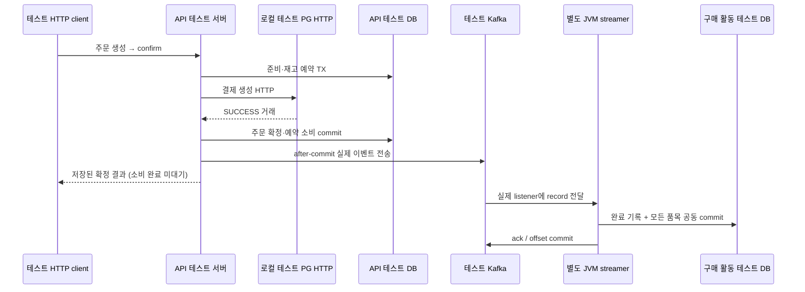

# W6 정상 PG 확정 → 구매 활동 전체 흐름 TDD 기록

## 요청과 검증 범위

2026-10-29 사용자가 **주문 확정 요청부터 테스트 PG, Kafka, streamer의 구매 활동 저장까지 정상 전체 흐름**을 TDD로 검증하도록 요청했다. [W6-C01](grading-criteria.md#공식-11개-항목과-확인-증거)을 대상으로 하며, 과제 원문과 기존 PG·트랜잭션·락·이벤트 계약을 유지한다.

앞선 [발행 검증](order-confirmed-publication-tdd-log.md)과 [소비 검증](purchase-activity-consumer-tdd-log.md)은 각 구간의 증거였다. 이번에는 **실제 API HTTP → 실제 로컬 PG HTTP → API DB commit → 실제 Kafka → 별도 JVM의 운영 streamer listener → 별도 구매 활동 DB → offset commit**을 한 실행에서 확인했다. 합성 이벤트를 직접 producer에 넣거나 소비 handler를 테스트에서 직접 호출해 전체 흐름을 대신하지 않는다.

기준 HEAD는 `6e686d824d979ad16a7a2baa70afbeee2c3ce460`이며 검사는 미커밋 작업 트리에서 실행했다. 기존 운영 코드·DB 스키마·트랜잭션·잠금·HTTP 계약은 수정하지 않았다. 사용자 DB·기존 topic/group·volume은 사용하거나 삭제하지 않았다.

## 이번에 추가한 책임

| 파일 | 책임 |
| --- | --- |
| [PgOrderPurchaseActivityEndToEndTest](../../apps/commerce-api/src/test/java/com/loopers/application/order/PgOrderPurchaseActivityEndToEndTest.java) | 실제 주문 생성/확정 HTTP, PG 요청과 저장 결과, Kafka wire, 별도 streamer DB·offset·로그, 동일 confirm 재요청의 추가 효과 없음 대조 |
| [OwnedStreamerProcess](../../apps/commerce-api/src/test/java/com/loopers/support/kafka/OwnedStreamerProcess.java) | 운영 streamer만 별도 JVM에서 실행. 전용 주소/설정 주입, 생존·로그 검사, 유한 종료·강제 종료 fallback·프로세스 회수 |
| [API Gradle](../../apps/commerce-api/build.gradle.kts) | 테스트 실행 전에 streamer main runtimeClasspath를 빌드하고 테스트용 system property로 전달. DDL 경로와 child classpath를 테스트 입력으로 등록 |

API와 streamer는 모두 `com.loopers` 아래를 스캔하므로 같은 classpath에 넣으면 설정·Entity·Repository가 섞일 수 있다. **API의 운영 의존성에 streamer를 추가하지 않고**, child JVM에 streamer의 운영 main classpath만 전달한다. API 테스트 클래스나 공유 Testcontainers 설정은 child에 넣지 않는다. Gradle 입력에 child classpath·DDL을 등록해 이후 streamer만 바뀌어도 API 테스트가 잘못 UP-TO-DATE로 생략되지 않게 했다.

## 격리와 실제 연결



API는 기존대로 발행·소비 완료를 기다리지 않는다. HTTP 응답과 후속 비동기 소비의 완료 순서는 달라질 수 있으며, 테스트가 응답 이후 각 결과를 유한 시간 내 확인한다.

| 자원 | 실제 사용·보호 |
| --- | --- |
| API HTTP·DB | `@SpringBootTest(RANDOM_PORT)`와 기존 MySQL/Redis Testcontainers fixture. 사용자 DB 주소를 쓰지 않음. API DB에 구매 활동 테이블이 없는 것도 확인 |
| PG | 기존 `LocalTestPg`의 loopback HTTP 서버. 합성 카드만 입력하고 실제 거래를 저장한 SUCCESS 응답 사용. 업체 PG·실제 결제 아님 |
| Kafka | 테스트 소유 `apache/kafka:3.8.1`, 고유 2-partition topic·구매 활동 group·wire 관찰용 별도 group |
| streamer | `CommerceStreamerApplication`을 main classpath로 실행. `test`, web none, 구매 활동 listener 활성화·demo 비활성화·같은 테스트 bootstrap 명시 |
| 구매 활동 DB | 별도 MySQL 컨테이너 `w6_streamer_e2e`. 저장소의 원본 streamer DDL을 적용하고 child는 `ddl-auto=validate` 사용 |
| child Redis | 이 흐름은 Redis를 사용하지 않으며 주소를 `127.0.0.1:1`로 명시해 개발자 Redis 기본 주소를 사용하지 않음 |
| 준비 확인 | child 생존, 실제 group 존재·STABLE·member 1명·두 partition 배정까지 확인한 후 고객 요청 실행 |

wire 검사 consumer의 직접 assign/seek는 새 발행을 읽는 관찰 도구다. 실제 구매 활동 저장은 별도 JVM의 group listener가 수행한다. 관찰 consumer의 위치를 업무 group의 완료 offset으로 오인하지 않는다.

## 먼저 정한 기대값

| 경계 | 기대값 |
| --- | --- |
| 주문 생성 HTTP | 상품 A 1개+2개, 상품 B 2개 요청 → HTTP 201·DRAFT, 정규화한 A 3개/B 2개 |
| 확정 HTTP | HTTP 200·meta.SUCCESS·CONFIRMED·paymentMethod PG·payment.status SUCCESS·paidAmount 500원 |
| 실제 PG 요청 | POST `/api/v1/payments`, 제공자 계정 135135, 서버의 providerOrderId, 금액 500원·합성 카드 일치. 생성 호출 1회·거래 1건 |
| API DB | CONFIRMED·결제 SUCCESS·모든 품목 CONSUMED, 재고 A 10→7/B 5→3, 포인트 1,000원 불변 |
| Kafka wire | orderId key·stable eventId·저장된 최초 confirmedAt·정규화한 두 상품/수량 일치. 카드·지문·PG 거래 식별자·불필요한 개인정보 없음 |
| streamer DB | 완료 1건·활동 2건, API의 상품 ID·수량 3/2·최초 시각(초/나노초)이 동일. 새 물리 JDBC 연결로 commit된 값 조회 |
| 소비 완료 | 실제 streamer group의 committed offset이 wire record의 offset+1. child의 APPLIED 로그도 같은 topic·partition·offset·orderId를 가리킴 |
| 같은 confirm 재요청 | 동일 응답, PG 생성/거래 1건·발행 메서드 총 1회·broker record 1건 유지. 재고/포인트와 구매 활동의 PK 포함 전체 snapshot 불변 |

재요청 직후 broker/DB를 한 번 읽는 것만으로는 늦게 도착할 추가 비동기 send를 놓칠 수 있다. 실제 publisher를 spy로 관찰하여 `publish()` 총 1회도 확인한다. spy는 실제 전송을 실행하며 PG 응답·Kafka·소비 저장을 mock으로 대체하지 않는다.

## Red → 실행 → Green

| 순서 | 실제 결과 | 구분 |
| --- | --- | --- |
| 테스트 먼저 작성 | 없는 `OwnedStreamerProcess` 참조로 컴파일 오류 3개·종료 1 | 전체 흐름 테스트와 필요한 실행 지원 계약을 먼저 정의한 Red |
| 실행 지원 연결 | 별도 child JVM helper·Gradle test-only classpath/DDL 입력 연결, 재요청 발행 횟수 assertion 보강 | 운영 업무 로직·기대값 변경 없음 |
| 첫 실행 시도 | Docker daemon 연결 불가로 초기화 실패 | 업무 실패/성공 증거로 세지 않음. Docker 앱만 시작했고 데이터/volume 초기화 없음 |
| 첫 전체 흐름 Green | 2026-10-29 15:23 KST, 신규 1개·실패/오류/skip 0, BUILD SUCCESSFUL 34초·종료 0 | HTTP부터 실제 streamer 저장·ack, 동일 재요청 불변까지 확인 |
| 관련 회귀 Green | 2026-10-29 15:24 KST, 총 9개·실패/오류/skip 0, BUILD SUCCESSFUL 39초·종료 0 | 기존 PG 발행 6개와 두 앱 ArchUnit·Checkstyle 추가 확인 |

첫 Green 명령은 다음과 같다.

```shell
./gradlew :apps:commerce-api:test \
  --tests 'com.loopers.application.order.PgOrderPurchaseActivityEndToEndTest' \
  --offline --console=plain
```

이번 Red/Green은 누락된 **통합 검증 환경**을 채운 과정이다. 기존 주문·발행·소비 알고리즘에 결함을 발견해 수정한 작업으로 표현하지 않는다.

## 최종 실행에서 관찰한 정상 사례

| 항목 | 실제 값 |
| --- | --- |
| orderId / providerOrderId | `1` / `LP-ORD-0000000001` |
| transactionKey / eventId | `TEST-TX-1` / `order-confirmed:v1:1` |
| confirmedAt | `2026-10-29T06:23:58.730593Z` — API DB·이벤트·구매 활동에 같은 최초 시각 |
| items / 금액 | 상품 `1` 수량 `3`, 상품 `2` 수량 `2` / `500`원 |
| topic | `order-events-e2e-879e19ad-85f6-4bd9-a6af-0181aded8458` |
| streamer group | `purchase-activity-e2e-b1b1fe8c-18cf-477b-91fd-37596072fee4` |
| broker 위치 / 완료 offset | partition `1`, offset `0` / committed `1` |
| PG·저장 결과 | PG 생성 1·거래 1, 완료 기록 1·구매 활동 2 |
| 재요청 | 응답·PK 포함 저장 사실·재고·포인트 불변, 추가 생성·발행 없음 |

최종 child PID `2853`의 로그는 같은 record에 `result=APPLIED`를 기록했고, 종료 시 `Consumer stopped`와 `mysql-main-pool - Shutdown completed`가 확인됐다. [해당 child 로그](../../apps/commerce-api/build/reports/w6-e2e/order-events-e2e-879e19ad-85f6-4bd9-a6af-0181aded8458/streamer.log)는 테스트 산출물이며 후속 실행/clean으로 없어질 수 있어 주요 사건 사실은 위 표에 남긴다.

첫 Green은 별도 자원인 topic `order-events-e2e-96ed5906-ec53-48e2-86db-8df39aa5be1f`, group `purchase-activity-e2e-8d8e1f1e-217b-4e50-9194-314fcce0ba96`, confirmedAt `2026-10-29T06:23:07.405012Z`에서 같은 기대값을 확인했다. 두 실행의 숫자 orderId가 같아도 같은 역사적 주문의 재전달로 보지 않는다.

## 최종 관련 검사와 정리

```shell
./gradlew :apps:commerce-api:test \
  --tests 'com.loopers.application.order.PgOrderPurchaseActivityEndToEndTest' \
  --tests 'com.loopers.application.order.PgOrderEventKafkaIntegrationTest' \
  --tests 'com.loopers.architecture.ArchitectureTest' \
  :apps:commerce-streamer:test \
  --tests 'com.loopers.architecture.ArchitectureTest' \
  :apps:commerce-api:checkstyleMain :apps:commerce-api:checkstyleTest \
  :apps:commerce-streamer:checkstyleMain :apps:commerce-streamer:checkstyleTest \
  --offline --console=plain
```

| 범위 | 결과 |
| --- | --- |
| API | 기존 `PgOrderEventKafkaIntegrationTest` 6 + 신규 E2E 1 + ArchUnit 1 = **3개 스위트·8개** |
| streamer | ArchUnit **1개 스위트·1개**. 실제 소비 동작은 위 API E2E의 child JVM으로 별도 실행 |
| 합계 | **4개 스위트·9개**, 실패·오류·skip **0** |
| Checkstyle | 양 앱 main/test 보고서 4개 모두 위반 0. API test 검사 실제 실행, 나머지는 소스 미변경으로 UP-TO-DATE |
| 종료 | BUILD SUCCESSFUL / **39초** / 종료 코드 **0** |

child 프로세스는 DB 정리보다 먼저 SIGTERM과 유한 대기로 종료하고, 필요 시 강제 종료 후 회수하는 fallback을 둔다. 이번 실행에서는 Spring의 listener/DB 종료 로그가 남았다. wire consumer·AdminClient·로컬 PG도 닫고 자신의 API 테스트 DB만 정리했다. Testcontainers 종료 후 실행 중 테스트 컨테이너는 0개였다. 사용자 DB·기존 topic/group·volume에 접근하거나 초기화하지 않았다.

관련 diff·계층 검사를 확인했으며 API 전체 862개·이전 streamer 전체 97개 등을 이번에 재실행하거나 합산하지 않는다. XML/HTML 보고서는 후속 실행으로 바뀔 수 있으므로 위 명령·시점·범위·관찰값이 이번 기록이다.

## 남은 범위

- **C08:** 같은 전체 환경에서 주문 commit 후 send 직전 실패를 주입하고, 주문/예약 보존과 해당 broker record·구매 활동의 부재를 함께 확인한다. 선행 발행 테스트의 누락 검증만으로 소비 DB 부재까지 확인했다고 하지 않는다.
- **C09:** 미발행 1건·정상 소비 1건의 W7 인계를 고정 clock·재현 코드·실행 revision과 함께 완성한다. 이번 정상 사례의 실제 값은 남겼지만 현재 시스템 시각과 미커밋 작업 트리 검증을 정식 W7 인계 완료로 표시하지 않는다.
- **C11 최종 대조:** 이후 변경 범위의 회귀와 W6 11개 항목의 문서·실제 증거를 최종 대조한다. 기술 글·커밋·PR·과제 제출은 별도 작업이다.

이번 완료는 **정상 confirm 전체 경로와 같은 confirm 재요청의 추가 효과 없음**이다. callback/reconcile의 PG→Kafka 검증은 기존 관련 6개에 유지되지만, 두 경로까지 별도 child JVM 전체 실험을 한 것으로 확대하지 않는다. Outbox·랭킹·실제 PG 연동·전체 W6 완료를 주장하지 않는다.
