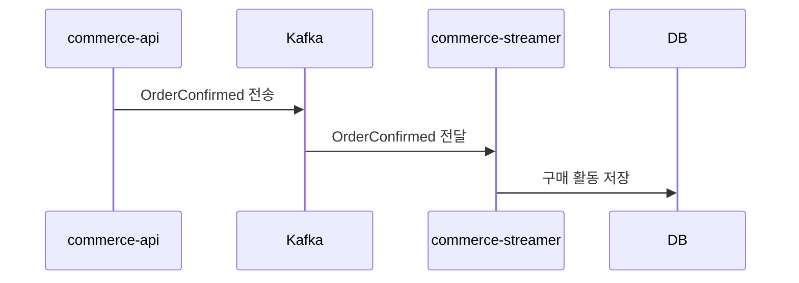
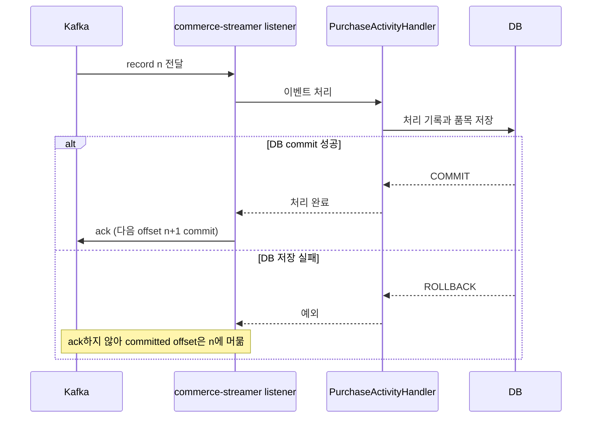

# 주문 확정 이벤트 발행 흐름

동기 PG 응답과 대사는 공통 `recordResult()` 트랜잭션을 사용한다.

1. 주문이 처음 `CONFIRMED`로 바뀔 때 `confirmedAt`을 저장하고 내부 `OrderConfirmed` 이벤트를 발행한다.
2. `@TransactionalEventListener(AFTER_COMMIT)`가 commit 후 `order-events`에 전송한다. key는 `orderId`의 문자열 표현이며, payload의 `confirmedAt`은 DB에 저장한 값 그대로 사용한다.
3. 이미 확정된 주문이나 rollback된 트랜잭션에서는 Kafka 이벤트를 발행하지 않는다.
4. commit 후 Kafka 전송이 실패해도 주문 확정은 유지한다. 이 발행 누락 가능성은 이번 주 범위에서 관찰하며 Outbox는 구현하지 않는다.

## 이벤트 전달과 저장

### Consumer 처리·ack

