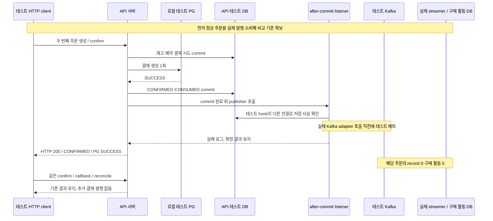

# W6 확정 commit 뒤 발행 직전 실패 전체 흐름 TDD 기록

## 요청과 완료 범위

2026-10-29 사용자가 **주문 확정은 저장됐지만 Kafka 발행 직전에 실패하는 상황**을 검증하도록 요청했다. [W6-C08](grading-criteria.md#공식-11개-항목과-확인-증거)의 주문·예약 보존, 해당 broker record·구매 활동 부재, PG 재생성 금지를 실제 전체 환경에서 확인했다.

[정상 전체 흐름 기록](normal-pg-purchase-activity-e2e-tdd-log.md)의 당시 결과는 그대로 보존한다. 이번에는 같은 [PgOrderPurchaseActivityEndToEndTest](../../apps/commerce-api/src/test/java/com/loopers/application/order/PgOrderPurchaseActivityEndToEndTest.java)의 한 실행에 **정상 주문 1건과 발행 누락 주문 1건**을 연속으로 만들었다. 기존 정상 흐름 기대값은 유지하고 두 번째 주문의 실패 경계와 재요청 검사를 추가했다.

이번 변경은 통합 테스트와 관련 문서다. 운영 코드·DB 스키마·기존 트랜잭션·락·PG 계약은 변경하지 않았다. 사용자 DB·기존 topic/group·volume은 사용하거나 변경하지 않았다. 기준 HEAD는 `6e686d824d979ad16a7a2baa70afbeee2c3ce460`이며, 검사는 **미커밋 작업 트리**에서 실행했다. 이 HEAD만으로 현재 W6 코드를 재현할 수 있다고 주장하지 않는다.

## 실패를 넣은 위치와 비교 방법



단순 Kafka timeout을 발생시킨 뒤 미발행이라고 추측하지 않는다. 실제 publisher의 spy에서 **해당 주문만 real adapter 호출 전에 예외를 던진다.** 따라서 이 주문의 Kafka 비동기 send 자체가 시작되지 않았다. 첫 정상 주문은 spy를 거쳐 실제 adapter와 broker로 전송된다.

| 검증 장치 | 확인하려는 사실 |
| --- | --- |
| 정상 주문 먼저 처리 | 실제 streamer가 배정받아 구매 활동을 저장하고 ack하는지 확인. consumer가 꺼져 있어 구매 활동이 0인 경우 배제 |
| 실패 hook 안의 별도 읽기 TX | `REQUIRES_NEW`로 다른 물리 연결에서 확정·시도·품목·재고·포인트 전체 값을 읽음. 실제 connection ID가 다른지 요청 밖에서 assertion |
| API 전체 snapshot | 주문·결제 시도·품목·상품의 모든 컬럼과 포인트 비교. PK·최초 확정 시각·예약·재고·지문 바이트도 보존 |
| broker endOffsets | 두 partition의 끝 offset이 정상 주문 처리 후 값에서 늘지 않음. 관찰 consumer도 추가 record 없음 |
| 구매 활동 DB 재조회 | 새 물리 연결에서 두 테이블 전체 snapshot이 정상 주문 처리 후 값과 동일. 실패 주문의 완료 기록·구매 활동은 각각 0 |
| 실제 group·프로세스 | child 생존·STABLE 유지, 업무 group의 committed offset 불변. 정상 주문 APPLIED 로그와 실패 주문의 완료 로그 부재 대조 |
| 세 HTTP 재요청 | 동일 confirm, callback, 수동 reconcile 이후에도 해당 주문 PG POST 1회·publisher 시도 1회. 주문·예약·재고·최초 시각 불변 |

after-commit 콜백에는 기존 thread-bound DB 자원이 남을 수 있다. `isActualTransactionActive()` 한 값만으로 commit 여부를 판정하지 않고 **다른 연결에서 이미 보이는 저장 사실**을 근거로 삼았다. 관찰용 새 TX는 테스트에만 있으며 업무 TX 분할이나 잠금 순서를 바꾸지 않는다.

## 기대값과 실제 결과

| 확인 대상 | 발행 누락 주문의 기대값 | 결과 |
| --- | --- | --- |
| HTTP·주문·결제 | 200 / meta.SUCCESS / CONFIRMED / PG SUCCESS. FAILED·UNKNOWN으로 퇴행하지 않음 | 통과 |
| 저장 금액 | 500원 유지 | 통과 |
| 품목 예약 | 두 품목 모두 CONSUMED | 통과 |
| 재고 | 상품 A 10→7, 상품 B 5→3. 실패·재요청으로 복원하거나 추가 차감하지 않음 | 통과 |
| 포인트 | 1,000원 유지 | 통과 |
| PG 생성 | 해당 주문 POST 1회·거래 1건. 정상 비교 주문까지 전체 2회·2건 | 통과 |
| 발행 시도 | 해당 주문 publisher 1회. 재요청으로 추가 호출 없음 | 통과 |
| Kafka | 해당 주문 record 0, 두 partition의 endOffsets 불변 | 통과 |
| streamer DB | 해당 주문 완료 0·활동 0, 기존 정상 주문의 PK 포함 전체 저장값 보존 | 통과 |
| 재확인 | confirm·callback·reconcile 후 전체 API snapshot·최초 confirmedAt·consumer offset 불변 | 통과 |

여기서 “이벤트 없음”은 **Kafka에 해당 record가 없다는 뜻**이다. API 내부에서는 최초 확정 사실을 준비해 after-commit listener까지 전달했다. listener의 실패 로그와 broker 수신·소비 완료를 구분한다.

## 테스트 작성과 실행 이력

| 순서 | 실제 결과 |
| --- | --- |
| 기대값·실패 hook 추가 후 첫 실행 | 15:41 KST, E2E 1개 실패·BUILD FAILED 32초. 별도 연결의 저장 사실은 같았지만 snapshot 안의 `byte[]`를 객체 주소로 비교해 실패 |
| 테스트 비교 보완 | 컬럼을 빼거나 기대값을 낮추지 않고 `usingRecursiveComparison()`으로 지문·키 바이트 내용까지 비교 |
| 첫 Green | 15:42 KST, E2E 1개·실패/오류/skip 0, BUILD SUCCESSFUL 28초·종료 0 |
| 검토·최종 관련 검사 | 정상 주문의 API 사실도 마지막에 재확인. 15:43 KST, 실제 실행 API 4개 스위트·20개 통과, BUILD SUCCESSFUL 44초·종료 0 |

첫 실패는 **새 검증 코드의 배열 비교 문제**였으며 운영 코드의 주문·발행 결함으로 기록하지 않는다. 기존 실패 처리 로직은 변경하지 않았다. 두 장면을 한 테스트에 둔 이유는 class 소유 topic/group·구매 활동 DB를 유지하면서 정상 저장을 비교 기준으로 삼기 위해서다. 독립 테스트 순서나 공유 DB의 중간 삭제에 의존하지 않는다.

## 최종 실행의 실제 사건 사실

두 사례는 같은 격리 topic `order-events-e2e-fb162652-8d25-4816-9789-02abadf52094`, group `purchase-activity-e2e-5bdf2a2b-6de5-4565-9e8a-14414043b2d1`에서 실행했다.

| 항목 | 정상 주문 | 발행 누락 주문 |
| --- | --- | --- |
| orderId | `1` | `2` |
| providerOrderId | `LP-ORD-0000000001` | `LP-ORD-0000000002` |
| transactionKey | `TEST-TX-1` | `TEST-TX-2` |
| eventId | `order-confirmed:v1:1` | `order-confirmed:v1:2` |
| confirmedAt | `2026-10-29T06:43:20.042295Z` | `2026-10-29T06:43:20.795407Z` |
| items / 금액 | 상품 1×3, 상품 2×2 / 500원 | 상품 3×3, 상품 4×2 / 500원 |
| 주문·결제 / 예약 | CONFIRMED·SUCCESS / CONSUMED | CONFIRMED·SUCCESS / CONSUMED |
| broker record | partition 1·offset 0 | 없음. offset을 꾸며 기록하지 않음 |
| 완료 / 구매 활동 | 1건 / 2건 | 0건 / 0건 |
| PG 생성 | 1회 | 1회, 이후 세 HTTP 요청에도 추가 0회 |

실패 주입 순간 원래 connection ID는 `21`, 별도 읽기 connection ID는 `22`였다. 원래 저장 결과를 새 연결에서 읽은 뒤 `order_event_dispatch_failed eventId=order-confirmed:v1:2 orderId=2 errorType=IllegalStateException`이 기록됐다. 정상 record의 committed offset은 `1`이며 실패·재요청 이후 전체 group offset도 불변이었다.

첫 Green은 별도 topic `order-events-e2e-0086f57f-1976-4d09-931e-03070ce82ff9`, group `purchase-activity-e2e-302963ab-62a3-4c2d-86cf-6a336964b105`에서 수행했다. 누락 주문 confirmedAt은 `2026-10-29T06:42:27.533356Z`, connection은 `9`와 `10`이었다. 실행마다 다른 격리 자원의 사건이며 서로 재전달된 주문으로 합치지 않는다.

## 재실행·검사·자원 정리

```shell
./gradlew :apps:commerce-api:test \
  --tests 'com.loopers.application.order.PgOrderPurchaseActivityEndToEndTest' \
  --tests 'com.loopers.application.order.PgOrderEventKafkaIntegrationTest' \
  --tests 'com.loopers.application.order.OrderConfirmedPublicationIntegrationTest' \
  --tests 'com.loopers.architecture.ArchitectureTest' \
  :apps:commerce-streamer:test \
  --tests 'com.loopers.architecture.ArchitectureTest' \
  :apps:commerce-api:checkstyleMain :apps:commerce-api:checkstyleTest \
  :apps:commerce-streamer:checkstyleMain :apps:commerce-streamer:checkstyleTest \
  --offline --console=plain
```

| 검사 | 결과 |
| --- | --- |
| API 실제 실행 | 전체 흐름 1 + 실제 PG/Kafka 발행 6 + commit/rollback 발행 12 + ArchUnit 1 = **4개 스위트·20개**, 실패·오류·skip 0 |
| streamer ArchUnit | 소스·입력 미변경으로 UP-TO-DATE. 15:24 KST의 1개 통과 결과 재사용이며 이번 실제 실행 개수에 합산하지 않음 |
| Checkstyle | 양 앱 main/test XML 4개 위반 0. API test 실제 실행, 나머지 3개는 UP-TO-DATE |
| 빌드 | BUILD SUCCESSFUL / 44초 / 종료 코드 0 |
| 정리 | child PID 4096의 `Consumer stopped`·Hikari 종료 로그 확인. 종료 후 실행 중 Testcontainers 컨테이너 0개 |

별도 streamer JVM·DB, API Testcontainers fixture, 실제 로컬 PG HTTP와 owned Kafka를 사용했다. [실행 지원](../../apps/commerce-api/src/test/java/com/loopers/support/kafka/OwnedStreamerProcess.java)의 기존 정리 순서에 따라 child를 먼저 종료하고 관찰 consumer·AdminClient·PG를 닫은 뒤 자신의 테스트 DB를 정리했다. 정상/실패 양쪽 API·child 로그에 합성 카드 번호가 남지 않는 검사도 통과했다.

[child 로그](../../apps/commerce-api/build/reports/w6-e2e/order-events-e2e-fb162652-8d25-4816-9789-02abadf52094/streamer.log)와 XML/HTML은 후속 실행·clean으로 바뀔 수 있으므로 주요 사건 사실은 위 표에 남겼다. 과거 전체 API·streamer 통과 수를 이번 검사에 합산하지 않는다.

## 해석과 남은 범위

**C08의 직접 발행 누락과 상태 보존을 확인했다.** 주문 DB commit과 Kafka 발행은 하나의 원자적 작업이 아니므로, 결제·주문은 성공했지만 구매 활동이 없는 구간이 실제로 존재한다. 이번 과제는 이 구간을 재현·기록하는 것이며, 이번에 누락 복구나 Outbox를 구현한 것은 아니다.

실패는 테스트 전용 pre-send 예외로 통제했다. OS 강제 종료·모든 네트워크 장애나 broker가 이미 수신한 뒤 응답을 잃는 경우까지 재현했다고 하지 않는다.

- **C09:** 두 사례의 실제 값과 코드는 확보했지만 고정 clock·완성된 W6 실행 revision을 포함한 정식 W7 인계는 남아 있다. 현재 시스템 시각·미커밋 작업 트리를 정식 인계 완료로 표시하지 않는다.
- **C11 최종 대조:** 이후 변경의 관련 회귀와 W6 11개 증거의 최종 대조는 후속이다. 기술 글·커밋·PR·과제 제출도 별도 작업이다.
