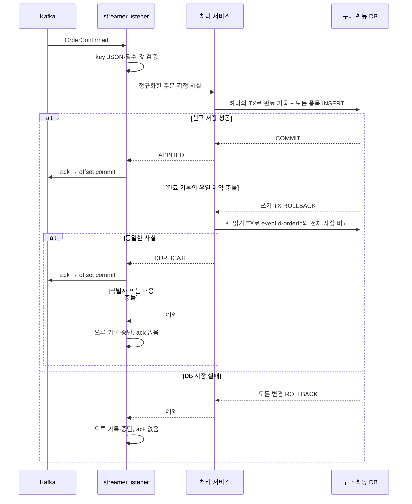

# W6 구매 활동 소비 TDD 기록

## 작업 범위와 선택

2026-10-29 사용자가 streamer의 이벤트 수신·구매 활동 저장을 TDD로 요청했다. **처리 완료 기록과 상품별 구매 활동을 함께 저장하고, 필요한 필드를 비교하며 JSON 사본은 추가하지 않는다(Q03)**. 처리 실패 시 **전용 listener를 중단하고, 원인을 해결한 뒤 같은 group으로 재시작한다(Q04)**.

기준 HEAD는 `6e686d824d979ad16a7a2baa70afbeee2c3ce460`이며 아래 검사는 미커밋 작업 트리에서 실행했다. 앞선 [주문 확정 발행 기록](order-confirmed-publication-tdd-log.md)의 API 구현·검사 증거를 보존한다. 이번 증분에서는 기존 주문·결제의 트랜잭션·잠금·포인트·예약 로직을 변경하지 않았고 사용자 DB에 접속하거나 스키마를 적용하지 않았다.

| 선택 | 이유와 미채택 대안 |
| --- | --- |
| 두 테이블과 필요한 필드 비교 | 완료 여부와 상품별 구매 사실의 역할을 나누면서 실제 저장 값을 비교한다. 비교용 JSON 사본은 같은 정보를 중복 저장하고 정규화 규칙을 두 곳에서 관리해야 하므로 추가하지 않는다. |
| DB 유일 제약 + 실패 TX 종료 후 사실 비교 | 동시에 도착한 요청도 DB가 식별자 충돌을 결정한다. 메모리 검사·조회 후 INSERT만으로 중복을 막지 않는다. |
| 전용 record listener, concurrency 1 | 이번 실습에서 메시지별 저장·완료 위치·실패 지점을 확인하기 쉽게 한다. 기존 공통 batch factory는 바꾸지 않는다. |
| 실패 시 중단·같은 group 재시작 | 저장하지 못한 메시지를 건너뛰지 않고 실패 원인과 복구 과정을 확인한다. 자동 재시도·DLT·건너뛰기는 이번 선택에 포함하지 않는다. 중단된 동안 해당 listener의 후속 처리가 멈추는 비용이 있다. |

## 구현한 책임과 저장 경계



DB commit과 Kafka offset commit은 별개다. DB commit 뒤 ack가 실패하면 재전달될 수 있으며, 저장된 사실과 같은 재전달은 추가 효과 없이 처리한다. 이 공백을 실제로 끊어 재현하는 C05 실험은 아래의 DB 저장 실패 실험과 구분해 후속으로 남긴다.

| 책임 | 구현 |
| --- | --- |
| 수신 계약 | [OrderConfirmedEventParser](../../apps/commerce-streamer/src/main/java/com/loopers/interfaces/consumer/OrderConfirmedEventParser.java): JSON 정수 타입·범위·필수 값·버전·key/orderId 일치 검증. 중복 JSON 필드와 뒤따르는 별도 JSON을 거절한다. 알 수 없는 추가 필드는 저장하지 않는다. |
| 구매 사실 | [OrderConfirmation](../../apps/commerce-streamer/src/main/java/com/loopers/domain/purchase/OrderConfirmation.java): 상품별 수량 합산·상품 ID 정렬·불변 목록. eventId 문자열과 최초 확정 시각을 그대로 보존한다. |
| 저장·중복 분기 | [PurchaseActivityHandler](../../apps/commerce-streamer/src/main/java/com/loopers/application/purchase/PurchaseActivityHandler.java): 외부 TX 참여를 거절하고 별도 프록시의 쓰기 TX가 끝난 후 결과를 반환한다. 중복 후보이면 rollback 이후 새 읽기 TX로 비교한다. |
| 공동 TX | [PurchaseActivityTransactions](../../apps/commerce-streamer/src/main/java/com/loopers/application/purchase/PurchaseActivityTransactions.java): READ_COMMITTED에서 완료 기록과 모든 품목을 저장한다. 중복 비교는 별도의 read-only TX이며 eventId·orderId 양쪽 조회가 모두 전체 입력 사실과 같아야 한다. |
| 영속성·오류 분류 | [JpaPurchaseActivityStore](../../apps/commerce-streamer/src/main/java/com/loopers/infrastructure/purchase/JpaPurchaseActivityStore.java): 실제 flush를 수행한다. MySQL 1062와 정확한 완료 기록 유일 제약 이름만 중복 후보로 바꾼다. 다른 CHECK·길이·활동 유일 제약 등의 오류를 정상 중복으로 숨기지 않는다. |
| Kafka 완료 | [OrderActivityKafkaListener](../../apps/commerce-streamer/src/main/java/com/loopers/interfaces/consumer/OrderActivityKafkaListener.java): 처리 서비스가 정상 반환한 뒤 ack한다. 실패 로그에 위치·예외 종류를 남기고 예외를 다시 던진다. |
| 소비 설정 | [OrderActivityKafkaConfiguration](../../apps/commerce-streamer/src/main/java/com/loopers/infrastructure/purchase/OrderActivityKafkaConfiguration.java): 전용 record factory, String/byte[] 역직렬화, auto commit false, MANUAL_IMMEDIATE, sync commits, concurrency 1, 중단형 error handler. |

| 테이블 | 저장 값·제약 |
| --- | --- |
| `processed_order_confirmation` | eventId·orderId·eventType·schemaVersion·confirmedAt. eventId와 orderId 각각 UNIQUE. |
| `product_purchase_activity` | orderId·productId·quantity·confirmedAt. `(orderId, productId)` UNIQUE, 완료 기록의 orderId를 참조하는 FK. 현재 상품·주문 테이블에는 FK를 만들지 않는다. |

시각은 초와 나노초 두 값으로 저장해 `Instant` 정밀도를 보존한다. `DATETIME(6)`에 저장하면서 다른 시각이 같아지는 문제를 피한다. eventId에는 binary NO PAD collation을 사용해 대소문자와 뒤 공백이 Java 문자열 비교와 다르게 합쳐지지 않게 했다. eventId 저장 한도 초과는 기술 오류로 처리하며 값을 자르거나 정상 중복으로 처리하지 않는다.

[수동 DDL](../../apps/commerce-streamer/src/main/resources/db/schema/001-purchase-activity.sql)은 테스트 소유 MySQL에만 적용했다. streamer는 마지막에 읽는 [purchase-activity.yml](../../apps/commerce-streamer/src/main/resources/purchase-activity.yml)에서 `ddl-auto=validate`를 사용한다. 재시작 시 완료 기록을 지우는 기존 local `create` 설정을 덮어쓴다. 실제 local 실행 전에는 대상 DB를 확인한 뒤 이 DDL을 별도로 준비해야 하며, 이번 작업에서는 사용자 DB에 적용하지 않았다. 자세한 절차는 [스키마 안내](../week2/commerce-schema-operations.md)를 따른다.

## Red → Green과 검사 중 수정

| 순서 | 실제 실행 결과 | 처리 |
| --- | --- | --- |
| 수신 모델·parser Red | 테스트를 먼저 작성한 실행에서 없는 모델·parser 참조로 컴파일 오류 31개, 종료 1 | 모델·정규화·엄격한 parser 구현 |
| listener Red | 없는 handler·store·listener 등의 참조로 컴파일 오류 22개, 종료 1 | ack 순서·오류 전달 테스트에 맞춰 listener와 처리 경계 연결 |
| 저장 Red | 통합 테스트 실행 명령에서 아직 없는 저장 계층 등의 참조로 컴파일 오류 22개, 종료 1 | Entity·JPA·공동 TX·유일 제약 충돌 분류 구현. 위 오류 수를 별도 업무 실패 건수로 합산하지 않음 |
| 첫 통합 검사 | 93개 중 1개 실패, 종료 1 | 잘못된 수량을 raw JdbcTemplate으로 넣는 테스트의 예외 타입 기대가 실제 Spring 변환과 달랐음. 아래 설명처럼 수정 |
| 실제 Kafka 검사 준비 | factory에 없는 `getConcurrency()`를 테스트에서 참조해 컴파일 실패 | 실제 등록된 `ConcurrentMessageListenerContainer`의 concurrency가 1인지 검사하도록 수정 |
| 최종 Green | 7개 스위트·96개 통과, streamer Checkstyle main/test 위반 0 | 실제 Kafka 수신·실패 중단·같은 group 재시작까지 포함 |

수량 CHECK 테스트의 실제 예외는 `DataIntegrityViolationException`이 아니라 `UncategorizedSQLException`이었다. 기대 타입을 실제 변환에 맞추고 **MySQL 3819·SQLState HY000·`ck_purchase_quantity`**를 함께 검증하도록 고쳤다. 실패 뒤 완료/활동 0건 기대는 유지했다. 업무 규칙·DB 제약·rollback 기대를 삭제하거나 완화한 수정이 아니다. Kafka factory API 수정도 도구 사용 오류이며 업무 Red로 세지 않는다.

## 테스트별 기대값과 결과

| 테스트 | 수 | 확인한 내용 |
| --- | ---: | --- |
| [OrderConfirmationTest](../../apps/commerce-streamer/src/test/java/com/loopers/domain/purchase/OrderConfirmationTest.java) | 20 | 필수 값·양수 수량·합산 overflow·불변 목록·순서 독립 정규화·정확한 식별자/시각 |
| [OrderConfirmedEventParserTest](../../apps/commerce-streamer/src/test/java/com/loopers/interfaces/consumer/OrderConfirmedEventParserTest.java) | 52 | 실제 JSON key/type/범위·필수 값·버전·중복 필드·추가 JSON·오류의 원문 비노출 |
| [PurchaseActivityIntegrationTest](../../apps/commerce-streamer/src/test/java/com/loopers/application/purchase/PurchaseActivityIntegrationTest.java) | 15 | 수동 DDL·JPA validate, 최초/동일/충돌, 다른 물리 연결의 동시 유일 제약 경합, 실제 SQL 뒤 전체 rollback·복구, 정밀한 시각/식별자·기술 오류 분리 |
| [OrderActivityKafkaListenerTest](../../apps/commerce-streamer/src/test/java/com/loopers/interfaces/consumer/OrderActivityKafkaListenerTest.java) | 4 | APPLIED/DUPLICATE 반환 뒤 ack, parser/handler 실패 시 ack 없음·예외 전파 |
| [OrderActivityKafkaIntegrationTest](../../apps/commerce-streamer/src/test/java/com/loopers/interfaces/consumer/OrderActivityKafkaIntegrationTest.java) | 3 | 실제 broker·Spring listener·MySQL 저장/중복, 실제 SQL 후 실패→중단→같은 group 재시작, 실효 소비 설정 |
| [StreamerLocalConfigurationTest](../../apps/commerce-streamer/src/test/java/com/loopers/infrastructure/purchase/StreamerLocalConfigurationTest.java) | 1 | DB 접속 없이 local ConfigData를 읽어 validate·앱 이름·admin/consumer 주소 일치 확인 |
| [ArchitectureTest](../../apps/commerce-streamer/src/test/java/com/loopers/architecture/ArchitectureTest.java) | 1 | streamer의 domain/application/interfaces 금지 의존 검사 |
| 합계 | **96** | 실패·오류·skip **0** |

- 주문 2개에 상품 활동 3건을 저장하고, 상품 7의 수량 합계는 5로 확인했다.
- 같은 이벤트의 품목 순서를 바꾸고 동일 상품을 여러 행으로 나눠도 합산 사실이 같으면 DUPLICATE이며 저장 건수는 늘지 않는다.
- 같은 eventId의 다른 orderId, 같은 orderId의 다른 eventId, 시각·수량·누락/추가 품목 차이는 충돌이다.
- 두 worker가 서로 다른 물리 연결에서 동시에 INSERT하면 APPLIED 1·DUPLICATE 1, 완료 1건·활동 2건이다.
- 첫 품목 INSERT까지 실제 실행된 뒤 두 번째 품목에서 실패하면 별도 조회에서 완료 0건·활동 0건이다. 원인을 제거하고 다시 처리하면 모두 저장된다.

## 실제 Kafka 실패·복구 관찰

테스트는 `apache/kafka:3.8.1`과 MySQL 8의 전용 컨테이너, 고유 topic/group을 사용했다. producer/admin/consumer는 같은 소유 broker를 가리킨다. topic은 partition 2개로 만들고, 실제 listener 하나에 두 partition이 배정될 때까지 유한 대기했다. 이것은 consumer 1→2→3 배정 비교 실험을 대신하지 않는다.

2026-10-29 **10:24 KST**, topic `order-events-consumption-51fb97be-02fc-4a28-82db-e9b06457475d`에서 다음 로그와 DB/offset assertion을 확인했다.

| 사례 | 실제 위치·관찰 | DB·완료 위치 기대 |
| --- | --- | --- |
| 두 번째 품목 저장 실패 | partition 0, offset 0, orderId 52. 10:24:42 `errorType=TestWriteFailure` | 실패 TX 내부에서 완료 1·첫 품목 1을 본 뒤 rollback. 별도 조회는 0·0, committed offset은 실패 record를 지나가지 않음(미존재 또는 ≤0) |
| 같은 group 재시작 | 같은 partition 0·offset 0, 10:24:52 `result=APPLIED` | 새로운 record·seek·offset reset 없이 재수신. 완료 1·활동 2, committed offset 1 |
| 정상 주문 | partition 0·offset 1, orderId 42, APPLIED | 완료 1·활동 2, committed offset 2 |
| 동일 사실 재발행 | partition 0·offset 2, orderId 42, DUPLICATE | 완료 1·활동 2 유지, committed offset 3 |
| 다른 주문 | partition 0·offset 3, orderId 43, APPLIED | 완료 2·활동 3, 상품 7 수량 합계 5, committed offset 4 |

실패/복구 테스트와 정상/중복 테스트는 종료 시 listener를 멈춘 뒤 **자신의 테스트 DB만** 정리한 독립 사례다. 정상/중복 사례의 offset 1·2는 같은 payload를 별도로 전송한 두 record이며, 동일 record의 offset 미커밋 재전달(C05) 증거로 세지 않는다. 실패/재시작 사례는 실제 Spring error handler가 listener를 멈춘 것을 확인한 뒤 원인을 제거하고 같은 group으로 재시작했다.

## 최종 실행 결과와 한계

```shell
./gradlew :apps:commerce-streamer:test \
  :apps:commerce-streamer:checkstyleMain \
  :apps:commerce-streamer:checkstyleTest \
  --offline --console=plain
```

2026-10-29 **10:24 KST**, **BUILD SUCCESSFUL / 36초 / 종료 코드 0**. JUnit XML은 **7개 스위트·96개, 실패/오류/skip 0**, Checkstyle main/test 보고서 2개는 **위반 0**이다. streamer ArchUnit 1개는 96개에 포함한다. 이전 API 862개 검사는 이번에 다시 실행하거나 합산하지 않았다.

- XML·[HTML 보고서](../../apps/commerce-streamer/build/reports/tests/test/index.html)는 후속 실행으로 바뀔 수 있으므로 위 명령·시점·범위·관찰값으로 이번 결과를 기록한다.
- 테스트의 producer/admin client는 유한 timeout으로 닫고 listener 종료 뒤 DB를 정리했다. Testcontainers가 소유 DB/broker를 종료했으며 종료 후 `org.testcontainers=true` 실행 컨테이너 조회 결과는 0개였다.
- 사용자 DB·기존 broker·다른 실행의 topic/group·볼륨을 삭제하거나 수정하지 않았다. Outbox·랭킹·자동 재시도는 추가하지 않았다.
- 남은 필수 실험은 **실제 PG→API 발행→streamer까지 연결한 전체 경로, DB commit 뒤 offset 공백의 실제 재전달(C05), consumer 1→2→3 배정(C04), 직접 발행 누락/정상 소비의 W7 인계 두 사례(C08~09)**다. 이후 관련 회귀·문서·11개 채점 증거를 최종 대조한다.

이번 요청의 streamer 수신·공동 저장·중복/충돌 처리·실제 listener 실패/재시작은 구현하고 검증했다. 이를 전체 W6 완료 또는 종단 간 exactly-once 보장으로 확대하지 않는다.
