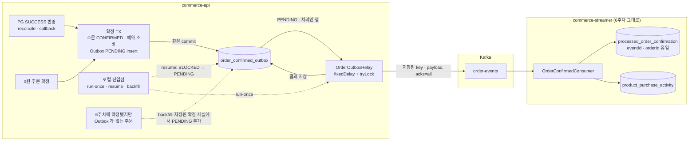
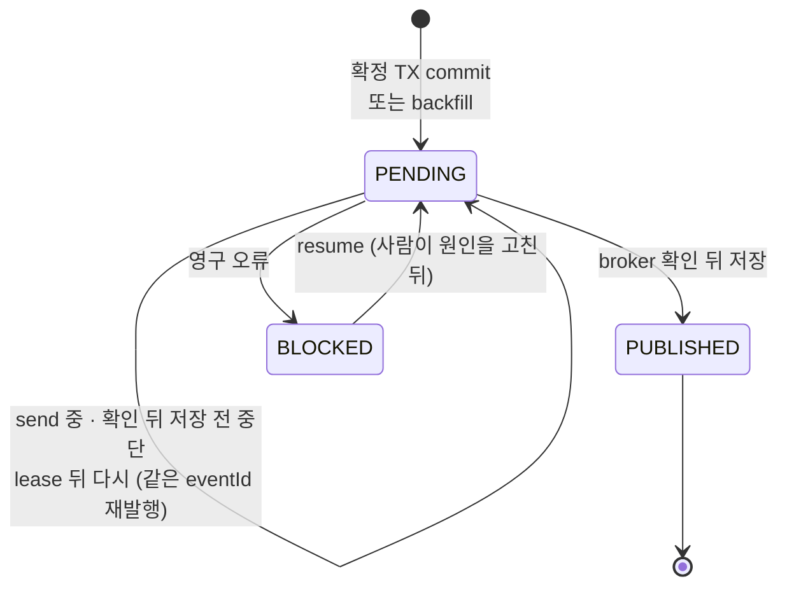
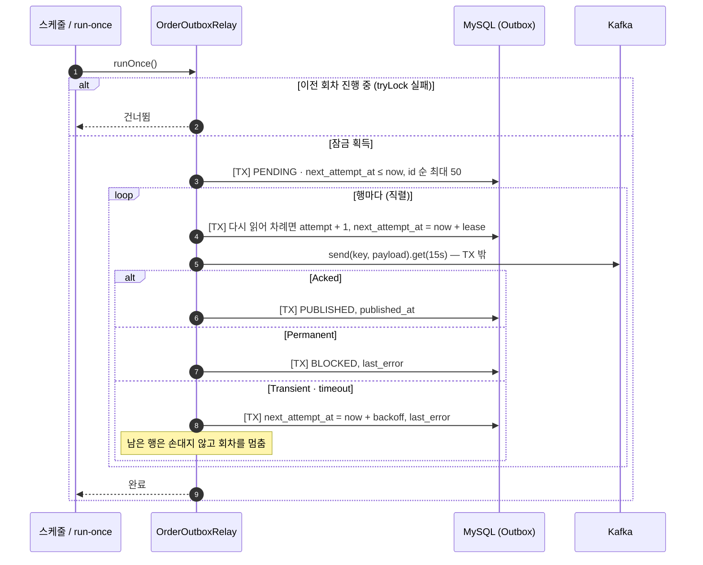

# 7주차 설계: Outbox 로 commit 뒤 발행 누락 구간 닫기

이 문서는 `docs/week6/design.md` 를 기준으로 **7주차에 바뀌거나 추가된 것만** 적는다. 절 번호는 새로 시작하고 결정 번호(D-xx)는 이전 문서를 이어 쓴다. 이번 결정은 D-100부터다.

## 1. 범위

**주문 확정과 "보낼 사실"을 같은 TX 에 남기고, 단일 relay 가 그 사실을 Kafka 로 옮긴다.** 6주차의 남은 누락 구간(commit 뒤 send 전 중단, 6주차 3.6)을 없애는 것이 목적이다. 재발행으로 생기는 중복은 6주차 consumer 의 멱등 처리가 흡수한다.

```
검증된 PG SUCCESS (또는 0원 주문 확정)
→ [DB TX] 주문 최초 CONFIRMED + 예약 소비 + Outbox PENDING   ← 함께 commit / rollback
→ relay: PENDING 조회 → 저장된 key · payload 로 send → broker 확인 → PUBLISHED
→ Kafka order-events → commerce-streamer (6주차 그대로)
```

| 대상 | 이번 변경 | 유지할 것 |
|---|---|---|
| 주문 확정 (commerce-api) | 확정 TX 안에서 Outbox insert. AFTER_COMMIT 직접 send 제거 | 결제 · 예약 · 재고 · 포인트 규칙, 확정 지점 두 곳(6주차 D-70) |
| 발행 | 단일 polling relay 신설, relay 전용 producer | 이벤트 계약(6주차 2장), topic · partition |
| commerce-streamer | 없음 | 소비 멱등 · DB TX · ack · 실패 정책 |
| 운영 | 미발행 · 격리 행 관찰과 로컬 재개 진입점 | |

- **범위 밖:** CDC relay, 여러 relay 의 분산 잠금, 범용 Outbox(다른 이벤트), DLT 재처리, 이전 POINT 주문 소급, 공개 관리자 API.

### 경계와 실패 시점

```
 commerce-api                                   Kafka                commerce-streamer
 ─────────────────────────────────────────      ────────────         ─────────────────
 [DB TX] 확정 · 예약 소비 · Outbox PENDING
    │ ① commit 전 실패 → 전부 rollback, Outbox 없음 (주문은 TX 직전 상태)
 commit
    │ ② commit 뒤 relay 전 중단 → PENDING 이 남아 relay 가 나중에 찾음
 relay [TX] 시도 시작 기록
    │ ③ send 실패 · timeout → PENDING 유지, 다음 시각 · 오류 기록
 send ─────────────────────────────────────▶ record
    │ ④ broker 확인 뒤 PUBLISHED 저장 전 중단 → PENDING 이 남아 같은 eventId 재발행
 relay [TX] PUBLISHED                                            (6주차 4~5장)
                                                                ⑤ 재발행 record → 같은 사실 no-op
```

| 지점 | 무엇이 남나 | 다루는 곳 |
|---|---|---|
| ① 확정 TX 실패 | 미완료 주문 · 시도 · 예약 그대로, Outbox 0 | 3.4 |
| ② commit 뒤 relay 전 | 확정 · 예약 소비 · Outbox PENDING | 4.2 |
| ③ 전송 실패 | PENDING, 오류 · 다음 시각 | 4.3, 4.4 |
| ④ 확인 뒤 저장 전 | PENDING, broker 에는 record 있음 | 4.3 |
| ⑤ 재발행 소비 | 구매 활동 그대로 | 6주차 4.3 |

**6주차의 ②(commit 과 send 사이 멈춤 → 이벤트 없음)가 이 표에서는 "PENDING 이 남음"으로 바뀐다.** 대신 ④ 의 중복 발행을 정상으로 받아들인다.

### 전체 흐름

구현 기준으로 그린 그림이다. 확정 경로 두 곳과 운영 진입점(5.2)이 모두 Outbox 행에 모이고, Kafka 로 옮기는 것은 relay 하나다.



**Outbox 상태.** 상태를 바꾸는 곳은 relay 회차와 resume 뿐이다. producer callback 은 상태를 바꾸지 않는다.



**relay 한 회차.** DB TX 는 짧게 끊고 send 대기는 TX 밖에서 한다(4.2).



## 2. 이벤트 계약

6주차 2장 그대로다. topic · key(`orderId` 문자열) · `eventType` · `schemaVersion` · `eventId`(`order-confirmed:v1:{orderId}`) · `confirmedAt` 형식 · `items` 를 바꾸지 않는다.

- **바뀌는 것은 헤더뿐이다.** 6주차는 공용 `JsonSerializer` 가 `__TypeId__` 헤더를 붙였다. relay 는 저장된 JSON 문자열을 그대로 보내므로 이 헤더가 없다. consumer 는 `ByteArrayDeserializer` 로 받아 직접 파싱하므로 영향이 없다.
- **같은 사건을 다시 보내도 payload 는 같다.** relay 가 메시지를 다시 만들지 않기 때문이다(3.3).

## 3. Outbox 기록 (commerce-api)

### 3.1 테이블 (D-100)

**주문 확정 전용 테이블 `order_confirmed_outbox` 를 둔다.**

```
order_confirmed_outbox          주문 확정 1건 = 1행
  id
  event_id         UNIQUE       order-confirmed:v1:{orderId}
  order_id         UNIQUE       확정 주문
  schema_version                1
  message_key                   orderId 문자열
  payload          TEXT         확정 TX 에서 만든 JSON, 생성 뒤 변경 금지
  status                        PENDING / PUBLISHED / BLOCKED
  attempt_count                 시도 시작 횟수
  next_attempt_at  DATETIME(6)  이 시각 이후에 relay 가 고름
  last_error                    마지막 실패 원인 (예외 타입 · 메시지, 길이 제한)
  created_at / updated_at       BaseEntity
  published_at     DATETIME(6)  PUBLISHED 를 저장한 시각
  INDEX (status, next_attempt_at, id)
```

- **`order_id` 에도 유일 제약을 건다.** "주문 확정은 한 번"이라는 업무 키를 DB 가 지킨다. 확정 메서드가 결제 대기에서만 통과해 지금도 두 번 기록되지 않지만, 그 전제가 깨져도 두 번째 insert 가 실패해 확정 TX 가 rollback 된다. streamer 처리 기록(6주차 D-76)과 같은 이유다.
- **topic 은 저장하지 않는다.** 이 테이블의 행은 모두 `order-events` 로 가고, topic 은 relay 설정이 정한다. 테스트는 고유 suffix topic 을 설정으로 넣는다.
- **`event_type` 컬럼을 두지 않는다.** 테이블 자체가 타입이다. payload 안에는 6주차 계약대로 들어 있다.
- **`attempt_count` 는 broker 수신 횟수가 아니다.** 시도를 시작할 때 올리므로 send 전에 멈춘 시도도 센다. 반대로 응답을 잃으면 실제 record 는 더 많을 수 있다.

| 버린 대안 | 얻을 수 있던 것 | 포기한 이유 |
|---|---|---|
| 범용 `outbox_event` (aggregate · event_type · topic 컬럼) | 다음 이벤트에 재사용, relay 가 타입을 모름 | 이벤트가 하나뿐이고, `order_id` 유일성을 범용 테이블에 걸 수 없다. 두 번째 이벤트가 생길 때 다시 판단한다(6주차 D-77 과 같은 기준) |

### 3.2 기록 위치 (D-101)

**`OrderService` 의 두 확정 메서드가 domain 포트 `OrderConfirmedOutbox.append(OrderConfirmed)` 를 직접 부른다.** 6주차의 `publishEvent(OrderConfirmed)` 자리다.

```
TX A (0원) 또는 TX B (PG SUCCESS)
 → OrderService.confirmWithoutPayment / confirmPaid
     order 상태 전이 (confirmedAt 결정, 6주차 D-82)
     outbox.append(OrderConfirmed.from(order))   ← 같은 TX, 예외면 함께 rollback
 commit
```

- **포트는 `domain/order/gateway`, 구현은 `infrastructure/order` 에 둔다.** 구현은 `OrderConfirmedMessage` 로 JSON 을 만들고 JPA 로 저장한다. 메시지 형식은 6주차처럼 infrastructure 가 소유한다.
- **같은 데이터 소스 · 같은 TX 다.** 구현은 트랜잭션을 새로 열지 않는다(`REQUIRES_NEW` 금지). 호출자인 확정 메서드가 `@Transactional` 이고 Steps 의 TX 에 참여한다.
- **6주차의 `OrderConfirmedListener` · `OrderEventPublisher` · `KafkaOrderEventPublisher` 는 제거한다.** 직접 send 와 relay 가 함께 돌지 않게 한다. 남겨 두면 같은 이벤트가 두 경로로 나가고, 직접 send 경로의 누락은 그대로 남는다.

| 버린 대안 | 얻을 수 있던 것 | 포기한 이유 |
|---|---|---|
| `publishEvent` 유지 + 동기 `@EventListener`(또는 `BEFORE_COMMIT`)가 insert | `OrderService` 변경 없음 | 원자성이 "listener 가 동기 · 같은 TX" 라는 보이지 않는 전제에 걸린다. 누군가 `AFTER_COMMIT` 이나 `@Async` 로 바꾸면 6주차의 빈틈이 조용히 돌아온다 |
| Steps(application)에서 insert | Facade · Steps 패턴과 같음 | 확정 지점은 `OrderService` 인데 기록이 Steps 에 있으면 Steps 를 거치지 않는 확정에서 빠진다(6주차 3.3 과 같은 이유) |

### 3.3 payload (D-102)

- **payload 는 확정 TX 안에서 직렬화해 문자열로 저장한다.** `Order.items` 는 LAZY 라 TX 밖에서 읽을 수 없고, relay 가 현재 상품 · 주문을 다시 읽어 만들면 재발행 내용이 달라질 수 있다.
- **직렬화 실패는 확정 TX 의 실패다.** 예외가 그대로 전파돼 확정 · 예약 소비가 rollback 된다(3.4).
- **엔티티는 payload · key · event_id · order_id 를 바꾸는 메서드를 갖지 않는다.** 상태 · 시도 필드만 행동 메서드로 바뀐다.

### 3.4 기록하지 않는 경우와 rollback 의 의미

- **대기 · UNKNOWN · 확정 실패 · 반복 적용(`ReservationChange.NONE`)에서는 확정 메서드가 불리지 않아 Outbox 도 없다.** 6주차 3.1 의 발행 조건과 같다.
- **Outbox insert 가 실패하면 그 TX 의 최초 성공 반영 · 예약 소비 · 확정이 함께 rollback 된다.** 결과는 TX 직전 상태다.
  - TX B: 주문 `PAYMENT_PENDING`, 결제 시도 이전 상태, 예약 유지. **주문 행이 사라지는 것이 아니다.**
  - TX A(0원): 주문 `DRAFT`, 재고 확보도 함께 rollback.
- **외부 PG 는 이미 SUCCESS 일 수 있다.** 로컬 rollback 은 PG 결제를 취소하지 않는다. 다음 reconcile · callback 이 5주차의 같은 거래 조회 → 결과 적용 경로로 다시 확정하고, 그때 Outbox 도 한 번 기록된다. PG create 는 다시 부르지 않는다.

## 4. Relay

### 4.1 실행 단위 (D-103)

**한 프로세스 안에서 한 번에 한 회차만 돈다.**

- **`@Scheduled(fixedDelay)` 로 회차를 시작한다.** fixedDelay 는 앞 회차가 끝난 뒤에 다음을 잡으므로 같은 스케줄의 tick 이 겹치지 않는다.
- **회차 진입에 `tryLock` 을 둔다.** 스케줄과 로컬 재개 진입점(5.2)이 같은 relay 를 동시에 돌리지 않게 한다. 잠금을 못 얻으면 그 회차를 건너뛴다.
- **스케줄은 설정 `order-outbox.relay.enabled` 로 켠다.** 운영에서는 인스턴스 하나만 켠다. 테스트는 끄고 relay 회차를 직접 호출한다.
- **이 잠금은 프로세스 안에서만 유효하다.** 두 인스턴스가 모두 켜면 같은 행을 두 relay 가 보낼 수 있다. 그래도 consumer 멱등이라 업무 효과는 한 번이지만, 이를 분산 잠금이라고 주장하지 않는다(8장).

### 4.2 한 회차 (D-104)

```
runOnce():
  [TX] PENDING 이고 next_attempt_at <= now 인 행을 id 순으로 최대 N 개 조회 (잠정 50)
  각 행마다 (직렬):
    [TX] 시도 시작: attempt_count + 1, next_attempt_at = now + lease (잠정 30s)
    send(topic, message_key, payload).get(timeout)       ← TX 밖
    성공: [TX] PUBLISHED, published_at, 로그(eventId · partition · offset)
    실패: [TX] 4.3 · 4.4 에 따라 PENDING(다음 시각 · 오류) 또는 BLOCKED
          일시적 오류면 이번 회차를 멈춤 (남은 행은 손대지 않음)
```

- **DB TX 와 send 대기를 나눈다.** send 를 기다리는 동안 행 잠금이나 커넥션을 쥐지 않고, 주문 확정 TX 와는 아예 무관하다.
- **시도 시작에서 `next_attempt_at` 을 lease 만큼 미룬다.** send 도중 프로세스가 죽으면 lease 가 지난 뒤 같은 행이 다시 골라진다. 별도의 "전송 중" 상태가 필요 없다.
- **일시적 오류가 나면 그 회차를 멈춘다.** broker 장애 때 묶음의 모든 행이 각각 timeout 을 기다리면 한 회차가 N × timeout 으로 길어진다. 남은 행은 시도 시작을 하지 않았으므로 `attempt_count` 도 늘지 않는다.
- **상태를 바꾸는 곳은 relay 회차 하나다.** producer callback 은 상태를 바꾸지 않는다. 늦게 끝난 future 가 새 시도의 결과를 덮어쓰지 않는다.

### 4.3 결과별 처리 (D-105)

| 결과 | Outbox | 근거 |
|---|---|---|
| future 성공 + 상태 TX 성공 | PUBLISHED · published_at | broker 가 `acks=all` 로 확인했다 |
| future 실패 (일시적) | PENDING, next_attempt_at = now + backoff, last_error | 4.4 |
| future 실패 (영구) | BLOCKED, last_error | 4.4 |
| 로컬 대기 timeout | PENDING, next_attempt_at = now + backoff | 수신 여부를 모른다. 0회라고 단정하지 않는다 |
| future 성공 뒤 상태 TX 실패 · 중단 | PENDING 그대로 (lease 뒤 재시도) | 같은 eventId 재발행. 별도 offset 의 record 가 하나 더 생긴다 |

- **PUBLISHED 를 send 전에 저장하지 않는다.** 그 사이에 멈추면 미발행 사건이 완료로 보이고, 다시 찾을 방법이 없다. 6주차의 누락 구간이 그대로 돌아온다.
- **PUBLISHED 는 소비 완료가 아니다.** relay 가 broker 확인을 저장했다는 뜻뿐이다. 구매 활동은 streamer 의 처리 기록 · 활동으로 따로 확인한다.

### 4.4 오류 분류와 BLOCKED (D-106)

| 분류 | 예 | 처리 |
|---|---|---|
| **영구** | `RecordTooLargeException`, `SerializationException`, `InvalidTopicException`, 인가 오류 | **즉시 BLOCKED.** 다시 보내도 성공하지 않는다 |
| **일시적 · 미분류** | Kafka `RetriableException`(`TimeoutException` · `NotEnoughReplicas` 등), 로컬 대기 timeout, 처음 보는 예외 | PENDING 유지, 지수 backoff. 상한 없이 재시도 |

- **영구 오류는 명시적으로 나열하고 나머지는 일시적으로 본다.** 6주차 D-86 과 같은 기준이다. 모르는 오류로 BLOCKED 가 되면 사람이 재개해야 하고, 일시적 오류로 남으면 backoff 로 계속 시도하며 대기 시간 지표에 드러난다.
- **일시적 오류에 시도 상한을 두지 않는다.** broker 장애가 길어지면 그 동안의 모든 확정 주문이 상한에 걸려 BLOCKED 로 쌓이고, 회복 뒤 일괄 재개가 필요해진다. 장애 시간과 무관하게 회복 뒤 스스로 따라잡게 둔다.
- **BLOCKED 는 완료가 아니다.** 미해결 작업이며 목록 조회(5.1)에 남는다. 원인을 고친 뒤 로컬 진입점에서 같은 행을 PENDING 으로 되돌려 재개한다(5.2). eventId · payload 는 바뀌지 않는다.
- **`last_error` 에는 예외 타입과 메시지만 남긴다.** payload 전체 · 카드 · 비밀값은 남기지 않는다. 길이를 잘라 저장한다.

### 4.5 relay producer (D-107)

**relay 전용 producer 를 따로 만든다.** 6주차 공용 `KafkaTemplate`(JsonSerializer)을 쓰면 저장된 JSON 문자열을 JSON 문자열로 다시 감싼다(6주차 DLT 에서 겪은 문제).

| 설정 | 값 (잠정) | 이유 |
|---|---|---|
| key · value 직렬화 | `StringSerializer` | 저장된 문자열을 바이트 그대로 보낸다 |
| `acks` | `all` (명시) | broker 확인을 받은 뒤에만 PUBLISHED. 6주차는 기본값에 기댔지만 이제 상태 판단의 근거라 명시한다 |
| idempotence | 켜짐 (기본) | producer 내부 재시도의 중복을 막는다. **애플리케이션이 다시 send 한 재발행은 합쳐 주지 않는다** |
| `request.timeout.ms` | 5s | |
| `delivery.timeout.ms` | 10s | producer 가 결과를 확정하는 상한. `linger.ms + request.timeout.ms` 이상이어야 한다 |
| 로컬 대기 (`get` timeout) | 15s | `delivery.timeout.ms` 보다 길게 두어 대부분 future 가 먼저 성공 · 실패로 끝나게 한다. 그래도 timeout 이면 "모름"으로 다룬다(4.3) |
| `max.block.ms` | 500 (6주차 값 유지) | 요청 경로에서 빠졌지만 metadata 를 못 받는 동안 relay 를 오래 묶을 이유도 없다. 막히면 일시적 오류로 다음 회차에 다시 시도한다 |

- **6주차 D-75 의 `max.block.ms` 근거(요청 응답 · DB 커넥션 묶임)는 사라진다.** 확정 요청이 Kafka 를 부르지 않기 때문이다. 값은 relay 쪽 이유로 다시 둔다.
- 설정은 commerce-api 의 `order-outbox.relay.*` 에 두고 코드에서 producer 를 만든다. 공용 `kafka.yml` 의 우선순위 문제(6주차 3.5)를 피하고, 실제 적용 값은 테스트로 확인한다.

### 4.6 간격 (D-108)

| 항목 | 값 (잠정) | 테스트 |
|---|---|---|
| 회차 간격 (fixedDelay) | 1s | 스케줄 끔, 직접 호출 |
| 묶음 크기 | 50 | 설정 |
| lease | 30s | 짧게 설정 또는 시각 통제 |
| backoff | 1s 에서 2배, 최대 5분 | 짧게 설정 또는 시각 통제 |

- 시각은 6주차처럼 `Clock` bean 에서 얻는다. 테스트는 짧은 값을 설정으로 넣고 유한한 deadline 으로 기다린다.
- **위 값은 측정 근거가 없는 기본값이다.** 구현은 이 값으로 하고, 실험(broker 장애 · 회복 뒤 backlog 소진 시간, 확정 → 발행 지연, 회차당 DB 부하)으로 다시 정한다. 정한 값과 근거는 실험 문서에 남기고 이 표를 갱신한다(10장).

## 5. 운영

### 5.1 관찰 (D-109)

새 모니터링 서버 없이 SQL 과 구조화 로그로 본다.

```sql
-- 발행 backlog 와 가장 오래 기다린 행
SELECT COUNT(*), MIN(created_at) FROM order_confirmed_outbox WHERE status = 'PENDING';
-- 미해결 격리 행
SELECT event_id, order_id, attempt_count, last_error, updated_at FROM order_confirmed_outbox WHERE status = 'BLOCKED';
-- 반복 실패 중인 행
SELECT event_id, attempt_count, next_attempt_at, last_error FROM order_confirmed_outbox
 WHERE status = 'PENDING' AND attempt_count > 1 ORDER BY attempt_count DESC;
```

- 로그: 시도 시작 · 성공(topic · partition · offset) · 실패(분류 · 원인) 마다 eventId · orderId · attemptCount 를 남긴다.
- **위치 찾기:** 구매 활동이 없으면 Outbox 상태부터 본다. PENDING · BLOCKED 면 relay, PUBLISHED 면 streamer(lag · DLT · 중단). 이미 활동이 있으면 아무것도 지우거나 다시 시작하지 않는다.

### 5.2 로컬 재개 진입점

application 계층에 세 동작을 두고, 로컬 profile 에서만 실행 인자로 호출한다. HTTP 로 노출하지 않는다.

| 동작 | 하는 일 |
|---|---|
| `runOnce` | relay 한 회차 (4.2). 스케줄과 같은 잠금 |
| `resume(eventId)` | BLOCKED 한 행을 PENDING, next_attempt_at = now 로. 다른 상태면 아무것도 하지 않고 현재 상태를 알림 |
| `backfill(orderIds)` | 6.2 의 누락 연결. 대상 주문을 명시해야 하며 전체 소급은 하지 않음 |

### 5.3 보존 (D-110)

- **미발행(PENDING) · BLOCKED 행은 자동 삭제하지 않는다.** 지우면 다시 찾을 근거가 사라진다.
- **PUBLISHED 행도 이번에는 지우지 않는다.** 정리 정책을 둔다면 조건은 다음과 같다.
  - Kafka retention(기본 7일)보다 오래 보존한다. 그 안에는 재처리 근거가 된다.
  - streamer 의 처리 기록(`processed_order_confirmation`)보다 먼저 지워도 되지만, **처리 기록이 Outbox 보다 먼저 지워지면 안 된다.** 오래된 사건을 다시 보낼 수 있는 동안 dedup 기록이 없으면 구매 활동이 두 번 생긴다. 지금 처리 기록은 지우지 않는다.

## 6. 6주차 누락 상태 재현과 복구 (D-111, D-112)

6주차 7.2 의 기록(orderId 1 · 2)은 임시 DB 와 함께 사라졌다. **새 격리 실행에서 6주차 코드로 같은 상태를 만들고, 같은 실행 안에서 7주차 코드로 복구한다.** 역사적 원본 행의 복원이 아니다.

### 6.1 준비: 6주차 revision 실행물 (D-111)

```
테스트가 소유: 격리 MySQL · Kafka(고유 topic) · TestPgServer
6주차 실행물: 커밋 475fe3e4 를 git worktree 로 꺼내 commerce-api · commerce-streamer bootJar 빌드
  → 두 jar 를 위 자원 주소로 프로세스 실행
주문 B: 주문 API → 결제 → reconcile → 확정 → 직접 발행 → streamer 소비 → 구매 활동 확인
주문 A: 주문 API → 결제 → reconcile → 확정 commit 뒤 send 가 broker 에 닿기 전에 api 프로세스 중단
확인 (새 DB 조회): A · B 모두 CONFIRMED · 예약 CONSUMED, Outbox 테이블 없음, A 의 구매 활동 0 · B 는 품목대로
기록: 두 주문의 orderId · eventId · confirmedAt · items · providerOrderId · transactionKey,
      PG create 누적 C, 외부 거래 수 T, broker 의 A eventId record 0건
```

- **제품 코드에 우회 스위치를 두지 않는다.** 준비 상태는 6주차 코드가 실제로 만든다. SUCCESS 를 직접 삽입하거나 7주차 Outbox 행을 지우지 않는다.
- **A 의 중단 방법은 구현 때 확정한다(10장).** 후보는 api 프로세스와 broker 사이 연결을 끊은 뒤(proxy) 확정하고, producer 버퍼의 record 가 전달되기 전에 프로세스를 끝내는 것이다. 어느 쪽이든 "확정 commit 됨 · broker 에 A 의 record 없음"을 관찰로 확인하고, 그 방법을 OS 강제 종료 시험이라고 부르지 않는다.
- 6주차 jar 가 `ddl-auto: create` 로 만든 스키마 위에서 7주차는 **`update`** 로 붙는다. `create` 면 준비 상태가 지워진다.
- 준비부터 복구 끝까지 DB · broker · PG 상태를 초기화하지 않는다. `@AfterEach` 정리도 사이에 끼지 않는다.

### 6.2 복구: 저장된 확정 사실에서 Outbox 연결 (D-112)

```
6주차 프로세스 종료 → 같은 DB · broker 에 7주차 context 연결
backfill([A, B]):
  [TX] 주문 조회
    CONFIRMED 가 아니거나 confirmedAt 이 없음 → 오류 (추측하지 않음)
    Outbox 없음 → OrderConfirmed.from(order) 로 PENDING 한 행 추가
    Outbox 있음 → eventId · confirmedAt · items 가 같은지 확인, 다르면 오류
relay runOnce → streamer(6주차와 같은 코드) 소비
```

- **identity 는 저장된 사실에서 다시 유도한다.** eventId 는 orderId 에서, confirmedAt 은 `orders.confirmed_at` 에서, items 는 주문 품목에서 온다. 6주차가 보냈을(B 는 실제로 보낸) 메시지와 같은 사건이 된다.
- **복구는 PG · 결제 · 예약을 건드리지 않는다.** 확정 메서드를 다시 부르지 않고 Outbox 만 추가한다.

| 확인 | 기대 |
|---|---|
| A | 구매 활동이 품목대로 새로 생김 |
| B | 재발행 record 가 와도 활동 행 · 수량 그대로 (streamer 결과 no-op) |
| 두 번째 backfill · relay | Outbox 행 · 구매 활동 증가 없음 |
| PG | create 누적 = C(최소 사례 2), 복구 중 조회 · callback 추가 0, 외부 거래 수 = T(2) |
| 주문 · 예약 | 재확정 0, 예약 추가 소비 0 |

- 모든 확인 뒤에 자신이 만든 프로세스 · 컨테이너 · worktree 만 정리한다.
- 이전 POINT 주문이나 다른 확정 주문을 자동 소급하지 않는다. 대상은 명시한 두 주문뿐이다.

## 7. 테스트

| 장면 | 핵심 기대 결과 | 테스트 (잠정 이름) |
|---|---|---|
| Outbox insert 실패 · 직렬화 실패 · insert 뒤 commit 전 실패 | 주문 · 시도 · 예약 TX 직전 상태, Outbox 0, PG create 추가 0 | api `OrderOutboxAtomicityTest` |
| 위 실패 뒤 같은 거래 재적용(reconcile · callback) | CONFIRMED · 예약 소비 · Outbox 각 한 번 | 〃 |
| 대기 · UNKNOWN · 실패 · 중복 callback · reconcile · 0원 | 6주차 발행 조건과 같게 Outbox 0 또는 1 | api `OrderOutboxRecordTest` (6주차 `OrderConfirmedPublicationTest` 대체) |
| commit 뒤 relay 전 중단 → 새 relay 실행 | PENDING 존재 · 활동 없음 → relay 뒤 PUBLISHED · record 1 | api `OrderOutboxRelayTest` |
| broker 확인 뒤 PUBLISHED 저장 전 중단 → 새 relay | 같은 행 PENDING 유지, 재시작 뒤 같은 eventId 의 별도 record | 〃 |
| 전송 실패 · timeout · 영구 오류 · 재개 | PENDING + backoff / BLOCKED / resume 뒤 같은 행 발행 | 〃 |
| 회차 중첩 | 스케줄 · 수동 동시 호출에서 한 회차만 실행 | 〃 |
| relay producer 유효 설정 | `acks=all`, timeout, 직렬화기 | 〃 |
| 주문 API → Outbox → 중단 → 재발행 → 실제 streamer | 아래 E2E 표 | api `OrderOutboxDeliveryE2ETest` |
| 6주차 누락 재현 · 복구 | 6.2 표 | api `Week6GapRecoveryExperiment` |
| 계층 규칙 · 기존 회귀 | ArchUnit, 5 · 6주차 테스트 | 기존 |

### E2E 기대 (상품 7 × 2, 상품 8 × 1 인 한 주문)

| 관찰 | 기대 |
|---|---|
| 주문 · PG 거래 | 확정 주문 1, 외부 거래 1 |
| Outbox | 같은 eventId 1행, 최종 PUBLISHED |
| Kafka | 같은 eventId 의 별도 record 2개 이상 (topic 을 직접 읽어 확인, send 호출 수가 아님) |
| consumer | 같은 사건 수신 2회 이상 |
| 처리 기록 | 같은 orderId · eventId 1행 |
| 구매 활동 | 상품별 2행, 수량 2 · 1 |
| 재고 · 포인트 | 예약 추가 소비 · 반환 없음 |

- **중단 hook 은 그 단계를 끝낸 뒤 다음 단계를 막는다.** "확인 뒤 저장 전"은 실제 send 성공 metadata 를 얻은 뒤 PUBLISHED 저장 단계에서 멈춘다. 예외를 던진 테스트를 OS 강제 종료로 표현하지 않는다.
- **재시작은 relay 객체를 새로 만들되 같은 DB · Kafka · eventId 를 쓴다.** 테스트가 Outbox 상태를 PENDING 으로 덮어써 복구 조건을 만들지 않는다.
- 테스트 자동 rollback 안에 넣지 않는다. relay · consumer 가 다른 TX 에서 보도록 실제 commit 한다.
- 테스트 0건 · skip · broker 연결 실패는 성공이 아니다. 대기에는 deadline 을 두고 실패 단계의 실제 상태를 출력한다.

### 반례: "PUBLISHED 를 먼저 저장하면 중복이 줄어든다"

```
[TX] PUBLISHED 저장 → send 전에 중단
→ 행은 PUBLISHED, broker record 0, 구매 활동 0
→ relay 는 PENDING 만 고르므로 이 사건을 영영 찾지 않음
```

중복 한 번을 줄이는 대신 6주차의 누락이 돌아온다. 중복은 consumer 가 막을 수 있지만 누락은 아무도 찾지 못한다. 이 장면을 relay 테스트의 반례로 둔다.

## 8. 알려진 한계

- **단일 relay 는 설정으로만 보장한다.** 두 인스턴스가 relay 를 켜면 같은 행을 동시에 보낼 수 있다. consumer 멱등으로 업무 효과는 한 번이지만 record 와 attempt_count 는 늘어난다. 여러 relay 는 행 claim(`FOR UPDATE SKIP LOCKED` 등) · 소유권 만료가 필요하다.
- **발행 지연:** 확정 뒤 최대 회차 간격(1s) + 처리 시간만큼 늦다. broker 장애 중에는 회복 뒤 backoff 만큼 더 늦다.
- **Outbox 저장소를 잃으면 복구하지 못한다.** 업무 DB 와 같은 DB 라 DB 복구 정책을 따른다.
- **BLOCKED 와 DLT 는 사람이 판단할 미해결 작업이다.** 자동 재처리가 없다.
- **순서:** 주문당 이벤트가 하나라 순서 문제가 없다. 같은 주문의 변경 이벤트가 생기면 key 외에 버전 · 적용 정책이 필요하다.
- **단일 broker:** `acks=all` 의 복제 보장은 6주차 cluster 실험 범위를 넘지 않는다.
- **CDC 는 비교만 했다.** polling 부하와 지연을 줄일 수 있지만 connector · binlog · offset 운영이 앱 밖에 생긴다. 이벤트가 하나이고 처리량이 작아 polling 을 골랐다.

## 9. 기존 코드 · 설정 변경

| 대상 | 변경 |
|---|---|
| `OrderService` | `publishEvent` 대신 `OrderConfirmedOutbox.append` |
| `domain/order` | entity `OrderConfirmedOutbox`(이름은 포트와 겹치지 않게 구현 때 정함), enum 상태, repository, gateway 포트(기록 · 전송) |
| `application/order` | relay 회차 · TX 단계 · 재개 · backfill |
| `infrastructure/order` | 기록 구현(JSON + JPA), relay producer 와 전송 구현 |
| 제거 | `OrderConfirmedListener`, `OrderEventPublisher`, `KafkaOrderEventPublisher` |
| commerce-api 설정 | `order-outbox.relay.*`, 6주차 `max.block.ms` 주석 갱신 |
| commerce-streamer | 없음 |

### 구현 순서

커밋을 작게 나누기 위해 직접 발행 제거를 relay 단계로 미룬다.

| 단계 | 하는 일 | 그 사이 상태 |
|---|---|---|
| 1. Outbox 기록 | 확정 TX 의 Outbox insert · 로컬 원자성 | 6주차 직접 발행이 그대로 돌고 Outbox 행은 PENDING 으로 쌓이기만 함. 발행 경로는 하나(직접 send) |
| 2. relay | relay 추가와 **같은 커밋에서** 직접 발행 구조 제거 | 발행 경로는 relay 하나. 둘이 함께 도는 커밋은 없음 |
| 3. 운영 · 재현 · E2E | 재개 진입점 · backfill · 6장 복구 · E2E | |

- 1단계 동안 쌓인 PENDING 은 2단계 relay 가 보내면 이미 직접 발행된 사건의 재발행이 되고, consumer 가 no-op 으로 흡수한다. 로컬 · 테스트는 `ddl-auto: create` 라 단계 사이에 남는 행도 없다.

### 6주차 테스트 대응

검사를 완화하는 것이 아니라 대상 동작이 바뀌어 교체한다. 각 테스트가 지키던 의도는 새 테스트로 옮긴다.

| 6주차 테스트 | 지키던 것 | 7주차 |
|---|---|---|
| `OrderConfirmedListenerTest` | commit 뒤에만 발행, rollback 이면 없음, 발행 예외가 응답으로 번지지 않음 | `OrderOutboxAtomicityTest`(rollback 이면 Outbox 0). 응답 경로에 Kafka 가 없어 마지막 항목은 사라짐 |
| `OrderConfirmedPublicationTest` | 발행 조건 · 한 번 · DB 사실과 같은 payload | `OrderOutboxRecordTest` + relay 발행 확인 |
| `OrderConfirmedPublishFailureTest` | send 실패가 주문을 바꾸지 않음 | `OrderOutboxRelayTest`(전송 실패 → PENDING, 주문 불변) |
| `OrderConfirmedPublicationGapTest` | commit 뒤 발행 누락 관찰 | 6.1 준비 단계(6주차 revision)로 옮김 |
| `OrderConfirmedMessageTest` | 메시지 계약 | 유지 |
| `OrderConfirmedEndToEndExperiment`, `OrderEventPublishExperiment` | 6주차 실험 기록 | 구현 때 직접 send 의존 여부를 보고 유지 · 갱신 결정 |

## 10. 구현 제안 때 정할 것

- **E2E 에서 streamer consumer 를 띄우는 방법.** 루트 빌드가 apps 의 plain `jar` 를 끄고 있어 `testImplementation(project(":apps:commerce-streamer"))` 가 그대로는 안 된다. 후보: streamer 의 plain jar 만 켬(빌드 설정 변경) / streamer bootJar 를 테스트가 프로세스로 띄움(6.1 과 같은 방식). 두 앱이 같은 기본 패키지(`com.loopers`)라 같은 JVM 에 올리면 component scan 을 명시적으로 좁혀야 한다.
- **6.1 의 A 중단 방법.** proxy 로 연결을 끊는 방식이 Kafka advertised listener 와 맞물리는지 확인한다. 안 되면 다른 방법을 비교해 다시 제안한다.
- **entity · 포트 이름.** 테이블 `order_confirmed_outbox` 는 정했다.
- **간격 값(D-108) 재결정.** 기본값으로 구현한 뒤 실험으로 다시 정한다.

## 11. 결정 요약

| 번호 | 결정 |
|---|---|
| D-100 | 주문 확정 전용 `order_confirmed_outbox`. event_id · order_id 각각 유일, `(status, next_attempt_at, id)` 인덱스 |
| D-101 | `OrderService` 확정 메서드가 domain 포트로 Outbox 를 같은 TX 에 기록한다. AFTER_COMMIT 직접 발행 구조는 제거한다 |
| D-102 | payload 는 확정 TX 안에서 JSON 으로 직렬화해 저장하고 바꾸지 않는다. 직렬화 실패는 확정 rollback |
| D-103 | relay 는 fixedDelay 스케줄 + 프로세스 내 `tryLock` 으로 한 회차씩, 설정으로 인스턴스 하나만 켠다 |
| D-104 | 시도 시작 TX(attempt + lease) → TX 밖 send 대기 → 결과 TX. 일시적 오류면 회차를 멈춘다. callback 은 상태를 바꾸지 않는다 |
| D-105 | broker 확인 뒤에만 PUBLISHED. timeout · 확인 뒤 저장 실패는 PENDING 으로 남겨 같은 eventId 재발행을 받아들인다 |
| D-106 | 나열한 영구 오류는 즉시 BLOCKED, 나머지는 상한 없는 지수 backoff. BLOCKED 는 로컬 진입점에서 같은 행으로 재개 |
| D-107 | relay 전용 producer(String 직렬화, `acks=all` 명시, delivery 10s, 대기 15s, `max.block.ms` 500) |
| D-108 | 회차 1s · 묶음 50 · lease 30s · backoff 1s ×2 최대 5분. 기본값으로 구현하고 실험 뒤 다시 정한다 |
| D-109 | 관찰은 SQL · 구조화 로그. PUBLISHED 와 소비 완료를 구분한다 |
| D-110 | PENDING · BLOCKED · PUBLISHED 모두 자동 삭제하지 않는다. 처리 기록은 Outbox 보다 오래 보존한다 |
| D-111 | 6주차 누락 상태는 6주차 revision 실행물로 새 격리 환경에서 만든다. 제품 코드에 우회 스위치를 두지 않는다 |
| D-112 | 복구는 저장된 확정 사실에서 Outbox 만 추가(없을 때 · 있으면 일치 확인)하고 relay 로 보낸다. PG · 결제 · 예약은 건드리지 않는다 |
