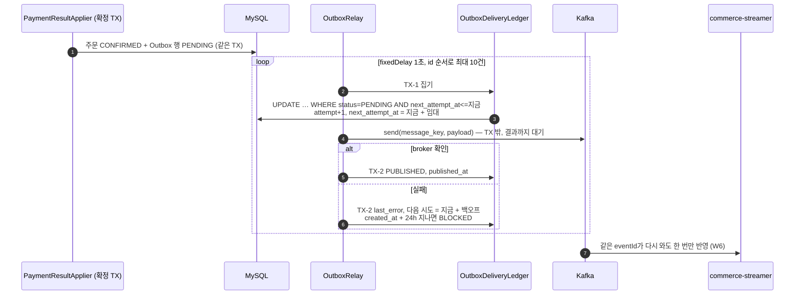
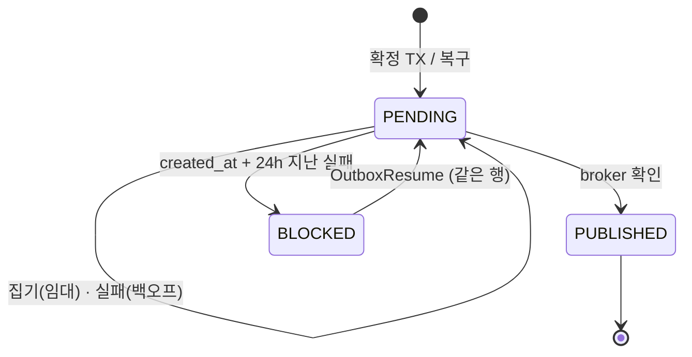

# 7주차 설계 — 확정과 "보낼 사실"을 함께 저장한다

6주차는 주문 확정을 commit한 뒤 메모리 큐에 넘겨 Kafka로 보냈다. commit과 send 사이에서 서버가 죽거나 전송이 실패하면 이벤트가 사라졌고, 무엇이 빠졌는지 찾을 기록도 없었다(W6 D-4).
7주차는 확정과 같은 트랜잭션에 Outbox 행을 저장하고, relay가 그 행을 읽어 broker가 받을 때까지 다시 보낸다. 얻는 것은 **누락 없는 at-least-once**다. 같은 eventId가 Kafka에 두 번 이상 실릴 수 있고, 그 중복은 6주차 consumer가 받는다(W6 D-18).

| 문서 | 내용 |
|---|---|
| `design.md` (이 문서) | 한 장 요약: 범위, 경계, 불변식, 상태, 유스케이스, 결정 목록, 한계 |
| [`decisions.md`](decisions.md) | 결정마다 근거와 버린 대안, 바로잡은 것 |

## 1. 범위

- **이번 주에 하는 것**
  - 확정 TX에서 Outbox 행 저장. 6주차 메모리 큐와 미발행 기록은 삭제한다.
  - relay: 집기, 보내기, 결과 기록, 백오프, 24시간 뒤 BLOCKED, 같은 행 재개.
  - 6주차에 빠진 이벤트 복구: 저장된 사실로, 확정과 같은 코드로 만든다.
  - 6주차 jar로 누락을 실제로 재현하고 7주차로 복구한다.
- **하지 않는 것**
  - 여러 relay의 동시 운영(D-4).
  - PUBLISHED 행 삭제 작업(D-7).
  - BLOCKED 재개용 공개 API(D-15).
  - 지난 주문 전체의 자동 소급(D-5).
  - CDC.
- **바꾸지 않는 것**: 이벤트 계약(`docs/week6/contract/order-confirmed.v1.json`)과 commerce-streamer 코드.

## 2. 경계

- 계층 배치(D-12)
  - `domain/outbox`: 엔티티와 상태 전이 규칙, 저장소 포트.
  - `application/outbox`: relay, ledger, 복구, 재개.
  - `infrastructure`: JPA 구현과 Jackson 직렬화.
  - `interfaces/scheduler`: 스케줄러.
- 임대: producer 최대 전송 시간(`max.block.ms` + `delivery.timeout.ms`)에 1분을 더한다. 측정값은 3분 5초다(D-2).
- 시각 판단은 모두 주입한 `Clock`으로 한다(D-11). 생성 시각만 공용 `BaseEntity`의 `created_at`을 쓴다(D-16).

## 3. 불변식

| | 규칙 | 지키는 곳 | 깨지면 |
|---|---|---|---|
| INV-701 | 처음 CONFIRMED가 된 주문은 같은 TX에서 Outbox 행을 정확히 하나 갖는다. PENDING·UNKNOWN·FAILED는 행을 만들지 않는다 | `PaymentResultApplier` 확정 TX, `event_id` unique | 확정만 남으면 6주차 누락. 행만 남으면 거짓 이벤트 |
| INV-702 | payload는 만든 뒤 바뀌지 않고, Kafka value는 payload와 바이트가 같다 | TEXT 저장, `updatable=false`, relay는 문자열 그대로 전송 | 재발행 내용이 다르면 consumer가 conflict로 기록 |
| INV-703 | PUBLISHED는 broker 확인 뒤에만 기록한다 | relay TX-2, 엔티티 전이 | send 전에 바꾸고 죽으면 다시 집을 행이 없다 |
| INV-704 | 한 행은 한 번에 한 회차만 보낸다 | 조건부 UPDATE, 임대 ≥ producer 최대 전송 시간 | 아직 보내는 중인 행을 다른 회차가 또 보낸다 |
| INV-705 | 안 나간 행은 지우거나 포기하지 않는다. 재개는 같은 행, 같은 eventId | 삭제 경로 없음, `resume`은 상태만 PENDING | 조용한 손실, 또는 consumer가 다른 이벤트로 봄 |
| INV-706 | 복구는 저장된 사실만으로, 확정과 같은 코드로 만든다. PG를 부르지 않는다 | `OrderConfirmedOutbox.create` 한 곳 | 같은 eventId에 다른 내용 → conflict |

## 4. Outbox 행 상태

## 5. 유스케이스 — 행 하나의 결말

| 상황 | 행 | Kafka | 근거 |
|---|---|---|---|
| 확정 commit, relay 정상 | PUBLISHED, 시도 1 | record 1 | INV-701, 703 |
| Outbox 저장·직렬화 실패 | 없음. 확정도 rollback, 다시 적용하면 확정 + 행 1 | 없음 | D-6 |
| commit 뒤 relay 전에 서버 종료 | PENDING. 다음 회차가 보냄 | record 1 | INV-701 |
| broker 확인 뒤 PUBLISHED 저장 전에 중단 | 임대가 지난 뒤 새 relay가 다시 보냄 | 같은 eventId record 2, 구매 활동은 1번 | D-2, W6 D-18 |
| broker 장애 | PENDING, 1초부터 2배씩, 최대 5분 | 회복 뒤 record 1 | D-3 |
| 24시간 넘게 실패 | BLOCKED, 회차가 고르지 않음 | 없음 | D-3 |
| BLOCKED 재개 | 같은 행 PENDING → PUBLISHED | 같은 eventId·payload | INV-705 |
| 6주차에 안 나간 주문 A 복구 | 새 행 → PUBLISHED | record 1, 활동 생김 | D-5 |
| 6주차에 이미 소비된 주문 B 복구 | 새 행 → PUBLISHED | 같은 바이트 record 2, 활동 그대로 | D-5 |
| 복구를 다시 실행 | 같은 행이 있어 변화 없음 | 없음 | D-5 |

## 6. 저장 모델

| 칸 | 설명 |
|---|---|
| `event_id` | `order-confirmed:v1:{orderId}`, unique |
| `order_id`, `event_type`, `schema_version`, `message_key` | 조회용과 전송 key |
| `payload` | 계약 JSON, TEXT, 수정 불가 (D-1) |
| `status` | PENDING / PUBLISHED / BLOCKED |
| `attempt_count`, `next_attempt_at`, `last_error` | 임대와 백오프에 같은 칸을 쓴다. `last_error`에는 payload를 싣지 않고 1000자로 자른다 |
| `created_at`, `published_at` | `created_at`은 `BaseEntity` (D-16) |

인덱스: `(status, next_attempt_at, id)`, `order_id`.

## 7. 결정 목록

- **Outbox 행**: [D-1](decisions.md) payload TEXT 한 번 생성 · [D-12](decisions.md) 계층 배치 · [D-16](decisions.md) `BaseEntity` 상속
- **relay**: [D-2](decisions.md) TX-1 → send → TX-2, 임대와 백오프 · [D-3](decisions.md) 같은 백오프, 24시간 뒤 BLOCKED · [D-4](decisions.md) 한 대, 조건부 UPDATE · [D-11](decisions.md) ledger 빈과 `Clock` · [D-15](decisions.md) id 순서로 10건씩, 재개는 빈 메서드
- **복구와 6주차 정리**: [D-5](decisions.md) 저장된 사실로 같은 코드 · [D-6](decisions.md) 저장 실패 시 확정 rollback (W6 D-26 뒤집음) · [D-7](decisions.md) 보존 기간 순서 · [D-8](decisions.md) conflict 주소 unique 유지 · [D-9](decisions.md) 6주차 부품 삭제
- **6주차 재현**: [D-10](decisions.md) 6주차 jar를 두 번 띄움, streamer는 별도 jar · [D-13](decisions.md) worktree로 jar 빌드 · [D-14](decisions.md) 재현 E2E는 태그로 check 밖

## 8. 한계

- relay는 한 대 전제다. 여러 대로 늘리면 같은 주문의 이벤트 순서가 바뀔 수 있다.
- PUBLISHED는 broker가 받았다는 뜻이지, 소비됐다는 뜻이 아니다.
- 재발행된 conflict는 도착할 때마다 한 줄씩 기록된다(D-8).
- 보존 기간 순서만 정했고, 삭제 작업은 없다(D-7).
- 서버가 send 도중 죽으면 최대 임대 시간(약 3분) 뒤에 다시 보낸다.
