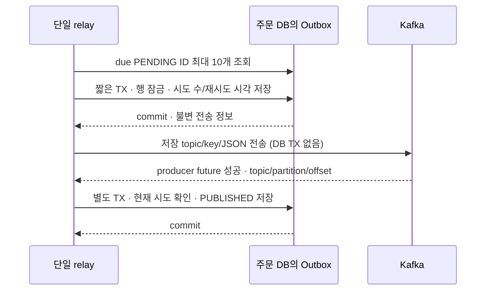

# W7 단일 Outbox relay TDD 기록

후속 3단계의 두 중단·실제 소비 중복 방지 검증은 [중단·재발행 E2E 기록](outbox-republication-e2e-tdd-log.md)을 따른다. 아래는 relay 증분 당시의 범위·실행 결과로 보존한다.

2026-11-06 후속의 실제 Kafka 응답 불능·SQL 대기량 관찰·같은 행 재개 검증은 [Kafka 통신 장애·재개 기록](outbox-kafka-outage-tdd-log.md)을 따른다. 아래의 합성 future 검사 및 당시 검사 건수와 구분한다.

2026-11-04 · [원자성 선행 기록](outbox-atomicity-tdd-log.md) · [체크리스트](implementation-checklist.md) · [정책](../week2/commerce-policy-decisions.md#w7-outbox-설계의-선택과-질문) · [전체 설계](../week2/commerce-erd-draft.md#w7-outbox와-단일-relay-설계)

## 이번에 연결한 범위

최초 주문 확정 TX에 저장한 Outbox를 **DB TX 밖에서 Kafka로 보내고, broker 성공 확인 뒤 별도 TX로 PUBLISHED를 기록**한다. 주문·PG·재고의 기존 트랜잭션과 잠금 순서는 변경하지 않았다. 기존 원자성 증분의 BEFORE_COMMIT 기록과 relay를 연결했으며 주문 경로에서 직접 Kafka send를 병행하지 않는다.

이번 실제 broker 검증은 저장 Outbox부터 전달 상태까지다. 주문 API·PG·streamer를 모두 연결한 W7 중단/재발행 E2E와 같은 실행의 W6 두 사례 보충은 다음 단계다. W6 재현용 직접 발행 테스트는 유지하며 W7 완료 증거로 대신 사용하지 않는다.

## 사용자 선택과 초기값

| 항목 | 선택 | 이유·비용 |
| --- | --- | --- |
| 실행 위치 | commerce-api의 전용 단일 스레드, 자동 실행 기본 OFF | 별도 앱 없이 시작하며 테스트에서 외부 자원에 자동 접근하지 않는다. API 재시작 동안 relay도 중단된다. |
| 활성화 | `commerce.outbox-relay.enabled` / `OUTBOX_RELAY_ENABLED`, 지정한 한 인스턴스만 true | 여러 API 중 하나만 발행한다. 메모리 중첩 방지는 다른 프로세스까지 보호하지 않는다. OFF는 전송 중지이며 Outbox 기록 중지가 아니다. |
| 회차 간격 | 이전 회차 종료 후 1초 | 느린 회차와 다음 tick을 겹치지 않는다. 1초마다 모든 사건이 전달된다는 의미는 아니다. |
| 묶음 | due PENDING 최대 10건, `nextAttemptAt → id` 순서, 순차 전송 | 작은 시작값으로 한 회차의 작업량을 제한한다. 최대 처리량을 위한 병렬화는 넣지 않는다. |
| 전송 예산 | 한 건 12초, 전송 접수와 future 대기를 같은 경과 시간 예산으로 계산 | 기존 producer의 접수 대기 최대 1초·전달 timeout 10초에 여유를 둔다. DB 시간은 제외하며 producer 설정을 변경하지 않는다. 10건이 모두 느리면 약 2분의 전송 시간과 DB 시간이 추가될 수 있다. |
| 재시도 | 실패 확인 뒤 5→10→20→40→60초, 이후 60초 | 장애 중 빠른 반복을 줄이면서 원인 해결 후 같은 행으로 재개한다. 재시도 가능 시각이며 실제 실행은 다음 polling과 앞선 작업에 따라 늦어질 수 있다. |
| 한 회차의 실패 | 첫 전송 실패·timeout·결과 저장 실패에서 회차 종료 | 같은 장애에 연달아 전송하는 것을 줄인다. 다음 회차에는 아직 기한이 오지 않은 실패 행을 제외하고 다른 due 행을 처리할 수 있다. |
| 반복 오류 | PENDING 보존·계속 재시도, BLOCKED 없음 | 운영자가 원인을 해결하면 자동 재개된다. 영구 오류도 계속 남으므로 오류 로그·대기량 확인이 필요하다. 자동 삭제·성공 간주는 하지 않는다. |

값은 선택한 초기 실험값이며 운영 처리량이나 SLA의 최적값을 측정해 정한 것은 아니다. 별도 relay 앱, 병렬 batch, BLOCKED 수동 재개는 이번에 채택하지 않은 대안이다.

## 순서와 실패 경계



| 경계 | 구현 |
| --- | --- |
| 전송 전 | `OutboxDeliveryTransactions.beginAttempt`가 행 잠금 뒤 due를 재확인하고 시도 수를 증가시킨다. `시작 시각 + 전송 예산 + 해당 backoff`를 미리 저장해 프로세스 중단·결과 저장 실패에도 재개 시각을 남긴다. |
| TX 범위 | 조회·시도 시작·결과 변경은 짧은 REQUIRES_NEW TX다. 이는 전달 상태 변경에만 적용한다. 주문 확정과 최초 Outbox INSERT의 공동 TX를 분리하지 않는다. relay 진입에 기존 호출자 TX가 있으면 거절한다. |
| 실제 전송 | 전용 StringSerializer가 저장 JSON을 그대로 보낸다. 기존 객체용 W6 producer와 구분한다. 현재 상품이나 바뀐 topic 설정으로 payload를 다시 만들지 않는다. |
| 성공 | `send()` 반환만으로 완료 처리하지 않는다. future 성공 metadata를 확인한 뒤 현재 PENDING·동일 시도 번호일 때만 PUBLISHED와 publishedAt을 저장한다. |
| 실패·timeout | 같은 행의 PENDING을 보존하고 오류 코드와 `실패 관찰 시각 + backoff`를 기록한다. timeout은 broker record 0건이라는 증거가 아니다. |
| broker 성공 뒤 상태 저장 실패 | 이미 commit됐는지 불확실할 수 있어 별도 실패 갱신으로 PENDING을 강제하지 않는다. 실제 DB가 PENDING이면 미리 저장한 기한 뒤 같은 사건을 재발행한다. 이미 PUBLISHED면 다음 조회에서 제외한다. |
| 늦은 완료 | Kafka future callback은 DB를 변경하지 않는다. 이전 시도의 늦은 완료는 새 시도의 상태를 덮어쓰지 못하며 상태 모델도 시도 번호를 검사한다. |
| 중첩 | scheduler와 내부 `runOnce()`가 같은 singleton의 AtomicBoolean을 사용한다. 중첩 진입은 skip한다. 분산 잠금·다중 relay 보장은 아니다. |
| 시각 | 저장·재시도 판단에는 주입 Clock, 대기 예산에는 monotonic 경과 시간을 사용한다. 테스트의 짧은 대기는 운영 기본값을 변경하지 않는다. |

종료 시 scheduler의 15초 대기 설정은 애플리케이션 전체 종료 상한이 아니다. Spring lifecycle은 진행 중 회차의 정상 종료를 먼저 기다릴 수 있다. 이번 설정 검증은 기동·유휴 종료이며 실행 중 OS 강제 종료 실험은 아니다.

`attemptCount`는 **DB에 commit한 시도 시작 횟수**다. 실제 send 직전에 중단될 수도 있으므로 send 호출 수나 broker record 수와 같다고 해석하지 않는다. PUBLISHED는 broker 확인 기록이지 streamer 구매 활동 완료가 아니다. 재발행은 허용하며 기존 consumer의 중복 방지가 필요하다.

## 변경 책임과 테스트

| 책임 | 코드 | 검증 |
| --- | --- | --- |
| 상태·기한·시도 번호 | `domain/outbox/OutboxMessage`, `OutboxDeliveryAttempt`, `application/outbox/OutboxRetryPolicy` | 단위 8개: 상태·불변 사실·이전 시도 거절·backoff 상한/입력 |
| due 조회·행 잠금·별도 TX | `OutboxRepository`, `OutboxJpaRepository`, `OutboxDeliveryTransactions` | 격리 MySQL 5개: 정렬/limit·기한 제외·실제 저장·rollback·재개 |
| 실행 조율 | `application/outbox/OutboxRelay` | 단위 11개: 순차 실행·미완료 future·중첩·접수 시간 포함·동기/비동기 실패·상태 저장 실패·늦은 완료 |
| DB와 실행 조율 연결 | `OutboxRelayIntegrationTest` | 격리 MySQL 6개: 전송 TX 없음·commit된 PENDING·timeout 후 새 runner·실제 CHECK 실패로 상태 TX rollback·늦은 시도 보호 |
| 실제 DB와 broker 연결 | `OutboxRelayKafkaIntegrationTest` | 1개: 운영 relay/sender/TX로 실제 broker metadata·JSON/key와 PUBLISHED 대조, 재실행 시 추가 record 0 |
| Kafka 전송·wire | `KafkaOutboxSender`, `OutboxKafkaConfiguration` | adapter 5개·설정 2개·실제 Kafka wire 1개: 저장 topic/key/JSON 보존·이중 인코딩 없음·실패 전파 |
| 자동 실행 | `OutboxRelayConfiguration`, `interfaces/scheduler/OutboxRelayScheduler` | 설정 3개: 기본 OFF·명시적 ON의 실제 스케줄 실행·잘못된 수치 거절 |

새 테스트 합계는 **10개 스위트·42개**, 실패·오류·skip 0이다. 모든 DB 테스트는 Testcontainers의 별도 DB를 사용하며 Kafka 테스트는 소유 컨테이너와 UUID topic/group을 사용한다.

## TDD 실행 기록

1. **Red:** 먼저 테스트·포트 기대값을 작성하고 실행했다. 미구현 relay/상태/전송 타입·메서드로 컴파일 실패했다. assertion 실패 Red와 구분한다. 로그: `/private/tmp/w7-relay-red.log`.
2. **첫 Green 실행 실패:** 최소 구현 후 41개 중 4개가 실패했다. Spring 저장소 예외 변환을 원인까지 검사하도록 수정하고, 중첩 테스트의 sendBudget mock 값을 맞췄다. 시간 설정은 DurationStyle로 명시적으로 파싱해 좁은 설정 context에서도 단위를 해석한다. 정책·기대값은 완화하지 않았다.
3. **Green:** 실제 DB+Kafka 결합 테스트를 포함한 42개가 모두 통과했다. `/private/tmp/w7-relay-green.log`, `BUILD SUCCESSFUL`, 종료 코드 0.
4. **회귀·정적 검사:** 아래 최종 검사 기록을 따른다.

첫 Green 명령은 신규 클래스 10개를 `:apps:commerce-api:test --tests ... --console=plain`으로 지정했다. 최종 회귀에서 같은 테스트를 다시 포함한다.

## 최종 관련 회귀·정적 검사

```bash
./gradlew :apps:commerce-api:test \
  --tests 'com.loopers.application.order.*' \
  --tests 'com.loopers.application.event.*' \
  --tests 'com.loopers.application.outbox.*' \
  --tests 'com.loopers.domain.outbox.*' \
  --tests 'com.loopers.domain.order.*' \
  --tests 'com.loopers.infrastructure.outbox.*' \
  --tests 'com.loopers.infrastructure.event.*' \
  --tests 'com.loopers.interfaces.api.order.*' \
  --tests '*ArchitectureTest' \
  :apps:commerce-api:checkstyleMain :apps:commerce-api:checkstyleTest \
  :apps:commerce-streamer:check --console=plain
```

| 검사 | 이번 결과 |
| --- | --- |
| API 관련 회귀 | **61개 스위트·851개 테스트**, 실패·오류·skip 0. 새 relay 42개를 포함한 수치이며 851+42로 합산하지 않는다. API 전체 테스트 수가 아니라 위 지정 범위다. |
| 실제 연결 | 주문/PG 기존 회귀·W7 공동 저장·W6 보존 전체 흐름, 신규 실제 Outbox DB/Kafka 테스트 포함 |
| API ArchUnit | 위 테스트에 포함, 통과 |
| API Checkstyle | main/test 모두 실제 실행, XML 위반 0 |
| streamer check | **UP-TO-DATE**. 이번에 99개를 새로 실행한 것으로 표시하지 않는다. 코드 변경 없이 직전 9개 스위트·99개 통과와 ArchUnit·Checkstyle 결과를 Gradle이 재사용했다. |
| 종료 | `/private/tmp/w7-relay-regression.log`, BUILD SUCCESSFUL·종료 코드 0 |
| diff | `git diff --check` 통과. 검사 통과를 위해 기대값·ArchUnit·lint 규칙을 삭제하거나 완화하지 않음 |

Gradle·Testcontainers 종료 뒤 `docker ps` 결과가 비어 있음을 확인했다. 실제 테스트 종료·컨테이너 정리는 완료됐다. 사용자 환경의 DB/기존 topic/group/볼륨을 지우는 정리 명령은 사용하지 않는다.

## 관찰과 재개

로그는 `outbox_attempt_started`, `outbox_broker_ack`, `outbox_send_unconfirmed`, `outbox_state_write_failed`, `outbox_retry_write_failed`, `outbox_relay_round_failed`로 구분한다. eventId·시도 수·broker metadata 또는 안전한 오류 종류를 남기며 payload와 예외 원문을 로그에 출력하지 않는다. DB `last_error`는 TIMEOUT/SEND_FAILED/INTERRUPTED 같은 제한된 코드다. 상세 원인 조사는 관련 broker·DB 상태와 함께 해야 한다.

다음은 운영자가 읽기 전용으로 사용할 관찰 SQL 예시이며 사용자 DB에서 실행하지 않았다.

```sql
SELECT status, COUNT(*) AS message_count, MIN(created_at) AS oldest_created_at
FROM outbox_message GROUP BY status;

SELECT event_id, attempt_count, next_attempt_at, last_error
FROM outbox_message
WHERE status = 'PENDING'
ORDER BY next_attempt_at, id LIMIT 10;
```

오류 원인 제거 후 지정한 하나의 인스턴스에서 relay를 켜면 기존 행의 기한에 맞춰 재개한다. 새 Outbox·새 eventId를 만들어 우회하지 않는다. Kafka 전송 실패나 PUBLISHED 저장 실패 때문에 PG 결제를 다시 호출하지 않는다. 미발행 행과 consumer dedup 사실의 보존 기간을 임의로 줄이면 늦은 재전달의 중복 방지를 잃을 수 있다. 이번에는 자동 정리 기능을 추가하지 않았다.

## 남은 범위

- 실제 확정 TX 뒤 relay 전 중단, 실제 broker ACK 뒤 PUBLISHED 저장 전 중단을 같은 자원에서 재개하고 streamer 구매 활동까지 확인한다.
- 같은 eventId의 별도 broker record 재발행에도 구매 활동·기존 PK/수량이 한 번만 남는지 전체 E2E로 확인한다.
- 실제 W6 정상·발행 누락 두 사례를 새 격리 실행에서 준비한 뒤 같은 DB/broker/PG 상태로 Outbox 보충·재전달한다. 복구 중 PG 추가 호출 0을 따로 대조한다.
- 전체 W7 결과·보존/관찰·제출 문서를 최종 대조한다. 기존 W6 C09 revision 연결은 완료된 기반으로 유지한다.

사용자 DB·기존 topic/group·볼륨은 변경하지 않았고 커밋·푸시하지 않았다.
