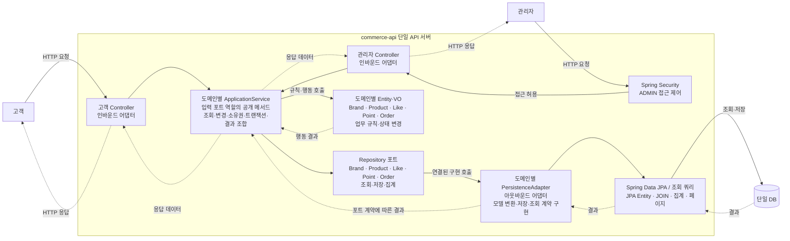
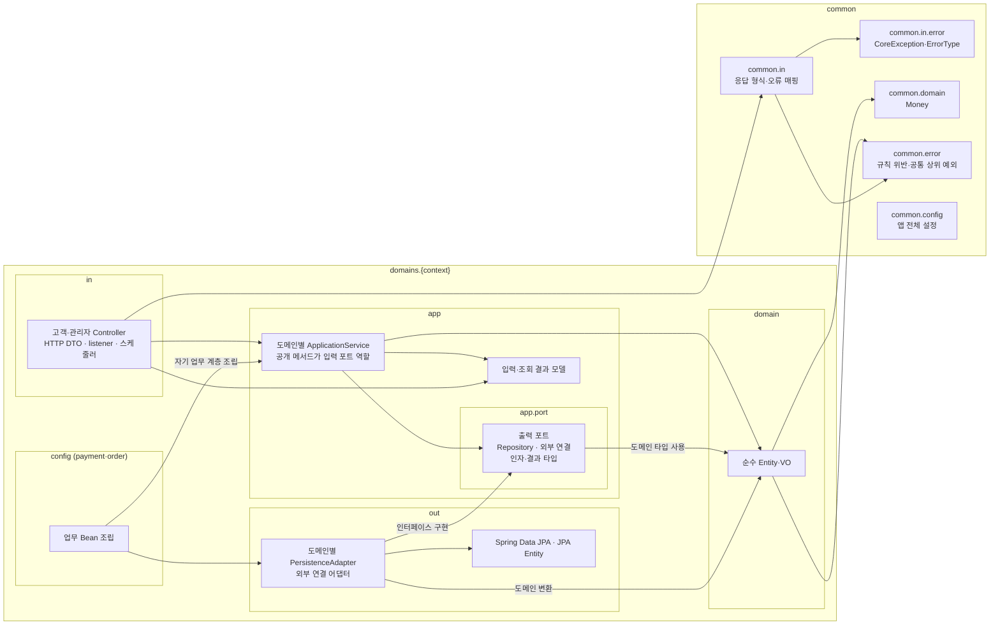
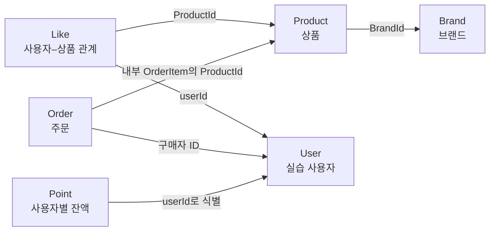
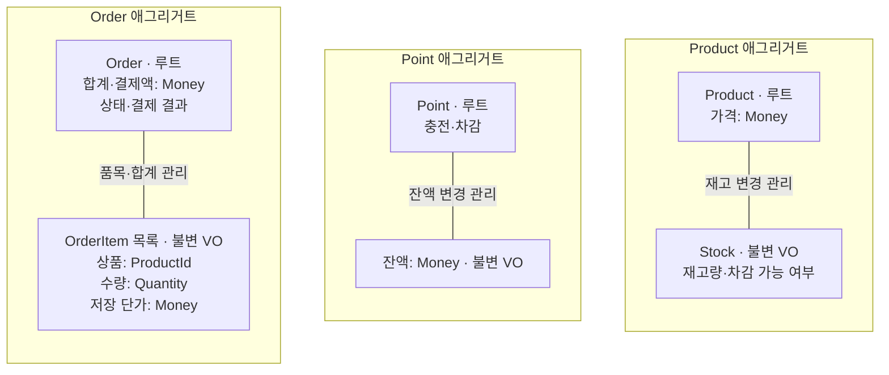
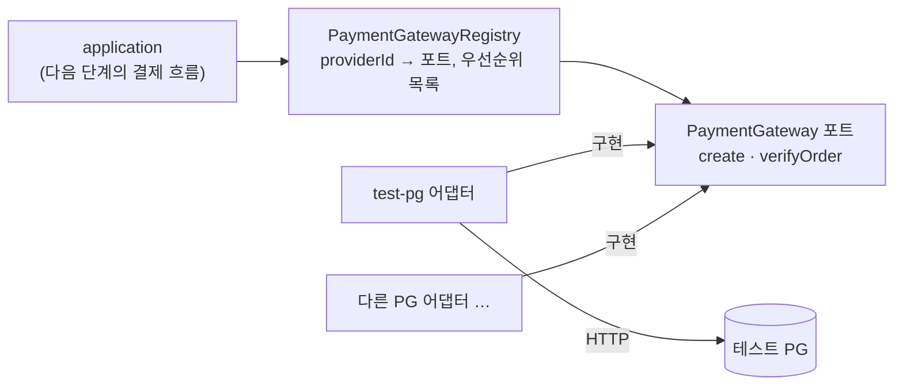

# Week 8 — 커머스 설계 (한정 수량 쿠폰 발급)

이 문서는 `docs/week7/commerce-events.md`를 복사해 8주차 작업을 반영한 현재 설계 기준이다(2026-11-11 사용자 승인). 7주차 문서는 제출 당시 기록으로 그대로 둔다. 1~28절은 7주차 설계를 그대로 이어받았고, 8주차 쿠폰 발급은 29절에 추가한다. 이 아래 문단의 "7주차" 표현은 이어받은 절의 출처를 뜻한다.

> **표시 규칙** — `[확정]`: 승인 없이 변경하지 않는 합의. `[임시]`: 연속 구현 중 사용자 승인으로 정한 현재 기준이며, 변경은 제안·승인 후 이 문서와 구현·테스트에 함께 반영한다. `[미결]`: 아직 정하지 않은 항목이며, 사용자 결정 전에는 구현하지 않는다. 하위 절은 상위 절의 표시를 따르며, 하위 절에 별도 표시가 있으면 그 표시를 따른다. 구체적인 HTTP 계약과 잠금 전략은 6절의 구현 정책과 8~13절의 3주차 설계와 15~20절의 4주차 설계와 21~26절의 5주차 설계와 27절의 6주차 설계와 2절·28절의 7주차 설계와 29절부터의 8주차 설계를 따른다. 작업 방식은 `AGENTS.md`를 따른다.

## 1. 버드뷰 [확정]

고객과 관리자는 하나의 API 서버와 DB를 사용한다. 고객은 상품 조회·좋아요·포인트·주문을 요청하고, 관리자는 브랜드·상품·재고를 관리하고 주문을 조회한다.



실선은 실행 중 요청·호출, 점선은 결과·응답이다. 반환 경로는 일부 축약했다. application이 도메인 행동과 포트 호출을 조율하며, domain은 DB를 직접 호출하지 않는다. 도메인별 Repository와 어댑터가 조회·저장을 함께 처리하며 별도 UseCase·Facade 계층은 두지 않는다.

## 2. 구조와 의존 [확정]

순수 도메인과 JPA 모델을 분리한 헥사고날 구조를 사용한다. **Controller → ApplicationService → Entity·VO / 출력 포트 → JPA 어댑터**를 기본 구성으로 한다. 7주차부터 commerce-api 패키지는 계층 먼저(`interfaces/application/domain/infrastructure` 아래 각 업무)가 아니라 **업무 먼저**로 나눈다(D99). 업무는 `com.loopers.domains.{context}.{in,app,domain,out}`에 묶고, 여러 업무가 함께 쓰는 것은 `com.loopers.common`에 둔다(D109, 2026-11-03 사용자 결정). 바뀐 것은 패키지 배치와 계층 규칙이고 동작·테이블은 그대로다(D102). 공개 응답은 브랜드 변경 PUT 한 곳만 바로잡았다(D108, 아래).

### 패키지 구조 (D99·D104·D109, 2026-11-03)

| 패키지 | 역할 | 허용하는 주요 의존 |
| --- | --- | --- |
| `domains.{context}.in` | 고객·관리자 HTTP 입력·응답, 식별 정보 전달, 오류 매핑. Kafka 명령 listener·스케줄러처럼 app을 부르는 입력도 여기 둔다 | app(같은·다른 컨텍스트), 다른 컨텍스트의 in(고객 식별 `user.in.CustomerIdentity`), `common.in`, `common.in.error`, `common.error` |
| `domains.{context}.app` | 도메인별 ApplicationService에서 실행 순서·소유권·트랜잭션 조율, 입력·조회 결과 모델 | domain, `app.port`, `common.domain`, `common.error`, Spring 트랜잭션. 다른 컨텍스트의 app·app.port·domain(예: order.app → payment.app·app.port·domain, product.app → brand.app.port, 아래 "컨텍스트 사이 의존" 표) |
| `domains.{context}.app.port` | 출력 포트(Repository·외부 연결 인터페이스)와 그 인자·결과 타입 | domain, `common.domain` |
| `domains.{context}.domain` | Entity·VO의 상태와 업무 규칙 | Java, 필요한 도메인 타입, `common.domain`, `common.error` |
| `domains.{context}.out` | 출력 포트 구현, JPA 저장·조회, 외부 연결, 도메인 모델 변환 | `app.port`, domain, JPA·외부 클라이언트 |
| `domains.{context}.config` | 그 업무 하나만 쓰는 Bean 조립·설정 속성(업무의 배치도) | 자기 업무의 모든 계층. 다른 업무는 모른다 |
| `common.domain` | 여러 업무가 함께 쓰는 값(`Money`) | Java, `common.error` |
| `common.error` | 여러 계층이 함께 쓰는 업무 신호: 규칙 위반(`InvalidValueException`, `RuleViolationException`)과 상태별 공통 상위 예외(`NotFoundException`, `TemporarilyUnavailableException`) | Java |
| `common.in` | 여러 업무가 함께 쓰는 HTTP 공통(`ApiResponse`, `ApiControllerAdvice`, `CommerceExceptionAdvice`, `RequestValues`) | `common.error`, `common.in.error`, Spring web. 업무(`domains`)는 모른다 |
| `common.in.error` | HTTP 응답용 `CoreException`·`ErrorType`(옛 starter `support.error`) | Java, Spring http |
| `common.config` | 앱 전체 설정(`AdminBoundaryConfig`, `CommerceJpaRepositoriesConfig`) | Spring. 업무 클래스는 모른다 |

- 컨텍스트는 brand, like, user, point, product, payment, order 일곱이다. 실제로 있는 계층은 다음과 같다.

| 컨텍스트 | 계층 |
| --- | --- |
| brand · point · product | in, app, domain, out |
| payment · order | in, app, domain, out, config |
| like | app, domain, out (좋아요 HTTP는 `domains.product.in`에 있다) |
| user | in, app, out (도메인 규칙이 없다. in에는 여러 업무가 쓰는 고객 식별 `CustomerIdentity`가 있다) |

- 최상위 `config`·`support` 패키지는 없어졌다(D109). `CommerceApiApplication`은 컴포넌트·설정 속성 스캔 기준이라 `com.loopers`에 그대로 둔다. starter `example` 패키지는 지웠다(D104).
- **config 자리(D109):** 한 업무만 쓰는 설정은 그 업무의 조립 지점(`domains.{context}.config`)에 둔다. 결제는 `PaymentGatewayConfig`·`PaymentLookupConfig`·`PaymentClockConfig`·`PaymentProvidersProperties`, 주문은 `OrderEventsKafkaConfig`다. 이 설정들은 app(비포트)·domain·out을 함께 엮으므로 in·out 안에 두면 규칙 2·5에 걸린다. 앱 전체 설정은 `common.config`에 둔다.
- `PaymentClockConfig`의 `Clock` Bean은 결제 쪽(`PaymentLookupConfig`, `PaymentCircuitBreakers`)과 주문 서비스(`OrderApplicationService`)가 함께 주입받는다. 타입으로 주입하므로 주문이 결제 config를 import하지 않는다.
- domain과 JPA 엔티티는 지금처럼 분리를 유지한다(D101). JPA 엔티티는 `domains.{context}.out`에 있고 domain은 JPA를 모른다.
- streamer·batch·modules는 이 구조 변경의 범위 밖이다(`modules/jpa`의 `com.loopers.domain.BaseEntity` 포함).



이 그림은 소스의 의존 방향이다. out이 app의 출력 포트를 구현한다. app은 out·in에, domain은 다른 계층·Spring·JPA·HTTP에 의존하지 않는다. in은 domain·out을 직접 쓰지 않고 app만 부른다. config는 자기 업무 계층을 조립하지만 계층은 config를 모른다. common은 업무를 모른다.

### 계층 규칙 (ArchUnit, 2026-11-03)

`ArchitectureTest`가 아래 규칙을 컴파일된 클래스(바이트코드)로 검사한다. 업무 계층은 패키지 패턴 `com.loopers.domains.(*).{in,app,domain,out,config}..`로 가린다. common은 이 패턴에 들지 않으므로 규칙 8과 common 규칙으로 따로 검사한다. freeze·ignore·예외 목록은 두지 않고, 위반은 코드를 옮겨 고친다.

| 규칙 | 내용 | 이유 |
| --- | --- | --- |
| 1 | domain은 app·in·out을 모른다 | 업무 규칙이 입출력·저장 방식에 끌려 바뀌지 않게 한다 |
| 2 | in은 domain·out을 모르고 app만 쓴다 | domain·저장 구현을 직접 쓰면 app의 트랜잭션·규칙을 우회한다 |
| 3 | app은 in·out을 모른다 | 포트로만 바깥과 연결해, 입력 방식·저장 구현이 바뀌어도 app은 그대로다 |
| 4 | out은 in을 모른다 | 바깥끼리 엉켜 app을 거치지 않는 흐름이 생기는 것을 막는다 |
| 5 | out은 app 중 `app.port`만 쓴다 | 구현은 포트(인터페이스와 그 인자·결과)만 알아, 서비스를 바꿔도 구현이 같이 깨지지 않는다 |
| 6 | 컨텍스트마다 있는 계층, payment·order의 config, common 하위(domain·error·in·in.error·config)의 클래스가 실제로 비어 있지 않고 규칙 패턴에 들어간다 | 패키지 이름이 틀리면 그 클래스는 규칙에 걸리지 않고 조용히 통과한다. 패턴 상수의 오타도 막는다. `allowEmptyShould(true)`는 쓰지 않는다 |
| 7(a) | 업무 config는 자기 업무 밖의 `domains` 패키지를 모른다 | 다른 업무를 엮으면 업무 사이 결합이 조립 지점에 숨어 경계 정리 때 보이지 않는다. 업무는 패키지 이름에서 읽어 새 업무의 config도 자동으로 검사한다 |
| 7(b) | in·app·domain·out은 업무 config와 `common.config`를 모른다 | 조립은 바깥에서 한다. 계층이 config를 알면 조립 방식이 바뀔 때 업무 코드가 따라 바뀐다 |
| 8 | `common`은 `domains`를 모른다 | common은 여러 업무가 함께 쓰는 바닥이다. 특정 업무를 알면 업무를 추가·삭제할 때 common이 따라 바뀐다 |
| common 내부 | `common.domain`·`common.error`는 `common.in`·`common.config`를 모른다 | 공통 값·예외가 HTTP 공통·조립을 알면 domain이 그것을 거쳐 HTTP·조립을 알게 된다 |

- 기술 의존 규칙
  - 업무 domain과 `common.domain`은 Spring·JPA(`jakarta.persistence`·`javax.persistence`)·servlet·`java.net.http`·`common.in.error`를 모른다.
  - app·domain과 `common.domain`·`common.error`는 `java.net`·Spring web/http·Jackson·Resilience4j를 모른다. HTTP 클라이언트·JSON·서킷 브레이커는 out의 구현 세부다.
- **`common.error`와 `common.in.error`의 차이:** `common.error`는 여러 계층이 함께 쓰는 순수 Java 업무 신호라 domain도 쓸 수 있다. `common.in.error`는 HTTP 응답용 `CoreException`·`ErrorType`(옛 starter `support.error`)이라 domain에서 쓰지 않는다.
- **공통 상위 예외와 응답 매핑(D109·r2-1, 2026-11-03):** 업무 예외는 `common.error`의 공통 타입을 상속하고, `common.in.CommerceExceptionAdvice`는 공통 타입만 처리한다. HTTP 상태로 바꾸는 일은 advice에만 있다. 응답 상태·본문은 바꾸기 전과 같다.

| 공통 타입(`common.error`) | 상속하는 업무 예외 | 응답 |
| --- | --- | --- |
| `NotFoundException` | `BrandNotFoundException`, `ProductNotFoundException`, `OrderNotFoundException` | 404 `Not Found` |
| `TemporarilyUnavailableException` | `PaymentLookupNotCalledException` | 503 `Service Unavailable` |
| `InvalidValueException` | (직접 사용) | 400 `Bad Request` |
| `RuleViolationException` | (직접 사용) | 409 `Conflict` |

- 모든 규칙은 하나씩 일부러 위반을 넣어 해당 규칙만 실패하는 것을 확인했다(작업 사본, 원복).
- 규칙이 들어올 때 고친 위반은 다음과 같다. 모두 패키지 이동이나 타입 변경으로 고쳤고 동작은 그대로다.
  - `OrderConfirmedPayload`를 `order.app.port`로 옮겼다. 발행 포트의 인자다(규칙 5).
  - `ProductListQuery`·`ProductListItem`을 `product.app.port`로 옮겼다. 목록 캐시 포트의 인자·결과다(규칙 5).
  - `PaymentLookupScheduler`를 `order.in`으로 옮겼다. 주문 서비스를 부르는 입력 쪽이다(규칙 5).
  - `BrandApplicationService.getBrand`가 `BrandId` 대신 `long`을 받는다(규칙 2).
  - `BrandResult.id`를 domain 타입 `BrandId`에서 `long`으로 바꿨다(규칙 2).
  - 업무 예외 4개가 `common.error`의 공통 타입을 상속하고, advice는 공통 타입만 처리한다(규칙 8).
  - `CustomerIdentity`를 `common.in`에서 `domains.user.in`으로 옮겼다(규칙 8).
- `PUT /api-admin/v1/brands/{id}` 응답은 그동안 `BrandId`가 그대로 직렬화되어 `data.id = {"value":N}`이었다. 이것을 숫자로 바로잡았다(공개 응답 변경, 사용자 승인 2026-11-03, D108). 이제 다른 브랜드 응답처럼 `data.id = N`이고, `BrandApiIntegrationTest`가 이 모양을 확인한다.

### JPA 리포지토리 스캔

`modules/jpa`의 `JpaConfig`는 `@EnableJpaRepositories("com.loopers.infrastructure")`만 스캔한다(streamer가 쓴다). commerce-api는 `common.config.CommerceJpaRepositoriesConfig`가 `@EnableJpaRepositories("com.loopers.domains")` 한 줄로 업무 아래 리포지토리를 등록한다. 새 업무가 생겨도 목록을 관리할 필요가 없다. 리포지토리 인터페이스는 각 업무의 out에만 둔다. 두 스캔 범위는 겹치지 않아 중복 등록이 없다. 엔티티 스캔은 `@EntityScan("com.loopers")`라 따로 할 일이 없다.

### 컨텍스트 사이 의존 (제출 뒤 작업의 출발점)

규칙 1~8은 컨텍스트 안의 계층 방향과 config·common의 경계만 본다. 컨텍스트 사이 경계 규칙(규칙 15~17)과 주문·결제 포트 분리(D100)는 이번 범위 밖이다(D102). 대신 지금 의존을 남긴다. 아래 수는 commerce-api main 코드에서 파일마다 다른 컨텍스트 클래스를 참조하는 (파일, 클래스) 쌍의 수다(2026-11-03 R2 뒤, `common` 제외).

| 방향 | 수 | 참조하는 계층 → 대상 | 주된 이유 |
| --- | --- | --- | --- |
| order → payment | 20 | app → payment.app(서비스 보조·정책)·app.port·domain | 결제 기록·PG 포트·조회 해석·만료 정책을 주문 서비스가 직접 쓴다(D100 대상) |
| product → brand | 7 | app·domain·out → brand.app·app.port·domain | 상품의 브랜드 ID, 브랜드 존재 확인·브랜드명 조합 |
| order → product | 6 | app·domain·out → product.app·app.port·domain | 재고 예약·반환, 주문 품목의 상품 ID |
| like → product | 6 | app·domain·out → product.app·app.port·domain | 상품 존재 확인, 좋아요 대상 상품 ID |
| brand → product | 3 | app → product.app·app.port·domain | 브랜드 일괄 삭제 때 연결 상품 처리, 목록 캐시 무효화 이벤트 |
| product → like | 2 | in·app → like.app·app.port | 상품 쪽 좋아요 HTTP, 내가 좋아요한 상품 목록 조회 |
| payment → order | 1 | in → order.app | PG callback이 주문 서비스의 결과 반영을 부른다 |
| brand → user | 1 | in → user.app | 고객 식별(`UserIdentificationService`) |
| order → user | 1 | in → user.in | 고객 식별(`CustomerIdentity`) |
| point → user | 1 | in → user.in | 고객 식별(`CustomerIdentity`) |
| product → user | 1 | in → user.in | 고객 식별(`CustomerIdentity`) |

- 다른 컨텍스트의 domain 타입(`BrandId`·`ProductId` 등)을 직접 쓰는 곳, 다른 컨텍스트의 app 서비스를 부르는 곳(`payment.in` → `OrderApplicationService`, `product.in` → `LikeApplicationService`), 다른 컨텍스트의 in을 쓰는 곳(order·point·product의 in → `user.in.CustomerIdentity`)이 경계 규칙을 넣을 때 정리할 대상이다.
- 업무 config(payment·order)는 규칙 7(a)로 자기 업무만 알아 위 표에 들어가는 것이 없다.

### 필요한 구성만 유지

- Controller는 인바운드 어댑터다. 고객·관리자 Controller와 DTO를 구분하되 같은 도메인을 사용한다.
- application은 Brand·Product·Like·Point·Order별 ApplicationService 하나로 시작한다. 공개 메서드가 입력 포트 역할을 하며 별도 UseCase 인터페이스·Facade·Command Handler는 두지 않는다. 입력·반환에 HTTP DTO를 사용하지 않는다.
- Repository는 아웃바운드 포트이고, PersistenceAdapter가 이를 구현해 Spring Data JPA를 사용한다.
- **결제 해석 책임 분리(2026-10-21 사용자 승인):** application의 순수 결과 객체 `PaymentLookupAssessment`가 PG 조회의 건수·보증 수준을 해석한다. 거래의 주문 ID·금액·저장 키 일치는 `PaymentRecord.compareTransaction`이 판단한다. 두 객체는 저장소·Spring·HTTP에 의존하지 않는다. 별도 ApplicationService·Facade는 추가하지 않는다.
- 도메인별 어댑터로 시작한다. ProductPersistenceAdapter처럼 해당 도메인의 Repository를 구현해 조회·저장을 함께 처리한다. 전체 도메인을 통합하거나 메서드마다 어댑터를 나누지 않는다. 단순 모델 변환은 내부 메서드로 처리하고 Mapper 클래스를 일괄 추가하지 않는다.
- 이름·설명까지 모두 VO로 만들거나 단순 규칙을 별도 도메인 서비스로 옮기지 않는다. 기존 경계를 유지하는 내부 리팩터링은 자율적으로 수행하고, 새 계층·입력 인터페이스 도입이나 서비스 책임 경계 변경은 이유와 영향을 설명하고 확인받는다.

| 서비스 | 책임 |
| --- | --- |
| BrandApplicationService | 브랜드 CRUD·조회, 브랜드와 연결 상품의 일괄 논리 삭제 |
| ProductApplicationService | 상품 CRUD·재고 설정·조회 |
| LikeApplicationService | 좋아요 등록·취소·내 목록 |
| PointApplicationService | 충전·잔액 조회 |
| OrderApplicationService | 주문 생성·확정·고객/관리자 조회 |

### 조회·변경 경계

CQRS를 적용하지 않는다. 도메인별 ApplicationService와 Repository가 조회·변경을 함께 처리한다. 별도 조회 전용 포트·서비스를 두지 않는다. 포트는 해당 컨텍스트의 `domains.{context}.app.port` 패키지에 두며, 도메인 타입이나 같은 `app.port`의 인자·결과 타입을 사용한다. JPA Entity·Spring Data `Page`·HTTP DTO는 노출하지 않는다.

고객 상품 목록·상세와 변경 대상은 **ProductRepository**에서 Product로 조회한다. 상품 변경은 Product의 행동을 호출한 뒤 저장한다. 조회 결과 조합은 **ProductApplicationService**에서 수행한다.

1. ProductRepository에서 조건에 맞는 상품 페이지를 조회한다.
2. 페이지의 브랜드 ID 목록으로 BrandRepository에서 브랜드를 일괄 조회한다.
3. 페이지의 상품 ID 목록으로 ProductRepository에서 좋아요 수(`products.like_count`)를 일괄 조회한다(18절).
4. application 결과 DTO로 조합하고 Controller가 HTTP 응답으로 변환한다. 상세 조회도 같은 책임 배치를 따른다.

상품마다 추가 조회하지 않는다. 좋아요 순 정렬은 ProductPersistenceAdapter의 쿼리가 `products.like_count`와 인덱스로 정렬한 뒤 페이지 처리하며 Product 목록을 반환한다(17·18절). 페이지를 가져온 뒤 application에서 재정렬하지 않는다. SQL의 테이블 참조는 애그리거트 간 객체 연관관계를 뜻하지 않는다.

Product에 응답 조합용 브랜드명·좋아요 수를 추가하지 않고 결과 DTO로 상태를 변경하지 않는다. `like_count`는 DB 열로만 존재하며 Product 도메인 모델에 두지 않는다(18절). 브랜드 응답 필드가 바뀌면 브랜드 조회·application 결과 조합·HTTP DTO 등 관련 부분을 수정하며 Product의 재고 규칙은 유지한다. 별도 조회 포트가 줄어드는 대신 결과 조합 코드와 DB 조회 횟수는 늘어날 수 있다.

### 저장과 복원

도메인을 영속 기술에서 분리하기 위해 JPA 모델을 별도로 둔다. 그 대신 명시적 저장과 모델 변환이 필요하며, 필드 변경 시 도메인·영속 모델·매핑을 함께 수정하는 비용을 감수한다. 도메인 객체에는 더티 체킹이 적용되지 않지만 어댑터 내부의 JPA 관리 엔티티에는 적용할 수 있다.

도메인 객체는 JPA 관리 객체가 아니므로 행동 호출 후 Repository로 명시적으로 저장한다. 복원은 저장된 ID·상태·금액을 되살리는 작업이며 신규 생성·충전·확정 행동을 다시 실행하지 않는다. DRAFT 확정 시 가격 재산정 여부는 복원과 별개로 결정한다.

### AI와 설계 다듬기

- **상황:** 초안의 상품 조회 전용 포트를 바탕으로 AI와 상품 규칙·조회 조합의 책임 중복을 검토하고, 조회 전용 포트와 UseCase·Facade의 필요성을 비교했다.
- **대안:** 역할별 분리는 조회 최적화와 계약 명시에 유리하지만 관리할 구조가 늘고, 통합은 단순하지만 결과 조합 코드와 DB 호출이 증가할 수 있다.
- **선택:** **헥사고날의 경계는 유지하면서 과제에 불필요한 추상화를 줄이기 위해** CQRS와 별도 UseCase·Facade를 두지 않는다. ApplicationService의 공개 메서드는 입력 포트, Repository는 출력 포트로 사용한다. 다섯 도메인과 도메인별 Entity·VO를 유지하고 조회 결과는 application에서 조합한다.
- **재검토:** 실제 조회 성능 문제나 결과 조합의 복잡도가 커지면 전용 조회 구조를 검토한다.

## 3. 도메인 관계 [확정]

Brand·Product·Like·Point·Order의 도메인과 Entity·VO 역할은 유지한다. Entity·VO는 각 도메인 패키지에 함께 두며 별도의 공통 `entity`·`vo` 패키지로 나누지 않는다.

| 패키지 | 소속 타입 |
| --- | --- |
| domains.brand.domain | Brand, BrandId |
| domains.product.domain | Product, ProductId, Stock |
| domains.like.domain | Like |
| domains.point.domain | Point |
| domains.order.domain | Order, OrderItem, Quantity |

공유 금액 VO는 `common.domain.Money`에 둔다. long의 0 이상 범위를 사용하고 연산 범위 초과를 거절한다.

### 애그리거트 사이의 관계

각 상자는 독립 애그리거트 루트다. User는 실습 사용자 식별 대상이며, 여기서 신규 애그리거트 설계를 추가하지 않는다. 화살표는 호출 순서가 아니라 **ID를 보관하는 쪽 → 참조 대상**이다.



Order와 Product의 연결은 **OrderItem이 상품 ID를 보관한다는 뜻**이며, Order에 Product 객체나 별도 상품 ID 필드를 추가한다는 뜻이 아니다. ID 참조는 JPA 객체 연관관계를 강제하지 않는다.

### 애그리거트 내부의 책임

아래 상자 묶음은 각각 하나의 애그리거트다. 실선은 루트가 관리하는 내부 구성이다. Brand와 Like는 위 관계도에 표시하고, 재고·잔액·주문 품목의 내부 구성만 펼쳤다.



Money는 각 값의 타입이며, 여러 애그리거트가 하나의 잔액 객체를 공유한다는 뜻이 아니다. Point는 최초 잔액 조회·충전 시 생성하며 주문은 1~100개 품목을 허용한다.

| 관계·객체 | 책임과 경계 |
| --- | --- |
| Brand–Product | 독립 애그리거트다. Product는 BrandId로 소속을 표현한다. application이 상품 생성 시 활성 브랜드를 확인하고, 브랜드 삭제 시 연결된 미삭제 상품을 함께 논리 삭제한다(11절). |
| User–Like–Product | Like는 사용자–상품 관계를 표현한다. DB 유일 제약으로 중복 관계를 막고 좋아요 수는 관계에서 집계한다. |
| Order–OrderItem | Order가 품목·합계·상태·결제 결과를 관리한다. OrderItem은 상품 ID·수량·단가를 담는 불변 VO다. |
| Product–Stock | Product 루트가 재고 변경을 관리한다. Stock VO가 음수 재고와 재고 부족을 거절한다. |
| User–Point | Point는 사용자별 잔액을 관리하며 충전·차감을 수행한다. 잔액은 Money VO로 표현한다. |

Brand·Product·Like·Point·Order는 각각 애그리거트 루트다. 내부 변경은 루트의 행동을 통하며, 다른 애그리거트는 ID로 참조한다. 재고·잔액 연산과 상태 규칙은 Entity·VO가 수행하고 application에 중복 작성하지 않는다. StockRepository·OrderItemRepository는 만들지 않는다.

브랜드·상품은 논리 삭제한다. 브랜드를 삭제하면 재고 0을 포함한 연결된 미삭제 상품도 같은 트랜잭션에서 함께 논리 삭제한다(11절). 상품 수정 시 브랜드를 유지하고, 이미 삭제된 브랜드·상품의 수정과 삭제된 상품의 재고 변경을 거절한다. 기존 주문 품목이 연쇄 삭제되지 않게 한다.

## 4. 대표 흐름 [확정]

### 좋아요 등록·취소

- 등록: 요청자 확인 → 활성 상품 확인 → 사용자–상품 관계 저장 → 관계가 새로 생긴 경우에만 `like_count` +1(18절).
- 취소: 요청자 확인 → 자신의 관계 삭제 → 실제로 삭제된 경우에만 `like_count` −1(18절). 삭제된 상품에 남은 좋아요도 취소할 수 있다.
- 내 목록에서는 삭제 상품을 제외한다.

### 포인트 충전 → 주문 확정

아래는 3주차 기록이다. **5주차부터 주문 확정은 23절로 대체한다:** 트랜잭션 A에서 재고 확보·결제 대기를 저장하고 commit → 트랜잭션 밖 PG 호출 → 트랜잭션 B에서 결과 반영. 포인트는 차감하지 않으며 10,000원 충전 후 7,000원 PG 결제에도 잔액은 10,000원이다.

1. 요청자의 Point를 조회하고 충전 후 잔액을 저장한다.
2. 상품·수량을 확인하고 품목·단가·합계를 가진 DRAFT 주문을 저장한다. 생성 시 차감하지 않는다.
3. 최초 확정은 본인의 DRAFT 주문에 대해서만 수행하며 상품 사용 가능 여부·재고·잔액을 확인한다. 이미 CONFIRMED인 주문의 재요청은 409로 거절한다.
4. OrderApplicationService가 필요한 Repository를 직접 사용하고 Product·Point·Order의 행동을 호출한다. 변경 저장은 하나의 트랜잭션으로 묶고 실패하면 전체를 롤백한다.
5. 저장된 주문과 잔액을 조회한다. 가격 변경이 없는 경우 10,000원 충전 후 7,000원 결제 시 잔액은 3,000원이다.

트랜잭션의 롤백이 동시 요청의 이중 차감까지 해결하지는 않는다. 주문 → 상품 ID 오름차순 → 포인트 순서로 DB 행을 잠그며, 이벤트·분산 처리 계층은 추가하지 않는다.

### 관리자 변경 → 고객 조회

1. Controller 진입 전에 Spring Security가 관리자 접근을 확인한다. Controller가 입력을 변환하고 application이 상품을 조회한다.
2. Product의 정보·재고 변경 행동을 호출하고 DB에 저장한다.
3. 고객 조회 시 ProductApplicationService가 ProductRepository·BrandRepository·LikeRepository로 변경된 상품·브랜드·좋아요 수를 조회하고 결과를 조합한다.
4. 고객용 응답으로 반환한다.

## 5. 기본 API 계약 [확정]

### 공통

- 고객은 `X-USER-ID`로 식별하며 자신의 좋아요·포인트·주문만 다룬다.
- `/api-admin/**`는 ADMIN만 허용하고 일반·미식별 요청은 403으로 거절한다.
- 생성은 201, 조회·변경·삭제는 200이다. 입력 오류 400, 사용자 식별 누락·없는 사용자 401, 관리자 접근 거절 403, 없는 대상·타인 주문 404, 업무 상태 충돌 409, 잠금 대기 시간 초과·교착 503을 사용한다(12절).

### 구현 확정: 브랜드 생성·상세

- 관리자 생성은 `POST /api-admin/v1/brands`, 입력은 `{"name":"브랜드"}`이며 설명은 받지 않는다. 이름은 공백이 아닌 1~100자 문자열이다. 성공은 201과 `data.id`, 잘못된 입력은 400이다.
- 고객 상세는 `GET /api/v1/brands/{brandId}`, 성공은 200과 `data.id`, `data.name`이다. 없거나 삭제된 브랜드는 404다.
- 고객은 `X-USER-ID`로 식별한다. 누락·없는 사용자는 401, 숫자로 해석할 수 없는 ID는 400이다. 실습 사용자 테이블에는 테스트 fixture로 사용자를 준비하며 회원가입 API는 추가하지 않는다.
- Controller 응답은 기존 ApiResponse를 사용한다. 오류 코드는 기존 ErrorType의 HTTP reason phrase를 따른다. 관리자 일반·미식별 요청의 403은 과제 Security 설정의 sendError를 사용하며 ApiResponse 본문을 보장하지 않는다.
- BrandApiIntegrationTest에서 실제 DB·MockMvc로 생성→상세, 입력 오류, 고객 식별, 관리자 접근, 없는·삭제된 대상을 검증한다.

### 고객: 브랜드·상품·좋아요

| Method | Path | 입력 | 성공 결과 | 대표 오류 |
| --- | --- | --- | --- | --- |
| GET | `/api/v1/brands/{brandId}` | 브랜드 ID | 활성 브랜드 상세 | 없음·삭제된 브랜드 |
| GET | `/api/v1/products` | 브랜드 필터·페이지·정렬 | 브랜드·좋아요 수 포함 목록 | 잘못된 페이지·정렬·필터 형식 |
| GET | `/api/v1/products/{productId}` | 상품 ID | 브랜드·좋아요 수 포함 상세 | 없음·삭제된 상품 |
| POST | `/api/v1/products/{productId}/likes` | 요청자·상품 ID | 좋아요 관계 등록 | 없음·삭제된 상품; 중복 등록은 200 |
| DELETE | `/api/v1/products/{productId}/likes` | 요청자·상품 ID | 자신의 관계 취소 | 식별 오류; 없는 관계도 200 |
| GET | `/api/v1/users/{userId}/likes` | 요청자·경로 사용자 ID | 자신의 좋아요 목록, 삭제 상품 제외 | 타인 사용자 ID 접근 |

상품 정렬은 `latest`(생성 시각 내림차순), `price_asc`, `likes_desc`를 지원한다. 동률은 상품 ID 내림차순이며 page=0, size=20(1~100)을 사용한다.

### 고객: 포인트·주문

| Method | Path | 입력 | 성공 결과 | 대표 오류 |
| --- | --- | --- | --- | --- |
| POST | `/api/v1/points/charge` | 요청자·양의 정수 amount | 충전 후 저장된 잔액 | 누락·타입·0 이하·합산 범위 초과 |
| GET | `/api/v1/points` | 요청자 | 자신의 저장된 잔액 | 식별 오류 |
| POST | `/api/v1/orders` | 상품 ID·수량 목록 | 품목·단가·합계·DRAFT 상태 저장 | 상품 없음·삭제됨, 양수가 아닌 수량 |
| POST | `/api/v1/orders/{orderId}/confirm` | 요청자·주문 ID·paymentAttemptKey·카드 정보(23절) | 트랜잭션 A → PG → 결과 반영, 결제 대기 202·종결 200, 포인트 미차감 | 타인 주문 404, 상품 사용 불가·재고 부족, 다른 시도 키 409(23절) |
| GET | `/api/v1/orders` | 요청자·조회 조건 | 내 주문 목록 | 식별·조회 입력 오류 |
| GET | `/api/v1/orders/{orderId}` | 요청자·주문 ID | 내 주문 품목·금액·상태·결제 결과 | 주문 없음·타인 접근 |

### 관리자

| Method | Path | 입력 | 성공 결과 | 대표 오류 |
| --- | --- | --- | --- | --- |
| GET | `/api-admin/v1/brands` | 조회 조건 | 관리자 브랜드 목록 | 조회 입력 오류 |
| POST | `/api-admin/v1/brands` | 브랜드 정보 | 브랜드 생성 | 유효하지 않은 정보 |
| GET | `/api-admin/v1/brands/{brandId}` | 브랜드 ID | 관리자 브랜드 상세 | 대상 없음 |
| PUT | `/api-admin/v1/brands/{brandId}` | 브랜드 ID·수정 정보 | 브랜드 정보 변경 | 대상 없음·삭제됨·입력 오류 |
| DELETE | `/api-admin/v1/brands/{brandId}` | 브랜드 ID | 브랜드와 연결된 미삭제 상품 일괄 논리 삭제 | 대상 없음; 반복 삭제 200 |
| GET | `/api-admin/v1/products` | 조회 조건 | 관리자 상품 목록 | 조회 입력 오류 |
| POST | `/api-admin/v1/products` | 브랜드 ID·상품 정보 | 상품 생성 | 브랜드 없음·삭제됨, 잘못된 상품 정보 |
| GET | `/api-admin/v1/products/{productId}` | 상품 ID | 관리자 상품 상세 | 대상 없음 |
| PUT | `/api-admin/v1/products/{productId}` | 상품 ID·이름·가격 등 허용된 정보 | 브랜드 유지, 상품 정보 변경 | 대상 없음·삭제됨·입력 오류 |
| DELETE | `/api-admin/v1/products/{productId}` | 상품 ID | 상품 논리 삭제 | 대상 없음; 반복 삭제 200 |
| PUT | `/api-admin/v1/products/{productId}/stock` | 상품 ID·0 이상 최종 수량 | 재고 설정 | 음수·타입 오류, 대상 없음·삭제됨 |
| GET | `/api-admin/v1/orders` | 구매자 등 조회 조건 | 구매자별 품목·상태·금액·결제 결과 목록 | 조회 입력 오류 |
| GET | `/api-admin/v1/orders/{orderId}` | 주문 ID | 관리자 주문 상세·결제 결과 | 주문 없음 |

## 6. 검증 범위와 구현 정책 [확정]

| 경계 | 확인할 내용 |
| --- | --- |
| domain | 재고 부족, 충전·잔액 범위, 주문 합계·상태; 대표 Stock 규칙에 TDD |
| application | 소유권, 브랜드 일괄 삭제 범위, 객체 협력 |
| DB | flush/clear 후 저장·재조회, 좋아요 유일 제약, 전체 롤백 |
| HTTP | 실제 구성 요소를 연결한 정상·대표 오류, 관리자 접근, 고객 소유권 |
| ArchUnit·Checkstyle | 계층 의존과 코드 규칙 |

신규·수정 커머스 테스트는 한글 `@DisplayName`을 사용한다. domain의 모든 경계값을 HTTP에서 반복하지 않는다. 기존 Example은 수정 대상에서 제외한다.

연속 구현 중 필요한 최소 정책을 임시 결정하도록 사용자 승인을 받았다. 아래 결정은 현재 구현과 테스트에 적용했으며 향후 변경 시 비용과 영향을 검토한다.

### 연속 구현의 임시 정책 [임시]

사용자 승인에 따라 미정 정책은 필요한 최소 단위로 선택하고 구현·테스트와 함께 기록한다. 상품은 이름 1~100자(공백만 입력 거절), 설명 없음, 가격은 0 이상 long, 재고는 0 이상 int로 정한다. 브랜드·상품 반복 삭제는 성공으로 처리한다.

관리자 브랜드·상품 목록·상세는 삭제 데이터를 포함한다. 목록은 page=0, size=20(1~100)을 기본으로 ID 내림차순 조회한다. 수정·재고 설정·삭제 성공은 200, 생성은 201, 입력 오류 400, 없는 대상 404, 삭제된 대상의 상태 변경은 409다. 상품 생성과 브랜드 삭제는 브랜드 행 잠금으로 직렬화하고, 브랜드 일괄 삭제는 브랜드 → 상품 ID 오름차순으로 잠근다(10절). 상품 변경은 상품 행 잠금을 사용한다.

좋아요 등록·취소는 200이며 중복 등록·없는 관계 취소도 상태 변화 없이 성공한다. 타인의 좋아요 목록 접근은 409로 거절한다. 상품 latest는 생성 시각 내림차순이며 모든 정렬 동률은 ID 내림차순이다. page=0, size=20(1~100), 잘못된 정렬·페이지·필터 형식은 400으로 거절한다. 상품 검색은 DB에서 수행하고 좋아요 수는 `products.like_count`를 읽으며(18절) application이 브랜드 정보를 일괄 조회해 조합한다.

포인트는 최초 잔액 조회·충전 시 0원 행을 생성한다. 충전 입력은 양의 long 정수이며 JSON 문자열·소수·누락·범위 초과는 400이다. 충전과 조회 성공은 200 및 data.balance다. 동일 사용자의 충전·결제는 포인트 행 잠금으로 직렬화한다. 최초 생성은 사용자 ID 유일 키와 DB upsert로 중복을 방지한다.

주문은 1~100개 품목, 양수 int 수량, 중복 상품 거절이다. 생성 시 단가를 고정하고 이후 상품 가격 변경은 반영하지 않는다. 생성은 201/DRAFT, 조회·확정은 200, 재확정과 재고·잔액 부족은 409, 타인 주문·없는 주문은 404로 거절한다. 0원 주문은 허용한다. 확정 잠금 순서는 주문 → 상품 ID 오름차순 → 포인트이며 전체를 한 DB 트랜잭션으로 묶는다. 성공 결제 결과는 SUCCESS, DRAFT는 NOT_PAID·결제액 0이다. 확정 실패는 DRAFT와 기존 잔액·재고를 유지한다.

주문 생성도 상품 ID 오름차순으로 상품 행을 잠근 뒤 단가·삭제 상태를 확인하고 DRAFT를 저장한다. 품목 응답 순서는 상품 ID 오름차순이다. 이는 생성과 상품 변경·삭제 사이의 경쟁을 방지하며 생성 시 차감하지 않는 정책은 유지한다.

## 7. 구현 제약 [확정]

1~6절을 보충하는 계층·모델·업무·접근 경계의 설계 제약이다.

### 계층·오류

- infrastructure는 HTTP 응답·권한·판매 정책을 결정하지 않는다. config는 실행 환경과 객체 연결만 담당하며 업무 규칙을 넣지 않는다.
- domain 내부의 ID 타입 참조는 허용한다. Entity가 Repository를 직접 호출하지 않는다.
- application의 Spring 트랜잭션 사용은 허용하며 필요한 출력 포트를 직접 주입한다. 별도 `XxxUseCase` 인터페이스·Facade·Command/Query Service·Dispatcher를 두지 않는다.
- 도메인 오류는 HTTP 상태 코드에 의존하지 않는다. interfaces가 확정된 오류 계약으로 변환한다. 예상하지 못한 예외를 일괄적으로 입력 오류로 처리하거나 내부 예외 내용을 응답에 노출하지 않는다.

### 애그리거트·모델

| 루트 | 정체성·내부 구성 |
| --- | --- |
| Brand | 브랜드 ID, 브랜드 정보·삭제 상태 |
| Product | 상품 ID, BrandId, Money, Stock, 삭제 상태 |
| Point | 사용자 ID, 잔액 Money |
| Like | 사용자 ID와 상품 ID의 조합으로 식별하는 관계 |
| Order | 주문 ID, 구매자 ID, OrderItem 목록, 합계·상태·결제액·결과 |

- `BrandId`, `ProductId`, `Money`, `Quantity`, `Stock`, `OrderItem`은 불변 VO다. 값 변경은 새 객체로 교체한다.
- 금액에 부동소수점을 사용하지 않고 덧셈·곱셈의 표현 범위 초과를 검사한다.
- 임의 setter나 수정 가능한 내부 컬렉션을 노출하지 않는다.
- Order가 품목과 합계를 관리한다. 외부 입력 합계를 신뢰하지 않고 서버가 조회한 단가와 수량으로 계산한다.
- OrderItem은 독립적인 수정·배송·취소가 없는 VO다. 저장용 JPA 행의 ID 때문에 도메인 Entity로 바꾸지 않는다.
- Brand는 상품 컬렉션을 갖지 않는다. 여러 루트를 함께 변경한다는 이유로 Product·Point를 Order 애그리거트에 포함하지 않는다.
- 목록의 필터·정렬·페이지 처리는 저장소 조회에서 수행한다. 전체 데이터를 읽어 메모리에서 페이지 처리하거나 목록의 각 항목마다 추가 조회하는 구현을 피한다.
- 기본 기능을 위해 이벤트·분산 트랜잭션·별도 조회 DB를 도입하지 않는다.

### 업무 규칙 보충

- 좋아요 수를 위한 별도 카운터를 기본 설계로 도입하지 않는다. 좋아요 취소 시 활성 상품 존재를 필수 조건으로 만들지 않는다.
- 1포인트는 1원이다. 잔액 0은 허용하며 충전·결제 실패 시 기존 잔액을 유지한다.
- 주문 확정 시 각 상품별 수량으로 재고를 확인한다.
- 삭제 상품은 새 주문·주문 확정·새 좋아요의 대상으로 사용하지 않는다.

### 고객·관리자·실행 환경

- 관리자 허용, 일반 사용자·미식별 요청 거절을 검증한다. 경로·클래스 이름만으로 권한을 보장한다고 가정하지 않는다.
- 입력 본문의 사용자 ID를 신뢰해 소유자를 결정하지 않는다.
- 고객 주문 조회와 관리자 조회는 `getMyOrder`와 `getAdminOrder`처럼 명시적인 메서드로 구분한다. `isAdmin` 플래그로 한 메서드의 조회 범위를 전환하지 않는다.
- 도메인에 관리자 여부나 Spring Security·HTTP 객체를 전달하지 않는다. 관리자도 같은 도메인 규칙을 따른다. 고객·관리자 응답 필드를 구분한다.
- 실습 실행은 `server.address=127.0.0.1`을 적용한다. 공개 배포와 실제 비밀정보·개인정보 사용을 하지 않는다. 모의 식별을 운영 인증으로 취급하지 않는다.

## 8. 3주차 범위

2주차의 브랜드·상품·포인트·주문을 이어서 개선한다. 패키지·도메인 책임, 고객·관리자 경계, Checkstyle·ArchUnit은 유지한다.

| 흐름 | 함께 성공·실패할 변경 | 보존할 것 |
| --- | --- | --- |
| 브랜드 일괄 삭제·비노출 | 브랜드와 연결된 미삭제 상품의 삭제 상태 | 다른 브랜드·상품, 과거 주문의 품목·수량·단가·총액·결제 결과 |
| 최초 주문 확정 | 재고 차감, 포인트 차감, CONFIRMED 전이, 결제액·결과 저장 | 실패한 주문의 DRAFT와 변경 전 재고·잔액 |
| 같은 재고·잔액의 동시 변경 | 읽기·검사·변경을 같은 행 잠금 안에서 수행 | 성공한 업무와 최종 재고·잔액의 일치 |

제외: 선택 확장(잠금 전략 비교, 주문 12건 실험, 브랜드 삭제와 상품 등록 동시 실행)은 시간이 남을 때 진행한다. 새 요청키·성공 응답 재사용, JVM `synchronized`, 이벤트·분산 트랜잭션은 도입하지 않는다.

## 9. 트랜잭션 경계

아래 주문 확정 경계는 3주차 기록이다. **5주차부터 주문 확정은 23절로 대체한다.** `OrderApplicationService.confirm`은 트랜잭션 없이 조율하고, `TransactionTemplate`으로 트랜잭션 A → 외부 PG 호출 → 결과 반영 트랜잭션 B를 분리한다. 포인트는 차감하지 않는다. B 예외는 rollback 완료 후 confirm에서 처리한다.

- **시작점:** Controller가 호출하는 ApplicationService 공개 메서드다. 서비스는 Spring bean으로 주입되어 호출이 프록시를 거친다. 같은 객체의 다른 `@Transactional` 메서드를 호출해 경계를 만들지 않는다.
- **선언:** `Order`·`Product`·`PointApplicationService`는 클래스 단위, `BrandApplicationService`는 변경 메서드 단위 `@Transactional`이다. 영속 어댑터에도 선언이 있지만 전파가 REQUIRED라 서비스 트랜잭션에 참여한다. 어댑터를 서비스 밖에서 직접 호출하면 저장마다 따로 commit되므로 변경은 항상 서비스 메서드에서 시작한다. `REQUIRES_NEW`·`NESTED`는 부분 commit을 만들므로 쓰지 않는다.
- **rollback:** 업무 예외(`RuleViolationException`·`InvalidValueException`·`*NotFoundException`)와 잠금 실패 예외는 모두 RuntimeException이다. 서비스 안에서 catch 후 정상 반환하지 않고 밖으로 전달해 전체를 rollback한다.
- **JPA와 JdbcTemplate:** 상품·주문·브랜드는 JPA, 포인트는 JdbcTemplate을 쓴다. 같은 DataSource라 JPA 트랜잭션 관리자가 묶은 커넥션에 JdbcTemplate도 참여하며, 주문 중간 실패 테스트(`OrderTransactionTest`)로 포인트 UPDATE까지 rollback되는 것을 확인했다.
- **flush:** JPA 변경은 commit 직전이나 쿼리 전에, JdbcTemplate UPDATE는 즉시 DB로 나간다. rollback 테스트는 실패 직전에 flush해 실제 변경 SQL이 나간 상태를 만든다.

| 흐름 | 호출 경로 (→ 는 프록시를 거치는 bean 호출) | 경계 |
| --- | --- | --- |
| 브랜드 일괄 삭제 | `AdminBrandController.delete` → `BrandApplicationService.delete` → `BrandPersistenceAdapter`(잠금·save) / `ProductPersistenceAdapter`(대상 조회·잠금·save) | `delete`의 `@Transactional` |
| 주문 확정 | `OrderController.confirm` → `UserIdentificationService.exists`(읽기 전용, 별도 트랜잭션) → `OrderApplicationService.confirm` → `Order`·`Product`·`PointPersistenceAdapter` | 클래스 `@Transactional` |
| 포인트 충전 | `PointController` → `PointApplicationService.charge` → `PointPersistenceAdapter` | 클래스 `@Transactional` |
| 관리자 재고 설정 | `AdminProductController` → `ProductApplicationService.setStock` → `ProductPersistenceAdapter` | 클래스 `@Transactional` |

경계 반례 검토 (`application`·`infrastructure` 커머스 코드 대상):

| 반례 | 확인 방법 | 결과 |
| --- | --- | --- |
| 자기 호출 | 서비스가 같은 객체의 공개 트랜잭션 메서드를 부르는지 검색 | 없음. 내부 호출은 private 메서드(`locked`, `compose`)뿐 |
| 예외 삼키기 | `catch` 검색 | 서비스·어댑터에 없음. interfaces 2곳은 DB 변경 전 ID 형식 오류를 400으로 바꾸는 변환 |
| 독립 commit | `REQUIRES_NEW`·`rollbackFor`·`noRollbackFor` 검색, 한 요청에서 변경 서비스를 여러 번 부르는지 확인 | 없음 |
| 빠진 잠금 대상 | 재고·잔액·주문 상태·삭제 상태를 바꾸는 모든 경로의 조회 확인 | 브랜드 삭제도 브랜드 → 상품 ID 오름차순으로 잠근다. 대상 상품 ID를 조회한 뒤 기본 키로 잠그는 구현은 11절을 따른다 |

## 10. 잠금 전략 [확정]

재고·잔액·주문 상태·삭제 상태는 모두 **행 쓰기 잠금(`SELECT … FOR UPDATE`) 후 도메인 규칙으로 판단**한다(비관적 잠금). 2주차 구현을 유지하고 모든 변경 경로가 따르는지 보강한다.

| 버린 대안 | 이유 |
| --- | --- |
| 조건부 갱신 (`UPDATE … WHERE stock >= ?`) | 재고 판단이 SQL로 옮겨져 `Stock`·`Money` 규칙과 중복된다. 주문 확정은 여러 행과 포인트를 함께 바꾸므로 트랜잭션·순서 제어는 여전히 필요하다 |
| 낙관적 잠금 (`@Version`) | 같은 행에 경쟁이 몰리는 시나리오(재고 5에 주문 8건)에서 충돌·재시도가 많고, 재시도 한도·재조회 구조가 추가된다 |

| 실패 처리 | 결정 |
| --- | --- |
| 잠금 대기 시간 | **3초.** `jpa.yml` 공통 데이터소스의 MySQL 세션 변수 `innodb_lock_wait_timeout=3`. JPA·JdbcTemplate에 같은 값이 적용된다. MySQL에는 문장 단위 대기 시간 문법이 없어 JPA 힌트에 의존하지 않는다. 기본값 50초 대기를 막고 Hikari 커넥션 대기 3초와 맞춘다 |
| 대기 초과·교착 응답 | **503**, "잠시 후 다시 시도해 주세요." 업무 거절(409·404)과 구분한다 |
| 재시도 | 서버 자동 재시도 없음. 클라이언트가 다시 요청한다 |
| rollback | 대기 초과 시 MySQL은 해당 문장만 되돌리므로, 예외를 catch하지 않고 전달해 Spring이 트랜잭션 전체를 rollback하게 한다 |
| 잠금 조회 규칙 | 잠글 엔티티를 같은 트랜잭션에서 먼저 일반 조회하지 않는다. 사전 조회가 필요하면 ID만 조회한다. 영속성 컨텍스트에 있던 엔티티는 잠금 조회 후에도 예전 값이 반환될 수 있다 |
| 잠금 구간 | 외부 호출·sleep을 두지 않는다 |

| 경로 | 잠금 순서 | 같은 행을 바꾸는 다른 경로 |
| --- | --- | --- |
| 주문 생성 | 상품(ID 오름차순) | — |
| 주문 확정 | 주문 → 상품(ID 오름차순) → 포인트 | 재고: 관리자 재고 설정 / 잔액: 충전 |
| 포인트 충전·잔액 조회 | 포인트 (최초 행은 user_id 유일 키 upsert) | 잔액: 주문 확정 |
| 관리자 상품 수정·재고 설정·삭제 | 상품 | 재고: 주문 확정 / 삭제 상태: 브랜드 일괄 삭제 |
| 상품 생성·브랜드 수정 | 브랜드 | — |
| 브랜드 일괄 삭제 (3주차) | 브랜드 → 상품(ID 오름차순) | 삭제 상태: 관리자 상품 삭제 |

같은 행을 바꾸는 경로는 모두 같은 행을 잠근 뒤 Entity 행동으로 변경한다. 상품을 잡은 채 브랜드를, 포인트를 잡은 채 상품을 기다리는 경로가 없고 여러 상품은 항상 ID 오름차순이므로 순환 대기가 생기지 않는다고 판단한다. 그래도 대기 초과·교착은 발생할 수 있다고 보고 503으로 처리한다. 잔액 조회가 쓰기 잠금을 거는 비용은 3주차 범위에서 바꾸지 않는다.

## 11. 브랜드 일괄 삭제·비노출 [확정]

`DELETE /api-admin/v1/brands/{brandId}`가 연결 상품이 있을 때 409로 거절하던 동작을, **브랜드와 연결된 미삭제 상품(재고 0 포함)을 함께 논리 삭제**하는 동작으로 바꾼다.

| 입력·상태 | 결과 |
| --- | --- |
| 활성 브랜드 (연결 상품 0개 이상) | 200, 브랜드와 연결된 미삭제 상품 전체 `deleted=true` |
| 이미 삭제된 브랜드 | 200, 변화 없음 |
| 없는 브랜드 | 404 |
| 일반 사용자·미식별 요청 | 403, DB 변경 없음 |
| 처리 중 예외 | 브랜드·상품 변경 전체 rollback |

처리 순서 (`BrandApplicationService.delete`, 한 트랜잭션):

1. 브랜드 행을 잠근다. 상품 생성도 이 행을 잠그므로 삭제 중 같은 브랜드에 상품이 추가되지 않는다. 이미 삭제됐으면 반환한다.
2. `ProductRepository.findActiveByBrandIdForUpdate`로 대상 상품을 잠근다. 미삭제 상품 **ID만** 일반 조회한 뒤 `WHERE id IN (…) ORDER BY id FOR UPDATE`로 기본 키만 잠그고, 잠근 뒤 읽은 상태가 미삭제인 행만 반환한다. `products.brand_id`에는 인덱스가 없어 `WHERE brand_id = ? FOR UPDATE`는 스캔한 모든 상품 행을 잠글 수 있기 때문이다. 인덱스 추가는 스키마 변경이라 이번 범위에서 제외한다.
3. 상품마다 `Product.delete()` 후 저장하고, 마지막에 `Brand.delete()` 후 저장한다.

- 사용처가 없어지는 `existsActiveByBrandId`는 위 메서드로 대체한다. Product에 새 필드를 추가하지 않는다.
- 주문 품목은 상품 ID와 주문 당시 단가를 저장하므로 상품 행을 남긴다. DB cascade로 주문을 지우지 않는다.
- 삭제 후에는 기존 `deleted` 검사가 그대로 적용된다. 고객 목록·상세와 내 좋아요 목록에서 제외, 새 좋아요·새 주문·확정 거절(삭제 전에 만든 DRAFT 포함, 404), 관리자 수정·재고 변경 거절. 자기 좋아요 취소는 유지한다.

## 12. 최초 주문 확정과 오류 분류

아래 포인트 확정은 3주차 기록이다. **5주차부터 23절로 대체한다:** 트랜잭션 A → PG → 결과 반영이며 포인트 미차감, 같은 시도 키는 현재 결과 반환이다. 트랜잭션 A 오류는 기존 오류 계약을 유지하고, PG 호출 이후 트랜잭션 B 저장 실패 응답은 결제 대기 202다.

`POST /api/v1/orders/{orderId}/confirm`의 2주차 구현을 유지하고 중간 실패·경쟁을 검증한다.

1. 주문 행을 잠그고 본인 주문인지 확인한다(아니면 404). 잠근 상태에서 DRAFT인지 확인한다(CONFIRMED면 409).
2. 품목을 상품 ID 오름차순으로 순회하며 상품을 잠그고 삭제 여부를 확인한 뒤 `Product.decreaseStock`으로 차감·저장한다. 중복 품목은 생성 시 거절하므로 상품별 총수량은 품목 수량과 같다.
3. 포인트 행을 잠그고 `Point.pay`로 차감·저장한 뒤 `Order.confirm`으로 CONFIRMED·결제액·SUCCESS를 저장한다.

어느 단계에서 실패하든 앞의 차감까지 전부 rollback된다. 상태 검사를 잠금 후에 하므로 같은 주문의 동시 확정은 하나만 성공한다.

| 분류 | 예외 | HTTP |
| --- | --- | --- |
| 업무 거절 | `RuleViolationException` (재고·잔액 부족, 재확정, 삭제 상품 변경) | 409 |
| 업무 거절 | `Product`·`Order`·`BrandNotFoundException` (삭제·없음·타인 주문) | 404 |
| 입력 오류 | `InvalidValueException`, 형식 오류 | 400 |
| 기술 오류 | 잠금 대기 초과·교착 (`PessimisticLockingFailureException` 계열) | 503 |
| 기술 오류 | 그 밖의 예외 | 500 |

기술 오류를 재고·잔액 부족으로 바꾸지 않으며, 동시성 테스트도 이 분류로 집계한다.

## 13. 검증 계획

공통: 기존 `MySqlTestContainersConfig`(MySQL 8.0)와 `DatabaseCleanUp`을 쓴다. 데이터는 worker 시작 전에 commit하고, 테스트를 부모 트랜잭션으로 감싸지 않으며, 서비스 트랜잭션이 끝난 뒤 새 조회로 확인한다. 실패 주입은 테스트 설정에서 실제 어댑터를 감싼 `@Primary` 저장소가 지정 순번의 저장에서 `EntityManager.flush()` 후 RuntimeException을 던지는 방식이며, 운영 코드에는 실패용 분기·API·sleep을 넣지 않는다.

| 테스트 | 준비·실행 | 기대 결과 |
| --- | --- | --- |
| `BrandRemovalTransactionTest` 정상 | 브랜드 B, 상품 P1·P2(P2 재고 0), 다른 브랜드 상품 Q, P1을 산 CONFIRMED 주문 | B·P1·P2 삭제, Q·주문의 품목·단가·총액·결제 결과 유지 |
| 〃 중간 실패 | 두 번째 상품 저장에서 flush 후 실패 | 새 조회에서 B·P1·P2 미삭제, Q·주문 유지 |
| 〃 삭제 후 제한 | 일괄 삭제 후 | 11절 삭제 후 제한 전부, 과거 주문 조회 결과 유지 |
| `BrandApiIntegrationTest` | 재고 0 상품이 연결된 브랜드 삭제 / 일반·미식별 DELETE(유효한 CSRF) | 200·브랜드와 상품 삭제(2주차 409 기대값 변경) / 403·변경 없음 |
| `OrderTransactionTest` | 여러 품목 DRAFT, 재고·포인트 UPDATE 후 주문 저장에서 실패 | DRAFT·NOT_PAID, 재고·잔액 변경 전과 같음 |
| `OrderConcurrencyTest` 재고 | 재고 5, 서로 다른 DRAFT 8건(각 1개), 충분한 잔액 | 성공 5·재고 부족 3·기술 오류 0·최종 재고 0, 확정 주문만 수량·결제액 반영 |
| 〃 포인트 | 잔액 10,000원, 서로 다른 상품(각 4,000원·재고 10)의 DRAFT 3건으로 상품 잠금 직렬화를 피하고 같은 잔액에서 경쟁 | 성공 2·잔액 부족 1·기술 오류 0·최종 잔액 2,000원. 요청별 성공은 CONFIRMED·SUCCESS·결제액 4,000원·재고 9, 거절은 DRAFT·NOT_PAID·결제액 0원·재고 10 |
| 〃 충전과 결제 | 잔액 10,000원에 2,000원 충전과 7,000원 확정 동시 | 둘 다 성공·기술 오류 0·최종 잔액 5,000원 |
| `LockTimeoutTest` | 테스트 트랜잭션이 상품 행을 잠근 동안 같은 상품 확정 | 약 3초 후 잠금 실패(HTTP 503), 상태 변화 없음. 잠금 해제 후 같은 요청 성공 |
| `AdminStockLockTest` | 다른 트랜잭션이 상품을 삭제 처리하며 행을 잠근 동안 관리자 재고 설정 | 관리자 요청이 행 잠금 대기에 들어간 뒤 해제되면 삭제 상태를 읽고 거절(409), 삭제 유지·재고 변화 없음 |
| `LostUpdateControlTest` (대조군) | 아래 설명 | 성공 2·최종 재고 4, `2 + 4 ≠ 5` |

- 재고·잔액 부족 rollback, 여러 품목 정상 확정, 같은 주문 동시 확정은 2주차 `OrderApiIntegrationTest`로 회귀 검사한다. HTTP 연결은 브랜드 삭제와 주문 확정 대표 사례로 확인한다.
- **대조군:** 재고 5를 commit한 뒤 독립 트랜잭션 두 개가 잠금 없는 SELECT로 읽고, 둘 다 5를 읽은 것을 확인한 다음(읽기 후 장벽) 각자 상수 4를 조건·version 없이 저장·commit한다. `stock = stock - 1` SQL은 쓰지 않는다. 장벽은 대조군에만 두며 timeout·SQL 오류는 재현으로 세지 않는다. 이 테스트의 통과는 실제 주문 정합성의 증거가 아니다.
- **동시성 실행 규칙:** 실제 서비스 테스트는 시작 latch만 맞춘다. 각 worker는 실제 ApplicationService bean을 호출하고 결과를 성공·업무 거절·기술 오류로 수집한다. 대기에는 제한 시간을 두고 timeout을 업무 거절로 세지 않으며 finally에서 executor를 정리한다. 테스트 커넥션 풀 10개는 worker 8개와 테스트 스레드에 충분하다.
- **불변식:** `초기 재고 − 성공 수량 합 = 최종 재고`, `초기 잔액 + 성공 충전 합 − 성공 결제 합 = 최종 잔액`, 실패 확정은 DRAFT·NOT_PAID·결제액 0, `성공 + 업무 거절 + 기술 오류 = 전체 요청`. 최종 재고가 음수가 아니라는 확인만으로 끝내지 않는다.

```bash
./gradlew :apps:commerce-api:test --tests '*BrandRemovalTransactionTest' --tests '*OrderTransactionTest'
./gradlew :apps:commerce-api:test --tests '*OrderConcurrencyTest' --tests '*LostUpdateControlTest' --tests '*LockTimeoutTest' --tests '*AdminStockLockTest'
./gradlew :apps:commerce-api:check
```

## 14. 3주차 변경 내역·미확인 사항·과제 대조 (3주차 제출 기록)

2주차 문서 대비 변경: 2절 서비스 책임(삭제 전 확인 → 일괄 논리 삭제), 3절 관계 표·본문(재고 0이어도 삭제 거절 → 함께 삭제), 5절 공통 상태 코드(503 추가)와 DELETE 브랜드 대표 오류(연결 상품 존재 → 대상 없음), 6절 검증 범위(삭제 조건 → 일괄 삭제 범위)와 임시 정책(409 거절 제거, 브랜드 → 상품 잠금), 8~14절 추가. 2주차 문서는 제출 기록으로 수정하지 않는다.

검증 결과와 미확인 사항:

- (확인됨) JPA와 JdbcTemplate의 같은 트랜잭션 참여는 `OrderTransactionTest`, 세션 변수 잠금 대기 시간 3초 적용은 `LockTimeoutTest`로 확인했다.
- 잠금 순서 분석은 코드 검토 결과이며 교착이 없다는 실험 증거는 아니다.
- (확인됨) 2026-10-06 macOS에서 Java 21과 기존 Testcontainers의 `mysql:8.0` 설정으로 `:apps:commerce-api:check --rerun-tasks`를 실행해 테스트 111건(실패·오류·skip 0), Checkstyle 위반 0, ArchUnit 3건 통과를 확인했다. CI 환경 실행은 별도 확인이 필요하다.

| 과제 체크리스트 | 근거 | 상태 |
| --- | --- | --- |
| 재고 0 포함 연결 상품과 브랜드가 함께 삭제되고 다른 대상은 유지 | 11절, `BrandRemovalTransactionTest`·`BrandApiIntegrationTest` | 완료 |
| 실제 DB 변경 뒤 실패를 유발해 전체 rollback을 별도 재조회로 확인 | 13절 실패 주입 | 완료 |
| 과거 주문·기존 접근·삭제 후 사용 제한 유지 | 11절, 삭제 후 제한·403 테스트 | 완료 |
| 재고·포인트·주문 확정이 함께 commit 또는 rollback | 12절, `OrderTransactionTest` | 완료 |
| 선택한 제어가 실제 SQL에 적용되고 다른 경로가 우회하지 않음 | 10절 경로표, 동시성·`LockTimeoutTest`·`AdminStockLockTest`, 잠금 제거 변이 검사 | 완료 |
| 재고·포인트 경쟁, 충전과 결제의 결과와 최종 DB 상태 일치 | `OrderConcurrencyTest` | 완료 |
| 대조군과 실제 서비스 검증 구분, 대기·자원 정리 | 13절 | 완료 |
| 프록시·예외·전파·잠금 범위와 diff 확인 | 9절 반례 검토, 구현별 diff 검토 | 완료 |
| 회귀 테스트·lint·ArchUnit 실행, 선택 이유 반영 | 10절, `check` | 완료 |

제출물: 변경 코드·테스트, 이 설계 문서, PR 설명(트랜잭션 경계·선택한 제어·핵심 결과).

## 15. 4주차 범위

3주차의 기능·계약·트랜잭션 경계·잠금 전략을 유지한 채 고객 상품 조회(목록·상세)의 성능을 개선한다. 개선 전 측정 결과와 원인 분석은 `docs/week4/query-performance.md`(측정 기록, 설계 기준 아님)에 있다.

| 순서 | 개선 | 상태 |
| --- | --- | --- |
| ① | 인덱스(17절)와 좋아요 수 비정규화(18절) | 구현·측정 완료(20절) |
| ② | 목록 캐시(cache-aside, 19절) | 구현·측정 완료(20절) |

제외: 깊은 페이지(offset 이후 커서 방식)는 선택 심화로 두고 이번 범위에서 계약을 바꾸지 않는다. 고객 조회의 트랜잭션 분리(요청당 트랜잭션 2개, 제어문 10개)는 3주차 확정 경계라 관찰만 기록한다.

## 16. 조회 계약과 측정 대상 [확정]

조회 API 계약(5절)은 바꾸지 않는다. 정렬 `latest`·`price_asc`·`likes_desc`, 동률은 상품 ID 내림차순, page=0·size=20(1~100), 삭제 상품 제외를 그대로 유지한다. **성능 개선은 개선 전후 응답 결과가 같을 때만 개선으로 센다.**

| 측정 대상 | 요청 | 비고 |
| --- | --- | --- |
| R1 (과제 측정 대상) | `GET /api/v1/products?brandId=1&sort=price_asc&page=0&size=20` | 큰 브랜드 + 가격순 |
| R3 | 작은 브랜드(200) `likes_desc` | 개선 전 결과를 얻을 수 있는 유일한 좋아요순 비교 대상 |
| R4 | `GET /api/v1/products/{productId}` | 상세, 좋아요 수 포함 |

- 측정 환경·인자는 baseline과 같게 한다(10만 `baseline`, 1,000만 `baseline-10m`). 가능하면 개선 전후를 같은 세션에서 쌍으로 잰다.
- 인덱스는 쿼리별 `EXPLAIN`으로 사용 인덱스와 `Using filesort` 제거를 확인한다.
- 인덱스로 늘어난 공간은 `information_schema`로 재서 결과와 함께 기록한다.

## 17. 인덱스 [확정]

원칙: `=`로 찾는 열을 앞에, 정렬 열을 뒤에 둔다. 복합 인덱스는 앞 열이 `=`로 고정될 때만 뒤 열의 정렬을 쓸 수 있으므로, 브랜드 필터 목록과 전체 목록은 인덱스를 따로 둔다. 인덱스는 지금 실제로 쓰는 쿼리 기준으로 정하고, 쿼리가 바뀌면 다시 검토한다.

| 테이블 | 인덱스 | 대상 쿼리 | 근거 |
| --- | --- | --- | --- |
| products | `(brand_id, price ASC, id DESC)` | 브랜드 가격순 | 정렬 방향이 섞여(`ASC, DESC`) 역방향 스캔으로 해결 불가 → 내림차순 인덱스(MySQL 8) |
| products | `(brand_id, created_at)` | 브랜드 최신순 | `DESC, DESC` 같은 방향 → 역방향 스캔. 끝에 붙는 PK(id)까지 내림차순 |
| products | `(created_at DESC, id DESC)` | 전체 최신순 | 브랜드를 고정하지 않으므로 별도 인덱스 |
| products | `(price ASC, id DESC)` | 전체 가격순 | 위와 같음 |
| products | `(brand_id, like_count DESC, id DESC)` | 브랜드 좋아요순 | 18절 |
| products | `(like_count DESC, id DESC)` | 전체 좋아요순 | 18절 |
| product_likes | `(product_id)` 추가 | 좋아요 수 초기 채우기·정합성 점검 | 평소 조회는 `like_count`를 읽음. 채우기·점검 때 상품별 개수를 세는 데 필요 |
| product_likes | `UNIQUE(user_id, product_id)` 유지 | 중복 방지, 좋아요 취소, 내 좋아요 목록 | 기존 인덱스 |

- `deleted`는 인덱스에 넣지 않고 WHERE로 거른다. 목록은 어차피 본 테이블에서 행을 읽어서 확인 비용이 작고, 현재 데이터의 삭제 비율이 약 5%라 버려지는 행이 적다. **삭제 상품 비율이 크게 늘면 다시 검토한다**(분포에 기댄 판단).
- 상품 쓰기(등록·수정·재고·좋아요 수)는 목록 조회보다 드물어, 보조 인덱스 6개의 쓰기·공간 비용을 감수한다.
- 인덱스는 JPA 엔티티의 `@Index`로 선언하고 `ddl-check`로 실제 DDL(정렬 방향 포함)을 확인한다.

## 18. 좋아요 수 비정규화 [확정]

좋아요 수는 `product_likes`를 세어야 나오는 값이라 `products` 인덱스로 미리 정렬할 수 없다. 그래서 `products.like_count`에 미리 세어 둔다. 원본은 계속 `product_likes`이고 `like_count`는 그 요약 복사본이다.

**저장 위치.** `products` 테이블의 열(`bigint not null default 0`). 브랜드 좋아요순을 인덱스 하나로 처리하려면 `brand_id`와 같은 테이블에 있어야 한다.

**도메인·JPA.** Product 도메인 모델에는 두지 않는다(3절). JPA 엔티티에서는 `insertable=false, updatable=false`인 읽기 전용 열로 매핑한다. Hibernate는 매핑된 모든 열을 UPDATE하므로, 쓰기 가능한 열이면 상품 저장 시 읽어 둔 값으로 덮어쓸 수 있다. 지금은 모든 상품 저장 경로가 행 잠금을 먼저 걸어 안전하지만, 그 안전성을 코드에 적히지 않은 약속에 맡기지 않고 구조로 막는다.

**변경 책임.** `ProductRepository`의 좋아요 수 조정 메서드(예: `adjustLikeCount(id, ±1)`)만 `like_count`를 바꾼다. `LikeApplicationService`가 좋아요 관계 저장·삭제와 같은 트랜잭션 안에서 호출한다.

**갱신 규칙.**

1. 원자적 갱신 `UPDATE products SET like_count = like_count + ? WHERE id = ?`. 앱이 값을 읽어 계산하지 않는다(갱신 손실 방지).
2. 실제로 바뀐 경우에만 ±1. 관계 INSERT·DELETE의 **영향 행 수**로 판단한다. 먼저 SELECT로 존재를 확인하지 않는다(확인 후 행동 경쟁). 중복 등록·없는 관계 취소는 3주차 계약대로 상태 변화 없이 성공하며 `like_count`도 변하지 않는다.
3. 등록 경로는 3주차대로 상품 행을 잠근 뒤(`FOR UPDATE`) 저장한다. 취소 경로는 원자적 갱신이 행 잠금을 잡으므로 별도 잠금을 추가하지 않는다.
4. 구현 주의: 현재 저장 SQL(`insert … on duplicate key update`)은 MySQL JDBC 기본 설정에서 중복이어도 영향 행 수가 1로 보일 수 있다. 중복 시 0이 나오는 방식(`INSERT IGNORE` 등)으로 바꾸고 실제 MySQL 테스트로 확인한다.

**조회.** 목록·상세의 좋아요 수와 좋아요순 정렬은 모두 `like_count`를 읽는다(정렬 값과 표시 값 일치). 상품마다 집계하지 않는다.

**초기 채우기.** 기존 데이터는 상품 id 구간을 나눠 여러 번 `UPDATE`해 채운다(구간마다 짧은 트랜잭션). 측정용 seed도 같은 방식으로 채운다.

**검증.**

| 확인할 것 | 방법 |
| --- | --- |
| 등록·취소·중복 등록·없는 관계 취소 후 `like_count`가 원본 개수와 같음 | 실제 MySQL 통합 테스트, 새 트랜잭션에서 재조회 |
| 같은 상품에 동시 등록·취소 후 `like_count` = `count(product_likes)` | 동시성 테스트(2절 동시성 규칙: 성공·업무 거절·기술 오류 합계, 최종 DB 불변식) |
| 상품 수정·재고 변경·주문 확정 후 `like_count` 유지 | 통합 테스트 |
| 정렬·표시 결과가 개선 전과 같음 | 10만 규모 결과 스냅샷 `compare` |

## 19. 목록 캐시 [확정, 수치는 임시]

**원칙.** 주문 확정 같은 결정은 늘 원본 DB와 잠금(10절)으로 한다. 캐시는 **보여 주기용**이라 낡아도 과다 판매는 생기지 않는다. 낡으면 곤란한 값은 캐시하지 않거나 바뀌는 순간 무효화한다.

**대상.** 고객 상품 목록(`GET /api/v1/products`)만 cache-aside로 캐시한다. 상품 상세는 `like_count` 도입 후 PK 조회 한 번이라 캐시하지 않는다.

**캐시 내용(값 분류).**

| 값 | 낡아도 되나 | 바뀌는 빈도 | 처리 |
| --- | --- | --- | --- |
| 페이지의 상품 ID 순서, 이름, 브랜드 이름, 좋아요 수 | 된다 | — | 캐시, TTL로 갱신 |
| 가격 | 안 된다(보여 준 가격 ≠ 결제 가격) | 드묾(관리자) | 캐시, **변경 시 무효화**. 정렬 기준이라 순서와 함께 캐시해야 순서·표시가 어긋나지 않는다 |
| 삭제 여부 | 안 된다(비노출 규칙) | 드묾(관리자) | 캐시, 변경 시 무효화 + 응답 전 PK로 한 번 더 확인해 삭제 상품 제외 |
| 재고 | 안 된다 | 잦음(주문마다) | **캐시하지 않음.** 요청마다 페이지 상품 ID로 PK 일괄 조회 |

응답 형식·정렬 계약(5절)은 바꾸지 않는다. 캐시 적중이든 아니든 같은 응답이어야 한다(재고·삭제 확인 결과만 최신으로 반영).

**키와 무효화 — 전체 버전 하나.**

- 버전 키 `products:list:version`(정수). 목록 키 `products:list:v{버전}:brand={id|all}:sort={sort}:page={p}:size={s}`.
- 무효화는 `INCR products:list:version` 한 번. 옛 버전 키는 아무도 읽지 않다가 TTL로 사라진다.
- 이유: 상품 하나가 바뀌면 그 상품이 표시되는 모든 정렬·모든 페이지(가격이 바뀌면 다른 페이지로 이동)와 전체 목록을 지워야 해 키를 특정할 수 없다. 브랜드별 버전으로 나눠도 전체 목록은 매번 무효화되고 관리자 변경은 드물어, 전체 버전 하나로 단순하게 간다.

**무효화 시점 — commit 후.** 트랜잭션 안(commit 전)에 버전을 올리면, 그 사이 들어온 요청이 commit 전 값을 읽어 새 버전 키에 채우고 이후 무효화 기회가 없어 TTL 동안 낡은 값이 남는다. 그래서 `AFTER_COMMIT`에서 올린다. 버전을 먼저 읽고 DB를 읽으므로, commit 전 값을 읽은 느린 요청은 옛 버전 키에만 쓴다(아무도 읽지 않음).

| 쓰기 경로 | INCR | 이유 |
| --- | --- | --- |
| 상품 생성·수정(이름·가격)·삭제 | O | 새 상품 노출, 가격 무효화, 비노출 |
| 브랜드 이름 변경·일괄 삭제 | O | 목록에 브랜드 이름 표시, 비노출 |
| 재고 설정·주문 확정 | X | 재고는 캐시하지 않음 |
| 좋아요 등록·취소 | X | 좋아요 수는 TTL로 갱신 |

**Redis 연결.** 버전 읽기·올리기와 캐시 읽기·쓰기는 **master**로 한다. 기본 템플릿은 `REPLICA_PREFERRED`라 복제 지연 중 replica에서 옛 버전을 읽으면 무효화가 늦게 반영된다.

**장애 시 동작.** Redis 읽기·쓰기·INCR이 실패하거나 타임아웃이면 요청은 실패시키지 않고 DB 조회로 응답한다(인덱스 적용 후라 DB가 감당 가능하다는 전제, 17절). commit 후 INCR이 실패하면 낡은 값은 최대 TTL 동안 남는다(TTL이 안전망). 실패는 로그로 남긴다.

**알려진 위험 — 캐시 스탬피드.** `INCR` 직후에는 모든 목록 키가 한꺼번에 비어, 그 사이 들어온 요청이 모두 miss로 DB에 간다. 관리자 변경이 드물고 인덱스 적용 후 목록 조회가 수 ms라 영향이 작다고 보고 별도 장치는 두지 않는다(miss 측정으로 확인). 규모가 커지면 검토할 것: 한 요청만 채우는 락(single-flight), 버전 범위 축소(브랜드별), TTL 지터, 읽기 복제 DB(단 복제 지연 중 miss가 옛 값을 새 버전 키에 채울 수 있어 무효화 설계를 다시 봐야 한다).

**수치 [임시].** 실제 트래픽이 없어 가정으로 정한 시작값이며 측정 후 조정한다.

| 값 | 시작값 | 가정 | 바꿀 신호 |
| --- | --- | --- | --- |
| 목록 캐시 TTL | 1분 | 무효화 실패 시 낡은 가격 최대 1분, 좋아요 수 최대 1분 지연 허용 | 적중률이 낮고 DB 부하가 크면 늘림, 낡은 표시가 문제면 줄임 |
| Redis 명령 타임아웃 | 1초 | 평소 Redis 응답은 수 ms. 일시 지연(GC 등)을 장애로 오판하지 않기 위함 | Redis p99가 충분히 낮으면 줄임(장애 시 요청이 기다리는 시간과 스레드 점유 감소) |

**검증.** 실제 MySQL·Redis(Testcontainers) 통합 테스트로 한다.

| 확인할 것 | 방법 |
| --- | --- |
| 첫 요청 miss → 저장, 두 번째 hit에서 DB 목록 조회 없음, 응답 동일 | 통합 테스트 |
| 위 INCR 표의 각 쓰기 후 다음 목록이 새 값, X 경로는 버전 그대로 | 통합 테스트 |
| hit여도 재고는 최신, 삭제 상품 제외 | 통합 테스트 |
| commit 전 버전 증가 없음, 롤백 시 증가 없음 | 통합 테스트 |
| 늦은 채움: commit 전 값을 읽은 요청이 무효화 뒤 쓰더라도 이후 요청은 새 값 | 포트 구현을 감싼 래치로 순서 통제 |
| Redis 장애·타임아웃 시 DB로 정상 응답 | 테스트에서 직접 띄운 Redis 컨테이너만 중지, finally 복구, FLUSHALL 금지 |
| 성능 | 캐시 hit·miss 각각의 R1~R3, 적중률. 결과가 같을 때만 개선으로 셈 |

## 20. 4주차 변경 내역·측정 결과·한계

3주차 문서 대비 변경: 2절 조회 순서 3단계(좋아요 수 집계 → `like_count` 일괄 조회)와 좋아요순 정렬 방식(JOIN·집계 → `like_count` 인덱스 정렬, 2026-10-15 사용자 승인), 2절 Product 책임(`like_count`는 도메인 밖 DB 열), 4절 좋아요 등록·취소 흐름(`like_count` ±1), 6절 임시 정책의 좋아요 집계 문장, 15~20절 추가. API 계약·정렬 결과는 바꾸지 않았다. 19절 목록 캐시 설계는 2026-10-15 사용자와 확정했다(TTL·타임아웃은 임시).

**측정 결과** (상세는 `docs/week4/query-performance.md` 4절, R1 p50)

| 단계 | 10만 | 1,000만 | 비고 |
| --- | ---: | ---: | --- |
| 개선 전 | 153.6ms | 3,771ms | 전체 스캔+filesort, 좋아요 집계 인덱스 전체 스캔 |
| 인덱스 + like_count (17·18절) | 14.6ms | 24.6ms | 좋아요순(10만 R3) 약 19.5초 → 7.8ms |
| 목록 캐시 hit / miss (19절) | 13.1 / 21.8ms | 27.7 / 34.4ms | 1,000만은 측정 흔들림이 hit 이득보다 큼 |

- 모든 단계에서 응답 결과가 개선 전과 같다(`compare` 다름 0건, 개선 전 TIMEOUT 항목은 비교 불가).

**비용과 한계**

- **인덱스**: 1,000만 규모 `products` 인덱스가 1,694MB로 데이터보다 크다. 상품 쓰기가 조회보다 드물어 감수한다(17절).
- **캐시 이득이 작다**: 인덱스 이후 SQL 시간이 2ms대라 hit 이득은 약 2ms(12%)다. 남은 시간(HTTP·JSON·트랜잭션)은 캐시로 줄지 않는다. 캐시는 보조이며, 지금 규모에서는 응답 시간보다 DB 조회 수 절감(목록 SELECT 4 → 2)이 주된 효과다.
- **miss 비용**: Redis 왕복 3번과 재고 PK 조회 때문에 캐시 없음보다 약 3~7ms 느리다. 목록 변경이 잦아 적중률이 낮으면 손해다.
- **Redis 장애**: 응답은 정확하다(전부 200, 캐시 없음과 같은 목록). 대신 요청마다 명령 타임아웃만큼(약 1초) 늦어진다. 연결이 거부될 때도 1초를 기다린다.
- **버전 키 유실**: 영속화가 꺼진 Redis를 재시작하자 버전 키가 사라져 v0부터 다시 시작했다. 데이터 키도 함께 사라지면 문제가 없지만, 버전 키만 메모리 부족으로 밀려나면(eviction) 옛 번호로 돌아가 아직 TTL이 남은 낡은 키를 읽을 수 있다. 낡은 값은 최대 TTL(1분)만큼 남는다.
- **스탬피드**: 19절 기록대로 `INCR` 직후 모든 목록 키가 비지만, miss 측정에서 조회가 수 ms라 영향이 작음을 확인했다.

**19절 임시 수치 판단 (2026-10-16).** TTL 1분·타임아웃 1초를 **유지**한다. 실제 트래픽이 없어 적중률·Redis p99 같은 조정 근거가 아직 없기 때문이다. 대신 장애가 이어질 때 요청마다 1초가 더해지는 문제는 **서킷 브레이커**(연속 실패 시 일정 시간 Redis를 건너뛰고 바로 DB로 응답)로 푸는 것을 다음 개선 후보로 둔다.

**확인된 사항** (작성 당시 미확인이던 것)

- 인덱스·비정규화의 효과와 결과 동일성: 측정으로 확인(위 표).
- `@Index`의 정렬 방향(`DESC`): Hibernate DDL 반영 확인(`ddl-check`).
- 중복 좋아요 영향 행 수: `on duplicate key update`가 중복에도 1을 돌려주는 것을 실제 MySQL 테스트로 확인하고 `INSERT IGNORE`로 바꿈.

## 21. PG 연결 포트와 결과 분류 [확정, 수치는 임시]

5주차 1단계 범위는 외부 PG를 부르는 연결 계층(포트·어댑터·레지스트리)이다. 업무 코드가 PG 응답을 어떻게 해석하고 주문에 반영할지는 이 절의 범위가 아니다.

**포트는 업무 쪽 소유.** 업무 코드는 application이 정의한 `PaymentGateway` 포트만 안다. PG마다 infrastructure의 어댑터가 그 PG의 HTTP·JSON을 포트 모양으로 변환한다. Controller·application·domain은 HTTP 상태 코드·JSON·네트워크 예외를 모른다. 2절의 infrastructure 역할(출력 포트 구현)에 외부 PG 호출 어댑터를 포함한다.



**여러 PG 교체 가능, 하드코딩 금지.** PG는 3개 이상으로 늘어날 수 있다.

- 어댑터마다 고유 `providerId`를 갖는다. 레지스트리가 모든 `PaymentGateway` 빈을 providerId로 모은다.
- 우선순위는 설정 목록 `payment.providers.priority`로 둔다. 레지스트리는 `get(providerId)`와 우선순위 순서 목록만 제공하며 전환 로직은 없다.
- providerId 중복, 우선순위에 없는 어댑터, 어댑터가 없는 우선순위 항목, 빈 목록이면 애플리케이션 시작을 실패시킨다.
- PG 추가 = 어댑터 클래스 + 설정 추가. 업무 코드는 바꾸지 않는다.

**어댑터는 사실만 보고하고 판단하지 않는다.** 서브 PG 전환·재조회·실패 확정은 애플리케이션이 다음 단계에서 정한다. 어댑터 안에서 재시도·fallback·다른 PG 호출을 하지 않는다.

**생성(create) 결과 분류 — 의심스러우면 결과 모름.**

| 결과 | 조건 (전부 만족할 때만) |
| --- | --- |
| 미발송 `NotSent` | 연결 단계 실패가 확실함: 연결 거부·connect timeout. 요청 바이트가 나갔을 가능성이 있으면 미발송이 아니다 |
| 접수됨 `Accepted` | 202 + 파싱 가능한 JSON + 비어 있지 않은 `transactionKey` + 응답 `orderId`·`amount`가 보낸 값과 일치 + `status`가 `PENDING`·`SUCCESS`·`FAILED` 중 하나 |
| 효과 없는 거절 `RejectedNoEffect` | 422 + `code == "TEST_PG_REJECTED_BEFORE_CREATE"` + `transactionCreated == false` + `orderId`·`amount` 일치 |
| 결과 모름 `Unknown` | 그 밖의 모든 경우: read timeout, 연결 후 끊김, 본문 없는 422, 다른 4xx·5xx(500에 위 거절 본문이 붙어 있어도), 깨진 JSON, 값 불일치, 알 수 없는 status |

- 예외 분류는 원인 타입으로 한다. 연결 단계 예외만 미발송이고, 그 밖의 IO 예외와 판단이 애매한 예외는 결과 모름이다.
- `Unknown`에는 원인 요약을 담는다. 응답 본문·카드 번호는 담지 않는다.
- **create 자동 재전송 금지.** 어댑터도 HTTP 클라이언트도 create를 다시 보내지 않는다(테스트 PG에 멱등 키가 없고, 같은 orderId 재POST를 중복 제거하지 않는다고 가정한다).

**조회 포트는 의도만 표현한다.** `verifyOrder(providerOrderId, storedTransactionKey)`는 이 주문의 거래 확인 요청이다. 저장된 거래 키는 없을 수 있다. 결과는 거래 목록 + 보증 수준(`ALL`: 해당 주문의 거래 전부 / `SINGLE`: 한 건만 확인) 또는 조회 실패·호출 안 함(`NotCalled`)이다. 어댑터는 조회 방법을 선택하고 사실만 보고하며 애플리케이션이 24절에 따라 해석한다. test-pg는 주문 ID 목록 조회를 사용해 `ALL`로 보고하고 기존 키·주문 ID 조회는 어댑터 내부로 옮긴다. 5xx·timeout·깨진 JSON·연결 실패는 조회 실패다. 0건·404는 효과 없음의 증거가 아니다.

**테스트 PG 계약 (과제 제공).**

| 호출 | 요청 | 응답 |
| --- | --- | --- |
| 생성 | `POST /api/v1/payments` `{orderId, cardType, cardNo, amount, callbackUrl}` | 202 `{transactionKey, orderId, amount, status}` / 효과 0건 확정 거절 422 `{"code":"TEST_PG_REJECTED_BEFORE_CREATE", orderId, amount, "transactionCreated":false}` |
| 키 조회 | `GET /api/v1/payments/{transactionKey}` | 200 거래 / 404 |
| 주문 조회 | `GET /api/v1/payments?orderId=` | 200 거래 배열(빈 목록 가능) |

- 공통 헤더 `X-USER-ID`(제공자 계정, 설정값). `orderId`는 6자 이상 문자열(예: `LP-ORD-0000000042`), `amount`는 원화 정수(JSON 숫자).
- base URL·callback URL·`X-USER-ID`는 설정이다. 조회 query는 URI builder로 인코딩한다.
- 조회 응답의 거래 모양은 생성 응답과 같은 `{transactionKey, orderId, amount, status}`로 가정한다.

**카드 번호.** 합성 값만 쓰고 DB·로그·예외 메시지·`toString`에 남기지 않는다.

**수치 [임시].**

| 값 | 시작값 | 가정 |
| --- | --- | --- |
| connect timeout | 1초 | 같은 망의 PG 연결은 수 ms. 연결 단계 실패를 빨리 확정한다 |
| read timeout | 3초 | 연결 후 응답(헤더·본문)까지의 상한. 넘으면 결과 모름 |

- create·조회 read timeout은 나누지 않고 둘 다 3초를 유지한다(2026-10-25 사용자 결정). 고객에게 confirm 응답을 빨리 주는 것을 우선하고, 결과 모름이 조금 늘어도 25절 재조회와 26절 2분 만료로 수습한다.

**다음 단계에서 결정.** 주문 흐름과 결제 시도 기록, 트랜잭션 분리, 주문·결제 상태, 재고 예약, callback 수신, 서킷 브레이커, 결과 모름의 재조회, 서브 PG 전환.

## 22. 결제 기록과 과거 포인트 결제 이관 [확정]

5주차 2a단계 범위는 결제 정보를 주문에서 결제 기록으로 분리하고 과거 포인트 결제를 이관하는 것이다. PG 결제 흐름(confirm 교체)은 2b(23절)에서 구현한다. 이 절은 3·7절의 Order 구성(결제액·결과)과 5절 확정·주문 조회의 결제 결과 서술을 대체한다.

- **책임 분리:** 주문은 주문(품목·금액·상태)만 안다. 결제수단·결제액·결제 결과는 결제 기록이 가진다.
- **결제 기록(`PaymentRecord`, 테이블 `payment_records`):** 포인트와 PG 결제를 모두 담는다. 주문당 결제 기록은 하나다(주문 ID 유일). 2a에서는 포인트 결제에 필요한 열만 만들고, PG용 열(시도 키·providerId·providerOrderId·거래 키 등)은 2b에서 추가한다.
- **이관 대상:** 과거 포인트 주문(CONFIRMED)의 결제액·결과는 결제 기록(수단 POINT, 성공)으로 이관한다. DRAFT 주문은 결제가 없으므로 옮기지 않는다.
- **이관 방식:** SQL 스크립트로 하고, 통합 테스트로 건수·금액 일치를 검증한다. 스크립트는 다시 실행해도 결과가 같아야 한다(이미 옮긴 주문은 건너뜀). 마이그레이션 도구(Flyway 등)는 도입하지 않는다.
- **주문의 `paid_amount`·`payment_result` 열:** Order 도메인·코드·JPA 매핑에서 쓰지 않는다(2026-10-25 매핑 제거). DB 열 삭제는 `src/main/resources/sql/`의 스크립트로 **이관(`migrate-point-payments.sql`) → 검증(`verify-point-payment-migration.sql`) → 삭제(`drop-legacy-order-payment-columns.sql`)** 순서로 한다. 검증은 옛 열에 결제 결과(SUCCESS)가 있는 주문 수 = 그 주문들의 POINT 결제 기록 수, 금액 합계 일치, 불일치 주문 0건을 확인하며, 하나라도 어긋나면 삭제하지 않는다. 이관 SQL은 옛 열을 읽으므로 **삭제 전에만** 실행할 수 있다. 삭제 SQL은 information_schema로 남은 열만 지워 다시 실행해도 안전하다.
- **주문 조회:** `GET /api/v1/orders`, `GET /api/v1/orders/{orderId}`는 결제 정보를 결제 기록에서 읽고, 응답에 결제수단(`paymentMethod`: `POINT` / `PG` / 결제 전이면 없음)을 추가한다. 기존 필드(결제액·결제 결과)는 의미를 유지한다.
- **관리자 주문 조회:** 관리자 주문 조회도 같은 결제 정보를 보여 준다.

## 23. PG 결제 흐름 [확정, 구현은 2b]

- **트랜잭션 A:** 주문 잠금 → 본인·DRAFT 확인 → 상품 ID 오름차순 잠금·재고 확보(가용 감소) → 결제 기록(`PaymentRecord`: PG, 상태=발송 시작, 시도 키, providerId, providerOrderId) 저장 → 주문 결제 대기. commit 후 PG create(트랜잭션 밖, 잠금 없음). **트랜잭션 B:** 결과 반영.
- **발송 시작 = "보냈을 수도 있음".** 재시작·결과 모름이면 create를 다시 보내지 않고 조회한다(0건이어도 재전송하지 않음).
- **providerOrderId** = `"LP-ORD-"` + 주문 ID 10자리. 실패 후 재결제가 생기면 시도 번호를 붙여야 한다.
- **재고 선점은 confirm 시점.** 선점 상태는 주문 상태로 표현한다: DRAFT=선점 없음, 결제 대기=확보, CONFIRMED=소비(추가 차감 없음), 결제 실패·결제 만료=반환. 결제 실패·만료 전이와 재고 반환은 같은 트랜잭션이다(만료는 26절). 부분 취소·여러 시도가 생기면 별도 예약 기록을 재검토한다.
- **시도 키(`paymentAttemptKey`):** 프론트가 결제 화면 진입 시 한 번 만든 UUID이며 재시도 때 같은 키를 쓴다. 결제 기록에 유일 제약을 둔다. 같은 주문+같은 키=재시도(지금 상태 반환), 같은 주문+다른 키=거절, 같은 키+다른 주문·금액=거절. 키는 요청 식별용이고 1회 발송은 주문 상태 잠금이 지킨다.
- **결과 반영(트랜잭션 B)은 하나의 경계로 모은다.** callback 본문은 신호일 뿐이고 PG 조회로 확인한다. 비관적 잠금: 주문 `FOR UPDATE` → Order 도메인이 판단 → 실패면 상품 ID 오름차순 잠금 후 반환. 잠금 순서는 confirm과 같다(10절의 잠금 후 판단 방식).
- 결과 반영은 호출 목적(CREATE·CALLBACK·MANUAL·AUTOMATIC)을 명시해 전달한다. 확인 필요 해제는 기존처럼 MANUAL의 확정 보고만 허용하며 boolean 인자로 권한을 표현하지 않는다.

- **트랜잭션 나누는 방식 (2026-10-21 사용자 승인):** confirm은 `@Transactional` 없이 조율만 한다. 트랜잭션 A와 결과 반영(트랜잭션 B)은 `OrderApplicationService` 안에서 `TransactionTemplate`으로 경계를 만든다. 같은 객체의 `@Transactional` 메서드를 부르면 프록시를 거치지 않아 경계가 생기지 않기 때문이다(9절). 결과 반영은 공개 메서드 하나(PG가 보고한 결과 하나를 받아 반영)로 두고, 3단계 reconcile·callback도 이 메서드를 쓴다. 이에 따라 `OrderApplicationService`의 클래스 단위 `@Transactional`(9절)은 메서드 단위 선언과 `TransactionTemplate`으로 바뀐다. 2절 서비스 구성은 유지한다.
- **확인 경로:** 결제 대기 202 응답의 확인 경로는 주문 상세 `GET /api/v1/orders/{orderId}`다(새 API 없음).

**상태 전이**

| 지금 상태 \ 들어온 일 | confirm | 결과: 성공 | 결과: 실패 | 결과: 모름 |
| --- | --- | --- | --- | --- |
| DRAFT | → 결제 대기 (트랜잭션 A, PG 시작) | 변화 없음 + 이상 기록 | 변화 없음 + 이상 기록 | 변화 없음 + 이상 기록 |
| 결제 대기 | 같은 키 → 지금 상태 반환(202) / 다른 키 → 거절 | → CONFIRMED (예약 소비) | → 결제 실패 (재고 반환 1회) | 유지 (이후 조회) |
| CONFIRMED | 같은 키 → 저장 결과 반환 / 다른 키 → 거절 | 변화 없음 | 변화 없음 + 충돌 기록 | 변화 없음 |
| 결제 실패 | 같은 키 → 저장 결과 반환 / 다른 키 → 거절 | 변화 없음 + 충돌 기록 | 변화 없음 | 변화 없음 |
| 결제 만료 (26절) | 같은 키 → 저장 결과(만료) 200 / 다른 키 → 거절 409 | 변화 없음 + 충돌 기록 (늦은 성공 → 사람이 환불) | 변화 없음 | 변화 없음 |

- "결과: 실패"는 PG `FAILED`와 효과 없는 거절(21절)을 포함한다. "결과: 모름"은 `PENDING`·결과 모름·조회 실패다.
- 결제 대기 → 결제 만료는 PG 결과가 아니라 시간(26절)으로만 일어난다. 고객·관리자 reconcile과 callback은 만료 주문도 조회하되 위 표대로 반영한다(종결 주문 규칙과 같음).
- **confirm 응답:** 결제 대기 202 + 상태 + 확인 경로 / 종결(CONFIRMED·결제 실패·결제 만료) 200 + 결과 / 다른 키·키 재사용 409 / 재고 부족·삭제 상품(PG 0회) 기존 409·404 / 타인·없는 주문 404 / 잠금 대기 초과 503. HTTP 코드는 요청 처리 결과, 결제 결과는 본문이다.
- **PG 호출 이후 트랜잭션 B 저장 실패:** rollback 후 주문을 새로 읽어 결제 대기 202 + 확인 경로를 반환한다. 주문 ID·PG 상태를 ERROR 로그에 남기며 카드 번호·예외 원문은 남기지 않는다. 트랜잭션 A 실패는 기존 오류 응답이다.
### 서브 PG 전환 [확정]

- 결제는 한 번만 수행한다. 연결 단계 실패가 확실한 `NotSent`일 때만 `payment.providers.priority`의 다음 PG로 전환한다. `Unknown`·접수됨·효과 없는 거절에서는 전환하지 않는다.
- 다음 PG create 전에 짧은 트랜잭션에서 주문 `FOR UPDATE` → 결제 대기·현재 providerId·결과 PENDING 확인 → providerId를 다음 PG로 변경하고 PG 상태 `SEND_STARTED` 저장·commit → 트랜잭션 밖 create 순서를 지킨다. providerOrderId는 유지한다.
- 이후 조회·reconcile·callback은 결제 기록의 현재 providerId 어댑터를 사용한다. 전환 저장 후 발송 전에 중단돼도 같은 키 재요청은 재발송하지 않는다.
- 모든 PG가 미발송이면 결과 반영 경계에서 `ALL_NOT_SENT`로 결제 실패·재고 반환 1회 처리한다. PG가 하나면 그 PG 미발송 즉시 실패다.
- 시도한 providerId와 결과 분류는 INFO 로그에 남긴다. 카드 번호·응답 원문은 남기지 않는다.

- **조회 해석·충돌·이상 기록:** 24절, 자동 재조회·조회 서킷 브레이커는 25절을 따른다. timeout 수치는 21절의 임시 기준을 유지한다.


## 24. 결과 확정 경로: callback·reconcile·이상 기록 [확정]

### 입력 경로와 경계

- **과제 원문 계약 반영(2026-10-21 사용자 지시):** 고객 본인 주문 `POST /api/v1/orders/{orderId}/payment/reconcile`을 제공한다. X-USER-ID 식별·소유권을 PG 조회 전에 확인하며 타인·없는 주문은 404, 식별 누락은 401, PG 결제가 아니면 409다. 기존 관리자 reconcile은 확장 API로 유지한다.
- 고객 reconcile은 미완료 PAYMENT_PENDING이면 202 + 주문 ID·주문 상태·결제 결과·PG 시도 상태(`providerStatus`)·주문 상세 조회 경로(`statusUrl`), 종결이면 200 + 주문 결과를 반환한다. 실제 조회 실패도 미완료이면 202 + 현재 상태이며 LOOKUP_FAILED를 기록한다. 회로 미호출은 기존 503 오류 계약을 적용하며 상태를 바꾸지 않는다.
- confirm의 202와 고객·관리자 주문 조회도 providerStatus로 PENDING·UNKNOWN·NEEDS_REVIEW를 구분한다. 포인트·결제 전 주문에는 PG 상태가 없다. 기존 응답 필드는 유지한다.
- 고객의 명시적 reconcile도 수동 확인 경로이며 일치하는 확정 결과로 확인 필요를 해제할 수 있다. 관리자 미완료 200·실제 PG 실패 200·회로 미호출 503의 기존 확장 계약은 유지한다.


- callback: `POST /api/v1/payments/callback`, 과제 본문 `{providerOrderId, transactionKey, status}`. 기존 `orderId` 이름은 providerOrderId의 별칭으로 계속 받으며 `amount`는 선택 입력(있으면 기존 숫자·0 이상 검증 유지)이다. 본문은 신호일 뿐 status·금액·키를 결제 결과에 반영하지 않는다. providerOrderId로 결제 기록을 찾고 저장된 providerId·providerOrderId·거래 키로 PG를 조회한다.
- 처리 순서: 결제 기록 찾기 → 트랜잭션 밖·잠금 없이 PG 조회 → 결과 반영 경계. 확인 필요(`NEEDS_REVIEW`) 기록은 callback 조회에서 제외한다(D41).
- callback 키는 저장된 거래 키가 있으면 그 키와 비교한다. 저장 키가 없으면 조회 결과가 정확히 1건이고 주문 ID·금액이 일치할 때 그 거래 키와 비교한다. 비교 대상이 없으면(조회 실패·0건·2건 이상·불일치) 키 불일치 이상을 기록하지 않는다. 다르면 `CALLBACK_KEY_MISMATCH`(영구적)만 기록하고 확인 필요로 바꾸지 않으며 조회 결과 반영은 그대로 진행한다.
- callback은 형식이 맞으면 조회 성공·실패와 무관하게 200. 모르는 orderId는 200 + WARN, 이상 테이블에는 쓰지 않는다. 본문 형식 오류는 400.
- 관리자: `POST /api-admin/v1/orders/{orderId}/payment/reconcile`. 기존 관리자 보안 경계를 사용한다. 저장된 값으로 조회 → 결과 반영 경계이며 확인 필요도 처리한다. 응답은 관리자 주문 조회와 같은 모양 200, 없는 주문 404, PG 결제가 아닌 주문 409. 회로 열림으로 호출하지 못한 경우는 25절에 따라 503 + 기존 ApiResponse 오류 형식이며 주문·재고·스케줄·이상 기록을 바꾸지 않는다. 실제 PG 조회 실패는 기존 200 + 현재 상태·일시적 이상 기록이다.
- 조회 결과와 create 보고는 `OrderApplicationService`의 결과 반영 경계에서 공통 내부 반영 메서드를 재사용한다. 트랜잭션 하나, 주문 → 상품 ID 오름차순 잠금, PG 호출은 그 밖을 지킨다.

### 조회 결과 해석

`PaymentLookupAssessment`는 조회 결과를 미호출·미확정·확인 필요·반영 가능한 보고로 해석하고, 저장 키 또는 검증된 일치 단일 거래 키를 callback 비교 근거로 제공한다. `OrderApplicationService`는 주문 잠금 아래 현재 결제 기록으로 이 해석을 수행한 뒤 기존 결과 반영·이상 기록·스케줄 저장을 조율한다. 해석 객체가 상태를 변경하거나 PG를 호출하지 않는다.

| 결과 | 주문·결제 기록 | 이상 종류 |
| --- | --- | --- |
| 조회 실패 | 결제 대기·PG 상태 유지 | `LOOKUP_FAILED` (일시적) |
| 호출 안 함 `NotCalled` | 주문·PG 상태 유지, 로그만. callback 200, 자동 조회 횟수 미집계·다음 시각만 연기 | 없음 |
| 0건 | 결제 대기·PG 상태 유지. 저장 키 존재 여부도 요약에 기록 | `NO_TRANSACTION` (일시적) |
| 1건, 주문 ID·금액·저장 키(있다면) 일치 | PENDING: 유지·키 저장 / SUCCESS: CONFIRMED / FAILED: 결제 실패·재고 반환 1회 | 없음 |
| 1건 불일치 | 결제 대기·`NEEDS_REVIEW`, 거래 키 유지 | `TRANSACTION_MISMATCH` (영구적) |
| 2건 이상, 보증 ALL | 결제 대기·`NEEDS_REVIEW`, 거래 키 유지 | `DUPLICATE_TRANSACTIONS` (영구적) |
| 2건 이상, 보증 SINGLE | 결제 대기·`NEEDS_REVIEW`, 거래 키 유지 | `COVERAGE_CONTRACT_VIOLATION` (영구적) |

보증 SINGLE은 그 주문 거래 전부를 확인한 것이 아니므로 전체 거래의 중복 여부를 판단하지 않는다. 다만 SINGLE로 2건 이상을 보고하면 보증 계약 위반으로 격리한다. `PaymentTransactionsLookup.Found`는 보증 수준을 항상 명시하며 기본값 ALL 보조 생성자는 두지 않는다. 종결 주문에 반대 결과는 상태를 덮어쓰지 않고 `CONFLICTING_RESULT`(영구적), DRAFT에 결과는 변화 없이 `RESULT_BEFORE_PAYMENT`(영구적)로 기록하며 WARN 로그도 유지한다.

주문이 결제 대기가 아니면 조회 실패·0건은 이상 테이블에 쓰지 않고 INFO 로그만 남긴다. 종결 주문의 반대 결과와 callback 키 불일치는 기존 영구 이상 기록 규칙을 유지한다.

확인 필요는 주문 상태가 아니라 결제 기록 PG 상태다. PENDING·결과 모름·조회 실패는 확인 필요를 지우지 않는다. **수동 reconcile이 일치하는 확정 성공·실패를 얻었을 때만** 확인 필요에서 벗어난다. callback 키 불일치 이상은 영구적이며 자동 해결하지 않는다.

test-pg 어댑터는 조회 응답의 다른 orderId 거래도 걸러내지 않고 사실대로 보고하며, 애플리케이션이 불일치·중복으로 해석한다.

### 이상 기록

- `payment_anomalies`: 주문 ID(`order_id`), 종류(`kind`), 처음 시각(`first_seen_at`), 마지막 시각(`last_seen_at`), 횟수(`occurrences`), 마지막 PG 값 요약(`last_summary`), 해결 시각(`resolved_at`), 내부 ID. `(order_id, kind)` 유일 제약.
- 결과 반영 트랜잭션 안, 주문 FOR UPDATE 잠금 아래 없으면 INSERT, 있으면 횟수·마지막 시각·요약을 갱신한다. 해결된 종류가 재발하면 해결 시각을 비우고 횟수를 올린다.
- 주문이 CONFIRMED·결제 실패로 종결되는 경계에서 미해결 일시적 이상만 해결한다. 영구적 이상은 자동 해결하지 않는다.
- 시각은 주입한 `Clock`을 사용한다. PG 요약에는 카드 번호·원문 응답을 담지 않고 상태·건수·일치 여부만 담는다.

스케줄러·자동 재조회·backoff·조회 서킷 브레이커는 25절을 따른다. 이상 해결 API·토스 어댑터는 범위 밖이다(주문 결제 열 삭제는 22절).


### 한계

모든 PG 미발송 뒤 트랜잭션 B 저장이 실패하거나 서브 PG 전환 저장이 실패하면, "모든 PG 미발송" 사실이 남지 않아 결제 실패로 확정할 수 없다. 결제 대기 → 재조회 0건 → 4단계 한도 후 확인 필요로 간다. 이중 결제는 없고 재고만 묶인다. 4단계 한도 처리는 25절을 따른다.


## 25. 결과 모름의 자동 재조회와 서킷 브레이커 [확정, 수치는 임시]

### 재조회 상태와 결과 반영

- `payment_lookup_schedules`: `order_id`(주문 ID·기본 키·유일), `next_lookup_at`(다음 조회), `actual_attempts`(PG에 실제로 물어본 횟수), `created_at`·`updated_at`(생성·갱신 시각).
- 트랜잭션 A에서 결제 대기 전이와 같은 트랜잭션으로 행을 만든다. 첫 시각은 주입 Clock의 지금 + 첫 간격에 full jitter를 적용한 값이다. create 전 중단돼도 재조회 대상에 남는다.
- 결과 반영 경계의 주문 잠금 아래 CONFIRMED·결제 실패 종결 또는 NEEDS_REVIEW가 되면 스케줄을 삭제한다. 26절 만료도 같은 잠금 아래 스케줄을 삭제한다. create 응답·callback·수동 reconcile·자동 재조회 모두 같은 경계를 사용한다.
- 자동 경로는 callback과 같이 NEEDS_REVIEW를 조회하지 않는다. 현재 결제 기록 providerId로 트랜잭션 밖에서 PG를 조회하고 기존 검증·결과 반영 경계에 넣는다. 자동 경로는 callback 키 비교를 하지 않는다.
- 같은 결과 반영 트랜잭션·주문 잠금 아래 실제 조회 횟수 +1 후 미확정이면 다음 시각을 갱신한다. NotCalled는 횟수·이상 기록을 늘리지 않고 다음 시각만 미룬다.
- 실제 조회 12회 한도에서 여전히 결제 대기면 NEEDS_REVIEW + 영구 이상 `LOOKUP_LIMIT_EXHAUSTED` + 스케줄 삭제로 전환한다. 실패로 확정하거나 재고를 반환하지 않는다(D42). 재고는 시작 후 2분이 되면 26절 만료가 반환한다.

### 간격과 실행 설정 [임시]

- `payment.lookup.initial-delay=2s`, `payment.lookup.multiplier=2`, `payment.lookup.max-delay=20s`, `payment.lookup.max-attempts=12` (2026-10-25 사용자 결정: 26절 2분 만료 안에 들도록 간격을 줄임).
- 명목 간격은 2→4→8→16→20→20…초이며 full jitter는 0~명목 간격 사이에서 선택한다. 무작위 선택은 주입 가능하게 하고, Clock은 기존 주입 Clock을 쓴다.
- 근거: 12회 명목 합은 2+4+8+16+20×8 = 190초이고 full jitter 평균은 그 절반인 약 95초라, 2분 만료 전에 대부분 12회 근처까지 조회한다. 지연이 크게 뽑히면 한도 전에 만료가 먼저 온다(만료가 상한).
- 바꿀 신호: 한도 소진 건수, 만료 건수와 만료 직전 실제 조회 횟수, 결제 대기 체류 시간 p99, 만료 후 늦은 성공(`CONFLICTING_RESULT`) 건수, PG 장애 지속 시간.
- `payment.lookup.scheduler.enabled=true`, `payment.lookup.scheduler.fixed-delay=1s`, `payment.lookup.batch-size=100`. 테스트 프로필에서는 스케줄 실행을 끄고 한 번 실행 메서드를 직접 호출한다.
- @Scheduled 고정 지연으로 다음 시각 ≤ 지금인 행을 다음 시각·주문 ID 순으로 최대 batch-size건 읽는다. 주문 하나의 예외는 잡아 로그에 남기고 다음 주문을 계속 처리한다.

### PG별 조회 서킷 브레이커 [임시]

- `resilience4j-circuitbreaker:2.4.0`을 직접 사용한다. Spring Boot 3.4.4·Java 21을 유지하며 Boot 자동 설정 스타터는 추가하지 않는다.
- infrastructure에서 PG 어댑터를 감싼다. providerId별 별도 회로이며 verifyOrder만 적용하고 create는 그대로 전달한다. application·domain은 Resilience4j에 의존하지 않는다.
- `payment.lookup.circuit.sliding-window-size=20`, `minimum-number-of-calls=10`, `failure-rate-threshold=50`, `open-duration=30s`, `half-open-calls=3`. 횟수 기반, 열림→반열림 자동 전환은 끄고 기존 Clock을 주입한다.
- 조회 Failed(5xx·timeout·연결 실패·깨진 응답)는 실패 표본, 거래 있음·0건 Found는 성공 표본이다(D45). 회로가 호출을 거절하면 포트의 NotCalled로 보고한다.
- NotCalled: callback은 200 + 로그, 자동 경로는 횟수·이상 기록 없이 다음 시각만 연기한다. 관리자 reconcile은 503 + 기존 ApiResponse 오류 형식이며 주문·재고·스케줄·이상 기록은 유지한다(사용자 승인). 남은 열림 시간을 정확히 제공할 수 있으면 Retry-After(초)를 붙이고, 그렇지 않으면 생략 사실을 보고한다.

회로 열림은 우리가 정책상 호출하지 않아 확인을 시도하지 않은 경우라 관리자 응답은 503이다. 실제 PG 500·timeout은 호출 후 실패를 관찰한 것이므로 기존 200 + 현재 상태 + LOOKUP_FAILED 기록을 유지한다.

### 한계

서버 한 대를 가정한다. 여러 대면 동일 주문을 중복 조회할 수 있지만 조회에는 외부 효과가 없고 반영은 주문 잠금으로 직렬화되므로 정확성 문제는 아니고 낭비다. 다중 서버가 되면 FOR UPDATE SKIP LOCKED 선점 또는 ShedLock을 검토한다.

PG 장애로 회로가 계속 열리면 한도가 줄지 않지만, 결제 대기는 26절의 2분 만료가 끝낸다. callback·수동 reconcile 경로는 남아 있다. 다중 서버 선점·timeout 수치 변경·create 회로·이상 해결 API·토스 어댑터는 범위 밖이다.

## 26. 결제 만료와 후속 정리 [확정, 수치는 임시]

멘토 피드백 "미확인 결제는 2~5분 안에 다음 상태로 전이하고 재고도 반환한다"를 반영한다(2026-10-25 사용자 승인). 그전에는 시간 상한이 없어 PG 장애가 길면 결제 대기와 재고 점유가 무기한 이어졌다.

### 결제 만료 상태

- 주문 상태에 **결제 만료(`PAYMENT_EXPIRED`)**를 추가한다. 결제 실패(`PAYMENT_FAILED`)는 "PG가 실패를 알림", 결제 만료는 "우리가 기다림을 포기함"이다. 둘 다 종결이며 재고를 반환한 상태다.
- 결제 기록은 결과(`result`)와 PG 상태(`provider_status`)를 모두 `EXPIRED`로 표시한다. 만료는 PG가 보고한 값이 아니므로 PG 보고(`PaymentReport`)로는 들어오지 않는다.
- 주문 조회·confirm·reconcile 응답의 `status`·`paymentResult`·`providerStatus`에 그대로 보인다. 종결이므로 confirm 같은 키·고객 reconcile은 200이다.

### 만료 기준과 대상

- 결제 기록에 결제 시작 시각 `started_at`을 둔다. 트랜잭션 A에서 주입 Clock으로 채우며 POINT 기록은 비어 있다. 재조회 스케줄 행의 `created_at`은 쓰지 않는다. 확인 필요가 되면 스케줄 행이 지워지는데 그 주문도 만료 대상이기 때문이다.
- 대상: PG 결제 기록의 결과가 미확정(PENDING)이고 주문이 결제 대기이며 시작 후 **2분 [임시]**(`payment.expiry.timeout=2m`)이 지난 주문. 경과 시간이 2분 이상이면 만료한다(1분 59초는 아님).
- **확인 필요(`NEEDS_REVIEW`) 주문도 포함한다.** 재고는 시간 기준으로 일관되게 풀고, 결제 쪽 문제는 남아 있는 영구 이상 기록으로 사람이 처리한다.
- **회로 열림 여부와 무관하다.** 벽시계만 보고 PG를 조회하지 않으며, 만료 판정은 PG 조회 결과에 의존하지 않는다.
- 조회: `payment_records`의 (`result`, `started_at`) 인덱스 `idx_payment_records_result_started_at`으로 `result = 'PENDING' AND method = 'PG' AND started_at <= 지금 - 2분`을 시작 시각·주문 ID 순으로 최대 `payment.lookup.batch-size`건 읽는다.
- 스키마 반영: ddl-auto를 쓰지 않는 환경은 배포 전에 `src/main/resources/sql/add-payment-started-at.sql`을 실행한다(2026-10-25 사용자 승인). 열·인덱스가 없을 때만 추가해 다시 실행해도 안전하고, 기존 PG 결제 대기 중 스케줄 행이 있는 기록은 스케줄 `created_at`(트랜잭션 A의 같은 시각)으로 `started_at`을 채운다.
- 스케줄 행이 이미 지워진 기존 결제 대기(확인 필요)는 시작 시각의 근거가 없어 비워 두며 만료 대상이 아니다. 남아 있는 영구 이상 기록으로 사람이 처리한다.

### 만료 처리

- 실행 주체는 25절 스케줄러다. 한 번 실행에서 만료를 먼저 처리한 뒤 자동 재조회를 한다. 주문 하나의 예외는 잡아 로그에 남기고 다음 주문을 계속 처리한다.
- 주문마다 결과 반영 경계와 같은 트랜잭션·같은 잠금 순서(주문 `FOR UPDATE` → 상품 ID 오름차순) 안에서: 잠금 아래 결제 기록이 여전히 미확정이고 2분이 지났는지 다시 확인 → Order 도메인이 결제 대기일 때만 결제 만료로 전이(이미 종결이면 아무것도 하지 않음) → 재고 반환 1회 → 결제 기록 만료 표시 → 재조회 스케줄 삭제 → 미해결 일시적 이상 해결 표시. 영구 이상은 그대로 남는다.
- 만료와 결과 반영은 같은 주문 잠금으로 직렬화된다. 먼저 잠근 쪽만 상태를 바꾸므로 성공 확정(재고 소비)과 만료(재고 반환)가 함께 일어나지 않는다.

### 만료 주문에 들어온 일

| 만료 주문에 들어온 일 | 처리 |
| --- | --- |
| 같은 키 confirm | 저장된 결과(만료) 200, create 없음 |
| 다른 키 confirm | 409 |
| 결과: 성공 | 덮어쓰지 않음 + `CONFLICTING_RESULT`(영구적) 기록. 늦은 성공은 사람이 환불한다 |
| 결과: 실패·모름 | 변화 없음 |

- 고객·관리자 reconcile, callback, 자동 재조회는 만료 주문도 조회는 하되 위 표대로 반영한다(종결 주문 규칙과 같음). 만료 주문은 스케줄 행이 없으므로 자동 재조회는 보통 일어나지 않는다.

### 범위 밖

PG 취소 API 연동(늦은 성공의 자동 환불), 다중 서버 선점, 실패·만료 후 재결제, create·조회 timeout 분리(21절).

## 27. 주문 확정 이벤트와 Kafka 구매 활동

### 이벤트 계약 [확정]

| 항목 | 값 |
| --- | --- |
| topic | `order-events` |
| key | 내부 주문 ID(`orderId`)를 문자열로 바꾼 값. 같은 주문의 이벤트는 같은 partition으로 간다 |
| `eventType` | `OrderConfirmed` |
| `schemaVersion` | `1` |
| `eventId` | 최초 확정 사실에 고정한다. 같은 확정을 다시 보내도 같은 값이다 |
| `confirmedAt` | 최초 확정 시각. 재발행해도 바뀌지 않는다 |
| `items` | 상품별로 합산한 수량. 모든 수량은 양수다 |

### 범위 [확정]

- 포함: 주문 확정 이벤트 발행과 commerce-streamer의 구매 활동 소비.
- 제외: 랭킹 API. (Transactional Outbox는 6주차 범위 밖이었고 7주차에 28절로 추가했다.)

### 1단계 테스트 기반 [확정]

- Kafka 테스트 broker는 `modules/kafka` testFixtures의 `KafkaTestContainersConfig`가 띄운다. 컨테이너의 `getBootstrapServers()` 값 하나를 `spring.kafka.bootstrap-servers`와 admin `bootstrap.servers`에 함께 주입한다.
- `kafka.yml`의 consumer는 `value-deserializer`와 Spring Boot 속성 `spring.kafka.consumer.enable-auto-commit: false`를 쓴다.
- 이벤트 소비는 기존 batch 팩토리와 별도인 record listener 팩토리(`KafkaConfig.RECORD_LISTENER`)를 쓴다: batch listener 끔, concurrency 1, ack mode `MANUAL_IMMEDIATE`, error handler는 아래 "소비 실패 정책"을 따른다.
- record 팩토리는 batch 팩토리의 `fetch.min.bytes=1MiB`·`fetch.max.wait.ms=5000`을 물려받지 않고 Kafka 기본 fetch 대기(1 byte·500ms)를 쓴다. 이벤트를 한 건씩 바로 처리해야 하고, 테스트가 poll마다 최대 5초씩 기다리지 않게 하기 위해서다.
- 배정·재전달 학습 실험은 업무 topic과 섞지 않도록 테스트마다 고유 topic·group으로 실제 broker에서 순수 Kafka 클라이언트로 한다.

### 구매 활동 저장 [확정] (D67)

- 테이블 두 개를 한 DB 트랜잭션으로 commit하고, commit이 성공한 뒤에만 ack한다.
  - `processed_order_confirmation`: 이벤트 단위 영수증. `event_id` 유일, `order_id` 유일, 정규화한 내용 지문(`payload_fingerprint`).
  - `product_purchase_activity`: 품목 단위. (`order_id`, `product_id`) 유일, `quantity`, `confirmed_at`.
- 내용 지문은 `eventId`·`orderId`·`confirmedAt`(UTC Instant)·`items`(productId 오름차순)만으로 만든다. JSON 속성 순서·items 순서·모르는 필드는 지문에 영향을 주지 않는다.
- 같은 eventId·같은 지문이 다시 오면 아무것도 하지 않는다(정상 재전달).
- 조회만으로 동시 소비 경쟁을 막을 수 없으므로 유일 제약이 최종 방어선이다. 유일 제약 위반이 나면 그 트랜잭션은 rollback하고 새 트랜잭션에서 기존 완료 기록과 다시 비교한다. 유일 제약 외의 DB 오류는 중복으로 바꾸지 않는다(일시적 실패).
- 과거 주문의 productId는 사실의 식별자로 저장한다. 상품 테이블 존재·현재 가격을 조회하지 않는다.

### 소비 실패 정책 [확정] (D68~D70)

| 상황 | 처리 |
| --- | --- |
| 같은 eventId인데 내용이 다름 / 같은 orderId인데 eventId가 다름 (D68) | 구매 활동을 추가하지 않고 이상 기록(`order_event_anomaly`) 후 정상 ack. 충돌은 처리 실패가 아니라 처리 결과다 |
| DB 저장 실패 등 일시적 실패, 이상 기록 저장 실패 포함 (D69) | 1초 간격 3회 재시도. 그래도 실패하면 건너뛰지 않고 컨테이너를 멈춘다. 그 offset은 commit하지 않는다. 재시도 총시간은 `max.poll.interval.ms`보다 충분히 짧게 둔다 |
| 처음 보는 `schemaVersion` (D70) | 재시도 없이 바로 멈춘다. 받는 쪽을 고쳐 배포·재시작하면 같은 record부터 처리된다. 모르는 버전 도착은 배포 순서 실수·계약 위반의 신호다 |
| `OrderConfirmed`가 아닌 `eventType` (D70 기준 적용, 2026-10-29 사용자 승인) | 처음 보는 `schemaVersion`과 같이 재시도 없이 바로 멈춘다. 받는 쪽이 그 eventType을 알게 되면 같은 record로 성공하기 때문이다. `eventType` 누락은 필수 필드 누락이다 |
| 모르는 필드 (D70) | 무시한다. 필드 추가는 호환되는 변경이다 |
| 깨진 JSON, 필수 필드 누락, key와 payload orderId 불일치, 수량 0 이하, items 안 같은 상품 중복 (D70) | record 내용 자체가 틀려 고칠 수 없으므로 충돌과 같이 이상 기록 후 ack |

- `order_event_anomaly`는 (`topic`, `partition_no`, `offset_no`) 유일이다. 같은 record가 재전달돼도 이상 행은 하나다.
- `purchase-activity` group만 `auto.offset.reset=earliest`를 쓴다(공통 `kafka.yml` 기본값 `latest`는 유지). committed offset이 없을 때(첫 배포, retention으로 offset이 유효하지 않을 때) 그 전에 쌓인 OrderConfirmed를 건너뛰면 구매 활동이 영구 누락되고, earliest로 생기는 재처리는 완료 기록과 유일 제약의 멱등 소비가 no-op으로 흡수한다. (2026-10-29 사용자 승인)

### 발행 [확정] (D72·D78·D79·D80, 2026-10-29 사용자 결정)

> 7주차 주석: 아래의 after-commit 직접 send(application event → `@TransactionalEventListener` → Kafka)는 7주차 2단계에서 제거했고, 28절의 Outbox relay가 대신 보낸다(D95). 아래 본문은 6주차 기록이다. payload·eventId·confirmedAt·producer 보장·topic 선언은 그대로 쓴다.

- **발행 위치(D72):** 결과 반영 경계(`applyLocked`)의 `CHANGED` 분기에서 바뀐 상태가 `CONFIRMED`일 때, 즉 최초 확정 순간에 같은 트랜잭션 안에서 저장된 주문으로 payload를 만들어 Spring application event로 발행한다. 별도 Bean의 `@TransactionalEventListener(phase = AFTER_COMMIT)`가 Kafka로 send한다. rollback이면 listener가 실행되지 않는다. listener 시점에 주문을 다시 읽지 않고(lazy 로딩 금지), listener 안에서 DB에 쓰지 않는다.
- **confirmedAt(D78):** 주문(`orders.confirmed_at`)에 저장한다. 주문 도메인이 처음 `CONFIRMED`로 바뀔 때 주입한 `Clock`으로 한 번만 기록하고 이후 바꾸지 않는다(중복 callback·재조회가 바꾸지 못함). 이미 `CONFIRMED`인 옛 주문(과거 포인트 결제, 이전 PG 확정)은 null로 두고 소급 발행하지 않는다. ddl-auto를 쓰지 않는 환경은 배포 전에 `src/main/resources/sql/add-order-confirmed-at.sql`을 실행한다(열·인덱스 `(status, confirmed_at)`이 없을 때만 추가, 다시 실행해도 안전, 값을 채우지 않음). 주문 조회 응답에는 노출하지 않는다(기존 API 계약 유지).
- **confirmedAt 정밀도 [확정] (2026-10-29 사용자 승인):** 밀리초로 자른다. 같은 확정을 저장된 주문에서 다시 만들어도(3b 재발행) payload가 같아야 하는데, 시스템 Clock의 나노초는 DB `DATETIME(6)`에 반올림되어 들어가 메모리 값과 달라질 수 있기 때문이다.
- **eventId(D79):** `order-confirmed:v1:{orderId}`. 전제: 주문은 한 번만 `CONFIRMED`가 된다(종결 상태, 결제 기록 주문당 하나). 같은 주문의 재확정 기능이 생기면 `v2` + 시도 번호로 규칙을 바꾼다.
- **payload 생성은 한 곳:** 저장된 주문(주문 ID, confirmedAt, 품목)만 입력으로 받는다. 같은 상품은 합산하고 items는 productId 오름차순이다. record key는 `String.valueOf(orderId)`. 카드 정보·PG 비밀·사용자 개인정보를 넣지 않고 상품 행·현재 가격을 조회하지 않는다. 3b 재발행도 같은 생성 코드를 쓴다.
- **발행 결과 대기(D80):** send는 기다리지 않는다(비동기). 성공이면 callback에서 (topic, partition, offset)을 INFO 로그로, 실패면 ERROR 로그와 실패 지표로 드러낸다. 놓친 발행은 3b 대사가 재발행한다.
- **send 실패해도 주문은 그대로:** 확정 응답은 저장된 주문 결과로 하고, 발행 실패 때문에 주문을 실패·미확인으로 되돌리거나 PG를 다시 부르지 않는다.
- **producer 보장:** `acks=all`, `enable.idempotence=true`를 명시한다(kafka-clients 3.8 기본값과 같지만 공통 설정이 바뀌어도 유지되게). 값 직렬화는 문자열(JSON)이며 공통 producer(`JsonSerializer`)와 분리한 주문 이벤트 전용 producer를 쓴다. 단일 broker라 복제 장애 내구성(`min.insync.replicas`)은 증명하지 못한다.
- **`max.block.ms` [임시]:** 2초(`commerce.kafka.producer.max-block`). broker 장애 때 metadata 대기로 요청 스레드가 오래 묶이지 않게 한다.
- **topic 선언 [임시]:** commerce-api가 `order-events`를 `NewTopic`으로 선언한다(없을 때만 생성). partition 3(`commerce.kafka.topics.order-events-partitions`), replication 1. broker 자동 생성에 맡기면 partition 수가 broker 설정에 따라 달라지고, partition 수를 나중에 늘리면 key → partition 배치가 바뀌어 같은 주문 순서 보장 범위가 흔들리므로 처음부터 소비자를 3개까지 늘릴 수 있는 값으로 둔다. replication 1은 로컬 단일 broker 기준이며 운영 복제 수는 범위 밖이다. 테스트는 고유 접미사 topic을 같은 선언으로 만든다.

### 대사와 재발행 [확정] (D73~D77, D82~D87, 2026-10-29 사용자 결정)

3a 실험 ④의 사례 A(주문은 CONFIRMED인데 OrderConfirmed가 broker에 없고 로그·지표도 남지 않음)를 끝에서 끝까지 비교해 찾아 다시 흘려보내는 안전망이다. 7주차 Outbox(누락 예방)와 역할이 다르며 그 뒤에도 남는다.

- **흐름:** commerce-batch 대사 Job이 누락 orderId를 찾아 재발행 명령을 보낸다 → commerce-api 명령 consumer가 주문을 재확인하고 3a와 같은 `OrderConfirmedPayloadFactory`로 OrderConfirmed를 다시 보낸다 → streamer는 기존 멱등 소비(이미 있으면 no-op). batch는 이벤트 형식을 모르고, OrderConfirmed의 주인은 commerce-api 하나다.
- **누락 정의:** `orders.status = CONFIRMED`, `confirmed_at`이 읽는 구간 안, `processed_order_confirmation`에 그 order_id가 없음. `confirmed_at`이 null인 옛 CONFIRMED 주문은 대상이 아니다.
- **읽는 구간(워터마크 증분):** `[워터마크 − 겹침, 지금 − 유예)`. 유예 5분·겹침 1분 [임시]. 바꿀 신호: 재발행 뒤 streamer no-op 비율, 찾은 누락 건수 추이. 겹침은 워터마크보다 이른 시각으로 찍혔지만 그 뒤에 commit된 확정을 다음 실행이 잡기 위한 것이고, 겹친 구간의 이미 보낸 누락은 다시 명령될 수 있다(멱등 소비가 흡수).
- **워터마크:** batch 전용 테이블 `reconcile_checkpoint(name PK, watermark_confirmed_at, watermark_order_id, updated_at)` 한 줄. 위치는 `(confirmed_at, order_id)` 두 값이다(같은 시각 동률 대비). 행이 없으면(첫 실행) 가장 이른 시각부터 읽는다. 겹침이 0이면 워터마크 위치 다음부터, 겹침이 있으면 `워터마크 시각 − 겹침`부터 그 시각을 포함해 읽는다. ddl-auto를 쓰지 않는 환경은 `apps/commerce-batch/src/main/resources/sql/create-reconcile-checkpoint.sql`을 실행한다(없을 때만 생성, local·test는 시작 시 자동 실행).
- **청크 처리:** 누락 주문을 `(confirmed_at, order_id)` 오름차순 keyset으로 청크 크기만큼 읽는다 → 청크의 명령을 모두 send하고 broker 확인을 전부 받은 뒤에만 워터마크를 그 청크 마지막 위치로 갱신한다(청크 트랜잭션과 함께 commit) → step이 끝까지 성공하면 워터마크를 구간 끝(`지금 − 유예`, order_id는 최대)으로 갱신한다. send 실패면 예외로 step이 실패하고 워터마크는 마지막 성공 청크에 남는다. 청크 크기 100 [임시], send 확인 대기 상한 10초 [임시].
- **명령:** topic `order-event-republish-requests`, key = orderId, 명령 하나 = 주문 하나. payload `{commandType: "RepublishOrderConfirmed", schemaVersion: 1, orderId, requestedAt}`(requestedAt은 UTC ISO-8601). 여러 건은 명령 여러 개를 모두 보낸 뒤 확인을 기다려 producer가 묶어 보내게 한다. topic은 commerce-api가 `NewTopic`으로 선언한다(partition 3·복제 1 [임시], order-events와 같은 이유).
- **commerce-api 명령 consumer:** 명령을 그대로 믿지 않고 주문이 실제로 `CONFIRMED`이고 `confirmed_at`이 있는지 재확인한다. 맞으면 같은 팩토리로 payload를 만들어 send하고, 재발행 send의 broker 확인을 받은 뒤에만 명령을 ack한다. 사용자 요청 경로가 아니라서 여기서는 기다린다(D80의 비동기 send와 다른 점). 주문 없음·CONFIRMED 아님·confirmed_at 없음은 재발행하지 않고 로그를 남긴 뒤 ack한다. send 실패는 재시도 후 멈춘다(`RetryThenStopErrorHandler`). 모르는 명령 버전·종류는 즉시 멈춘다. 깨진 명령(JSON 오류, 필수 필드 누락, key와 orderId 불일치)은 고칠 수 없는 record라 ERROR 로그·지표 후 ack한다(D70 기준). group `commerce-api-republish`, `auto.offset.reset=earliest`(committed offset이 없을 때 쌓인 명령을 건너뛰면 누락이 다시 묻힌다. 재처리는 재발행이 멱등이라 흡수한다).
- **설정과 실행:** 유예·겹침·청크 크기는 batch 설정 속성(`commerce.reconcile.*`, 환경변수로 덮어쓰기 가능)이다. 실행 주기는 바깥 스케줄러(cron 등) 몫이고 batch는 실행마다 Job(`orderEventReconcileJob`) 한 번이다. "지금 바로 보기"는 같은 Job을 즉시 실행하는 것이며 정기 실행과 같고 워터마크도 같이 움직인다. Job 끝에 요약 한 줄을 남긴다: 구간, 확인한 확정 주문 수, 누락 orderId, 명령 send 결과, 워터마크 전후.
- **경계 메모(D75):** batch가 `orders`와 `processed_order_confirmation`을 함께 읽는 것은 운영 도구인 대사의 권한으로 허용한다. batch는 api·streamer의 엔티티 클래스에 의존하지 않고 JDBC로 읽는다. api·streamer는 서로의 테이블을 읽지 않는다. 지금은 같은 MySQL이라 SQL `NOT EXISTS`로 읽지만, DB가 나뉘면 양쪽을 따로 읽어 비교하는 방식으로 바뀌어야 한다.
- **한계:** 과거 구간 재훑기·특정 orderId 지정 재발행은 없다. 재발행은 7주차 Outbox relay와 역할이 겹치는 부분이 있다.

## 28. Transactional Outbox

### 목적

6주차 실험 ④ 사례 A(`docs/week6/order-event-gap-cases.md`)에서는 주문 확정 commit과 Kafka send 사이에 원자성이 없었다. 그래서 확정은 남았는데 OrderConfirmed가 broker에 없고 로그·지표도 남지 않는 상태가 생겼다. 7주차는 이 구간을 대사로 사후에 찾는 데서 그치지 않고 구조로 막는다. 확정과 같은 DB 트랜잭션에 "보낼 메시지"를 한 행 기록하고, 보내는 일은 나중에 relay가 그 행을 읽어서 한다. 1단계는 기록과 로컬 원자성, 2단계는 그 행을 broker에 전달하는 단일 polling relay와 재시도다.

### 기록 위치와 원자성 [확정] (2026-11-01 사용자 결정)

- 결과 반영 경계(`applyLocked`)의 `CHANGED` 분기에서 저장한 주문이 처음 `CONFIRMED`가 된 지점(27절 D72의 발행 위치)에서 기록한다.
  - payload는 저장된 주문으로 한 번 만든다.
  - 1단계 순서는 Outbox 포트 `OrderConfirmedOutbox.append(payload)` → 기존 application event 발행이었다. 2단계에서 application event 발행을 지워 지금은 `append`만 한다(D95).
- 같은 트랜잭션에서 `PENDING` 행을 insert한다. 확정과 기록은 함께 commit되거나 함께 rollback된다.
  - `REQUIRES_NEW`(별도 트랜잭션) insert와 after-commit insert는 금지한다. 둘 다 확정과 기록이 따로 남을 수 있다.
- 어댑터는 insert 직후 flush한다. `event_id` 유일 제약 위반과 DB 오류가 commit 때가 아니라 그 호출에서 드러나게 하기 위해서다. 예외는 잡지 않고 올린다.
- 직렬화 실패도 같은 트랜잭션의 실패로 다룬다. 확정까지 rollback되고, 빈 payload로 저장하거나 예외를 삼키지 않는다.
- 최초 확정이 아닌 경우에는 기록하지 않는다. 대상은 다음과 같다.
  - `UNCHANGED`·`CONFLICT` 분기
  - DRAFT 결과
  - 결제 대기(PENDING·결과 모름)
  - 결제 실패
  - 만료 뒤 늦은 성공
  - 이관된 과거 POINT 확정 주문
- 같은 거래의 성공이 여러 경로로 반복돼도(create 응답·callback·reconcile·같은 키 confirm) 행은 처음 기록한 하나다.

### 테이블 `order_outbox` [확정] (2026-11-01 사용자 결정)

| 열 | 타입 | 규칙 |
| --- | --- | --- |
| `id` | BIGINT PK auto | relay의 안정된 정렬 키 |
| `event_id` | VARCHAR(100) NOT NULL, UNIQUE | 27절 D79의 `order-confirmed:v1:{orderId}` |
| `order_id` | BIGINT NOT NULL | 원본 주문 |
| `event_type` | VARCHAR(50) NOT NULL | `OrderConfirmed` |
| `schema_version` | INT NOT NULL | `1` |
| `message_key` | VARCHAR(50) NOT NULL | 6주차 send의 record key와 같은 값(`String.valueOf(orderId)`) |
| `payload` | TEXT NOT NULL | 6주차 send와 같은 직렬화 결과 문자열 그대로 |
| `status` | VARCHAR(20) NOT NULL | 최초 `PENDING`. relay가 `PUBLISHED`(broker 확인 뒤) 또는 `BLOCKED`(행 탓 실패 5회)로 바꾼다(2단계) |
| `attempt_count` | INT NOT NULL | 최초 0. broker 수준·행 수준 실패 모두 1씩 센다(관찰용) |
| `row_failure_count` | INT NOT NULL DEFAULT 0 | 2단계 추가. 행 수준 실패만 센다(BLOCKED 판단용) |
| `next_attempt_at` | DATETIME(6) NOT NULL | 최초 `created_at`과 같은 값 |
| `last_error` | VARCHAR(500) NULL | 최초 null |
| `created_at` | DATETIME(6) NOT NULL | 기록 시각(주입한 `Clock`) |
| `published_at` | DATETIME(6) NULL | broker 확인을 기록한 시각(주입한 `Clock`). PUBLISHED 전에는 null |

- **payload는 TEXT:** MySQL `JSON` 타입은 저장할 때 키 순서·공백을 다시 쓴다. 그러면 relay가 저장된 문자열을 그대로 보낸다는 보장과 "6주차 send와 같은 문자열"이라는 확인이 약해진다. TEXT는 넣은 바이트를 그대로 돌려준다. 메시지는 수백 바이트라 TEXT(64KB)로 충분하다.
- **`next_attempt_at` = `created_at`, NOT NULL:** relay 조회 조건이 `next_attempt_at <= 지금` 하나로 끝나서 아래 인덱스를 그대로 탄다. null을 허용하면 `is null or <=` 조건이 되어 인덱스를 잘 쓰지 못한다.
- **`event_id` UNIQUE:** 같은 확정이 두 번 기록되지 않게 하는 최종 방어선은 코드의 상태 판단이 아니라 DB 제약이다.
- **인덱스 `(status, next_attempt_at, id)`:** relay가 `status = 'PENDING' and next_attempt_at <= ? order by next_attempt_at, id limit ?`로 고르는 조건과 정렬을 덮는다. 2단계 relay의 조회(`findDue`)가 이 모양 그대로다.
- **생성 뒤 바꾸지 않는 열:** `event_id`, `order_id`, `event_type`, `schema_version`, `message_key`, `payload`, `created_at`. 보낼 내용과 기록 사실은 한 번 정하면 바뀌지 않는다. 상태·시도 관련 열(`status`, `attempt_count`, `row_failure_count`, `next_attempt_at`, `last_error`, `published_at`)만 relay가 바꾼다.

### payload 생성은 한 곳 (27절 D79 유지)

- 6주차 `OrderConfirmedPayloadFactory.create(저장된 주문)`와 `OrderConfirmedMessageSerializer.serialize`를 그대로 쓴다. Outbox를 위해 규칙을 새로 만들지 않는다. 그래서 Outbox payload, 6주차 직접 send, 3b 재발행이 같은 값을 만든다.
- app은 payload(값 객체)만 포트에 넘긴다. 직렬화는 out 어댑터(`OrderConfirmedOutboxPersistenceAdapter`)가 한다. 근거는 2절의 ArchUnit 규칙 3("app은 in·out에 의존하지 않는다")과 기술 규칙("app·domain·common.domain·common.error는 HTTP 클라이언트·네트워크·JSON·Resilience4j 타입에 의존하지 않는다")이다. 어댑터는 규칙 5("out은 app 중 app.port만 쓴다")대로 `app.port`의 포트와 `OrderConfirmedPayload`만 쓴다.
- 클래스 배치:
  - 포트 `domains.order.app.port.OrderConfirmedOutbox`
  - 어댑터·엔티티·JPA 리포지토리 `domains.order.out.OrderConfirmedOutboxPersistenceAdapter`·`OrderConfirmedOutboxJpaEntity`·`OrderConfirmedOutboxJpaRepository`
  - ArchitectureTest가 이 클래스들이 계층 검사 대상에 들어가는지 확인한다.
- **Outbox는 주문 전용이다(D111, 2026-11-03 사용자 결정).** 지금 Outbox로 보내는 이벤트는 주문 확정 하나뿐이라 `common.outbox`로 빼지 않고 주문 업무 안에 둔다.

### 운영 스키마

- ddl-auto를 쓰지 않는 환경은 Outbox 기록·relay 코드를 배포하기 전에 `apps/commerce-api/src/main/resources/sql/create-order-outbox.sql`을 실행한다. 다시 실행해도 결과가 같다.
  - `order_outbox`: `CREATE TABLE IF NOT EXISTS`. 이미 기록된 행을 지우지 않는다. 열·유일 제약·인덱스 모양은 엔티티와 같다.
  - `row_failure_count`(2단계): 1단계 스크립트로 만든 테이블에 열이 없을 때만 추가한다(MySQL 8에 `ADD COLUMN IF NOT EXISTS`가 없어 information_schema로 확인). 기존 행은 0이 된다.
  - `BLOCKED`: `status`가 VARCHAR라 스키마 변경 없이 값만 늘었다.
  - `outbox_relay_settings`(2단계): `CREATE TABLE IF NOT EXISTS`, 기본 행(id 1, 100건, 10000ms, 켜짐)은 없을 때만 넣는다. 다시 실행해도 사람이 바꾼 값을 덮지 않는다.
- `OrderOutboxDdlTest`가 이것을 확인한다. 테이블을 지운 뒤 실행해 엔티티와 비교하고, 다시 실행해도 같고 행·바꾼 설정이 남는지, 1단계 모양 테이블에 열이 추가되는지 본다.

### 6주차 직접 send: 1단계 유지, 2단계 제거 [확정] (D95, 2026-11-01 사용자 결정)

- 1단계에서는 6주차 직접 send(`OrderConfirmedEventListener` AFTER_COMMIT → `KafkaOrderConfirmedPublisher.send`)를 그대로 두었다.
- 2단계에서 relay를 넣으며 제거했다: `applyLocked`의 `publishEvent(payload)`, `OrderConfirmedEventListener`, 포트·어댑터의 `send`, send 전용 실패 지표(`commerce.order.events.publish.failed`)·로그. 대사 재발행(`republish`)은 그대로다.
- 깨지는 6주차 발행 테스트는 지우지 않고 relay 기준으로 대체했다(확정만 하면 broker에 없고, relay 한 회차 뒤 1건이며 payload가 Outbox payload와 같다).

### relay 책임 [확정] (2026-11-03 사용자 결정)

- relay는 DB에 남은 보낼 사실을 broker에 전달하고, broker 확인을 그 행에 기록한다.
- relay가 하지 않는 일:
  - 무엇을 보낼지 정하기(확정 트랜잭션이 행으로 정한다)
  - payload 만들기(저장된 key·payload를 그대로 보낸다. 새 eventId를 만들지 않는다)
  - 소비 확인(streamer의 멱등 소비 몫)
  - 행 삭제
  - 끝에서 끝까지 누락 찾기(3b 대사의 몫)
- 클래스 배치(2절 규칙 안):
  - 트리거 `domains.order.in.OrderOutboxRelayScheduler`
  - 한 회차 유즈케이스 `domains.order.app.OrderOutboxRelay.runOnce()`
  - 포트 `app.port`: `OrderConfirmedOutbox`(조회·상태 기록), `OrderConfirmedMessageSender`(전송, 결과 `Published`/`BrokerFailure`/`RowFailure`), `OutboxRelaySettings`
  - 어댑터 `domains.order.out`: `KafkaOrderConfirmedMessageSender`, `OrderConfirmedOutboxPersistenceAdapter`, `OutboxRelaySettingsPersistenceAdapter`

### 순서 [확정] (D112)

- 조회 → 저장된 key·payload 그대로 send → broker 확인(future 성공) → 별도 짧은 트랜잭션에서 `PUBLISHED`·`published_at`을 기록한다.
- 조회와 send는 트랜잭션 밖이고, 상태 기록은 행마다 `TransactionTemplate` 한 번이다.
- timeout·실패면 `PENDING`을 유지하고 시도 정보를 기록한 뒤 `next_attempt_at`을 미룬다.
- 거꾸로(PUBLISHED 먼저, send 나중) 하면 send가 실패했을 때 "PUBLISHED인데 broker에 없음"이 남고, relay는 PUBLISHED를 다시 보지 않아 영영 누락된다. 지금 순서에서 생길 수 있는 것은 "broker에 있는데 PENDING"(다음 회차 재전송)뿐이고, 이 중복은 streamer 멱등 소비가 흡수한다.

### 회차 중단과 행만 미루기 [확정] (D113·D114, relay-1 2026-11-03 사용자 결정)

- **broker 수준 실패:** 그 행에 시도를 기록하고 회차를 즉시 끝낸다. 나머지 행은 손대지 않고 다음 회차에 본다(D113). 서킷 브레이커 라이브러리는 쓰지 않는다. 행 탓 실패로 세지 않으므로 broker 장애가 오래 이어져도 `BLOCKED`가 되지 않는다.
- **행 수준 실패:** 그 행만 미루고 행 탓 실패를 1 올린 뒤 다음 행을 계속 보낸다. 5번째 행 탓 실패에서 `BLOCKED`.
- **분류 기준은 예외 이름이 아니라 영향 범위다(relay-1).** 모든 행에 해당하는 실패(broker·연결·metadata·topic)는 broker 수준이고, 그 행 내용 때문에 생긴 실패만 행 수준이다. 예외는 원인 사슬을 따라 찾고, 동기로 던져진 예외도 같은 규칙을 따른다. 기록하는 오류 문자열은 원인 예외의 이름과 메시지다.

| 예외(kafka-clients 3.8.1, 원인 사슬에서 찾음) | 상위 | 분류 |
| --- | --- | --- |
| `TimeoutException`(delivery timeout, metadata 대기 `max.block` — 실패한 future로 돌아옴) | `RetriableException` | broker 수준 |
| `NotEnoughReplicasException`, `DisconnectException` | `RetriableException` | broker 수준 |
| `NetworkException`, `NotLeaderOrFollowerException`, `UnknownTopicOrPartitionException`(없는 topic) | `InvalidMetadataException` → `RetriableException` | broker 수준 |
| relay 로컬 대기 초과 `java.util.concurrent.TimeoutException` | — | broker 수준 |
| 종료된 producer에 send(`IllegalStateException`) | — | broker 수준(D119) |
| `TopicAuthorizationException`·`ClusterAuthorizationException` 등 권한 오류, 인증 오류 | `AuthorizationException`·`AuthenticationException` | broker 수준(D119) |
| `RecordTooLargeException`, `RecordBatchTooLargeException`, `InvalidTopicException`, `SerializationException`, 그 밖의 예외 | `ApiException`·`KafkaException` | 행 수준 |

- **인터럽트:** broker 확인을 기다리다 `InterruptedException`을 받으면 인터럽트 플래그를 되살리고 행 수준으로 세지 않는다(전송 결과는 `BrokerFailure`). relay는 send 직후 DB를 부르기 전에 플래그를 보고, 서 있으면 그 행을 기록하지 않은 채 회차를 끝낸다. 플래그가 선 채로 커넥션 풀을 부르면 연결을 얻다 실패할 수 있기 때문이다. 그 행은 `PENDING`으로 남아 다음 회차에 다시 보낸다.

### 상태 전이마다 쓰는 쪽은 하나 [확정] (D115·D122)

- send callback으로 상태를 바꾸지 않는다. 상태는 relay가 broker 결과를 받은 뒤에만 쓴다.
- 상태 전이마다 쓰는 쪽은 하나: `PENDING`→`PUBLISHED`·`BLOCKED` = relay, `BLOCKED`→`PENDING` = 사람의 재개 도구(`WHERE status='BLOCKED'`). 두 쪽이 같은 상태의 행을 동시에 쓰지 않아 경쟁이 없다(D122).
- relay의 상태 갱신은 모두 `WHERE id = ? AND status = 'PENDING'` 조건부 update이고 영향 행 수를 돌려준다. relay는 `PUBLISHED`·`BLOCKED`를 되돌리지 않는다.
- producer `delivery.timeout.ms` 30초(`commerce.kafka.producer.delivery-timeout`) < relay 대기 35초(`commerce.outbox.relay.send-timeout`) `[임시]`. producer가 먼저 포기해 broker 결과(성공·실패)가 relay 대기 안에 온다. Kafka 조건 `delivery.timeout.ms ≥ linger.ms(0) + request.timeout.ms(20초)`도 만족한다.
- 이 producer는 3b 대사 재발행(`republish`)도 쓴다. `delivery.timeout`이 30초로 줄어도 재발행 대기(10초)보다 길어 재발행 동작은 그대로다.
- 재개 도구는 아래 "운영 경계" 참고.

### 수치와 라이브 조절 [임시] (D116·D117, relay-4)

- **backoff:** 실패 뒤 `next_attempt_at = 지금 + min(1초 × 2^(attempt_count−1), 60초)`. 갱신 뒤의 `attempt_count`로 계산한다(1·2·4·8·16·32·60·60…초). jitter 없음.
- **BLOCKED:** 행 탓 실패 5회.
- **실행:** `@Scheduled(fixedDelay = 1초)`라 앞 회차가 끝난 뒤에 다음 회차가 시작되고 같은 작업은 겹치지 않는다.
- **회차 안 반복:** 묶음을 조회해 행마다 직렬로 보낸다. 묶음이 꽉 찼고 회차 시작 뒤 경과 시간이 회차 최대 시간 미만이면 쉬지 않고 다음 묶음으로 간다. 덜 찼거나 최대 시간에 닿으면 끝낸다. 최대 시간은 다음 묶음을 시작할지만 정하고 진행 중인 send를 끊지 않는다.
- **설정 행 `outbox_relay_settings`(한 줄, 손잡이 3개):** 묶음 크기 기본 100(1~1000), 회차 최대 시간 기본 10초(1~30초), 켜기 기본 켜짐. relay가 회차마다 읽으므로 사람이 SQL로 바꾸면 재시작 없이 다음 회차부터 적용된다. 공개 API는 없다.
  - 범위를 벗어난 필드만 그 필드의 기본값으로 바꾸고 나머지는 그대로 쓴다(필드별 대체, relay-4). 사람이 끈 relay가 다른 필드의 잘못된 값 때문에 켜지면 안 되기 때문이다. 행이 없으면 전체를 기본값으로 쓴다. 바꿀 때 경고 로그에 값과 이유를 남긴다.
- **두 켜기의 관계:** 설정 파일 `commerce.outbox.relay.enabled`는 "이 인스턴스에서 스케줄러를 띄우나"를 정한다(여러 인스턴스면 한 대만 true, 테스트 프로필은 false). DB `enabled`는 "지금 보낼까"를 정한다. 끄면 회차를 건너뛰고 `PENDING`은 쌓이기만 한다. 스케줄러가 없으면 DB 값과 상관없이 보내지 않는다.
- **스케줄러 풀 2(`spring.task.scheduling.pool.size`):** Boot 기본값은 스레드 1개라, relay가 broker 대기로 최대 35초 막히면 결제 재조회·만료 작업도 함께 밀린다. 2로 두어 결제 작업이 relay에 막히지 않게 한다.

### 묶음 크기 근거

- 전송이 직렬이라 처리량은 대략 1 / 한 건 왕복 시간이고, 묶음 크기와 거의 무관하다. 꽉 차면 쉬지 않고 다음 묶음으로 가기 때문이다.
- 묶음 크기는 한 번 조회하는 행 수이자, 장애 한 번(broker 확인 뒤 기록 전 중단 등)에 중복이 생길 수 있는 최대 건수다.
- 묶음을 바꿀 신호: `PENDING` 수, 가장 오래 기다린 행의 나이, 회차 시간.
- 측정(2026-11-03): 테스트 broker(Testcontainers 단일 broker, 로컬)에서 send → broker 확인 왕복 20회는 중앙값 4.16ms, 최소 1.69ms, 최대 19.27ms였다. 운영값이 아니며 운영 broker·네트워크에서는 다시 재야 한다.

### 운영 경계 (과제 4장)

- **BLOCKED 재개(로컬 전용, 공개 API 없음):** 원인(메시지 크기 등)을 고친 뒤 local 프로필로 앱을 띄우며 `--outbox.resume=<eventId>`를 준다(`domains.order.in.OrderOutboxLocalTools`, `@Profile("local")` `ApplicationRunner`). 여러 개면 인자를 반복한다.
  - `OrderOutboxResume.resume(eventId)`가 짧은 트랜잭션에서 `update … set status='PENDING', row_failure_count=0, next_attempt_at=지금 where event_id=? and status='BLOCKED'`를 실행한다. 결과는 `RESUMED` 또는 `NOT_BLOCKED`(행이 없거나 BLOCKED가 아님)이다.
  - 조건이 `status='BLOCKED'`라 PENDING·PUBLISHED 행은 바뀌지 않는다. 위 "상태 전이마다 쓰는 쪽은 하나"(D115·D122) 참고.
  - `attempt_count`·`last_error`는 이력이라 그대로 둔다. BLOCKED 판단에 쓰는 `row_failure_count`만 0으로 되돌린다.
  - 재개한 행은 relay의 다음 회차가 저장된 key·payload 그대로 같은 eventId로 보낸다.
  - 원인을 고치지 않고 재개하면 행 탓 실패가 다시 5회 쌓여 BLOCKED로 돌아간다.
- **구조화 로그:** relay가 실패를 기록할 때마다(broker 수준·행 수준, BLOCKED로 바꿀 때 포함) `warn` 한 줄을 남긴다: `eventId, orderId, attempt(이번 실패를 센 값), classification(BROKER/ROW), blocked, error`. PUBLISHED는 양이 많아 남기지 않는다.
- **관찰 SQL:** `apps/commerce-api/src/main/resources/sql/outbox-observation.sql`. 읽기 전용이고 `-- name:` 줄로 조회를 구분한다. `OutboxObservationSqlTest`가 준비한 행에서 다섯 조회를 실제로 실행해 확인한다.

| 이름 | 보는 것 | 읽는 법 |
| --- | --- | --- |
| `pending_count` | PENDING 수 | 계속 늘면 relay가 밀리거나 broker 장애다 |
| `oldest_pending_age` | 가장 오래된 PENDING의 `created_at` 뒤 경과 초 | 확정 뒤 broker 도착까지 가장 긴 지연 |
| `blocked_rows` | BLOCKED 목록(eventId·orderId·attempt·row_failure_count·last_error) | 원인을 고친 뒤 하나씩 재개한다 |
| `recent_failure_reasons` | 최근 1시간 PENDING·BLOCKED의 실패 이유(원인 예외 이름)별 수 | 실패 시각 열이 없어 `next_attempt_at`(실패 시각 + backoff ≤ 60초)으로 근사한다. 재개한 행은 `next_attempt_at`=재개 시각이고 `last_error`가 남아 있어 새 실패가 없어도 여기에 다시 잡힌다 |
| `order_delivery_state` | 주문 하나의 Outbox 상태와 영수증(`processed_order_confirmation`) 유무 | PENDING = broker 확인 전, PUBLISHED = broker 확인, consumed = streamer 처리 완료 |

- `order_delivery_state`는 api·streamer가 같은 DB를 쓰는 지금 구성에서만 한 줄로 볼 수 있다. 운영에서 DB가 나뉘면 `order_outbox`와 `processed_order_confirmation`을 각자 조회해 eventId로 맞춘다.
- **보존 정책(메모, 자동 삭제 없음):**
  - Outbox 행과 소비 영수증은 자동으로 지우지 않는다.
  - 원칙: 소비 영수증 보존 기간 ≥ 같은 eventId가 다시 올 수 있는 기간. 그 기간은 Kafka topic retention(재전달), PUBLISHED 행 보존, 대사 재발행 도구를 쓸 수 있는 기간 중 가장 긴 것이다. 영수증이 먼저 지워지면 다시 온 같은 eventId를 처음 보는 사건으로 처리해 구매 활동이 중복된다.
  - PUBLISHED 행 정리는 나중에 "N일 지난 PUBLISHED 행을 묶음으로 삭제"를 후보로 둔다. N은 위 원칙과 대사 범위에 맞춰 정한다.

### 6주차 누락 상태 재현과 복구 (5단계, D120·D121, 축소판)

- **복구 메서드(D121):** `OrderOutboxBackfill.ensure(주문 ID 목록)`. 로컬 진입점 `--outbox.backfill=41,42`(`OrderOutboxLocalTools`, local 프로필). 주문마다 짧은 트랜잭션 하나이고 주문별 결과를 돌려준다.
  - CONFIRMED이고 확정 시각·품목이 있으면 1단계와 같은 팩토리(`OrderConfirmedPayloadFactory`)로 같은 eventId `order-confirmed:v1:{orderId}`의 payload를 만든다.
  - Outbox 행이 없으면 PENDING으로 추가(`ADDED`). 있으면 저장된 문자열이 같은 직렬화 결과인지 확인만 한다: 같으면 `ALREADY_SAME`, 다르면 덮어쓰지 않고 `PAYLOAD_MISMATCH`.
  - CONFIRMED 아님(`NOT_CONFIRMED`)·확정 사실 부족(`MISSING_FACT`)·주문 없음(`ORDER_NOT_FOUND`)은 추측해 채우지 않고 결과로 드러낸다.
  - PG를 부르지 않고 주문·예약·결제 기록을 바꾸지 않는다. 보내는 일은 relay의 다음 회차가 한다.
- **재현 방식(③ 대역, 과제 문구와 다른 점):** 과제는 6주차 실행물로 누락 상태를 만드는 것이지만, 이번 재현은 **실제 6주차 실행물이 아니라 Outbox 기록을 비운 대역으로 만든 같은 상태**다(사용자 결정, D120 구체안).
  - 테스트 설정에서 `OrderConfirmedOutbox.append`를 아무것도 하지 않는 대역으로 바꾼 채 주문 API로 A·B를 확정한다. 운영 코드에는 분기가 없고, SUCCESS 직접 삽입·Outbox 행 삭제는 하지 않았다.
  - B는 6주차 AFTER_COMMIT send를 흉내 내, 테스트가 1단계와 같은 팩토리·직렬화기로 만든 메시지를 `KafkaTemplate`으로 한 번 직접 보낸다. A는 보내지 않는다("send 실패로 broker에 없는 상태"와 같은 결과).
  - 잃는 것: 6주차 코드 경로(after-commit listener)가 실제로 실패하는 모습은 재현하지 않는다. 같은 JVM·같은 컨텍스트라 프로세스 교체(6주차 → 7주차 배포)도 흉내 내지 않는다.
- **이번 재현 실행의 사건(`OrderOutboxRecoveryE2ETest`, e2eTest 1회 실행 값):**
  - 아래 실행 값(주문 ID, TR 번호, offset, C·T)은 이번 1회 실행의 관찰값이다. 테스트는 값 자체가 아니라 증가 0·불변을 단언한다.
  - 주문 A = 1, B = 2. 둘 다 첫 상품 2·둘째 상품 1, `confirmed_at` 2026-10-29T01:00(주입 시계). PG 거래 `TR-000001`(A)·`TR-000002`(B), 둘 다 SUCCESS.
  - 재현 직후: A = CONFIRMED·Outbox 없음·broker 0·구매 활동 없음. B = CONFIRMED·Outbox 없음·broker 1(`0@0`)·구매 활동 2행(수신 `RECORDED`). 첫 상품 재고 1·둘째 상품 재고 3.
  - 복구 1회차: `[A ADDED, B ADDED]` → relay 한 회차 → A record `0@1`(`RECORDED`, 구매 활동 2행 새로 생김), B 재발행 record `0@2`(`ALREADY_PROCESSED`, 구매 활동 그대로). 두 행 모두 PUBLISHED.
  - 복구 2회차: `[A ALREADY_SAME, B ALREADY_SAME]` → relay가 보낼 행 없음. Outbox·broker record 수·구매 활동 그대로.
  - PG create 누적 C = 2 → 2, 외부 거래 수 T = 2 → 2, PG 조회 0 → 0. callback은 테스트가 보내지 않았다. callback 추가 0은 직접 세지 않고, 결제 기록(id·result·provider_status·attempt_key)이 복구 전후 같다는 단언으로 간접 확인한다. 주문(상태·확정 시각)·결제 기록·재고는 복구 전후 같다.
- 판별력: 복구 메서드의 "이미 있으면 확인만" 분기를 빼고 항상 추가하게 하면 2회차에서 `Duplicate entry 'order-confirmed:v1:1' for key 'order_outbox.uk_order_outbox_event_id'`로 실패한다.
- `docs/week6/order-event-gap-cases.md`는 6주차 기록이라 고치지 않았다.

### 범위 밖과 다음 단계

- 2단계에서 한 것: 단일 polling relay, `PUBLISHED`·`BLOCKED` 전이와 재시도 규칙(`attempt_count`·`row_failure_count`·`next_attempt_at`·`last_error` 갱신), 직접 send 제거.
- 다음 단계:
  - 3단계(한 일): 중단 실험(확정 commit 뒤 relay 전, broker 확인 뒤 저장 전)을 예외로 회차를 끊어 재현했다.
  - 4단계(한 일): 끝에서 끝까지(E2E) 확인. e2eTest의 정리(그 JVM의 DB 전체 truncate)는 별도 JVM·별도 컨테이너·테스트 1개이고 streamer 컨텍스트를 먼저 닫으므로 다른 실행과 경쟁하지 않는다.
  - 5단계(한 일): 6주차 누락 상태 재현·복구(위 "6주차 누락 상태 재현과 복구").
  - 운영 경계: `BLOCKED` 재개 로컬 진입점, 구조화 로그, 관찰 SQL을 더했다(위 "운영 경계").
- 범위 밖: 대사 경로 변경.
- 3b 대사(27절 "대사와 재발행")는 Outbox 뒤에도 끝에서 끝까지 비교하는 안전망으로 남는다.

### 한계

- 1단계는 broker와 무관하다. 기록된 행이 실제로 broker에 가는지는 2단계 relay 테스트(실제 MySQL·Kafka 컨테이너)에서 확인했다.
- relay는 실행 하나를 전제한다(스케줄러 켜기 설정을 한 인스턴스만 true). 분산 잠금이 아니므로 여러 인스턴스를 켜면 같은 행을 중복으로 보낼 수 있다(streamer 멱등 소비가 흡수하지만 보장 장치는 아니다).
- 실패 분류 단위 테스트는 예외 모양을 만들어 넣은 것이다. 실제 broker가 각 예외를 내는 조건은 없는 topic(R11) 외에는 확인하지 않았다.
- 원자성은 예외 경로의 rollback으로 확인했다(테스트 설정에서 Outbox 포트 대역으로 실패를 주입하고, 운영 코드에는 분기를 두지 않음). 프로세스 강제 종료·DB 연결 끊김은 흉내 내지 않았다.
- after-commit insert가 아니라는 점은 테스트로 증명되지 않고 코드 리뷰로만 확인한다. after-commit으로 기록하면 rollback 장면에서는 기록 자체가 실행되지 않아 0행이 되고, 정상 장면에서는 commit 뒤 1행이 되어 두 테스트를 모두 통과하기 때문이다. 별도 트랜잭션(`REQUIRES_NEW`)은 변이 확인으로 잡는다.
- 직렬화 실패 테스트는 대역이 예외를 던지는 장면이다. 운영 직렬화기 자체의 실패를 시험한 것은 아니다.
- 테스트 스키마는 엔티티로 만든다. 운영 SQL 파일은 별도 테스트로 엔티티와 비교한다.
- **단일 relay:** 처리량은 한 건 왕복 시간에 묶인다(직렬 전송). 인스턴스 하나가 멈추면 다른 인스턴스가 이어받지 않는다(켜기 설정을 사람이 옮긴다).
- **재시도:** broker 수준 실패는 BLOCKED가 되지 않고 1초부터 두 배씩 늘려 최대 60초 간격으로 계속 재시도한다. 오래가는 장애는 로그·`pending_count`·`oldest_pending_age`로 사람이 알아채야 한다. 재개는 eventId 하나씩이고 일괄 재개는 없다.
- **보존:** 자동 삭제가 없어 Outbox·영수증 테이블이 계속 자란다. 보존 기간과 정리 작업은 정하지 않았다.
- **대사 재발행은 Outbox 장부에 남지 않는다:** 3b 대사 재발행(`republish`)은 Outbox를 거치지 않고 broker에 바로 보낸다. 그래서 재발행 사실은 `order_outbox`에 남지 않고, 관찰 SQL로도 보이지 않는다.
- **관찰 SQL 검증 범위:** 테스트는 같은 DB에서 실행했다. 영수증 테이블은 api 테스트 스키마에 없어, 테스트가 조회에 쓰는 열만 가진 테이블을 만들어 확인했다. DB가 나뉜 운영 구성과 운영 로그 수집기의 필드 파싱은 확인하지 않았다.

### Relay 설계 점검

| 질문 | 지금 설계 | 근거 | 상태 |
| --- | --- | --- | --- |
| Offset은 누가 관리하나 | 보내는 쪽은 관리하지 않는다(broker가 정하고 ack metadata는 저장하지 않음). 받는 쪽은 DB commit 뒤 수동 ack, auto commit 끔, `purchase-activity` group은 earliest | D69, 27절 "1단계 테스트 기반"·"소비 실패 정책" | ✔ |
| 발송이 실패하면 | PENDING 유지·backoff, broker 수준이면 회차 중단, 행 탓 5회면 BLOCKED, 사람이 재개 | D112~D119·D122, 이 절 | ✔ |
| 소비가 실패하면 | 고칠 수 없는 record는 이상 기록 뒤 ack, 일시 실패는 재시도 뒤 멈춤, 모르는 버전은 멈춤 | D68~D70, 27절 "소비 실패 정책" | ✔ |
| DLQ | DLQ topic은 없다. 고칠 수 없는 record는 이상 기록(`order_event_anomaly`) 뒤 ack하고, 일시 실패·모르는 버전은 컨테이너를 멈춘다 | 27절 "소비 실패 정책"(D68~D70: DLQ 대신 이상 기록·멈춤). DLQ는 결정 기록 없이 범위 밖 | ✖ |
| 순서 | key = orderId라 같은 주문은 한 partition. 주문당 이벤트가 하나라 문제없다. 같은 주문에 이벤트가 여러 개 생기면 버전·오래된 버전 무시 규칙이 필요하다 | 27절 "발행"(record key) | △ |
| broker의 같은 eventId 중복 | broker는 걸러 주지 않는다(idempotent producer는 한 세션 안 재시도 중복만 막음). consumer 영수증이 막는다 | D67, 27절 "구매 활동 저장" | ✔ |
| DB에 많이 쌓이면 | PENDING은 꽉 차면 쉬지 않고 이어 가고, 묶음 크기를 라이브로 바꾸며, 관찰 SQL로 본다. PUBLISHED는 자동 삭제 없이 보존 원칙만 있다 | D117, 이 절 "운영 경계" | △ |
| 스냅샷·파티셔닝 | payload 스냅샷은 TEXT로 고정한다. Kafka partition 3·replication 1은 6주차에 정한 [임시] 값(소비자 3개까지 늘릴 수 있게, 로컬 단일 broker 기준)이고 운영 수치로는 따지지 않았다. DB 테이블 범위 파티셔닝은 없다. 기준 후보: Kafka는 처리량·consumer 동시성·key 분포, DB는 정리 단위(날짜) | 28절 "테이블 `order_outbox`"(payload TEXT 이유), 27절 "발행"의 topic 선언 [임시](partition 3·replication 1) | ✔ / ✖ |

## 29. 쿠폰 발급 (8주차 1단계 DB 발급, 2단계 Redis 수용)

### 범위 [확정] (2026-11-11 사용자 결정)

- 한정 수량 쿠폰을 발급하고, 내 쿠폰 목록을 보여 준다. 1단계는 DB만으로 발급하고, 2단계는 새 발급 앞에 Redis 수용(②③⑤)과 수용 설정 행(429·503)을 더한다. 실제 Redis 중단·재개 확인과 측정은 3단계에서 다룬다.
- **"선착순"이라는 표현은 쓰지 않고 "한정 수량"이라고 쓴다(D129).** 이번 설계는 요청이 도착한 순서대로 발급한다고 약속하지 않는다. 총량 안에서 누가 발급받을지는 DB의 동시 처리 결과에 따른다. **429는 나중 발급을 보장하지 않는다.** 지금 자리가 없다는 뜻일 뿐이고, 다시 요청했을 때 수량이 남아 있어야 발급된다.
- 쿠폰은 캠페인마다 정해진 정액 할인 하나(`discount_amount`)다. 정률 할인·주문 적용·사용 처리는 범위 밖이다.
- 캠페인을 만드는 관리 화면·API는 없다. 로컬에서는 local 프로필 전용 seed SQL이 캠페인을 준비한다.
- 7주차 주문 이벤트·구매 활동은 건드리지 않는다.

### API [확정]

| method·path | 사용자 | 성공 | 대표 오류 |
| --- | --- | --- | --- |
| `POST /api/v1/coupon-campaigns/{campaignId}/issues` | `X-USER-ID`(주문과 같음, 없거나 모르는 사용자는 401) | 새로 발급 201, 이미 가진 쿠폰이면 200(같은 couponId) | 없는 캠페인 404, 비활성·품절 409 |
| `GET /api/v1/coupons` | `X-USER-ID` | 200, 본인 쿠폰만 `issued_at` DESC, `id` DESC | 401 |

- 응답 본문은 couponId·campaignId·혜택(`discountAmount`)·발급 시각이다. 클라이언트가 userId를 따로 보내는 경로는 없다.
- **오류(D126):** 비활성과 품절은 409 하나로 묶고 메시지도 하나다. 오류 코드를 나누지 않는다. 없는 캠페인은 `NotFoundException` → 404, 발급 불가는 `RuleViolationException` → 409다.

### 테이블 [확정]

| 테이블 | 열 | 제약 |
| --- | --- | --- |
| `coupon_campaign` | id, name, active, total_quota, issued_count(기본 0), discount_amount, created_at | `issued_count <= total_quota`, `issued_count >= 0` |
| `issued_coupon` | id(= couponId), campaign_id, user_id, discount_amount(캠페인 값 복사본), issued_at | `uk_issued_coupon_campaign_user(campaign_id, user_id)`, 인덱스 `idx_issued_coupon_user_issued(user_id, issued_at, id)` |

- ddl-auto를 쓰지 않는 환경은 배포 전에 `apps/commerce-api/src/main/resources/sql/create-coupon.sql`을 실행한다. 다시 실행해도 결과가 같다.
- 혜택은 발급할 때 캠페인 값을 복사해 둔다. 캠페인 값이 나중에 바뀌어도 이미 발급한 쿠폰의 혜택은 바뀌지 않는다.

### 발급 흐름 [확정] (D125·D127·D128)

```
① 조회: 캠페인 LEFT JOIN 그 사용자의 보유 쿠폰. 잠금 없음, 트랜잭션 없음
   - 캠페인 없음                          → 404 (D127)
   - 보유 쿠폰 있음                       → 200 + 같은 couponId (비활성·품절이어도)
   - 비활성 또는 issued_count >= total_quota → 409 (D128)
   - 그 외                                → ②③ 수용(2단계, 아래 "수용") → ④ → ⑤
④ 발급 트랜잭션 하나(짧게, 외부 호출 없음)
   - UPDATE coupon_campaign SET issued_count = issued_count + 1
       WHERE id = ? AND active AND issued_count < total_quota   (D125)
   - 0행 → 409
   - 1행 → INSERT issued_coupon(혜택은 캠페인 값 복사) → commit → 201
   - 유일 제약 충돌 → 그 트랜잭션 rollback(UPDATE도 취소) → 새 트랜잭션에서 ① 재조회
       → 쿠폰 있으면 200, 없으면 원래 오류 그대로
```

- **판정 순서:** ①에서 보유 쿠폰 확인이 품절·비활성 판정보다 먼저다. 이미 받은 사용자는 캠페인이 끝난 뒤에도 같은 쿠폰을 200으로 돌려받는다.
- **총량 보호(D125):** 조건부 UPDATE와 영향 행 수로 지킨다. 비관적 잠금(`FOR UPDATE`)·`@Version`은 쓰지 않는다. MySQL이 그 행의 UPDATE를 직렬화하므로 issued_count가 total_quota를 넘지 않는다.
- **①의 409는 잠금 없는 읽기다(D128).** issued_count는 늘기만 하므로 ①에서 품절로 본 캠페인이 ④에서 발급 가능해지는 일은 없다(비활성 → 활성 전환은 사람의 SQL 변경뿐). ④의 조건부 UPDATE가 같은 조건을 다시 검사한다.
- **같은 사용자 중복:** 유일 제약이 하나만 통과시킨다. 충돌한 요청은 새 트랜잭션에서 다시 조회해 쿠폰이 있을 때만 200으로 바꾼다. 다른 이유의 실패나 재조회 결과가 없으면 성공으로 바꾸지 않는다.
- **혜택 복사(D131):** 조건부 UPDATE 뒤 같은 트랜잭션의 영속성 컨텍스트는 낡을 수 있다. INSERT 직전에 영속성 컨텍스트를 비우고 캠페인을 다시 읽어 혜택을 복사한다.
- **JVM 메모리 상태 금지:** 발급 판단에 `synchronized`·로컬 캐시·static 카운터를 쓰지 않는다. 여러 서버에서도 DB만으로 성립해야 한다.
- 수용(②③)과 반환(⑤)은 ① 다음과 ④ 앞뒤에 들어간다(2단계, 아래 "수용").

### 수용과 수용 설정 행 [확정] (8주차 2단계, D123·D130·D132~D135·D137)

```
② 설정 행 읽기(coupon_admission_settings, 행 하나)
   - open = false, 행 없음, 읽기 실패          → 503 (기본 닫힘, D130·D133)
   - capacity·epoch는 이 행의 값(HTTP 입력이 아님)
③ Redis 자리 얻기(Lua 한 번: SISMEMBER·SCARD·SADD, 키 coupon:issue:permits:{②의 epoch}, token = 실행마다 서버가 만든 UUID)
   - 1 → ④
   - 0 → 429 (자리가 없음)
   - 예외·timeout·0/1이 아닌 결과 → 설정 행 닫기(이유·시각) → 503, ④를 시작하지 않음 (D123)
④ 1단계 발급 트랜잭션 그대로
⑤ finally에서 자기 token 반환(SREM, ③과 같은 epoch 키). ④의 트랜잭션이 끝난 뒤(commit·rollback·예외 모두)
   - 반환 실패 → 응답은 원래 결과 그대로, error 로그 + 설정 행 닫기(이유·시각) (D134)
```

- **①에서 끝나는 요청(200·404·409)은 Redis를 부르지 않는다.** 새 발급만 ②③⑤를 거친다.
- **Redis 획득·반환은 DB 트랜잭션 밖이다.** 트랜잭션 안에서 자리를 얻으면 거절될 요청까지 DB 연결을 잡는다. 반환도 트랜잭션이 끝난 뒤라 커밋 전에 자리가 비지 않는다.
- **자리는 동시에 ④를 진행하는 요청 수의 상한이다.** 발급 총량은 여전히 ④의 조건부 UPDATE가 지킨다(D125). 같은 사용자의 동시 미완료 요청은 각자 자리를 차지할 수 있다(효과는 DB가 하나로 만든다). 같은 token을 두 실행이 공유하지 않는다.
- **수용 상태는 DB 설정 행에만 둔다(D130·D133).** 열은 `capacity`(자리 수)와 `open`(열림) 두 개로 한 열에 한 뜻이다. 기본은 닫힘이다. Redis에 두지 않는다(장애 기록이 장애 영역 안에 있으면 안 된다). 서버 메모리에 두지 않는다(여러 서버에서 같아야 한다).
- **TTL·자동 재개는 없다.** Redis가 되살아나도(PONG) 스스로 열지 않는다. 사람이 아래 확인 모드로 원인을 확인한 뒤 연다(3단계).
- **Redis 명령 timeout 500ms는 수용 전용 연결에만 둔다(D135·D137).** 공용 Redis 설정(`datasource.redis.command-timeout: 1s`)은 상품 목록 캐시도 쓰므로 바꾸지 않고, 같은 master 호스트를 가리키는 쿠폰 전용 연결·template(`domains.coupon.config`)을 둔다. 캐시의 장애 계약은 그대로다.
- **Redis·Spring 예외는 app으로 새지 않는다(D123).** 어댑터가 업무 의미 예외(`AdmissionUnavailableException`)로 바꾼다.
- Lua는 입력을 검사한다(capacity ≥ 1 정수, token 비어 있지 않음). 틀리면 오류 응답이고 Set은 바뀌지 않는다.
- 열린 행의 capacity가 0 이하이면 Lua 검사 오류 → 닫기 → 503이다(닫히는 쪽으로 실패).

| 상태 | 응답 | 헤더 | 뜻 |
| --- | --- | --- | --- |
| 자리 없음 | 429 (`CapacityExceededException`, `common.error`) | `Retry-After: 1` | 지금 자리가 없다. 다시 요청해도 발급을 보장하지 않는다 |
| 수용 닫힘·Redis 실패 | 503 (`AdmissionClosedException`, `TemporarilyUnavailableException` 계열) | `Retry-After: 30` | 발급을 받지 않는 중이다. 발급 보장 아님 |

- 본문 메시지에 "발급 보장" 같은 성공 표현을 넣지 않는다. 다른 503(결제 등)의 응답 계약은 바꾸지 않는다(쿠폰 전용 처리기가 Retry-After를 붙인다).

| 테이블 | 열 |
| --- | --- |
| `coupon_admission_settings`(행 하나, id = 1) | id, capacity, open, epoch(기본 1, 3단계), closed_reason, closed_at, updated_at |

- ddl-auto를 쓰지 않는 환경은 `sql/create-coupon-admission-settings.sql`을 실행한다(다시 실행해도 안전, 2단계 테이블에는 epoch 열이 없을 때만 추가). local seed는 capacity 3, open = false다.

### 장애와 재개 [확정] (8주차 3단계, D138~D140)

- **epoch(D138):** 수용 자리 키는 `coupon:issue:permits:{epoch}`다. 한 요청의 획득(③)과 반환(⑤)은 모두 그 요청이 ②에서 읽은 epoch의 키를 쓴다. **열기만 epoch를 +1** 하고, 장애로 닫을 때는 바꾸지 않는다(자동 재개 금지). 그래서 장애 전에 남은 token(반환하지 못한 것)은 옛 키에 남아 새 키의 자리 계산에 들어가지 않고, 열기 전에 시작한 실행은 반환할 때 옛 키에서만 지운다. fencing(④에서 epoch를 다시 확인하는 것)은 하지 않는다.
- **재개 도구(D139):** local 프로필 전용 러너 `CouponAdmissionLocalTools`, 앱 시작 인자로만 받는다. 공개 API는 없다.
- **확인 모드 `--coupon.admission.check`(D140):** 아무 값도 바꾸지 않고 다음을 보고한다.
  1. 상태: open, closed_reason, closed_at, 닫힌 뒤 경과 시간
  2. 시간 기준: 경과 ≥ 실행 최대 시간(설정값 `commerce.coupon.admission.max-execution`, 기본 10초 = 잠금 대기 3초 + 연결 대기 3초 + 여유) → ✓/✗
  3. DB 기준: `performance_schema.data_locks`에서 `coupon_campaign`·`issued_coupon` 잠금을 쥔 트랜잭션 수가 0 → ✓/✗(잠금은 트랜잭션이 열려 있는 동안만 남는다). `information_schema.innodb_trx`와 JOIN하면 잠금을 쥔 트랜잭션이 innodb_trx에 보이지 않는 경우가 있어(테스트에서 확인) 쓰지 않는다. 조회 실패(권한 포함)는 ✗이고 열지 말라고 보고한다
  4. 대조: 캠페인별 issued_count = 실제 issued_coupon 수 → ✓/✗
  5. 참고: 현재 epoch 키의 token 수
  6. 결론: 2·3·4가 모두 ✓일 때만 "열어도 됨"
- 운영 DB 계정에 PROCESS와 performance_schema SELECT 권한이 필요하다. 없으면 확인 모드는 DB 기준을 ✗(조회 실패)로 보고하고 "열지 말 것"이라고 결론낸다.
- **열기 모드 `--coupon.admission.open`:** epoch +1, open = true, closed_reason·closed_at을 비운다. 확인 결과를 강제하지 않는다(사람이 판단). 로그에 이전·새 epoch를 남긴다.
- **이미 열린 상태의 열기는 아무것도 바꾸지 않는다(D142).** 열기 갱신은 `open = false`인 행에만 적용하고, 영향 행이 0이면 epoch·open을 그대로 두고 "이미 열림, 변경 없음(epoch=N)"을 남긴다. 열린 상태에서 epoch를 올리면 현재 세대에서 실행 중인 token이 자리 계산에서 빠져 동시 실행이 최대 2C까지 늘 수 있기 때문이다.

### 결정 기록

| 번호 | 결정 |
| --- | --- |
| D123 | Redis 수용 실패는 예외로 올린다. 어댑터에서 업무 의미 예외로 번역하고 Redis·Spring 예외 타입이 app으로 새지 않는다 |
| D124 | 브랜치 `feat/week8-coupon`은 `feat/week7-outbox-v2`(6743cb1)에서 분기한다 |
| D125 | 발급 총량은 조건부 UPDATE + 영향 행 수로 지킨다. 비관적 잠금·`@Version`은 쓰지 않는다 |
| D126 | 품절·비활성은 409 하나로 묶는다. 메시지 하나, 오류 코드 분리 없음 |
| D127 | ① 조회는 캠페인 LEFT JOIN 보유 쿠폰이고, 없는 캠페인은 맨 앞에서 404 |
| D128 | ①에서 비활성·품절이면 바로 409(잠금 없는 읽기). ④의 조건부 UPDATE 재검사는 유지한다 |
| D129 | "선착순"이 아니라 "한정 수량"이라고 쓴다. 도착 순서를 약속하지 않는다. 429는 나중 발급을 보장하지 않는다 |
| D130·D133 | 수용 닫힘 상태는 DB 설정 행에 둔다. 열은 capacity와 open 두 개(한 열 한 뜻), 기본 닫힘. Redis·서버 메모리에 두지 않는다 |
| D131 | 혜택은 INSERT 직전에 캠페인을 다시 읽어 복사한다 |
| D132 | 재개는 러너로 한다. 2단계는 local 전용 열기만 둔다. 확인 모드는 3단계 |
| D134 | 반환(SREM) 실패는 사용자에게 원래 결과를 주고, 내부에서 로그 + 설정 행 닫기(이유·시각). 닫기 실패도 error 로그만 |
| D135 | 429는 `common.error`의 새 업무 예외(Retry-After 1), 503은 `TemporarilyUnavailableException` 계열(Retry-After 30). Redis 명령 timeout 500ms, 키 `coupon:issue:permits` 하나, token은 실행마다 UUID |
| D137 | timeout 500ms는 공용 Redis 설정이 아니라 수용 전용 연결에 둔다(같은 master 호스트, 공용 1s 유지) |
| D138 | 설정 행에 epoch(기본 1). 자리 키는 `coupon:issue:permits:{epoch}`, 획득·반환 모두 ②에서 읽은 epoch. 열기만 +1, 닫기는 그대로. fencing 없음 |
| D139 | 재개 도구는 기존 local 러너(시작 인자). 공개 API 없음 |
| D140 | 확인 모드는 바꾸지 않고 보고만(상태·시간·DB 잠금·대조·token 수·결론). 열기 모드는 epoch +1, 확인 결과를 강제하지 않음 |
| D142 | 이미 열린 상태의 열기는 바꾸지 않는다(갱신 조건 `open = false`, 영향 행 0이면 epoch·open 유지와 "변경 없음" 로그) |

### 한계

- 동시성 테스트는 한 JVM 안의 여러 DB 연결이다. 여러 서버 인스턴스가 실제로 동시에 도는 경우와 운영 MySQL의 격리 수준 차이는 확인하지 않는다.
- 같은 사용자가 몰리면 유일 제약 충돌 뒤 재조회가 그만큼 생긴다. 사용자별 요청 제한은 범위 밖이다.
- 같은 사용자의 동시 미완료 요청은 각자 수용 자리를 차지한다. 그만큼 다른 사용자가 429를 받을 수 있다.
- 반환하지 못한 token은 TTL이 없어 옛 epoch 키에 남는다. 열기가 epoch를 올려 새 키를 쓰므로 자리 계산에는 들어가지 않는다(옛 키 정리는 사람이 한다).
- 앱 안에서 트랜잭션 전 단계로 실행 최대 시간보다 오래 멈춘 실행은 시간·DB 어느 기준으로도 보이지 않는다. 그 경우 열기 뒤 동시 실행이 잠깐 C를 넘을 수 있다(쿠폰 정확성은 DB가 지킨다). 막으려면 fencing이 필요하다(범위 밖).
- 2단계 테스트는 실패를 포트 대역으로 주입했다. 3단계는 테스트 전용 Redis 컨테이너를 실제로 멈추고 다시 띄워 확인한다(공용 컨테이너는 건드리지 않는다).
