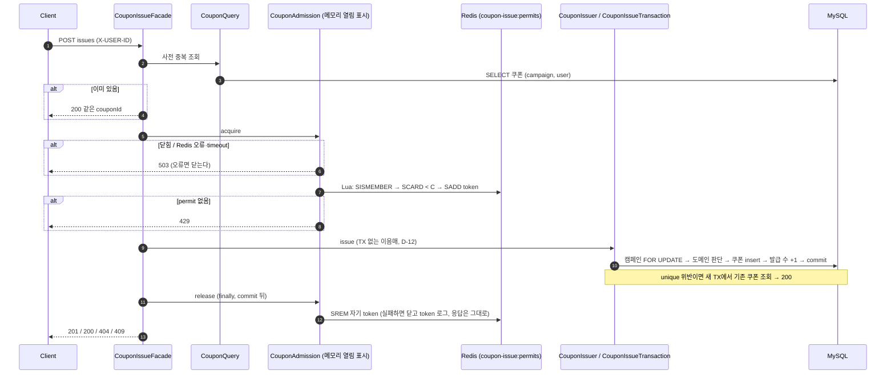

# 8주차 설계 — 감당할 수 있는 만큼만 쿠폰 발급을 받는다

행사 쿠폰 발급 요청이 한꺼번에 몰리면, 발급 한도를 DB가 지켜도 모든 요청이 DB 커넥션을 잡고 기다리며 주문·조회까지 느려진다.
8주차는 실제 발급 앞에 Redis로 **동시 처리 한도 C**(동시에 실행할 수 있는 permit 수)를 두고, permit이 없으면 바로 429로 거절한다. **쿠폰이 남아 있는 것과 지금 처리할 자리가 있는 것은 다르다.**

| 문서 | 내용 |
|---|---|
| `design.md` (이 문서) | 한 장 요약: 범위, 경계, 불변식, 유스케이스, 처리량, 결정 목록, 한계 |
| [`decisions.md`](decisions.md) | 결정마다 근거와 버린 대안 |
| [`load-test/`](load-test/README.md) | 실제 앱 부하 측정(k6, Prometheus)과 결과 |

## 1. 범위

- **이번 주에 하는 것**
  - 쿠폰 캠페인과 발급: 총 한도와 1인 1장은 DB(캠페인 행 비관적 락, `(campaign_id, user_id)` unique).
  - 동시 처리 한도: Redis Set에 실행마다 다른 token, Lua 한 번으로 확인과 추가, 반환은 자기 token만 `SREM`.
  - Redis 장애: fail-closed(503), 자동으로 다시 열지 않음, TTL 없음.
  - API: `POST /api/v1/coupon-campaigns/{campaignId}/issues`(처음 201, 이미 받았으면 200), `GET /api/v1/coupons`.
  - 처리량 측정: C를 바꿔 가며 처리량, 구간별 시간, 커넥션 풀 사용량을 쟀다(D-17, D-18).
- **하지 않는 것**
  - 수용 열기·닫기·남은 token 정리용 HTTP(D-11). 캠페인 준비 API(D-16).
  - 서버 여러 대에서의 수용 상태 공유(D-7).
  - `Retry-After`(D-9).
  - 대기열, 재고 행 나누기, 묶음 발급(처리량 상한을 올리는 방법, 다음 고민).

## 2. 경계

- **계층 배치**
  - `domain/coupon`: `CouponCampaign`(활성·잔여 판단), `IssuedCoupon`(혜택 사본), 저장소 포트.
  - `application/coupon`: 흐름(`CouponIssueFacade`), 수용(`CouponAdmission`, 포트 `AdmissionPermits`), DB 발급 TX(`CouponIssueTransaction`)와 그 입구(`CouponIssuer`), 조회, 준비.
  - `infrastructure/coupon`: JPA, 전용 Redis 연결(`AdmissionRedisConfig`), Lua 실행(`RedisAdmissionPermits`).
  - `interfaces/api/coupon`: 컨트롤러와 DTO.
- **Redis 연결**: master에만 붙는 전용 연결. command timeout 500ms, 연결 수립 1초, 끊기면 즉시 거절(D-14). 공용 연결은 timeout이 없어 60초를 기다린다.

## 3. 불변식

| | 규칙 | 지키는 곳 |
|---|---|---|
| INV-801 | 발급 수 ≤ 총 한도, 발급 수 = 실제 쿠폰 수 | 캠페인 행 `FOR UPDATE`, `CouponCampaign.issueTo`, 같은 TX |
| INV-802 | 한 사용자는 캠페인당 최대 한 장, 다시 요청하면 같은 couponId | `(campaign_id, user_id)` unique, 위반 시 새 TX 조회 |
| INV-803 | DB 발급 경로의 신규 실행은 동시에 C개 이하 | Lua 한 번(확인과 추가), 실행마다 다른 token |
| INV-804 | permit 반환은 업무 결과를 바꾸지 않고 자기 token만 지운다 | `SREM` 자기 token, 반환 실패해도 쿠폰 유지 |
| INV-805 | 수용 상태를 모르면 신규 발급을 시작하지 않고, 사람이 확인하기 전에는 다시 열지 않는다 | 메모리 표시(기본 닫힘), 오류·timeout 시 닫기, TTL 없음 |
| INV-806 | 혜택은 발급 순간 값으로 남고, 사용자는 자기 쿠폰만 본다 | 혜택 사본 칼럼(`updatable=false`), 요청자 ID로만 조회 |

## 4. 유스케이스

| 상황 | 응답 | DB | Redis Set |
|---|---|---|---|
| 처음 발급 | 201 | 쿠폰 1, 발급 수 +1 | 실행 중에만 token 1 |
| 이미 받음 | 200, 같은 couponId | 변화 없음 | 건드리지 않음 |
| 버튼 두 번 (동시) | 201과 200, 같은 couponId | 쿠폰 1 | token 2개였다가 0 |
| 품절·비활성 | 409 | 변화 없음 | permit 반환 |
| 없는 캠페인 | 404 | 변화 없음 | permit 반환 |
| C개가 실행 중 | 429 | DB 발급 경로에 안 들어감 | 변화 없음 |
| 수용 닫힘 / Redis 오류·timeout | 503 (이미 받은 사람은 200) | 변화 없음 | 알 수 없음 → 닫고 token 로그 |
| Redis 재시작, PONG | 여전히 503, `open()` 뒤에야 201 | — | 비어 있음 |
| commit 뒤 반환 실패 | 201 그대로 | 쿠폰 유지 | token이 남음 → 닫힘, 확인 뒤 `releaseLeftover` |
| commit 뒤 응답 유실 → 재요청 | 200, 같은 couponId | 추가 발급 0 | 비어 있음 |

## 5. 처리량

C를 정하고, 그 C가 실제로 DB를 지키는지 쟀다(`experiment/`, `load-test/`).

- **처리량은 락이 정한다**: 처리량 ≈ `1 ÷ 락 보유 시간`. C를 1 → 12로 늘리면 락 대기가 4 → 189ms로 늘었다. 실제 앱에서는 C=3부터 초당 약 34장에서 멈췄다.
- **C의 상한은 커넥션 풀이 정한다**: 발급 실행은 C만큼 커넥션을 쥔다. C=40(풀 40)에서 다른 기능 p95가 14ms → 34ms로 늘었다(D-17).
- **사전 중복 조회는 permit 앞(A)에 둔다. 비용은 알고 고른다**: 429로 거절될 요청도 재시도마다 DB를 읽는다. 발급 VU 200에서는 C와 상관없이 풀 40이 꽉 찼고, 다른 기능 p95가 약 30배 느려졌다. permit 뒤(B)로 옮기면 신규 처리량은 1.2~1.6배지만, 이미 받은 사람의 응답이 7~10배 느려지고 Redis 장애 때 503을 받는다(D-18).

## 6. 결정 목록

- **두 한도와 장애**: [D-1](decisions.md) 총 한도는 DB, 동시 처리는 Redis · [D-2](decisions.md) fail-closed · [D-6](decisions.md) PONG으로 다시 열지 않음 · [D-7](decisions.md) 메모리 표시, 기본 닫힘
- **permit**: [D-3](decisions.md) Lua 한 번 · [D-4](decisions.md) 실행마다 token, 자기 것만 반환 · [D-5](decisions.md) TTL 없음, 사람이 확인 후 정리 · [D-10](decisions.md) 반환 실패해도 201
- **DB 발급**: [D-8](decisions.md) 비관적 락, 판단은 도메인 · [D-15](decisions.md) 혜택 사본
- **응답과 진입점**: [D-9](decisions.md) 409/429/503 · [D-11](decisions.md) 운영 작업은 빈 메서드만
- **검증**: [D-12](decisions.md) 붙잡기 이음매 · [D-13](decisions.md) 전용 Redis 컨테이너 정지 · [D-16](decisions.md) 기본값
- **연결과 처리량**: [D-14](decisions.md) 전용 Redis 연결, 500ms · [D-17](decisions.md) C의 상한과 값 · [D-18](decisions.md) 사전 중복 조회 위치

## 7. 한계

- **몰릴 때 사전 중복 조회가 커넥션 풀을 채운다**(D-18). 다음 개선: 이미 받은 사용자 목록을 Redis에도 두고 사전 중복 조회는 Redis만 본다. 최종 판단은 그대로 DB가 한다.
- 수용 열림 표시는 서버마다 따로다. 오류를 보지 못한 서버는 열린 채 남는다. 서버 한 대 기준이다(D-7).
- failover로 직전 token 몇 개만 빠지면 알아채지 못한다(D-6, D-7).
- 장애 뒤에는 사람이 확인할 때까지 신규 발급이 멈춘다. fencing(세대 번호로 옛 실행의 DB 쓰기 거절)이 있으면 바로 다시 열 수 있다(다음 고민).
- `Retry-After`가 없어 429를 받은 클라이언트가 바로 다시 보낸다(D-9).
- 429마다 스택이 붙은 WARN 로그가 남아, 부하 측정 60초에 앱 로그가 약 200MB 쌓였다.
- 처리량 상한은 캠페인 행 락 하나가 정한다. 올리려면 락 보유 시간 줄이기, 재고 행 나누기, 묶음 발급(대기열) 중 하나가 필요하다.
