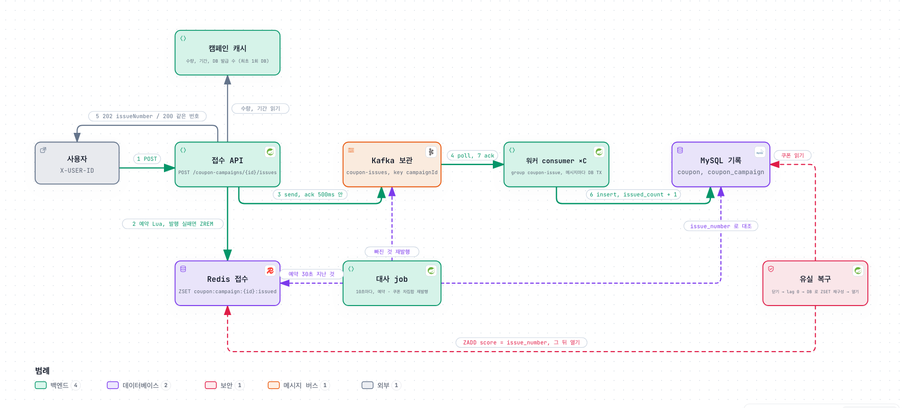

# 8주차 설계: 받는지는 Redis 가 정하고, 쿠폰은 DB 가 뒤따라 기록한다

규칙 ID 는 `docs/week8/requirements.md` 를 따른다. 측정 스크립트와 원본은 저장소에 두지 않는다.

문서는 두 부다. 1부는 원문의 기본 예제(요청 앞 Redis Set 세마포어)를 구현하고 측정해서 **무엇이 병목이고 무엇을 지켜야 하는지** 안 기록이다. 2부는 그 위에 세운 발급 방식이다. 1부의 코드는 제품 경로에 두지 않고(Q-9), 1부의 측정이 2부의 모든 결정의 근거다.

---

# 1부. 처리량 제한 실험

## 1. 기본 예제의 경로

```
POST issues ─ 기존 쿠폰 조회(DB) ─ 품절 표시 ─ Redis Lua 자리 획득 ─ 발급 TX(DB) ─ 자리 반환(SREM)
                                                  │ 자리 없음 429       │ 조건부 update
                                                  │ 모름 503            │ 유일 제약
```

자리 수 C 를 Redis Set 하나로 세고, 자리를 얻은 실행만 DB 에 간다. TX 는 `CouponTransactions` 한 덩어리고 facade 에는 TX 가 없다. 같은 빈 안의 호출은 프록시를 안 거쳐 TX 가 안 걸리므로 TX 를 다른 빈으로 뺀 구조는 `PaymentTransactions` 와 같다.

## 2. 병목은 캠페인 행 하나다 (`EXP-015`)

세마포어 없이 동시 요청 수를 올리며 쟀다. 단계마다 20 초, 새 캠페인, 요청마다 다른 사용자다.

| 동시 | 발급/s | 최대 대비 | p99 | 커넥션 사용 | 커넥션 대기 | 바쁜 스레드 |
|---|---|---|---|---|---|---|
| 1 | 324 | 52% | 7.2ms | 1 | 0 | 1 |
| 2 | 536 | 85% | 10.5ms | 2 | 0 | 2 |
| 4 | 588 | 93% | 20.1ms | 4 | 0 | 4 |
| 8 | 620 | 99% | 44.7ms | 7 | 0 | 8 |
| 16 | 629 | 100% | 77.3ms | 16 | 0 | 16 |
| 64 | 534 | 85% | 242.3ms | 40 | 24 | 64 |
| 256 | 558 | 89% | 1,062.8ms | 40 | 155 | 195 |

- 병목은 캠페인 행 잠금이다. 동시 16 에서 요청당 평균 잠금 대기가 약 22ms 로 p50 과 같고, 앱 CPU 는 3% 다.
- 상한은 한 건이 update 부터 commit 까지 잠금을 쥐는 시간(약 1.7ms)으로 정해진다. 대부분 commit 의 디스크 쓰기다.
- 동시 64 부터 커넥션 40 개가 모두 차고, 256 에서 Tomcat 스레드 200 개 중 195 개가 바쁘다. 처리량은 그대로이고 쥔 자원만 는다. 이 두 줄이 **쿠폰이 다른 기능을 죽이는 방식**이다.
- 컨텍스트 스위치는 병목이 아니다. 동시 1, 4, 16, 64, 256 에서 초당 355, 894, 889, 851, 846 건이고 mysqld 의 자발적 스위치는 요청당 약 26 으로 일정하다. 실행마다 상한이 600 ~ 890 사이로 흔들리는 것은 로컬 디스크 쓰기 편차다.

knee 는 최대 처리량의 90% 에 처음 닿는 동시 수로 정했고 이 환경에서 4 다. 4 에서 8 로 올리면 처리량은 5% 늘고 p99 와 쥐는 커넥션은 2 배가 된다.

## 3. 같은 행이면 group commit 이 묶이지 않는다

MySQL 은 `innodb_flush_log_at_trx_commit=1`, `sync_binlog=1` 이라 commit 마다 fsync 를 하고, 동시에 commit 하는 TX 를 묶어 fsync 한 번으로 처리한다(group commit). 저장 프로시저로 같은 행과 다른 행을 갱신하는 TX 를 동시 수를 바꿔 쟀다.

| 대상 | 동시 1 | 동시 4 | 동시 16 | 동시 64 | binlog fsync ÷ commit |
|---|---|---|---|---|---|
| 같은 행 | 1,636/s | 1,693/s | 1,591/s | | 1.00 (묶이지 않음) |
| 다른 행 | 1,723/s | 4,270/s | 8,939/s | 8,823/s | 1.00 → 0.57 → 0.17 → 0.05 |

같은 행은 잠금 때문에 commit 이 한 번에 하나씩이라 묶을 상대가 없다. 다른 행이면 16 개가 fsync 하나를 나눠 쓴다. **행 하나를 모두가 갱신하는 구조는 동시 수를 올려도 상한이 안 오른다.** 상한을 올리려면 행을 나누거나(파티셔닝), 갱신을 묶거나(묶음 TX), 그 행을 요청 경로에서 빼야 한다. 2부는 셋째다.

## 4. 격리와 재시도 (`EXP-016`)

포인트 잔액 조회(DB)와 상품 목록(Redis 캐시)을 초당 100 건씩 부르면서 쿠폰 발급을 동시 256 으로 몰았다.

| 실행 | 쿠폰 요청/s | 발급/s | 포인트 p99 | 목록 p99 | 커넥션 대기 최대 | 바쁜 스레드 최대 |
|---|---|---|---|---|---|---|
| 기준선 (쿠폰 없음) | | | 8.1ms | 10.6ms | 0 | 3 |
| 제한 없음 | 740 | 744 | 332.1ms | 359.6ms | 161 | 200 |
| 4 개 제한, 바로 다시 보냄 | 5,042 | 70 | 73.7ms | 100.5ms | 59 | 200 |
| 4 개 제한, `Retry-After` 만큼 기다림 | 965 | 749 | 81.6ms | 81.9ms | 70 | 200 |
| 4 개 제한, `Retry-After` 에 지터 | 955 | 725 | 5.5ms | 7.8ms | 0 | 9 |

- 자리를 4 개로 묶으면 다른 API 가 산다. 격리는 된다.
- 거절된 요청이 같은 시점에 다시 오면 몰림이 남는다. 지터가 있어야 기준선 수준이다.
- **거절도 자원을 쓴다.** 바로 다시 보내는 실행은 초당 5,000 건이 들어오고 거절될 요청도 기존 쿠폰 DB 조회를 하므로 커넥션 대기가 생긴다. 거절 로그의 스택 트레이스를 없애 처리 가능 요청을 초당 13,885 건으로 올렸더니 기존 쿠폰 조회가 초당 14,000 번이 되어 커넥션 대기가 152 까지 쌓였다. 거절을 싸게 하는 것만으로는 막을 수 없고, 거절이 **DB 에 가지 않아야** 한다.
- 품절 표시(`SoldOutCampaigns`)가 그 답의 절반이다. 품절을 한 번 본 서버는 이후 요청을 DB 와 Redis 없이 409 로 끝낸다. 2부는 기존 예약 확인이 Lua 안으로 들어가 이것을 쓰지 않는다(11 장).

## 5. Redis 명령 비용

`redis-benchmark -c 50 -n 200000` 으로 같은 Redis 에서 쟀다.

| 명령 | 초당 | 평균 |
|---|---|---|
| `GET` | 123,916 | 6.2µs |
| `SET` | 141,945 | 5.8µs |
| `SADD` | 147,275 | 5.8µs |
| 자리 획득 Lua (`EVALSHA`, 명령 3 개) | 95,923 | 7.8µs, p50 0.34ms |

Lua 는 명령 한 개보다 35% 느리지만 왕복 세 번보다 빠르다. Lua 의 비용은 "Lua 왕복 1 번 대 개별 명령 왕복 N 번" 으로 비교해야 한다. 1부 경로의 Redis 사용은 최고 초당 28,000 번으로 상한의 30% 였다. **DB 상한 600 과 Redis 상한 96,000 의 160 배 차이**가 2부의 근거다.

## 6. timeout 은 모름이다

`CLIENT PAUSE 1000 WRITE` 로 쓰기를 1 초 멈춘 Redis 에 Lua 를 보내고 200ms 에 포기했다. 명령은 0.21 초에는 실행되지 않았고 약 1.0 초에 실행됐으며 응답은 1.21 초에 왔다. 클라이언트 타이머는 네트워크의 무엇도 취소하지 않는다. 같은 token 으로 다시 보내면 `SISMEMBER` 가 1 을 돌려주고 `SCARD` 는 그대로다. **멱등한 명령만 timeout 뒤 다시 물어 결과를 확정할 수 있다.** 2부의 예약 Lua 가 같은 사용자를 다시 받으면 같은 번호를 돌려주는 이유다(`RSV-001`).

테스트는 `CLIENT PAUSE ... WRITE` 로 실제 timeout 을 만들고, 제어 명령은 앱과 다른 소켓(별도 Lettuce 연결)으로 보낸다. 같은 공유 연결로 보내면 멈춘 명령 뒤에 줄을 서서 제어 명령까지 timeout 이 난다. 2부의 `EXP-025` 가 같은 기법을 쓴다.

## 7. 소켓 줄서기와 Redis 배치

Lettuce 는 소켓 하나에 명령을 순서대로 보내고 응답을 순서대로 받는다. 큰 응답 하나가 앞에 있으면 뒤의 작은 명령이 그것을 다 받을 때까지 기다린다(head-of-line blocking). 캐시(`RedisProductListingCache`)와 쿠폰이 같은 `REDIS_TEMPLATE_MASTER` 를 쓰므로 같은 소켓이다. 서버 쪽에서는 단일 스레드가 O(N) 명령 하나에 묶이면 연결을 나눠도 소용없다.

| 층 | 막는 법 | 뒤집을 조건 |
|---|---|---|
| 소켓 | 쿠폰 전용 `LettuceConnectionFactory` | 쿠폰 Lua 의 지연이 캐시 값 크기를 따라 움직이는 것이 측정될 때 |
| 서버 (단일 스레드, fork, eviction) | 인스턴스 분리 | 운영 Redis 가 `allkeys-*` 이거나 캐시가 `maxmemory` 에 닿는 운영일 때. 예약 집합은 TTL 이 없어 `allkeys-*` 면 캐시와 함께 지워진다 |
| 클러스터 | Lua 의 키들에 해시 태그 `{...}` | Redis Cluster 로 갈 때. 지금 2부 Lua 는 키가 하나라 당장은 걸리지 않는다 |

인스턴스를 나누는 이유는 줄서기가 아니라 eviction 과 영속성 정책의 충돌이다. 채널톡의 큐 파티셔닝 글도 같은 결론이다. 같은 Redis 안에서 키를 나누고, 물리 분리는 CPU 측정값으로 판단한다.

### 7.1 처리량은 클라이언트의 모양이 정한다 (`EXP-020`)

같은 Redis, 같은 2부 예약 Lua(`ZSCORE`, `ZCARD`, `ZREVRANGE 0 0`, `ZADD`)를 `redis-benchmark` 로 모양만 바꿔 쟀다.

| 모양 | 초당 | p50 |
|---|---|---|
| 연결 1, 답 받고 다음 | 17,513 | 0.055ms |
| 연결 4 | 61,387 | 0.055ms |
| 연결 50 | 138,889 | 0.319ms |
| 연결 50, 파이프라인 16 | 220,751 | 3.7ms |
| 연결 1, 파이프라인 64 | 175,747 | 0.239ms |
| 연결 1, 파이프라인 256 | 199,196 | 0.247ms |
| `GET` 연결 50, 파이프라인 16 | 3,448,276 | 0.159ms |

연결 하나로 답을 기다리며 보내면 처리량은 1 / 왕복시간이고 서버는 논다. 파이프라인에서 Lua 하나가 4.5µs 인데 그것이 서버의 비용이고, 나머지는 요청마다의 read, write 시스템콜이다. "단일 스레드라 느리다" 에서 느린 것은 명령이 아니라 왕복이다. `io-threads 4` 가 Lua 를 169,205 로 6% 올린 것은 그 시스템콜을 나눈 것이고, 작게 나온 이유는 `redis-benchmark` 자체가 단일 스레드라 먼저 막혀서다. 5 장의 95,923 은 "연결 50" 모양의 숫자다.

Lettuce 는 연결 하나지만 스레드들이 답을 기다리지 않고 한 소켓에 계속 쓰므로 "연결 1, 파이프라인 n" 모양이다. n 은 그 순간 답을 기다리는 스레드 수다. 연결 하나로도 19 만이 나오는 이유는 Redis 가 소켓 하나에서 한 번 read 로 여러 명령(16KB, Lua 호출이면 100 개 남짓)을 읽어 한 바퀴에 처리하기 때문이다. 그래서 연결 하나에서 조심할 것은 처리량이 아니라 셋이다. 답이 순서대로 와서 큰 답 뒤의 작은 답이 기다리는 것, `BLPOP` 과 `WAIT` 같은 블로킹 명령이 뒤를 전부 세우는 것(전용 연결이 필요하다), Netty I/O 스레드 하나가 그 소켓을 맡는 것. 셋째가 `EXP-022` 에서 앱으로 재야 하는 숫자다.

복제는 따라온다. 초당 125,339 로 쓰는 4 초 동안 `redis-readonly` 의 offset 이 master 와 같았다. `WAIT 1 1000` 은 연결 1 에서 24,510/s(0.039ms), 연결 50 에서 250,000/s 다. 한 바퀴에 모인 `WAIT` 를 `REPLCONF GETACK` 한 번으로 묻기 때문이다.

예약 ZSET 의 메모리는 63,018 명에 5.9MB, 한 명 94 바이트다. 한도 10 만이면 9.4MB 다.

### 7.2 멈춤은 기본 설정에서 보이지 않는다 (`EXP-021`)

| 상황 | 그동안 Lua 처리량 | 멈춤 |
|---|---|---|
| 951,677 개 ZSET 을 `ZRANGE 0 -1` 5 번 | 68,634 (절반) | 143ms × 5 |
| 100 만 개 ZSET 을 `DEL` | 115,473 | 155ms |
| 같은 것을 `UNLINK` | 134,228 | 없음 (5ms 넘는 이벤트 0) |
| 1 초 도는 Lua 하나 | 83,752 (2 초 구간) | 1,000ms |

p50 은 0.319 에서 0.367 로 거의 안 움직였다. 143ms 멈춤이 다섯 번 있었는데도 평균과 p50 이 숨기고, `latency-monitor-threshold` 기본값이 0(꺼짐)이라 `LATENCY LATEST` 도 비어 있다. 켜지 않으면 아무도 모른다. 2부에 걸리는 것은 둘이다. 대사의 `ZRANGEBYSCORE` 가 한도 10 만이면 비례로 15ms 를 모두 세우므로 `LIMIT` 으로 끊어 읽고(15 장), 캠페인 키는 `DEL` 이 아니라 `UNLINK` 다.

긴 Lua 는 전부 세운다. 7 초짜리 Lua 중에 1.2 초에 보낸 `PING` 은 3.96 초 걸려 있다가 BUSY 에러로 답했고, 그 직후 보낸 것은 0.06 초에 BUSY 였다. `busy-reply-threshold` 5000ms 까지는 아무 답 없이 걸려 있고 그 뒤에야 거절한다. 그동안 Lettuce timeout 이 먼저 터져 앱은 6 장의 "모름" 이 된다. 쓰기를 이미 한 스크립트는 `SCRIPT KILL` 이 안 되고 `SHUTDOWN NOSAVE` 뿐이다. 유실 복구의 `ZADD` 10 만 건을 Lua 하나로 짜면 이 길이고, 그래서 파이프라인으로 나눠 보낸다(16.1).

AOF `always` 는 "명령마다 fsync" 가 아니라 "응답 전에 fsync" 다. 한 바퀴에 들어온 명령을 다 실행하고 잠들기 전에 한 번 fsync 하고 응답하므로, 동시성이 오르면 fsync 하나에 묶이는 명령이 는다. 3 장의 MySQL binlog group commit 과 같은 모양이다.

| appendfsync | 연결 1 | 연결 50 | 연결 1, 파이프라인 64 |
|---|---|---|---|
| everysec | 18,123 | 144,092 | 175,747 |
| always | 2,718 (fsync 하나 0.37ms) | 39,200 (fsync 하나에 14 개) | 55,084 (20 개) |

디스크는 둘 다 초당 2,700 번 fsync 하고, 실리는 명령 수가 다르다. 그래서 `always` 의 비용은 처리량이 아니라 응답 지연에 붙는 fsync 시간이다(p50 0.30 → 1.21ms). 16.1 이 이 숫자로 `always` 를 두지 않는 이유를 적는다.

로컬은 `maxmemory 0`, `noeviction` 이다. 공용 Redis 가 `allkeys-lru` 면 예약 ZSET 이 크래시도 로그도 없이 사라질 수 있고, 2부에서 그것을 잡는 것은 유실 감지(`FLT-008`) 하나다.

한 문장으로 줄이면 이렇다. **느린 것은 명령이 아니라 왕복이고, 위험한 것은 처리량이 아니라 한 번의 멈춤이며, 그 멈춤은 기본 설정에서 보이지 않는다.**

## 8. 기본 예제가 못 하는 것

- **쿠폰이 남았는데 429 를 준다.** 상한이 600 ~ 890/s 이므로 수량 10,000 에 5 초 동안 50,000 명이 오면 3,000 명만 처리하고 나머지는 거절한다. 요청 경로에 DB 가 있는 한 어떤 자리 수로도 못 고친다.
- **선착순이 없다.** 자리를 얻는 순서는 Redis 가 Lua 를 받은 순서지만, 거절된 사람이 다시 와서 얻으면 늦게 온 사람이 먼저 받는다.
- **보수적 재개의 비용이 크다.** Set 은 프로세스 상태의 복사본이라 반환 실패, timeout 뒤 늦은 실행, 프로세스 죽음으로 token 이 남고, Redis 유실로 token 이 사라진다. 원문은 TTL 로 지우지 못하게 해서(살아 있는 실행과 겹치므로) 어긋남을 감지하면 닫고 사람이 확인한 뒤 열게 한다. 닫히는 조건에 "옆 캐시의 큰 응답이 200ms 를 넘김" 도 들어간다. 쿠폰은 자리 수를 넘겨도 수량과 중복은 DB 가 지키므로 피해가 잠금 대기 증가뿐인데, 닫히면 사람이 열 때까지 전원 503 이다. 자리 초과 피해가 작은 자원에는 lease 가 맞고, 보수적 재개는 자리 초과가 돈에 닿는 자원(PG 호출 한도, `max_connections`)에 맞는다.

이 세 가지 때문에 2부로 간다. 1부에서 가져가는 것은 닫힌 채 시작하고 명시적으로 여는 규칙(2부 Q-15), 멱등한 재시도 계약, `CLIENT PAUSE` 테스트 기법, 측정 스크립트다.

---

# 2부. 발급 방식

이번 주제는 "받을 수 있는 만큼만 받는다" 다. 1부의 세마포어는 그것을 **DB 앞에서 동시 실행 수 C 로** 셌다. 1부 측정이 보여 준 것은 그 자리에서 세면 "받을 수 있는 만큼" 이 캠페인 행 하나의 속도(600 ~ 890/s)가 되고, 쿠폰이 남았는데도 429 를 준다는 것이다(8 장). 2부도 받을 수 있는 만큼만 받는다. 다른 것은 **세는 자리와 단위**다. 자원마다 그 자원이 감당하는 단위로 센다.

| 받을 수 있는 만큼 | 세는 것 | 넘으면 | 규칙 |
|---|---|---|---|
| 캠페인이 줄 수 있는 수 | Redis 명단 크기 < 한도 N | 409 품절 | `RSV-002`, `CPN-005` |
| 이 프로세스가 동시에 기다릴 수 있는 수 | bulkhead 자리 N (ack 대기 스레드) | 503, 예약 없음 | `PUB-004` |
| DB 가 동시에 받을 수 있는 TX 수 | consumer C (파티션 배정이 전역 상한) | 큐에 쌓임. 사용자는 PENDING | `WRK-002` |

세마포어 C 는 사라지지 않고 워커로 옮겨 갔다(18 장). 요청 경로에서 DB 를 세지 않는 이유는 요청 경로에 DB 가 없기 때문이고, 그래서 한도 안의 사람은 전원 즉시 접수되며 밖의 사람은 즉시 409 다. 공지가 기대한 두 가지, "발급 가능하면 실패를 주지 않는다" 와 "선착순이 공정하다" 가 각각 첫 행과 번호(`RSV-002`)에서 나온다. 받을 수 있는 만큼만 받는 것과 받을 수 있는 사람에게 실패를 주지 않는 것은 같은 문장의 양면이고, 1부는 앞쪽만 지켰다.

## 9. 원본은 DB, 접수 판정은 Redis

| 사실 | 원본(source of truth) | 비고 |
|---|---|---|
| 이 사용자가 쿠폰을 **가졌다** | DB | 목록은 DB 만 본다(`CPN-007`) |
| 발급 수, 한도 이하 | DB | 조건부 update 가 끝까지 지킨다 |
| 이 사용자가 **받기로 됐다**, 몇 번째인지 | Redis | DB 에 아직 없는 동안만. 워커가 기록하면 DB 에도 `issue_number` 가 남는다 |

Redis 는 원본이 아니라 **DB 보다 먼저 접수를 판정하는 admission 계층**이다. 어긋나면 DB 가 이긴다. 워커가 DB 에서 품절이나 중복을 받으면 Redis 의 결정을 뒤집고(`WRK-004`, `WRK-005`), 대사는 Redis 에 맞춰 DB 를 고치지 않고 DB 에 없는 예약을 다시 보낸다(`RCN-003`). Redis 가 상태를 잃어도 초과 발급과 중복은 생기지 않는다. 생길 수 있는 것은 "받기로 됐는데 못 받음" 이고, 그것도 복구 순서를 지키면 0 이다(16.1).

SSOT 가 아닌 것을 읽어 응답하는 자리는 하나다. 재요청에 200 `PENDING` 을 줄 때 Redis 를 보고 답한다. "쿠폰이 있다" 가 아니라 "접수됐다" 이므로 받아들였고, 쿠폰이 있다는 답(`ISSUED`, `couponId`)은 DB 를 확인해야 나간다.

## 10. 접수 경로



```
POST /api/v1/coupon-campaigns/{id}/issues
  │
  ├─ 캠페인 캐시 ─────────── 없으면 DB 에서 한 번 읽어 채움. 없는 캠페인 404, 비활성 409
  ├─ 로컬 bulkhead ───────── ack 기다리는 자리가 가득이면 503 (예약 없음)
  ├─ Redis Lua 예약 ──────── {1, n} 새로 받음 / {0, n} 이미 있음 / {-1} 품절 / {-2} 유실 / {-3} 닫힘
  │     이미 있음 → DB 에 쿠폰이 있으면 200 ISSUED + couponId, 없으면 200 PENDING + n
  │     품절 → 409
  │     유실 → 캠페인 닫음, 503
  ├─ Kafka 발행, ack 대기 ── 500ms 상한, 동시 대기 상한. 실패면 예약 ZREM 뒤 503
  └─ 202 PENDING + issueNumber

워커 (consumer × C) ─ 메시지마다 DB TX: 쿠폰 insert + issued_count 조건부 update
대사 job ──────────── 예약 − 쿠폰 차집합을 다시 발행
```

요청 경로에 DB 쓰기가 없다. DB 읽기는 캠페인 캐시를 채우는 최초 한 번과, 재요청에서 `ISSUED` 를 확인하는 한 번뿐이다. 1부의 "기존 쿠폰 조회" 는 Lua 의 `{0, n}` 이 대신한다. Redis 가 중복을 먼저 알므로 재요청도 DB 를 거의 안 간다.

응답은 202, 200, 409, 404, 503 다섯이다. 429 는 없다. 서버 사정으로 못 받는 것은 전부 503 이고(Q-4), 429 는 사용자별 요청 제한을 둘 때만 쓴다.

## 11. 예약 (`RSV-*`)

| 항목 | 정한 것 |
|---|---|
| 키 | 캠페인마다 `coupon:campaign:{campaignId}:issued`. ZSET, member 는 사용자 ID, score 는 `issueNumber` |
| 한도, 활성 | 프로세스의 캠페인 캐시에서 Lua 인자로 넘긴다(`RSV-003`). 캐시는 `ConcurrentHashMap`, 만료 없음. 캠페인은 만든 뒤 바뀌지 않는다(Q-5) |
| DB 발급 수 (유실 감지의 하한) | 같은 캐시에 실려 Lua 의 `dbIssuedCount` 로 간다. 이것만은 캐시가 아니라 **하한**이다. 처음 읽은 값(대개 0)에 머물면 `ZCARD < 하한` 이 영원히 안 울리므로, 대사가 10 초마다 backlog 게이지를 위해 읽는 DB 값으로 `issuedCount` 만 바꾼다(`refreshIssuedCount`). 한도와 활성은 그대로다. 하한이 10 초 뒤처져도 `ZCARD ≥ DB 발급 수` 는 항상 참이라 오탐이 없고, 유실은 늦어도 한 주기 뒤 첫 요청에서 잡힌다 |
| 유실 감지 인자 | 캐시가 아는 DB 의 `issued_count`. `ZCARD` 가 그보다 작으면 집합이 줄어든 것이다(Q-15) |
| 연결 | `REDIS_TEMPLATE_MASTER` |
| 품절 뒤 요청 | 그대로 Lua 에 간다. 기존 예약이면 `{0, n}` 으로 200 이어야 하므로(`CPN-004`) 프로세스에 품절을 표시해 Redis 를 건너뛰지 않는다. 품절 요청의 비용은 Lua 한 번이다(7.1) |

```lua
-- KEYS[1] = 예약 집합, KEYS[2] = 닫힘 키, ARGV = userId, quota, dbIssuedCount
if redis.call('EXISTS', KEYS[2]) == 1 then return {-3} end  -- 닫힘. 복구 중이라 재요청도 503
local n = redis.call('ZSCORE', KEYS[1], ARGV[1])
if n then return {0, tonumber(n)} end                 -- 이미 받음. 같은 번호
local size = redis.call('ZCARD', KEYS[1])
if size < tonumber(ARGV[3]) then return {-2} end       -- DB 가 아는 발급 수보다 작다. 유실
if size >= tonumber(ARGV[2]) then return {-1} end      -- 품절
local top = redis.call('ZREVRANGE', KEYS[1], 0, 0, 'WITHSCORES')
local next = top[2] and tonumber(top[2]) + 1 or 1
redis.call('ZADD', KEYS[1], next, ARGV[1])
return {1, next}
```

- `ZSCORE`, `ZCARD` 는 O(1), `ZREVRANGE 0 0` 과 `ZADD` 는 O(log N) 이고 N 은 한도다. 한도 10 만이어도 µs 다(7.1 에서 Lua 하나 4.5µs).
- 번호는 **가장 큰 score + 1** 이다. `ZCARD + 1` 이면 `ZREM`(`PUB-002`)으로 가운데 번호가 빠지거나 유실 복구 뒤 DB 에 빈 번호가 있을 때 같은 번호가 두 사용자에게 간다. 가장 큰 score 기준이면 번호는 겹치지 않고, 빈 번호는 생길 수 있다(`RSV-002`).
- 같은 사용자 동시 요청 둘은 Lua 가 순서대로 실행돼 둘째가 `{0, n}` 을 받는다.
- ZSET 을 고른 이유는 대사(15 장)가 번호 범위로 읽어야 해서다. Set 이면 번호를 따로 둬야 하고 Hash 면 범위 조회가 없다. Hash + `INCR` 은 모든 연산이 O(1) 이고 메모리가 절반이지만 대사가 매번 전체를 읽어야 한다. ZSET 은 한 명 94 바이트, 10 만이면 9.4MB 다(7.1). **뒤집을 조건**: 대사가 없어질 때, 또는 한도가 수백만이라 캠페인 하나가 수백 MB 일 때. 그때는 중복 판정만 Bitmap 으로 빼고 번호는 Hash 에 둔다.
- 취소는 `ZREM`, 복구는 DB 쿠폰을 `ZADD` 로 다시 넣는 것이다. 둘 다 Lua 가 필요 없다.

Set 이 아니라 ZSET 이라 1부와 자료구조가 다르지만, 둘 다 원소 하나가 한 사람이고 크기가 상한이다. 1부는 "지금 안에 있는 사람" 이 C 이하, 2부는 "받기로 된 사람" 이 한도 이하다. 1부는 끝나면 빠지고 2부는 빠지지 않는다. 그래서 2부의 집합은 트래픽이 아니라 한도에 비례한다.

## 12. 발행 (`PUB-*`)

| 항목 | 정한 것 |
|---|---|
| topic | `coupon-issues`. 파티션 키 `campaignId`(`PUB-003`) |
| 메시지 | `campaignId`, `userId`, `issueNumber`, `reservedAt`. JSON |
| producer | 기존 설정 그대로. `acks=all`, `enable.idempotence=true` |
| ack 대기 상한 | 500ms. 넘으면 503. 앞에 `max.block.ms` 1s(메타데이터 대기)가 붙을 수 있어 최악은 1.5s 다 |
| 동시 대기 상한 | 로컬 `Semaphore`. `tryAcquire()` 로 기다리지 않고 차면 503 |
| 실패 처리 | 결과는 Published, Unconfirmed, Rejected 셋이다(`PUB-002`). Unconfirmed(`get()` timeout, interrupt)는 producer 가 레코드를 아직 쥐고 있어 `delivery.timeout.ms` 30s 안에 닿을 수 있으므로 예약을 남긴다. Rejected(future 가 실패로 끝남: 없는 토픽, 크기 초과, delivery timeout 만료. `send()` 가 바로 던짐. 직렬화 실패)는 producer 가 포기한 것이라 `ZREM` 한다. `ZREM` 도 실패하면 예약은 남고 503. 대사가 메운다 |
| 순서 | bulkhead 는 **예약 전에** 본다. 막히면 예약 없이 503 이라 `ZREM` 이 없다. 자리는 예약과 발행 동안만 쥐고, 재요청의 DB 읽기는 자리를 돌려준 뒤에 한다 |

두 장치가 각자 다른 장애를 맡는다.

| 장치 | 막는 장애 | 없으면 |
|---|---|---|
| timeout | 한 요청이 오래 묶임 | `delivery.timeout.ms=30000` 이라 요청마다 30 초 |
| 로컬 bulkhead | broker 가 **느리거나 죽은** 동안 스레드가 전부 빨림. ack 400ms 에 초당 1,000 요청이면 Little 로 400 스레드. timeout 은 500 안이라 안 걸림 | 포인트 조회가 스레드를 못 받음. 1부에서 DB 풀로 본 전파 |

broker 가 죽은 동안도 bulkhead 가 맡는다. 기다리는 스레드는 상한 N 이 최대고 나머지는 즉시 503 이다. circuit breaker 를 두지 않는 이유는 19 장이다. 구현은 W5 의 PG 와 같은 Resilience4j `Bulkhead`(`coupon-publish`, 대기 0)이고, application 은 domain 의 `CouponPublishSlots`(`tryAcquire`, `release`)로 쓴다. 1부 `CouponAdmission` 과 같은 꼴이고 지키는 자원만 DB 에서 스레드로 바뀌었다.

로컬 bulkhead 는 1부의 Set 세마포어와 다르다. 지키는 자원이 이 프로세스의 스레드라 서버가 몇 대든 로컬이 맞고, JVM 이 죽으면 같이 사라져 반환 실패나 유실이 없다. 1부의 분산 세마포어가 token 유실 때문에 보수적 재개까지 필요했던 것과 대비된다.

**bulkhead 는 접수 처리량의 천장이다.** 자리 N 에 ack 지연 L 이면 접수 상한은 N / L 이다(Little). N=32 에 L=2ms 면 16,000/s 로 Redis(96k/s)보다 먼저 막고, 그 너머는 broker 가 정상인데도 503 이다. L=50ms 면 640/s 다. 그래서 접수의 실제 천장은 min(Redis, N / L, Tomcat 200 / L) 이고, N 은 `EXP-022` 에서 L 의 p99 를 재서 정한다. 출발값 32 는 추정이다. `maxWaitDuration` 을 0 이 아니라 수십 ms 로 두면 순간 몰림을 거절 대신 잠깐 줄 세워 흡수하고, 그만큼 스레드 시간을 더 쓴다. 상한이 있는 것 자체는 문제가 아니다. 재지 않은 값이 문제다. 비동기 응답은 상한을 스레드에서 메모리로 옮길 뿐이라 19 장의 조건이 될 때만 본다.

Unconfirmed 에 `ZREM` 하지 않는 이유는 "확인을 못 받았다" 가 "안 갔다" 가 아니기 때문이다. 500ms 뒤에 broker 가 받으면 쿠폰은 생기는데 예약은 없어 `ZCARD < DB 발급 수` 가 되고, 유실 감지(16.1)가 Redis 유실로 오판해 캠페인을 닫는다. 예약을 남기면 사용자는 503 뒤 재요청에서 같은 번호로 200 `PENDING` 을 받고, 메시지가 닿으면 쿠폰이 되고, 끝내 안 가면 대사가 보낸다. 번호는 그대로라 선착순도 지켜진다. **뒤집을 조건**: 대사의 재발행 지표가 Unconfirmed 수를 따라 오를 때. 그때는 메시지가 실제로 안 가는 것이라 Unconfirmed 도 `ZREM` 하고 사용자가 새로 접수하게 한다.

ack 를 기다리는 이유(Q-11)는 "202 인데 메시지가 없는" 간극을 요청 경로에서 없애기 위해서다. 올리브영의 선착순 쿠폰 글이 그 간극(1차 검증과 워커 반영 사이)에서 1 만 건당 1.4 건을 잃었다. 기다리지 않으면 응답은 빠르지만 그 간극을 대사에만 기댄다.

Kafka 를 두는 이유는 접수(Redis)와 보관(Kafka)의 장애 영역을 떼어 놓기 위해서다. Redis Streams 로 같은 Lua 안에서 보관까지 하면 쓰기가 한 번이라 `PUB-*` 와 대사가 빠지지만, Redis 가 지워지면(`FLUSHDB` 는 복제본에도 전파된다) 워커가 아직 안 읽은 202 를 같이 잃는다. 19 장.

패턴의 출처는 Release It!(Nygard)의 timeout, bulkhead, circuit breaker, fail fast 와 Microservices Patterns(Richardson)의 reconciliation, idempotent consumer 다.

## 13. 워커 (`WRK-*`)

| 항목 | 정한 것 |
|---|---|
| 위치 | commerce-api 안의 `@KafkaListener`(Q-8). consumer group `coupon-issue` |
| 동시 수 | 컨테이너 `concurrency = C`. 설정 `coupon.issue.worker.concurrency`. 1부의 knee 4 가 출발값이고 `EXP-023` 으로 다시 정한다 |
| 컨테이너 | W6 `PurchaseActivityListenerConfig` 와 같은 모양. 수동 커밋, `earliest`, 인프라 실패는 같은 record 를 backoff 로 재시도하고 건너뛰지 않음. `max.poll.records` 50. 기본 500 이면 DB 가 느린 날 레코드마다 잠금 대기 상한 3 초 × 500 = 25 분이 `max.poll.interval.ms` 5 분을 넘겨 consumer 가 쫓겨나고 리밸런스가 반복된다. 50 × 3 초 = 150 초로 안에 든다. 정상일 땐 50 개가 30ms 라 처리량 손실이 없다. 핫파티션 자체는 리밸런스를 만들지 않는다. lag 은 멤버십과 무관하다 |
| 메시지 하나 | `CouponTransactions.issue(campaignId, userId, issueNumber, reservedAt)` 한 TX |
| DB 중복 | `COUPON_ALREADY_ISSUED` 를 받으면 로그만 남기고 offset 을 넘긴다. 같은 메시지 재전달과 대사의 재발행이 여기서 멱등해진다 |
| DB 품절 | `COUPON_SOLD_OUT` 을 받으면 지표 `coupon.issue.rejected_by_db` 를 올리고 넘기고, **그 사용자가 Redis 명단에 있을 때만** 그 캠페인의 유실 복구(16.1)를 시작한다. 명단에 없는 사용자의 품절(DLT 리플레이가 정상 품절 캠페인에 닿은 경우)은 어긋남이 아니다. Redis 가 받은 것을 DB 가 거절했다는 것은 예약 집합과 DB 가 어긋났다는 뜻이다. 넘기기만 하면 그 사용자는 재요청마다 200 PENDING 을 받고 대사는 매 주기 그 번호를 후보로 잡는다. `ZREM` 만 하면 빈 자리로 다음 사람이 202 를 받고 또 거절된다. 재구성하면 거절된 사용자는 집합에서 빠져 409 를 받고, 쿠폰 없는 PENDING 이 남지 않는다 |
| 인프라 실패 | `DataAccessException` 처럼 기다리면 낫는 것. 예외를 던져 컨테이너가 backoff(1s → 30s)로 같은 레코드를 재시도. offset 은 그대로. 지표 `coupon.issue.worker.retry` 는 둘째 전달부터 센다 |
| 다시 해도 같을 실패 | 읽을 수 없는 메시지, 없는 캠페인, 비활성 캠페인, 그 외 `DomainException`. 재시도 없이 `coupon-issues.dlt` 로 보내고 넘긴다(`WRK-009`). 지표 `coupon.issue.worker.dead_letter`. 멈추면 같은 파티션의 다른 캠페인까지 서므로 넘긴다. DLT 발행이 실패하면(broker) 넘기지 않고 재시도한다 |
| DLT 뒤 | consumer 하나가 DLT 를 읽어 로그 테이블(`coupon_issue_dlt_log`, PENDING)에 적고, 운영자가 `/api-admin` 으로 조회해 골라 원본 토픽에 다시 보낸다(`WRK-010`). 자동으로 다시 보내지 않는다. 다시 해도 같을 실패라 사람이 원인을 고친 뒤여야 한다 |
| 켜고 끄기 | `coupon.issue.worker.auto-startup`(`WRK-008`). 끄면 접수는 받고 기록만 멈춘다. `EXP-023` 이 끈 채 예약을 쌓고 켠다 |

코드는 셋이다. `interfaces/consumer/CouponIssueListener` 가 메시지를 읽어 ack 하고, `application/coupon/CouponIssueWorker` 가 TX 밖에서 중복과 품절을 가르고, `CouponTransactions.issue` 가 TX 다. 워커와 TX 를 한 클래스에 두지 않는 이유는 중복 처리 때문이다. 유니크 위반은 `saveAndFlush` 에서 터져 그 TX 는 rollback 만 남는데, 같은 메서드 안에서 잡고 정상 반환하면 commit 이 `UnexpectedRollbackException` 이 된다. 잡는 곳은 TX 밖이어야 하고, 같은 빈 안의 호출은 프록시를 안 거치므로 빈이 둘이다.

test 프로필은 워커를 끈다. 요청 경로 테스트가 "접수 뒤 DB 에는 아직 없다"(`CPN-004`)를 단언하는데, 워커가 돌면 그 사이에 쿠폰이 생겨 결과가 워커 속도에 달린다. 워커 테스트만 전용 토픽(`coupon-issues-worker`)으로 켠다. 토픽을 나누는 이유는 다른 테스트가 남긴 메시지다. 그 캠페인은 이미 truncate 돼 없고, 없는 캠페인은 "버그" 행이라 워커가 그 메시지에서 멈춘다.

같은 캠페인이 한 파티션이라 그 캠페인의 메시지는 consumer 하나가 순서대로 쓴다. 캠페인 행 잠금 경쟁이 **캠페인 하나 안에서는 없다.** 1부 3 장의 같은 행 측정(동시 1 에서 초당 1,636)이 워커 하나의 소진 속도 출발점이다. C 는 캠페인 여러 개가 동시에 열릴 때를 위한 것이다.

DB 행을 동시에 갱신하는 수의 **전역 상한은 파티션 수다.** 같은 consumer group 안에서 한 파티션은 인스턴스가 몇 대든 consumer 하나만 읽으므로, 인스턴스 10 대에 C=4 여도 파티션이 3 개면 전체에서 3 개만 돈다. 1부의 전역 세마포어가 지키던 자원(캠페인 행)을 2부에서는 파티션 배정이 지키고, token 유실과 보수적 재개가 없다. consumer 가 죽으면 리밸런스가 파티션을 넘긴다.

오토스케일링으로 API 인스턴스가 늘고 줄어도 같다. 설정 어디에도 인스턴스 수가 없고, consumer 는 group 에 들어가 파티션을 나눠 받을 뿐이다. 달라지는 것은 둘이다. 인스턴스가 들어오고 나갈 때 리밸런스로 group 이 1~2 초 멈추는 것(잦으면 `CooperativeStickyAssignor`), 그리고 scale-in 으로 처리 중에 죽은 consumer 의 메시지가 다른 consumer 에 다시 오는 것이다. 뒤의 것이 `WRK-004` 가 있는 이유다.

키가 `campaignId` 라 블프 캠페인 하나가 열리면 그 메시지 전부가 파티션 하나로 간다. 핫파티션이 맞고 알고 받는다. 뜨거운 것은 파티션이 아니라 그 캠페인의 `issued_count` 행이라서다. 키를 어떻게 두든 그 캠페인의 쿠폰은 전부 한 행을 올려야 하고, 키가 정하는 것은 그 경쟁을 Kafka 큐에서 줄 서서 치르느냐 InnoDB 행 잠금에서 치르느냐뿐이다. 1부 측정이 같은 행은 병렬이 안 된다였으니 Kafka 에서 줄 서는 쪽이 싸다. 파티션 자체의 한계는 멀다. 메시지 150 바이트에 접수 천장 16,000/s 면 2.4MB/s 다. 병목은 그 파티션을 읽는 consumer 하나의 DB 쓰기 속도이고 그것은 키와 무관하다. 그래서 한 캠페인의 소진을 올리는 손잡이는 묶음 TX(Q-13)이고, 그것으로도 모자랄 때의 선택지가 19 장의 레인이다. 파티션이 3 개라 캠페인 둘이 같은 파티션에 걸려 consumer 하나를 나눠 쓸 수 있다. **동시에 여는 캠페인 수가 파티션 수에 닿으면 파티션을 늘린다.** 파티션은 싸고 키 배정은 그대로다. 로컬 bulkhead(12 장)가 지키는 것은 인스턴스마다 따로 있는 Tomcat 스레드라 로컬이 맞다. 전역으로 셀 공유 자원은 요청 경로에 없다. 뒤집을 조건은 요청 경로에 공유 자원이 다시 들어올 때(Redis 를 보호해야 할 만큼 요청이 늘 때)이고, 그때 세는 자리는 Redis 앞의 rate limit 이다(19 장).

묶음 TX(Q-13)는 메시지 N 개를 쿠폰 insert N 번과 `issued_count += N` 조건부 update 하나로 묶는다. 같은 행 잠금을 N 분의 1 로 줄인다. 요청 경로에서는 N 개 요청이 한 스레드에 모이지 않아 불가능했고, 워커에서는 한 파티션을 한 스레드가 읽으므로 자연스럽다. 묶음 안에 중복이나 품절이 섞이면 건별로 다시 푼다. `EXP-023` 의 건별 수치를 본 뒤 정한다.

## 14. DB 발급 (`ISS-*`)

워커의 TX 가 따른다. 1부와 같은 코드이고 `issue_number` 열이 더해진다.

```sql
INSERT INTO coupon (campaign_id, user_id, issue_number, discount_amount, issued_at, ...) VALUES (...);
UPDATE coupon_campaign SET issued_count = issued_count + 1 WHERE id = ? AND issued_count < total_quota;
```

- 조건은 더하기 전 값을 본다. 1 행이면 성공, 0 행이면 품절이다. 한도 판단은 SQL 한 곳에만 있다. 애그리거트는 만들 때의 규칙, 비활성 거절, 혜택 복사를 맡는다.
- insert 를 먼저, update 를 마지막에 둔다. 캠페인 행 잠금은 update 부터 commit 까지라 이 순서가 가장 짧다.
- 중복은 `saveAndFlush` 로 저장소의 try 안에서 insert 를 실행해 잡는다. MySQL 1062 이면서 메시지에 `uk_coupon_campaign_user` 가 있을 때만 `COUPON_ALREADY_ISSUED` 다. 연결 오류나 다른 제약 위반은 그대로 던져 워커가 재시도한다.
- 혜택은 쿠폰에 복사한다. 캠페인 혜택이 바뀌어도 받은 쿠폰은 받을 때 값이다.
- MySQL 은 READ COMMITTED 다. 캠페인을 읽는 쪽은 잠금 없는 `SELECT` 라 MVCC 로 워커의 update 를 기다리지 않는다. 수량 행을 캠페인 메타데이터와 분리할 이유는 "다른 쓰기" 가 생길 때다. **뒤집을 조건**: 운영 중 캠페인을 갱신하는 쓰기가 생기면(Q-5 가 뒤집히면) 수량 행을 분리한다.
- 워커의 갱신이 undo 를 만들고 purge 가 치운다. `EXP-023` 에서 `History list length` 를 같이 찍어 purge 가 따라가는지 본다.
- 재요청(`CPN-004` 의 200)은 요청마다 `SELECT ... WHERE campaign_id = ? AND user_id = ?` 한 줄을 읽어 ISSUED 인지 본다. 1부에서 "기존 쿠폰 조회" 가 초당 1 만 4 천 번으로 커넥션 대기를 만들었던 자리인데, 2부는 재요청만 읽고 요청 경로에 TX 가 없어 풀이 읽기 전용으로 비어 있다. 이 읽기는 bulkhead 자리를 돌려준 뒤에 한다. **뒤집을 조건**: `EXP-022` 에서 재요청 비율을 올렸을 때 커넥션 대기가 보일 때. 그때는 워커가 DB 에 적으면서 Redis 에 ISSUED 표시를 남겨 재요청이 DB 를 안 가게 한다. 지금 안 하는 이유는 Redis 에 둘째 진실이 생기기 때문이다(9 장).

## 15. 대사 (`RCN-*`)

| 항목 | 정한 것 |
|---|---|
| 주기 | `@Scheduled` 10 초(Q-14). 잰 값이 아니라 두 경계 사이의 값이다. 아래 경계는 Unconfirmed 메시지가 뒤늦게 닿는 시간(`delivery.timeout.ms` 30 초가 최대, 로컬 ack p99 77ms)이라 주기보다 늦게 닿으면 한 번 더 보내고 `WRK-004` 가 흡수한다. 위 경계는 메시지를 잃은 사용자가 ISSUED 를 보기까지 1~2 주기라는 것이다. 비용은 경계가 아니다 |
| 대상 | DB 의 활성 캠페인(10 초마다 id SELECT 한 번). 캐시의 캠페인으로 하면 재시작 뒤 첫 요청이 올 때까지 그 캠페인의 누락이 안 풀린다. 닫힌(복구 중) 캠페인은 건너뛴다. 재구성 중에 보내면 열자마자 유실로 다시 잡힌다 |
| 누락 판정 | 번호로 한다. ZSET 에 예약 시각이 없고(score 가 번호), 번호는 가장 큰 score + 1 이라 시간 순이다. 후보 = 번호 ≤ 지난 실행 때 본 최대 번호(한 주기는 지남) 이고 번호 ≤ DB 의 최대 `issue_number`(워커가 그 번호를 지나감) 인데 DB 에 없는 것. **워커가 비어 있으면**(lag 0) 둘째 조건을 뺀다. 큐에 아무것도 없는데 DB 에 없으면 그건 누락이고, 이 조건이 없으면 캠페인의 마지막 번호가 영원히 후보가 안 된다 |
| 읽기 | `ZRANGEBYSCORE key (읽기 커서 min(지난 최대, DB 최대) WITHSCORES LIMIT 1000` 으로 두 선 사이만 읽는다. ZSET 끝은 `ZREVRANGE 0 0` 한 번이다. 10 만을 한 번에 읽으면 7.2 의 비례로 15ms 를 모두 세운다 |
| 읽기 커서 | DB 에 있는 번호가 **이어진 데까지만** 전진한다. 재발행했는데 아직 DB 에 없는 번호가 커서를 잡아 다음 주기에 다시 보인다. 워커가 적으면 커서가 넘어간다 |
| 확인된 것 | 번호가 DB 에 있거나, 번호는 없어도 **그 사용자가 그 캠페인의 쿠폰을 가졌으면** 확인된 것이다. 유실 복구 창(16.1)에서 같은 사용자가 다른 번호로 적힐 수 있는데, 번호만 보면 그 예약을 매 주기 다시 보내고 워커는 매번 중복으로 넘긴다. 후보는 드물어 SELECT 한 줄의 비용이다 |
| 다시 보낸 메시지 | `reservedAt` 은 대사 시각이다. ZSET 에 예약 시각이 없다. 그 쿠폰의 `issued_at` 이 그만큼 늦다 |
| 지표 | 캠페인마다 `coupon.issue.backlog`(`ZCARD − issued_count`, 게이지), `coupon.issue.republished`(카운터), `rejected_by_db` |

대사는 쿠폰을 만들지 않는다. 메시지를 다시 보내고 워커가 기록한다. 워커의 DB 중복 처리가 있어 같은 예약을 두 번 보내도 쿠폰은 하나다. `ZRANGEBYSCORE` 는 O(log N + M) 이고 두 선 사이 M 만 읽으므로 10 초마다 돌려도 Redis 에 부담이 없다. 정상 운영에서 두 선 사이는 비어 있다.

두 선은 인스턴스 메모리다. 재시작하면 첫 실행은 ZSET 끝만 기억하고 끝난다. 인스턴스가 여럿이면 같은 캠페인을 각자 대조해 같은 번호를 두 번 보낼 수 있고 `WRK-004` 가 흡수한다. 정상 운영에서 후보가 0 이라 그 낭비는 실제로 없다. **뒤집을 조건**: 재발행 지표가 인스턴스 수에 비례해 오를 때. 그때는 두 선을 Redis 에 두고 한 인스턴스만 돌린다.

둘째 조건이 고정 시간 T 를 대신한다. 같은 캠페인은 한 파티션이고 워커는 순서대로 쓰므로(`WRK-007`) DB 에 60 번이 있는데 58 번이 없으면 58 번 메시지는 없거나 늦게 보내진 것이다. 늦게 보내진 것은 첫째 조건이 한 주기 안에 거른다. 워커가 밀린 동안은 DB 최대 번호가 천천히 올라 큐에 있는 번호가 후보가 되지 않는다. 고정 T 였다면 한도 10 만에 워커 초당 1,600 이면 뒤쪽이 60 초를 기다려 T=30 초가 전부를 누락으로 보고 큐를 두 배로 만든다.

대사가 필요한 장면은 예약 뒤 ack 전에 프로세스가 죽은 경우(`FLT-004`)와 `ZREM` 까지 실패한 경우(`PUB-002`)뿐이다. DB 품절로 거절된 번호(`WRK-005`)는 복구가 집합에서 지우므로 후보가 되지 않는다. 정상 운영에서는 후보가 0 이고, 재발행 지표가 0 이 아니면 "한 주기 전" 을 "두 주기 전" 으로 늘린다(Q-14).

## 16. 장애

| 장애 | 잃는 것 | 지키는 것 | 사용자 |
|---|---|---|---|
| Redis 안 됨 | 새 접수 | 202 받은 것은 Kafka 에 있어 워커가 기록 | 접수 503, 목록 정상 |
| Redis 느림 (줄서기, fork) | 그 요청 | 같음 | 200ms 넘으면 503 |
| Redis 상태 유실 | Redis 의 복사본 | DB 와 Kafka 에서 재구성 | 복구 동안 503 |
| Kafka 죽음 | 새 접수 | 예약은 남음(재요청은 같은 번호로 200), 다른 기능 스레드(bulkhead) | 503 |
| Kafka 느림 | 상한 넘는 접수 | 다른 기능 스레드(bulkhead) | 일부 503 |
| 앱 죽음 (예약 뒤 ack 전) | 그 요청의 응답 | 대사가 메움 | 재요청하면 200 |
| DB 죽음 | 워커 진행 | 메시지는 Kafka 에 남음. 접수는 계속됨 | 202 상태 유지, 목록 503 |

### 16.1 Redis 유실 감지와 복구 (`FLT-008`, Q-15)

Redis 가 재시작하면 AOF `everysec` 가 마지막 1 초를 잃고, 빈 인스턴스로 교체되면 전부 잃는다. 그 1 초의 예약을 셋으로 나누면 **202 를 준 것은 하나도 안 잃는다.**

| 그 1 초의 예약 | 뒤 | 결과 |
|---|---|---|
| ack 받고 202 줌 | Kafka 에 메시지 있음 | 워커가 기록. 쿠폰 생김 |
| ack 기다리는 중 | 응답이 끊김 | 사용자 재요청. 메시지가 갔으면 워커가 기록하고 재요청은 재구성 뒤 ISSUED, 안 갔으면 새로 접수 |
| Lua 뒤 발행 전에 앱도 죽음 | 둘 다 없음 | 사용자 재요청 |

잃는 것은 Redis 의 복사본이고 DB 와 Kafka 에서 다시 만든다. 진짜 피해는 **되살리기 전에 빈 상태로 받는 것**이다. 집합이 비면 번호가 1 부터 다시 나가 한도만큼 더 받아들이고, 워커가 DB 품절을 받아 "202 인데 쿠폰 없음" 이 생긴다. 그래서 순서를 강제한다.

1. 감지: 요청 경로에서 Lua 가 `ZCARD < dbIssuedCount` 면 `{-2}`, 워커에서 DB 품절(`WRK-005`). 그 캠페인을 닫고 503. 닫힘은 Redis 키 `coupon:campaign:{id}:closed` 다. 인스턴스 전부가 같이 닫혀야 하므로 로컬 메모리가 아니고, DB 열이면 캐시 무효화가 따라와야 한다. Redis 가 다시 지워져 이 키도 사라지면 다음 요청의 `{-2}` 가 다시 닫는다. Lua 는 이 키를 맨 먼저 보므로 복구 동안은 재요청도 503 이다. 집합을 다시 만드는 중이라 `{0, n}` 을 믿을 수 없어서고, 보유 목록(`FLT-002`)은 그대로다
2. 워커 lag 0 을 기다린다. Kafka 에 남은 메시지를 DB 에 다 쓴다
3. DB 쿠폰(사용자, `issue_number`)을 `ZADD` 로 넣는다. Lua 하나로 묶지 않고 파이프라인으로 나눠 보낸다(7.2)
4. 연다. 번호가 이어진다

코드는 `CouponLossRecovery` 다. `start` 는 닫힘 키를 두고 단일 스레드에 복구를 맡긴 뒤 바로 돌아오므로 감지한 요청은 503 만 주고 끝난다. 같은 인스턴스 안의 중복 시작은 진행 중 집합이 막고, 인스턴스 둘이 같이 시작하면 둘 다 재구성하는데 결과가 같다. lag 0 은 Kafka Admin 으로 **그 캠페인의 파티션**(키 해시로 계산) 의 committed offset 과 end offset 을 500ms 마다 비교한다. 토픽 전체를 기다리면 다른 캠페인의 10 만 건 뒤에서 60 초를 닫혀 있게 된다. 재구성은 `UNLINK` 뒤 DB 쿠폰을 번호 순으로 1,000 건씩 읽어 파이프라인 `ZADD` 다. 재구성 뒤 파티션에 다시 쌓였으면(대사나 리플레이가 보낸 것) 한 번 더, 최대 3 번 돈다. 복구가 실패하거나 복구 중인 인스턴스가 죽으면 캠페인은 닫힌 채 남는다. 닫힘 키에 TTL 이 없고 Lua 가 닫힘을 유실보다 먼저 보므로 자동 감지가 다시 열어 주지 않는다. 그때의 길은 수동 복구(`POST /api-admin/v1/coupon-campaigns/{id}/recover`)이고, 닫힌 캠페인은 backlog 게이지가 움직이지 않는 것으로 보인다. 열기는 코드가 하지만 닫힌 채로 두는 쪽이 기본이라는 1부 규칙은 그대로다.

번호는 복구 창에서 겹칠 수 있다. 사용자 A 의 #5 가 Unconfirmed 로 producer 에 남은 채 Redis 가 비고, 복구가 1 ~ 4 로 재구성해 열면 B 가 #5 를 받고, 그 뒤 A 의 레코드가 닿아 DB 에 #5 가 둘이 된다. 수량과 1 인 1 장은 그대로다(유니크가 번호가 아니라 사용자라서). 번호에 유니크를 걸면 늦게 닿은 A 가 쿠폰을 잃는데 그쪽이 더 큰 약속이라 걸지 않는다. `RSV-002` 는 그래서 "유실 복구 창 밖에서는" 으로 좁힌다.

2 를 건너뛰면 Kafka 에는 있고 DB 에는 없던 사람이 재구성에 빠져 그 수만큼 더 받아들인다. 열기는 재구성이 끝난 뒤에만 받는다. 1부의 "닫힌 채 시작, 명시적 열기" 와 같은 규칙이고, 열기 전 할 일이 "진행 중 실행 확인" 이 아니라 "DB 로 재구성" 이라 자동화할 수 있다. AOF `always` 를 두지 않는 이유는 처리량이 아니다. 7.2 에서 `always` 는 연결 50 에서 초당 39,200 으로 DB 의 24 배다. 두지 않는 이유는 fsync 시간이 요청 지연에 그대로 붙어서고(p50 0.30 → 1.21ms, 디스크가 느린 날엔 수십 ms), 마지막 1 초를 지켜도 빈 인스턴스 교체와 eviction 은 못 막아 복구 절차가 그대로 필요해서다. **뒤집을 조건**: 복구에 걸리는 시간이 허용치를 넘고 디스크 fsync p99 가 1ms 안일 때.

### 16.2 202 의 근거

"202 를 받으면 쿠폰이 된다" 는 보장이고, 근거는 접수가 Kafka 에 보관됐다는 것이다. 보관은 Kafka 의 내구성 위에 선다. W7 의 outbox 가 DB fsync 위에 섰던 자리를 Kafka 가 대신한다.

| 202 가 쿠폰이 안 되는 경우 | 책임 | 처리 |
|---|---|---|
| broker 가 ack 한 메시지를 잃음 | Kafka 내구성 | 운영은 복제 3, `min.insync.replicas=2`. 로컬은 broker 1 대라 디스크 손실이면 잃는다. 전제로 적는다 |
| 워커가 retention 보다 오래 멈춤 | 운영 | 대사가 "예약은 있는데 쿠폰 없음" 으로 잡아 재발행 |
| DB 가 중복, 품절 외의 이유로 거절 | 버그 | DLT 로 보내고 로그 테이블에 남긴다. 잃지 않고 넘긴다. 사람이 고친 뒤 다시 보낸다(`WRK-009`, `WRK-010`) |
| 재구성 전에 열음 | 운영 | 코드가 거부한다 |

### 16.3 Kafka 장애 중 우회하지 않는다 (`FLT-003`)

Kafka 가 죽었을 때 1부 경로(세마포어 C 로 막은 동기 DB 쓰기)로 내려가는 선택지가 있다. 두 경로를 유지해야 하고, 우회 중에는 상한이 600/s 로 돌아와 몰리면 거절이 다시 나오며, 장애를 DB 로 옮기는 것이다. 1부에서 Redis 장애 때 DB 로 우회하지 않은 이유와 같다. **뒤집을 조건**: "broker 장애 중에도 느리게나마 발급" 이 요구될 때.

## 17. 아웃박스를 두지 않는 이유

아웃박스는 "저장소에 적었는데 broker 에 못 보냄" 을 막는다. 우리도 Redis 와 Kafka 에 따로 쓰는 dual write 라 같은 구멍이 있고, 다른 방법으로 막는다.

| 구멍 | 아웃박스 | 2부 |
|---|---|---|
| 예약은 됐는데 발행 실패 | relay 가 다음 회차에 | 예약을 지우고 503. 사용자가 다시 |
| 예약 뒤 ack 전에 프로세스 죽음 | relay 가 | 대사가 |
| 발행은 됐는데 202 못 줌 | 같음 | 워커가 기록. 재요청 200 |
| "보낼 것" 의 내구성 | DB fsync | Redis AOF 1 초 |

예약 집합이 outbox 테이블 역할을, 대사가 relay 역할을 한다. 다른 것은 내구성 하나이고, 그 대가로 요청당 DB 쓰기가 없다. 1부 측정이 그 쓰기가 상한이라고 했다. DB 아웃박스를 써야 하는 경우는 "202 를 줬으면 Redis 의 1 초 유실에도 반드시" 가 요구될 때이고, 그러면 요청당 DB insert 와 상한이 돌아온다. 16.1 의 복구 순서가 그 요구를 Kafka 내구성 위에서 만족시키므로 두지 않는다.

## 18. 자원 보호 비교

| 자원 | 1부 | 2부 |
|---|---|---|
| DB 커넥션 풀 (40) | 요청 경로가 C 개 점유 | 요청 경로 0. 워커 C 개만 |
| 캠페인 행 잠금 | 요청마다 경쟁, 상한 600 ~ 890/s | 워커만 경쟁. 사용자 응답과 무관 |
| Tomcat 스레드 (200) | 요청당 DB TX 시간(잠금 대기 포함) | 요청당 Redis 0.3ms + Kafka ack 수 ms. 느린 broker 는 로컬 bulkhead 가 막음 |
| Redis | 요청당 Lua 1 + `SREM` 1 | 요청당 Lua 1. 품절 뒤 0 |
| Kafka | 안 씀 | 요청당 메시지 1 |
| 보호가 없는 것 | | Redis 자체. 요청 경로에 자리 제한이 없어 96k/s 를 넘으면 timeout 503. 그 앞은 rate limit 의 자리다 |
| 접수 천장 | 600 ~ 890/s (캠페인 행) | min(Redis 96k/s, bulkhead N / ack 지연 L, Tomcat 200 / L). 12 장 |

1부의 세마포어 C 는 사라진 것이 아니라 **워커로 옮겨 갔다.** 동시에 DB 에 쓰는 실행 수가 C 라는 사실은 같고, 그 자리가 요청 경로 앞이 아니라 메시지를 읽는 스레드 수가 됐다.

## 19. 지금 고르지 않은 선택지

| 선택지 | 하는 일 | 고르지 않은 이유 | 뒤집을 조건 |
|---|---|---|---|
| 1부 세마포어 복귀 | 요청 앞에 Redis Set 으로 자리를 센다 | 요청 경로에 DB 가 없어 지킬 자원이 거기 없다 | Redis 자체를 보호해야 할 만큼 요청이 늘 때. 그때는 로컬 rate limit 이 먼저다 |
| Kafka 장애 시 동기 우회 | broker 가 죽으면 세마포어 C 로 막은 DB 직접 쓰기 | 16.3 | 16.3 |
| 사용자 대기열 | 번호표 ZSET, 위치 조회 API, 폴링 | 한도 안은 전원 즉시 접수되고 한도 밖은 즉시 409 라 기다릴 사람이 없다. 폴링 트래픽이 발급보다 크다 | 접수 요청이 Redis 상한에 닿을 때, 또는 "한도 밖이지만 이탈분을 기다리겠다" 를 제공할 때 |
| 사용자별 요청 제한 (429) | 같은 사용자가 1 초에 N 번 넘으면 429 | 품절 뒤 요청이 Lua 한 번(4.5µs)이라 비용이 거의 0 이다 | 어뷰저가 Redis 를 채울 때 |
| 품절 표시 (1부 `SoldOutCampaigns`) | 품절을 본 서버가 Redis 없이 409 | 기존 예약 확인이 Lua 안이라 표시가 `CPN-004` 의 200 을 깬다. 유실 복구 뒤 품절이 풀리면 인스턴스마다 지워야 한다. 품절 요청 하나는 Lua 4.5µs 라 Redis 가 초당 수만 번을 받는다(7.1) | 품절 뒤 요청으로 Redis CPU 가 병목일 때. 그때는 Redis 플래그 + 인스턴스 L1(1초)로 Redis 호출을 1초에 한 번으로 줄이되, `ZADD` 만 건너뛰고 `ZSCORE` 는 물어 200 을 지킨다 |
| 모든 실패를 DLT 로 | 인프라 실패도 N 번 재시도 뒤 DLT 로 보낸다 | DB 가 10 분 죽으면 그 사이 메시지 전부가 DLT 에 쌓여 사람이 수천 건을 다시 보내야 한다. 기다리면 낫는 실패는 기다리는 게 싸다(`WRK-006`). DLT 는 다시 해도 같을 실패만 받는다(`WRK-009`) | 인프라 실패가 "몇 분" 이 아니라 "몇 시간" 단위이고, 그동안 파티션을 비워 다른 캠페인을 진행시켜야 할 때 |
| Redis Streams 로 보관 | 예약 Lua 안에서 `XADD` 까지 해 쓰기를 한 번으로. 워커는 `XREADGROUP`, `XACK`, `XAUTOCLAIM` | `PUB-*` 와 대사가 빠지지만 접수와 보관이 한 장애 영역이 된다. Redis 가 지워지면 워커가 안 읽은 202 를 잃는다. `WAIT 1` 비용 자체는 작다(7.1) | "Redis 가 지워져도 202 를 지킨다" 가 요구가 아닐 때, 또는 Kafka 가 없는 환경 |
| 201 응답 | 예약을 발급으로 치고 목록에 Redis 예약을 합침 | 목록이 두 저장소를 봐야 한다(Q-7) | 클라이언트가 접수 상태를 못 다룰 때 |
| DB 아웃박스 | 17 장 | 17 장 | 17 장 |
| 묶음 TX | 13 장 | `EXP-023` 건별 수치 뒤 | Q-13 |
| 수량 행 분리 | `coupon_campaign` 에서 `issued_count` 를 별도 행으로 | 14 장. 읽기는 MVCC 라 경쟁하지 않는다 | 캠페인을 갱신하는 쓰기가 생길 때 |
| AOF `always` | Redis 쓰기마다 fsync | 16.1 | 16.1 |
| 비동기 응답 | `kafkaTemplate.send` 의 `CompletableFuture` 를 컨트롤러가 그대로 돌려줘 ack 를 기다리는 동안 Tomcat 스레드를 놓는다. 500ms 는 `orTimeout` | 상한이 없어지는 것이 아니라 스레드에서 메모리로 옮겨 간다. 대기 future 수에 상한을 안 두면 메모리로 번지고, 두면 결국 future 에 세마포어를 거는 것이다. broker 가 느릴 때 500ms 안에 ack 가 없으면 어차피 503 이라, 얻는 것은 그 500ms 동안 더 많은 요청을 같이 기다려 주는 것뿐이다. 이 저장소가 전부 동기(RestClient, Lettuce sync)라 비동기 엔드포인트가 하나 생기고, 필터가 두 번 돌고 ThreadLocal 과 스택이 끊긴다. 동기 + bulkhead 가 Spring MVC 에서 바깥을 수백 ms 기다리는 호출의 표준이고 W5 PG 와 같은 선택이다 | `EXP-022` 에서 broker 가 정상인데 bulkhead 503 이 나오고, N 을 올리면 다른 API p99 가 흔들릴 때. 둘 다일 때만 간다 |
| 발행 circuit breaker | ack 실패가 이어지면 열어서 시도 없이 503, 주기적으로 한 번 시도 | 막으려던 장애(broker 가 죽은 동안 스레드 소모)를 bulkhead 가 이미 상한 N 으로 막는다. 상대가 로컬 producer 버퍼라 우리 호출이 broker 를 더 아프게 하지 않고, producer 는 metadata 갱신으로 복구를 먼저 아는데 breaker 는 open-wait 가 지나야 열어 복구를 늦춘다. 상태 기계 하나와 설정 다섯이 그 대가다 | 발행 앞에 한 번의 실패가 스레드 500ms 보다 비싼 일(동기 외부 호출)이 생길 때 |
| 쿠폰 전용 Redis 연결, 인스턴스, 해시 태그 | 7 장 | 7 장 | 7 장 |
| 쿠폰 사용 | `used_at`, `order_id` 와 `UPDATE ... WHERE used_at IS NULL` | 원문 범위 밖 | 사용이 범위에 들어올 때. 상태 열은 두지 않고 사실(언제 어느 주문에)을 적는다. 만료, 회수처럼 상태가 셋 이상이 되면 상태 열을 본다 |
| 캠페인 수량 파티셔닝 | 카운터 행을 N 개로 나눠 잠금 분산 | 요청 경로에 행이 없어 분산할 이유가 없다. 워커에서는 묶음 TX 가 더 싸다 | 워커 소진 속도가 묶음 TX 로도 부족할 때 |
| 파티션 키 `userId` | 한 캠페인을 모든 파티션에 퍼뜨려 consumer 수만큼 병렬로 쓴다 | 끝에서 `issued_count` 한 행에 다시 모인다. 1부에서 같은 행은 동시 수를 올려도 처리량이 안 늘고 lock wait 만 늘었다. 순서가 깨져 대사가 번호 대신 시간 T 로 돌아간다(15 장) | 고르지 않는다. 행 경쟁이 사라지는 구조(수량 행 없음)가 되기 전에는 얻는 것이 없다 |
| 파티션 키 `campaignId:lane` | `userId % k` 로 한 캠페인을 k 레인으로 나눠 consumer k 개가 쓴다 | 행 잠금이 k 로 돌아온다(1부 knee 4). 레인 사이 지연 차만큼 대사가 오탐하고 `WRK-004` 가 흡수한다. 묶음 TX 가 먼저다 | `EXP-023` 에서 묶음 TX 로도 한 캠페인 소진이 요구 시간을 넘길 때. 요구 시간은 아직 없고 그때 정한다 |

## 20. 측정 방법

처리량은 둘이고 섞지 않는다. **접수 처리량**은 broker 가 ack 하고 202 를 돌려준 수다. 사용자의 끝이고 응답 지연도 여기 속한다. **기록 처리량**은 DB 에 쿠폰 행과 `issued_count` 가 commit 된 수다. 시스템의 끝이고 PENDING 의 길이를 정한다. 1부의 600 ~ 890/s 는 요청 경로가 DB 까지 끝낸 수라 기록 처리량이며, 2부의 접수 처리량과 나란히 두면 비교가 아니라 착시다. 비교는 같은 것끼리 한다. 기록 vs 기록(`EXP-023` 의 consumer 하나 vs 1부 동시 요청)과 요청 경로 상한 vs 상한(캠페인 행 vs 12 장의 접수 천장)이다.

| 실험 | 부하 | 기록 |
|---|---|---|
| `EXP-022` 접수 처리량 | `EXP-015` 와 같은 constant-vus 단계. 한도 1 억 | 처리량, p50, p99, 503 수. Redis `INFO commandstats`, 앱 CPU, `tomcat.threads.busy`. 1부 4 장과 같은 표 |
| `EXP-023` 워커 소진 | 워커를 멈춘 채 예약 10,000 건을 쌓고 워커를 켠다. C 1, 4, 16. 묶음 TX 는 N 50, 200 | 초당 처리 수, 비우는 데 걸린 시간, `Innodb_row_lock_waits`, `History list length` |
| `EXP-024` 정확성과 공정성 | 한도 N 에 서로 다른 사용자 2N 을 constant-arrival-rate 로. 워커가 비운 뒤 | `ZCARD`, `issued_count`, 쿠폰 행 수, 사용자당 행 수, `rejected_by_db`. k6 가 받은 `issueNumber` 와 보낸 순서, DB `id` 순서와 `issue_number` 순서의 어긋남 비율 |
| `EXP-025` 장애 | `docker stop` broker, `tc qdisc` 로 broker 지연, `docker stop redis`, `CLIENT PAUSE`, `FLUSHDB` 뒤 복구, `docker stop mysql` | 장면마다 예약 수, 쿠폰 수, 발급 수, 응답 분포, 다른 API p99 |
| `EXP-026` 다른 기능 영향 | `EXP-016` 과 같은 방식. 워커가 DB 를 쓰는 동안도 | 다른 API p99 와 실패율 |

서버 지표는 `/actuator/prometheus` 를 1 초마다 읽는다. 환경은 1부와 같다(Mac 로컬 12 코어, MySQL 8.0, Hikari 40, Tomcat 200, broker 1 대). 측정 중에는 같은 포트를 쓰는 통합 테스트를 돌리지 않는다.

## 21. 작업 단계

| # | 할 일 | 규칙 | 상태 |
|---|---|---|---|
| 1 | 캠페인 애그리거트, DB 발급, 중복, 목록, API | `CPN-*`, `ISS-*` | 완료 (1부에서) |
| 2 | 1부 측정 | `EXP-015` ~ `EXP-021` | 완료 (1부 2 ~ 7 장) |
| 3 | 예약 Lua 와 Redis 구현 | `RSV-001` ~ `RSV-005` | 남음 |
| 4 | 접수 경로와 응답 | `CPN-004`, `RSV-005` | 남음 |
| 5 | 발행, timeout, bulkhead | `PUB-*` | 남음 |
| 6 | 워커 | `WRK-*`, `ISS-*` 를 워커 경유로 | 남음 |
| 7 | 대사 | `RCN-*` | 남음 |
| 8 | 유실 감지와 복구 | `FLT-008` | 남음 |
| 9 | 1부 코드 삭제 (`CouponAdmission`, `RedisCouponAdmission`, `SoldOutCampaigns`, `COUPON_BUSY`, 자리 획득 Lua, ADM/FLT 테스트) | Q-9 | 남음 |
| 10 | 측정 | `EXP-022` ~ `EXP-026` | 남음 |
