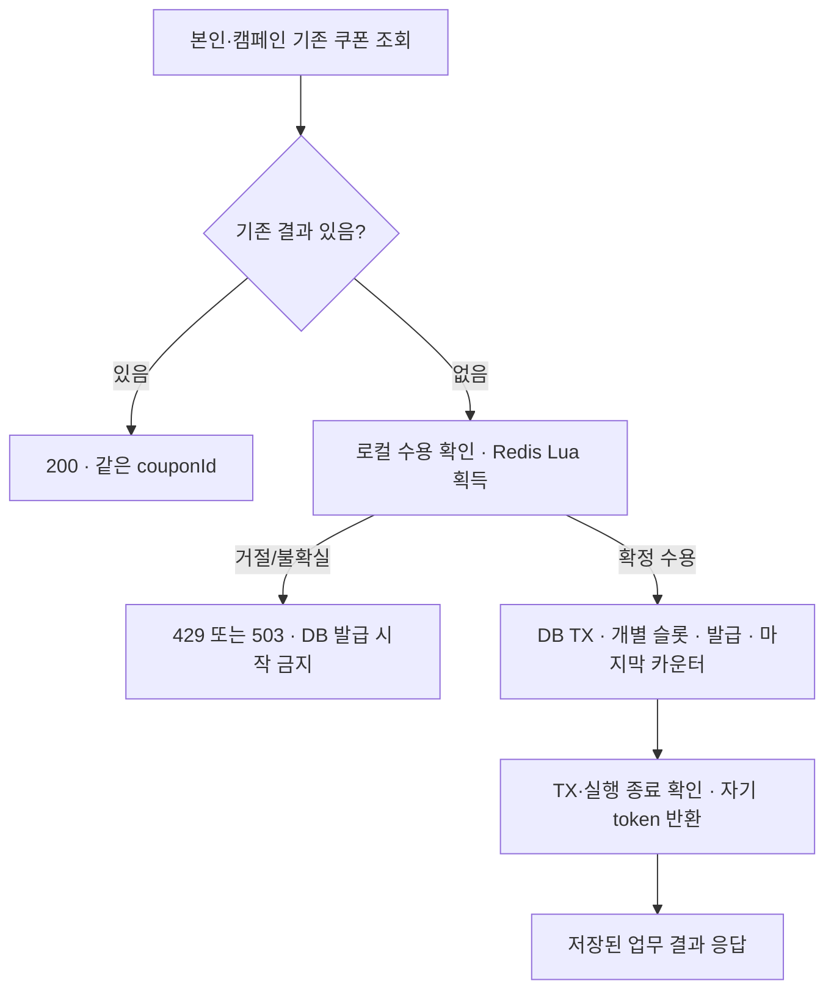

# 이전 Redis 수용 설계 · 현재 적용하지 않음

사용자가 전체 한도를 없애고 인스턴스별 Java Semaphore를 선택하기 전의 논의 기록이다.
현재는 [최신 설계](../design.md)를 따른다. 아래 Redis Set/Lua/token 복구 요구를 현재 구현 지시로 해석하지 않는다.

---

# 8주차 쿠폰 설계 · 사용자와 논의 중

기능 구현 전 설계다. 확정한 방향을 실제 책임/저장/처리 흐름으로 구체화한다.
과제 계약은 [요구사항](../total_requirement.md), 후보 비교/선택 근거는 [트레이드오프](../trade-offs.md)를 따른다.

## 확정과 제안의 구분

| 항목 | 상태 |
|---|---|
| 독립 coupon Context | 사용자 확정 1-A |
| DB 슬롯 사전 준비 + 마지막 구간의 캠페인 잠금/issuedCount 갱신 | 추가 선택 S01-A, 기존 2-A의 캠페인 선잠금을 변경 |
| 앱 실행 중 로컬 관리자 명령으로 수용 제어 | 사용자 확정 3-A, T07에 해당 |
| 혜택 설명 + 정액 할인 금액을 발급 시 snapshot 저장 | 사용자 확정 4-B |
| 로컬 관리자 명령을 HTTP API로 전달 | 사용자 확정 5-A |
| TX 없는 facade + 별도 공개 `@Transactional` 발급 서비스 | 사용자 확정 6-A |
| 쿠폰 발급 잠금에 짧은 명시적 대기 제한 | 사용자 확정 7-A, 시간/적용 방식 미정 |
| 자기 token 반환 1회 시도, 실패는 닫힘/수동 복구 | 사용자 확정 8-A |
| token 형식 `<bootUUID>:<executionUUID>` | 사용자 확정 9-B |
| C는 서버 설정 고정, 초기 실험 3 | 사용자 확정 10-A·변경은 설정 후 재시작 |
| 본인 보유 쿠폰 전체 목록 | 사용자 확정 11-A·페이지 없음 |
| recover와 open HTTP 명령 분리 | 사용자 확정 12-A |
| Redis 명령 응답 대기 초기값 1초 | 사용자 확정 13-A·실제 client 적용 검증 필요 |
| 마지막 캠페인 카운터 잠금 대기 초기 목표 1초 | 사용자 확정 14-A·실제 MySQL 적용 검증 필요 |
| coupon 업무별 오류 코드 | 사용자 확정 15-A·공통 응답 구조/다른 API 응답 유지 |
| 사전 슬롯의 목적 | 사용자 확정: 총량을 행으로 보호하고 캠페인 공통 잠금 구간도 줄임 |
| 슬롯 선택은 SKIP LOCKED | 사용자 확정 16-A |
| 시작 후 totalQuota/혜택 고정, active만 변경 | 사용자 확정 17-A |
| 아래 클래스명·테이블명/필드 타입·관리 endpoint·TX 완료 추적 | 상세 설계 제안, 아직 미확정 |

## 책임과 패키지 제안

| 구성 | 제안 위치 | 책임 |
|---|---|---|
| `CouponCampaign`, `CouponSlot`, `Coupon` | `domain.coupon.model` | 캠페인 규칙·사전 발급 자리·실제 발급 결과 |
| `CouponCampaignRepository`, `CouponSlotRepository`, `CouponRepository` | `domain.coupon.repository` | 저장 계약·빈 슬롯 잠금·마지막 캠페인 잠금·기존 결과 |
| `IssueCouponUseCase`, `IssueCouponFacade` | `application.coupon.usecase`, `application.coupon.facade` | 사전 기존 조회·수용·업무 TX·반환·결과 조율 |
| `IssueCouponTxService` | `application.coupon.service` | 슬롯 선점·쿠폰 insert·마지막 카운터 갱신을 한 공개 TX 진입점으로 실행 |
| `CouponQueryDao`, 조회 record | `application.coupon.query` | 기존 발급/본인 보유 목록의 조회 계약 |
| `CouponAdmission` | `application.coupon.port` | 획득/자기 반환 계약, Redis 타입 비노출 |
| `CouponAdmissionControl` | `application.coupon.support` | 로컬 열림/닫힘·진행 중 실행·복구 상태 조율 |
| JPA Entity/Mapper/Repository 구현 | `infrastructure.persistence.coupon` | 저장 매핑·행 잠금·유일 제약 예외 식별 |
| Redis admission 구현 | `infrastructure.redis.coupon` | master template·Lua·SREM·오류/불확실 결과 분류 |
| 발급/목록 Controller | `interfaces.api.coupon.controller` | 현재 사용자 입력·HTTP 상태·ApiResponse 변환 |
| 관리자 수용 Controller | `interfaces.api.coupon.controller` | 확정한 로컬 HTTP 명령을 application 제어에 전달 |

실제 패키지의 종류 이름/기존 관례는 구현 시작 시 맞춘다. domain은 Spring/JPA/Redis를 모른다.
추가된 coupon domain은 순수성 검사 대상에 포함한다. Controller/application이 infrastructure를 직접 참조하지 않는다.
기존 GET 원칙에 맞춰 목록은 Controller → QueryDao → QueryDSL 구현이다. 조회 전용 UseCase를 추가하지 않는다.

## 테이블 제안

### `coupon_campaigns`

| 필드 | 타입 후보 | 의미/규칙 |
|---|---|---|
| id | BIGINT PK | 캠페인 식별자 |
| name | VARCHAR | 캠페인 이름, 길이 미정 |
| active | BOOLEAN | 신규 발급 가능 여부 |
| total_quota | BIGINT | 총 발급 한도, 생성 시 허용 범위 미정 |
| issued_count | BIGINT | 누적 발급 수, `0 <= issued_count <= total_quota` |
| benefit_description | VARCHAR | 예: 5,000원 할인권, 설명 필드 저장 확정·길이 미정 |
| discount_amount | BIGINT 후보 | 정액 할인 금액 저장 확정·타입/유효 범위 미정 |
| created_at / updated_at | 기존 저장 메타데이터 관례 | 캠페인 생성/변경 시각 |

### `coupon_slots` · 추가 선택 S01-A

발급 총량만큼 캠페인 활성화 전에 준비하는 영속적인 발급 자리다. Redis의 현재 처리 자리와 다르다.
총량 100이면 준비 완료된 슬롯 100개를 사용하며 발급 중 슬롯을 임의로 추가하지 않는다.

| 필드 | 타입 후보 | 의미/규칙 |
|---|---|---|
| id | BIGINT PK | 발급 자리 식별자 |
| campaign_id | BIGINT | 이 자리가 속한 캠페인 |
| state | VARCHAR/enum 후보 | AVAILABLE 또는 ISSUED, 상태/표현은 세부 제안 |

후보 인덱스는 `(campaign_id, state, id)`다. 슬롯 조회/잠금의 실제 실행 계획과 잠금 범위를 검증한다.
사전 슬롯 생성 수·totalQuota·활성화 조건이 일치해야 한다. 준비 실패/부분 생성 상태에서는 활성화하지 않는다.
사용자 확정 17-A: 행사 시작 후 totalQuota·혜택 설명·정액 금액은 변경하지 않고 active만 전환한다.
비활성 뒤 재활성해도 슬롯/카운터/기존 쿠폰은 초기화하지 않는다. 다른 총량/혜택은 새 캠페인으로 준비한다.
일시 비활성 상태를 총량/혜택 재설정 허용으로 해석하지 않는다. FK 구조는 후속 설계하며 전체 관리 CRUD는 추가하지 않는다.

### `coupons`

| 필드 | 타입 후보 | 의미/규칙 |
|---|---|---|
| id | BIGINT PK | 응답 couponId |
| campaign_id | BIGINT | 발급한 캠페인 |
| slot_id | BIGINT NOT NULL·UNIQUE | 실제 사용한 사전 슬롯, 같은 슬롯으로 두 장 발급 금지 |
| user_id | BIGINT | 실제 소유 사용자 |
| issued_at | DATETIME(6) 후보 | 발급 시각, 기존 시간/정밀도 계약에 맞춤 |
| benefit_description | VARCHAR | 발급 당시 혜택 설명 snapshot 확정 |
| discount_amount | BIGINT 후보 | 발급 당시 정액 할인 금액 snapshot 확정 |

`UNIQUE(campaign_id, user_id)`로 실제 사용자 중복을, `UNIQUE(slot_id)`로 슬롯 재사용을 보호한다.
서버가 선택한 slot의 campaignId와 발급 쿠폰의 campaignId를 일치시킨다. FK를 둘 경우 복합 참조 등 정합성도 설계한다.
슬롯 상태·쿠폰 INSERT·issuedCount 증가는 같은 TX다. 실패 시 슬롯만 소모되거나 카운터만 남지 않는다.
목록용 `(user_id, issued_at, id)` 인덱스와 안정적 내림차순 조회를 검토한다.
발급 시 캠페인의 설명/금액을 쿠폰에 함께 복사한다. 기존 쿠폰은 자신의 발급 당시 snapshot을 조회한다.
현재 선택 17-A에서는 행사 시작 후 원본 캠페인의 혜택도 고정된다. 다른 캠페인의 혜택으로 기존 결과를 바꾸지 않는다.
금액은 원문 문자열에서 파싱하지 않는다. 실 할인 계산·정률 할인 등의 유형 확장은 추가하지 않는다.
FK·문자열 길이·금액 범위/타입·기존 BaseEntity 매핑은 미확정이다. 아직 SQL을 적용하지 않는다.

### FK 상세 후보 · 질문 18 미확정

A안은 DB FK로 관계를 보호한다. 후보는 다음과 같다.

- `coupon_slots.campaign_id`는 `coupon_campaigns.id` 참조.
- `coupon_slots(id,campaign_id)`에 복합 참조용 유일 키를 둔다.
- `coupons(slot_id,campaign_id)`가 해당 슬롯의 `(id,campaign_id)`를 참조한다.
- `coupons.slot_id`의 별도 유일 제약과 `(campaign_id,user_id)` 유일 제약은 유지한다.
- coupon에서 campaign으로 직접 FK를 중복 추가하지 않고 슬롯 경유로 캠페인 일치를 보호한다.

슬롯의 campaign_id는 준비 후 불변으로 두고, 상태 변경 SQL에서 불필요하게 FK 값을 다시 쓰지 않도록 매핑/SQL을 검토한다.
FK 검사도 잠금을 잡으므로 실제 SQL/flush를 확인하기 전 공통 잠금 축소를 보장하지 않는다.
B안은 FK 없이 ID 관계를 application에서 검사하며 잘못된 참조를 DB가 직접 막지 못하는 비용이 있다.

## 본인 목록 조회 계약

사용자 확정 11-A: `GET /api/v1/coupons`는 본인의 전체 목록을 반환하며 cursor/size/total 페이지 필드를 추가하지 않는다.
정렬은 `issuedAt DESC, couponId DESC`이며 비어 있으면 성공 응답의 data는 빈 배열을 제안한다.
조회 record 후보는 couponId·campaignId·issuedAt·benefitDescription·discountAmount다. 필드명/날짜 표기는 기존 규칙에 맞춘다.
현재 캠페인의 혜택을 조인해 과거 발급 snapshot을 덮어쓰지 않는다. 같은 시각의 여러 쿠폰은 couponId로 순서를 정한다.

## 신규 발급과 잠금 순서 제안



사용자 확정 6-A: 조율 facade 전체에는 DB TX를 걸지 않고 별도 Spring 빈의 `IssueCouponTxService.execute`가 업무 TX를 연다.
TX 시작 전 Redis 수용, TX proxy 종료 이후 반환을 조율한다. 자기 호출로 `@Transactional` proxy를 우회하지 않는다.
추가 선택 S01-A의 논리 순서는 다음과 같다. 물리 SQL/flush 순서와 FK 잠금은 실제 검증 후 상세안을 확정한다.

1. 업무 TX 안에서 기존 쿠폰을 재확인한다. 있으면 상태/품절과 관계없이 기존 결과를 반환한다.
2. 해당 캠페인의 미발급 슬롯 하나를 `FOR UPDATE SKIP LOCKED`로 고른다. 잠긴 슬롯은 건너뛴다(확정 16-A).
3. 선택한 슬롯으로 사용자 쿠폰을 준비/insert하고 슬롯을 발급 완료로 변경한다. 사용자/슬롯 유일 제약을 유지한다.
4. 마지막 공통 구간에서 캠페인 행을 잠그고 현재 active·totalQuota·issuedCount를 확인한다.
5. 활성/잔여 조건을 만족하면 현재 값에서 issuedCount를 1 증가시키고 명시적으로 save한 뒤 함께 commit한다.
6. 마지막 조건 거절/insert 실패/카운터 실패는 슬롯·쿠폰·카운터 전체 rollback이다. 종료 확인 뒤 자기 Redis token을 반환한다.

캠페인의 마지막 확인은 현재 값에 대한 locking read/명시적 refresh 등으로 처리한다.
앞서 읽은 JPA Entity나 Repeatable Read snapshot의 오래된 issuedCount를 덮어쓰면 안 된다.
캠페인이 중간에 비활성으로 바뀌면 마지막 확인에서 신규 발급을 거절하고 앞선 미커밋 변경도 rollback한다.
잠금 순서는 슬롯 → 캠페인으로 통일하며 관리 경로가 캠페인을 잡은 뒤 슬롯을 잡아 역순을 만들지 않게 한다.
같은 사용자 충돌은 실패 TX가 끝난 뒤 정확한 중복 제약을 식별하고 새 조회에서 기존 결과를 반환한다.
슬롯이 없을 때도 새로 완료된 본인 쿠폰 여부를 적절한 별도 조회에서 확인해 기존 결과 반환을 보호한다.

이 방식도 캠페인 카운터의 공통 잠금은 남는다. DB 전체 발급이 무조건 병렬이 되거나 성능이 개선된다고 주장하지 않는다.
FK 검사/SQL 순서가 캠페인 잠금을 앞당기면 예상 이점이 줄거나 잠금 승격 충돌이 생길 수 있다.
MySQL은 FK 검사를 위해 참조 행에 공유 record lock을 잡을 수 있으므로 FK를 미정인 채 성능을 확정하지 않는다.
[MySQL FK 검사 잠금](https://dev.mysql.com/doc/refman/8.0/en/innodb-locks-set.html)을 바탕으로 실제 schema/SQL의 잠금을 검증한다.
JPA save 호출 순서만으로 INSERT/UPDATE의 물리 순서를 가정하지 않는다.

### 슬롯 선택 SQL과 빈 결과 · 세부 제안

확정한 SKIP LOCKED를 구현할 SELECT 후보는 다음과 같다. 실행 계획/실제 잠금 범위는 MySQL에서 검증한다.

```sql
SELECT id
FROM coupon_slots
WHERE campaign_id = :campaignId AND state = 'AVAILABLE'
ORDER BY id
LIMIT 1
FOR UPDATE SKIP LOCKED;
```

조회가 비어도 잠긴 행을 건너뛴 결과일 수 있으므로 품절로 단정하지 않는다.
빈 결과 경로는 발급 쓰기를 하지 않고 해당 TX를 종료한 뒤 새 조회 경계에서 기존 결과/현재 상태를 확인하는 안을 제안한다.
확인 중에도 원래 실행은 Redis 자리를 유지하며, DB TX/실행 종료 확인 이후 자기 자리만 반환한다.

| 확인된 사실 | 제안 결과 |
|---|---|
| 같은 사용자·캠페인의 완료 쿠폰 발견 | 200·기존 couponId |
| 캠페인 없음/비활성 | 기존과 같은 업무 오류 계약 |
| 최신 issuedCount가 totalQuota에 도달 | 확정 품절 |
| 남은 한도가 있으나 당장 슬롯 획득 불가 | 일시 DB 슬롯 경합·503/별도 코드 후보, 품절·Redis 429와 구분 |
| 슬롯 수/쿠폰 수/카운터 구조 불일치 | 정합성 오류로 기록·확정 품절로 숨기지 않음 |

새 조회도 오래된 snapshot/managed Entity 값에 의존하지 않게 한다. 정확한 조회·잠금 순서는 FK/SQL 상세화와 함께 검증한다.
빈 결과를 재확인하는 것은 새 발급 TX를 자동으로 재시도하는 정책과 구분한다. 자동 발급 재시도는 아직 추가하지 않는다.
원문의 총량 경쟁 기대를 일시 경합으로 대체하지 않는다. 해당 실험의 종료/최종 판정 방법은 검증 계획을 따른다.

사용자 확정 7-A/14-A에 따라 마지막 캠페인 카운터 잠금 대기의 초기 목표를 1초로 둔다.
실제 MySQL 적용 경계/설정/실효값은 검증해야 한다. 슬롯 SKIP LOCKED의 동작을 1초 대기로 바꾸지 않는다.
JPA hint나 HTTP timeout 설정만으로 실제 DB 잠금이 중단됐다고 주장하지 않는다.
잠금 실패 후 전체 업무 TX rollback·실행 종료를 확인한 경우 자기 token을 반환한다.
정상 rollback된 잠금 실패 자체로 Redis 수용을 장애 닫힘 처리하지 않는다. TX 종료/결과 불명은 닫힘을 유지한다.

## Redis token과 실행 추적

사용자 확정 9-B: 앱 시작 때 bootUUID를 생성하고 HTTP 실행마다 새 executionUUID를 생성한다.
Redis의 전용 공유 Set에는 `<bootUUID>:<executionUUID>` 문자열만 저장하며 token TTL을 두지 않는다.
사용자 확정 10-A: 초기 실험 C=3을 신뢰하는 서버 설정으로 읽는다. 키 이름/설정 속성은 아직 제안 단계다.
동적 C 변경 API는 만들지 않는다. 설정을 바꾸고 재시작해도 새 boot의 수용은 기본 닫힘이며 종료/점유 확인 뒤 명시적으로 연다.
같은 앱 시작에 속한 서로 다른 실행은 bootUUID만 같고 executionUUID/token 전체는 다르다.
로그/로컬 실행 registry에서 token·campaignId·userId·현재 단계·TX 결과·반환 결과를 연결하는 것을 제안한다.
실행 registry의 구체 필드/phase는 미확정이며 사용자+캠페인을 token으로 재사용하지 않는다.

접두어는 소유 범위를 찾는 정보다. 이전 boot의 접두어라는 이유만으로 token을 삭제하지 않는다.
앱 재시작은 새 bootUUID·기본 닫힘으로 시작한다. 이전 실행의 DB 종료/실제 쿠폰 결과 확인은 여전히 필요하다.

## 결과와 TX 완료의 구분

| 관찰 | 후속 동작 |
|---|---|
| 사전 조회에서 기존 쿠폰 | Redis/업무 TX 없이 200 |
| Lua 수용 0 | 429·DB 업무 진입 없음 |
| Redis 수용 실패/불확실 | 503·수용 닫힘·DB 업무 진입 없음 |
| DB commit 확인 | 발급 사실 유지·종료 뒤 자기 token 반환·최초 201 |
| TX 안에서 기존 결과 발견 | 추가 발급 없음·종료 뒤 반환·200 |
| 품절/비활성·rollback 완료 | 업무 거절·종료 뒤 반환 |
| 잠금 대기 실패·전체 rollback/실행 종료 확인 | 별도 잠금 실패 응답·자기 반환, 품절/수용량 거절과 구분 |
| 남은 수량이 있으나 획득 가능한 DB 슬롯 없음 | 일시 슬롯 경합·503/코드 후보 미확정, 품절/Redis 429로 오분류하지 않음 |
| TX 결과/작업 종료 불명 | token 유지·수용 닫힘·성공/실패 추정 금지 |
| commit 뒤 SREM 실패 | 저장된 발급 결과 유지(최초 201/기존 200)·수용 닫힘·미확인 점유 복구 대상으로 기록 |

TX proxy의 정상 반환/예외만으로 모든 오류의 commit/rollback 완료를 단정하지 않는다.
최종 완료 신호/오류 응답은 다음 논의에서 구체화한다. 예외 시 무조건 반환하는 finally를 사용하지 않는다.

### TX 완료 관찰의 구체화 · 제안

`IssueCouponTxService`에 실행별 완료 관찰 객체를 전달하고 Spring `TransactionSynchronization.afterCompletion`의
COMMITTED/ROLLED_BACK/UNKNOWN을 기록하는 안을 제안한다. 이를 DB의 원격 작업 종료를 독립적으로 보장하는 장치로 취급하지 않는다.
callback 안에서 Redis 반환/추가 DB 쓰기를 수행하지 않고, TX proxy 호출이 끝난 뒤 facade가 기록/예외/실행 종료를 함께 판단한다.
등록이 안 됐거나 callback이 없거나 UNKNOWN/commit 통신 오류 등으로 확정할 수 없으면 닫힘/token 유지다.
기존 완료 상태를 일반 예외/HTTP timeout만으로 rollback 완료로 바꾸지 않는다. 실제 JpaTransactionManager 오류 경로도 검증한다.
이 객체/registry는 실행 소유이며 사용자 정보를 ThreadLocal로 전달/잔존시키는 방식은 추가하지 않는다.
참고: [Spring TX 완료 callback](https://docs.spring.io/spring-framework/docs/6.2.0/javadoc-api/org/springframework/transaction/support/TransactionSynchronization.html).

사용자 확정 8-A에 따라 종료 뒤 자기 SREM은 한 번만 시도한다.
실패/불확실 응답이면 token이 제거됐다고 단정하지 않고 신규 수용을 닫고 수동 복구 대상으로 남긴다.
DB commit이 확인된 응답은 저장된 최초 201/기존 200을 유지한다. 반환 오류로 쿠폰/발급 수를 되돌리지 않는다.
관리자 복구의 명시적 SREM은 원래 실행의 자동 재시도와 구분한다.

## 로컬 관리자 제어 제안

기본 시작은 `CLOSED_INITIAL`, 명시적 열기 뒤 `OPEN`, 장애/불확실 관찰 뒤 `CLOSED_UNCERTAIN`을 제안한다.
관리자 수동 닫힘 `CLOSED_MANUAL`도 구분하면 닫힌 이유와 재개 조건을 설명하기 쉽다. 상태명/구현은 미확정이다.

| 명령 후보 | 동작 |
|---|---|
| status | 상태/닫힘 이유·이 인스턴스의 진행 중 실행·정리 대상 확인 |
| close | 새 진입 차단, 기존 실행을 강제로 종료하거나 token 삭제하지 않음 |
| recover | 수용 닫힘에서 종료/결과 확인을 거쳐 자기 범위의 비활성 token만 정리 |
| open | 기존 실행/DB 작업 종료·점유 확인/복구 조건을 충족한 경우만 명시적으로 열기 |

사용자 확정 5-A: 관리자 명령을 로컬 HTTP API로 제공한다. 기존 사용자-1 fixture 제한과 로컬 실행 프로필을 적용하는 것을 제안한다.
구체 endpoint·응답·로컬 프로필/접근 경계는 아직 미확정이다. 제안 경로는 다음과 같다.

| HTTP 후보 | 책임 |
|---|---|
| `GET /api/v1/admin/coupon-admission` | 수용 상태/닫힘 이유·실행/복구 대상 조회 |
| `POST /api/v1/admin/coupon-admission/close` | 신규 진입 닫기, 기존 실행/token 유지 |
| `POST /api/v1/admin/coupon-admission/recover` | 닫힘 상태에서 확인된 자기 비활성 token만 정리 |
| `POST /api/v1/admin/coupon-admission/open` | 종료/점유 신뢰 등 재개 조건 확인 후 명시적으로 열기 |

사용자 확정 12-A: recover와 open을 분리한다. recover 성공은 token 정리 완료를 뜻하며 수용은 닫힘으로 유지한다.
관리자는 정리 결과를 조회한 뒤 별도 open을 요청한다. open은 그 시점의 재개 조건을 다시 확인하며, 기존 검증 결과를 무조건 신뢰하지 않는다.
open은 token을 정리하거나 Redis FLUSHDB/Set 삭제를 하지 않는다. 강제 열기 옵션은 제안하지 않는다.
status/open 요청이 일반 상품 캐시·기존 PG/Outbox 상태를 바꾸지 않는다.

새 실행 등록과 close 판단을 같은 로컬 동기화 경계에서 조율해 관리자가 등록 중 실행을 놓치지 않게 한다.
획득 진행 중/DB 실행 중/반환 미확인 실행을 복구 판단에 포함한다.
프로세스 재시작으로 메모리 실행 목록이 비어도 기존 DB 작업/Redis token이 끝났다는 증거가 아니다.
자기 token 식별/관찰 정보의 보존·재시작 뒤 복구 증거는 후속 질문에서 설계한다.
이번 범위는 통제된 로컬 인스턴스이며 다중 인스턴스 제어/자동 failover 보장으로 확대하지 않는다.

질문 20의 A안은 현재 boot의 실행 registry와 로그를 이용하고, 이전 boot는 운영자가 이전 process/DB 작업 종료·실제 결과·정확한 token 범위를 확인하는 절차로 둔다.
B안은 별도 DB 실행 이력을 추가하지만 미완료 이력만으로 작업 종료를 증명하지는 못한다. 아직 선택하지 않았다.
프로세스 재시작 뒤 registry가 비었다고 자동 open/recover하지 않는다. 운영 근거를 확보하지 못하면 닫힘을 유지한다.

### 빈 슬롯 경합의 동기 대기 · 질문 19 미확정

SKIP LOCKED 빈 결과에서 기존 쿠폰/품절/비활성을 확정하면 바로 해당 결과를 반환한다.
아직 남은 한도가 있지만 미잠금 슬롯을 못 고른 경우 A안은 즉시 503 `COUPON_SLOT_BUSY`다.
B안은 같은 Redis 실행 token을 유지하고 쓰기 전 슬롯 획득/상태만 전체 예산/횟수 안에서 재확인한다.
각 빈 결과 TX를 종료한 뒤 TX 밖에서 기다리며 실제 INSERT 이후의 업무 TX를 자동 재실행하지 않는다.
다시 DB 진입하기 전 로컬 닫힘/세대 변경도 확인한다. 예산 내에 결과를 확정하지 못하면 503이며 큐/발급 예약을 뜻하지 않는다.
정확한 예산/간격/횟수와 원문 총량 실험의 최종 판정은 선택 후 확정한다.

## timeout과 오류 계약

사용자 확정 13-A/14-A: Redis 명령 대기 초기값 1초, 마지막 캠페인 카운터 잠금 대기 초기 목표 1초다.
두 한도는 각각의 대기 경계이며 전체 HTTP/TX 작업의 절대 종료 시간으로 더하거나 오해하지 않는다.
Redis는 실제 수동 master factory 설정에, DB는 실제 MySQL의 잠금 대기에 적용되는지 구현 단계에서 검증한다.
기존 다른 API의 timeout/연결 설정을 일괄 변경하지 않는다.

업무 상태 충돌은 기존 `ApiErrorMapper`의 재고 부족 등 409 규칙에 맞춰 다음을 제안한다.
사용자 확정 15-A: 업무별 코드로 구분하며 공통 ApiResponse 구조와 기존 다른 API 응답은 유지한다.
아래 세부 상태/코드는 구현 시 실제 mapper 계약과 함께 연결할 설계안이다.

| 상황 | HTTP 후보 | coupon 오류 코드 후보 | 수용 상태 |
|---|---|---|---|
| 없는 캠페인 | 404 | `COUPON_CAMPAIGN_NOT_FOUND` | 자체로 닫지 않음 |
| 품절 | 409 | `COUPON_SOLD_OUT` | 자체로 닫지 않음 |
| 비활성 | 409 | `COUPON_CAMPAIGN_INACTIVE` | 자체로 닫지 않음 |
| 자리 없음 | 429·과제 고정 | `COUPON_CAPACITY_EXCEEDED` | 자체로 닫지 않음 |
| 수용 닫힘/Redis 확인 불가 | 503·과제 고정 | `COUPON_ADMISSION_UNAVAILABLE` | 닫힘 유지/전환 |
| 잠금 대기 실패·rollback/종료 확인 | 503 후보 | `COUPON_LOCK_BUSY` | 자체로 닫지 않음 |
| 잔여 한도는 있으나 미잠금 슬롯 획득 불가 | 503 후보 | `COUPON_SLOT_BUSY` | 자체로 닫지 않음 |
| TX 결과/실행 종료 불명 | 503 후보 | `COUPON_ISSUE_OUTCOME_UNKNOWN` | 닫힘·token 유지 |

같은 503이어도 잠금 실패와 Redis/실행 결과 불명은 운영 후속 조치가 다르다.
예상하지 못한 일반 DB 오류를 품절/중복/잠금 실패로 숨기지 않는다. 관리자 제어 오류와 접근/입력 오류는 후속 설계한다.

## 다음에 논의할 세부

질문 16-A/17-A의 SKIP LOCKED·시작 후 총량/혜택 고정은 확정했다.
질문 13-A/14-A/15-A로 Redis 1초·마지막 카운터 잠금 초기 목표 1초·업무별 오류 코드를 확정했다.
슬롯 SKIP LOCKED가 모든 DB 잠금 대기를 없애는 것은 아니다. 14번은 마지막 캠페인 카운터 행의 대기다.
FK/flush 순서·빈 슬롯 결과의 처리·TX 종료 확인·복구 근거를 이어서 확정한다.
다음 질문은 18(FK 경유 보호), 19(빈 슬롯 즉시 실패/제한 재확인), 20(이전 boot 수동 근거/실행 DB 이력)이다.
