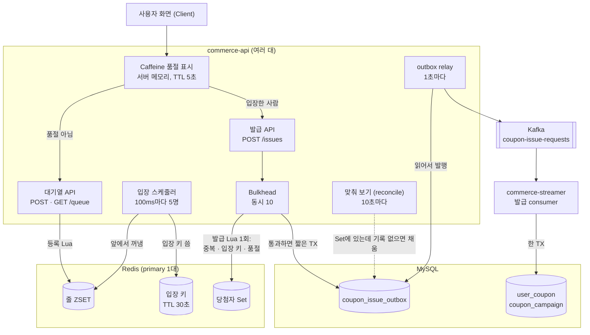
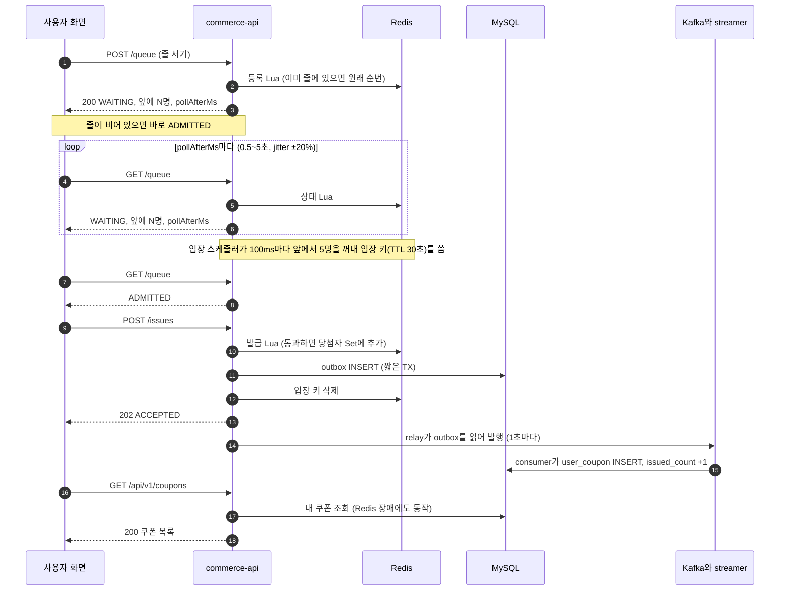
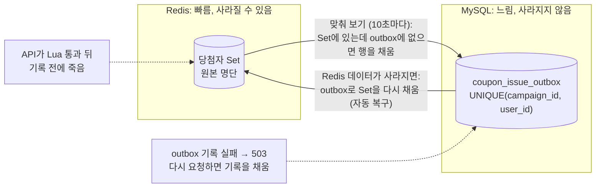
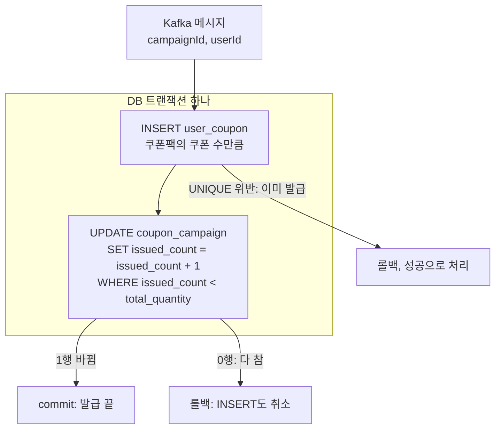

# 8주차 설계 — 쿠폰 발급과 수용량 통제

> - 표기: ✅ 합의 · 🔧 AI 기본값 · 🤔 결정 필요
> - 그림만 따로 보기: `docs/week8/design-diagrams.html`
> - 과제 원문: Notion 8주차 발제·실습 (비공개)
> - 읽는 법: 맨 위 "한눈에 보기"만 보면 전체가 잡힌다. 아래 결정마다 **결론** 한 줄이 있고, 이유·버린 안·숫자는 "자세히"를 펼치면 나온다.

## 한눈에 보기

### 1. 전체 구조



- 발급 API는 판정(Redis Lua 1회)과 outbox 기록까지만 하고 **202**를 준다.
- 쿠폰을 실제로 만드는 건 commerce-streamer의 consumer다.
- 세마포어(동시 처리 자리 수 C)는 없다. 11-12에 뺐다(D-3, 범위 다시 정함).

### 2. 사용자 흐름



### 3. 실패 처리: 되돌리지 않고 앞으로 채운다



- Set에서 빼는 경로는 없다. 두 곳이 서로 빠진 걸 채우기만 한다.
- 같은 행을 여러 번 채워도 UNIQUE가 하나만 남긴다. 그래서 채우는 쪽끼리 겹쳐도 꼬이지 않는다.

### 4. consumer 트랜잭션



### 용어

| 이 문서의 말 | 뜻 |
|---|---|
| 당첨자 Set (= 발급 사용자 Set) | Redis Set. 발급 Lua를 통과한 사용자 명단. 줄지 않는다 |
| 입장 키 (= 입장 토큰) | Redis `entry:{campaignId}:{userId}`, TTL 30초. 있어야 발급 API를 부를 수 있다 |
| 맞춰 보기 (reconcile) | 당첨자 Set과 outbox를 비교해 빠진 outbox 행을 채우는 10초 주기 작업 |
| 캠페인 상태 키 | Redis `campaign:{id}:state`. 없으면 Redis 데이터가 사라진 것(`UNKNOWN`)으로 본다 |
| Caffeine 품절 표시 | 서버 메모리의 품절 사본. 품절이면 Redis까지 가지 않고 거절 |

### 결정 요약

| ID | 무엇 | 결론 | 상태 |
|---|---|---|---|
| P-W8-01 | 정책: 줄 세우는 순서 | Redis에 도착한 순서대로 줄 세우고 앞에서부터 입장. 내 앞 인원만 보여 줌. 한도 n장, 1인 1장 | ✅ 11-12 |
| D-1 | 전체 구조 | 판정은 API의 Redis Lua 1회, 쿠폰 생성은 consumer. 응답은 202 | ✅ 11-10 (세마포어 부분은 11-12에 뺌) |
| D-2 | 실패 처리 | 되돌리지 않고 앞으로 채움. Set이 원본, outbox가 따라잡음. DLT는 관리자 재처리 | ✅ 11-12 |
| D-3 | 범위 다시 정함 | 세마포어(C=3)는 빼고 실험으로. 대기열을 본 설계로. 멀티 인스턴스 전제 | ✅ 11-12 |
| D-4 | 대기열 | ZSET 줄, 100ms마다 5명 입장(Redis 카운터라 서버 수와 무관), 입장 키 30초, 서버가 정하는 조회 간격, 품절 = Set 크기 ≥ 수량, Redis 데이터 유실은 자동 복구 | ✅ 11-12 |
| D-5 | 쿠폰 DB 모델 | 캠페인(줄·수량)과 쿠폰(할인 규칙) 분리, 당첨되면 쿠폰팩 전부, 발급 수는 조건부 UPDATE | ✅ 11-12 |
| D-6 | 격벽 (bulkhead + rate limit) | 발급 API에 Bulkhead(동시 10, Lua 앞), 등록·조회에 RateLimiter, consumer 동시 처리 2 | ✅ 11-12 |
| D-7 | API 계약 | 대기열 API는 업무 상태를 200 본문으로, 발급은 202 / 200 / 409 / 503. 429·503 ErrorType 추가 | ✅ 11-12 |
| D-8 | consumer 위치 | commerce-streamer (다른 프로세스가 가장 강한 격벽) | ✅ 11-12 |
| D-9 | Redis 격리 | 이번 주는 상품 캐시와 같은 Redis. 상품 캐시 조회가 느려지면 나눔 | ✅ 11-12 |

## 정책

### P-W8-01. 줄 세우는 순서 ✅ 11-12 (11-10 판을 바꿈)

**결론: Redis에 도착한 순서대로 줄을 세우고, 앞에서부터 들여보낸다.**

<details>
<summary>자세히: 보여 주는 것, "도착 순서"인 이유, 11-10 판과 그 비용</summary>

- 사용자에게는 내 앞 인원을 보여 준다. 남은 수량과 예상 대기 시간은 보여 주지 않는다(🔧).
- 캠페인 한도 n장과 1인 1장을 지킨다.
- 다시 누르거나 새로고침해도 원래 자리를 유지한다.
- "Redis에 도착한 순서"인 이유: 네트워크가 빠른 사람이 먼저 도착하므로 버튼을 누른 순서와 조금 다를 수 있다. 지킬 수 있는 건 서버가 받은 순서까지다.
- 11-10 판(바뀌기 전): 순서는 약속하지 않는다. 순번을 보여 주지 않으므로 ZSET이 아니라 Set. 429 뒤 다시 요청.

**11-10 판의 비용 (11-11 메모, 대기열을 넣게 된 계기)**

- 자리가 비는 순간에 도착한 요청이 받으므로 누가 받을지는 운이다.
- 429를 받은 사람이 계속 다시 누르면 요청이 더 늘어난다.
- Kafka 장애 때는 C명(세마포어 자리 수)만 대기하고 나머지는 전부 429다.
- 이게 받아들일 수 없는 서비스라면 해법은 대기열이다. ZSET에 도착 순서대로 줄을 세우고, 자리가 나면 앞사람부터 들여보낸다. 공정하고 다시 누를 필요가 없지만, 순번 조회·입장 신호 같은 장치가 늘어난다.
- 과제도 같은 질문을 던진다: "queue가 없으면 어떤 복구 책임이 줄고 어떤 사용자 경험을 포기할까요?" 글 주제 예시 "동기 발급과 비동기 대기열 중 선택한 이유", 참고 자료 "Please Wait. You're In The Queue."

</details>

## 결정

### D-1. 전체 구조 ✅ 11-10

**결론: 구성도 B(통합안)로 간다. 발급 API는 Redis Lua 1회로 판정하고 202를 준다. 쿠폰 업무 테이블은 consumer만 쓴다.**

> ⚠️ 아래 11-10 그림과 "Set 두 개"는 옛 설계다. 세마포어(permits Set · token · 자리 수 C)는 11-12에 D-3(범위 다시 정함)에서 뺐고, Kafka 직접 발행은 outbox로 바뀌었다(D-2 실패 처리). 지금 흐름은 맨 위 "한눈에 보기" 그림 1·2를 본다.

<details>
<summary>자세히: 11-10 그림(옛 설계), Lua로 묶는 이유, 202인 이유, 버린 안</summary>

**11-10 그림 (옛 설계, 기록용)**

```
Client → commerce-api
           ① Caffeine 품절 플래그   — 품절이면 Redis까지 가지 않고 거절
           ② Redis Lua 1회          — 중복 → 한도 → 자리(세마포어) 순서로 판정
           ③ Kafka 발행 (+token)    — 202 Accepted
         → consumer: DB TX(한도·unique 최종 방어) → commit 뒤 SREM 자기 token
```

- commerce-api의 발급 경로는 쿠폰 업무 테이블에 닿지 않는다(블로그 구조). 목록 조회만 DB를 읽는다. (지금은 outbox 기록 하나만 DB에 쓴다. D-2 실패 처리 참고)
- (옛 설계) Redis에 Set 두 개: 발급 사용자 Set(줄지 않음)과 permits Set(세마포어, token ≤ C, 끝나면 반환).

**판정을 Lua 하나로 묶는 이유 (11-11, 지금도 그대로)**

- 확인 후 실행 경쟁: 두 요청이 동시에 `SCARD = C-1 → 자리 있음`을 보고 둘 다 SADD하면 자리가 C+1이 된다. 한도(n)도 같은 방식으로 넘는다. Lua는 실행 중에 다른 명령이 끼어들지 못한다. (예시의 C는 옛 세마포어지만, 한도 n에는 지금도 같은 경쟁이 있다.)
- 중간에 죽음: coupon-system처럼 `SADD` 뒤 `INCR`을 따로 부르면, 그 사이에 프로세스가 죽을 때 "수락됐지만 count는 안 오른" 사용자가 남는다.
- MULTI/EXEC(블로그)는 명령을 한 번에 실행할 뿐, SCARD 결과를 보고 SADD를 할지 말지 고를 수 없다.
- 성능 차이는 작다(왕복 2번 → 1번). 이유는 성능이 아니라 원자성이다.

**201 대신 202**

- 과제의 "최초 발급 201 + couponId"는 202 Accepted로 바뀐다. 응답 시점에 DB에 쿠폰이 없으므로 201을 주면 "없는 쿠폰을 성공으로 응답"이 된다. PR에 이유를 적는다.

**버린 안**

- 동기안(구성도 A, API 안에서 세마포어가 DB TX를 감쌈). 학습자가 블로그 구조를 목표로 정함.
- 세마포어를 consumer에만 두는 안: 429를 줄 수 없고, consumer 동시 처리 수는 이미 partition 수 × thread 수로 정해져 있다.

</details>

### D-3. 범위 다시 정함 (멘토 공지 반영) ✅ 11-12

**결론: 세마포어(C=3)는 본 설계에서 빼고 실험으로 남긴다. 대기열을 본 설계에 넣는다. 멀티 인스턴스를 전제로 한다.**

<details>
<summary>자세히: 멘토 공지, 세마포어를 뺀 이유, 멀티 인스턴스 전제</summary>

멘토 공지(11-12): 발제의 세마포어는 처리량 제한을 이해하기 위한 기본 샘플이고, 실험 수준으로 끝내도 된다. 처리량 제한에 걸려 쿠폰을 받을 수 있는데도 실패를 돌려주는 경험은 피하고, 공정한 선착순을 고민해 보라. 쿠폰 발급 구현 방식은 자유.

- **본 설계:** Redis Lua(선착순 판정) + API + Kafka + Caffeine 품절 표시 + **대기열**.
- **세마포어(C=3) 빼기:** 우리 구조는 API가 202를 주고 바로 끝나서 스레드를 붙잡지 않는다. 줄은 outbox → Kafka가 맡고, DB로 가는 처리량은 consumer 동시 처리 수가 제한한다. 그러면 C=3이 더하는 효과는 "100명 안에 든 사람도 처리 자리가 없으면 429"뿐이다.
- **세마포어 실험:** 처리량 제한 이해용으로 따로 둘 수 있다. 과제 체크리스트("C=3에서 네 번째 거절" 등)를 꼭 맞추지 않아도 된다고 봄 (학습자, 공지 해석). 우선순위는 가장 낮다.
- **전제: 멀티 인스턴스.** API와 consumer가 여러 대 뜬다고 보고 설계한다. 그래서 판정 상태는 Redis에 두고, Caffeine 품절 표시는 서버마다 따로 켜진다.
  - 과제 원문은 기본 실험을 "로컬 발급 인스턴스의 통제된 장애·재개"로 한정하고, "다중 인스턴스 자동 장애 전환까지 안전한 분산 semaphore라고 주장하지 않"는다고 적는다. 로컬 실험은 1~2대로 한다.
- 대기열은 학습자가 이론을 처음 본다. 이론부터 한 단계씩 정한다.

</details>

### D-4. 대기열 ✅ 11-12

| 번호 | 무엇 | 결론 |
|---|---|---|
| D-4-1 | 위치 | 발급 API 앞에 대기열 API. 직접 만든다(서비스 밖 대기열 아님) |
| D-4-1a | 언제 켜나 | 항상 줄을 거친다. 앞에 아무도 없으면 바로 입장 |
| D-4-2 | Redis에 담는 방식 | ZSET, score = Redis 순번 카운터. 다시 등록하면 원래 자리 |
| D-4-3 | 입장시키는 쪽 | 모든 서버가 돌되 100ms 구간 한도를 Redis 카운터로 셈. 전용 스레드 1개 |
| D-4-4 | 입장 토큰 | Redis 키, TTL 30초. 삭제는 outbox 커밋 뒤 |
| D-4-5 | 순번 조회, 줄 길이 | 서버가 다음 조회 시점(`pollAfterMs`)을 알려 줌. 줄 길이 제한 `queue_capacity`, 넘으면 429 |
| D-4-6 | 품절·마감 | 품절 = 당첨자 Set 크기 ≥ 쿠폰 수, 모든 Lua가 확인. 품절이면 줄을 지움 |
| D-4-7 | Redis 장애 | 연결 안 되면 503. 데이터가 사라지면 outbox로 자동 복구 |

#### D-4-1. 위치: 발급 API 앞에 대기열 API ✅ 11-12

**결론: 줄 서기 → 순번 조회 → 입장 → 발급 순서. 대기열에는 429가 없다.**

<details>
<summary>자세히: 네 단계, 입장 속도의 기준, 서비스 밖 대기열을 버린 이유</summary>

```
① POST /queue    대기열 등록 → 순번 응답, 연결은 바로 끊음
② GET  /queue    순번 조회 (몇 초마다)
③ 스케줄러        앞에서부터 초당 N명 입장 → 입장 토큰 발급
④ POST /issues   입장 토큰이 있어야 호출 가능 → Caffeine → Lua → outbox → Kafka → DB
```

- 대기열에서는 429가 없다. 입장 속도를 넘은 사람은 줄에서 더 기다릴 뿐이다. 그래서 쿠폰 수와 입장 속도 사이에 지켜야 할 크기 관계는 없다.
- 입장 속도(초당 몇 명)는 뒤쪽 처리 능력(consumer의 초당 발급 커밋 수, TPS)을 보고 정한다. RPS는 들어오는 HTTP 요청 수라서 기준이 아니다.

**버린 안: 서비스 밖 대기열** (NetFUNNEL, Cloudflare Waiting Room 같은 별도 서비스·게이트웨이). 직접 만든 이유:

- 줄이 쿠폰 상태를 알아야 한다. 이미 받은 사람은 줄에 넣지 않고, 품절되면 남은 줄을 바로 정리한다. 밖의 대기열은 URL·트래픽 단위로 동작해서 이 판단을 우리 서버에 다시 물어야 한다.
- 줄의 단위가 사용자다(1인 1자리). 밖의 대기열은 보통 브라우저 세션(쿠키) 단위다.
- 과제 주제가 처리량 제한과 입장 통제를 직접 이해하는 것이다. 밖의 서비스를 쓰면 그 부분이 가려진다.
- 비용: 트래픽이 아주 크면 등록 요청도 전부 우리 서버(API·Redis)가 받는다. 밖의 대기열은 이걸 edge에서 흡수한다. 이 규모가 되면 밖의 서비스를 다시 검토한다.

</details>

#### D-4-1a. 항상 줄을 거침 ✅ 11-12

**결론: 몰릴 때만 켜지 않는다. 캠페인 기간이 곧 줄이 열린 기간이다.**

<details>
<summary>자세히: 몰릴 때만 켜는 안을 버린 이유, 여닫는 시점</summary>

- 몰릴 때만 켜는 안(트래픽이 기준을 넘으면 줄을 세움)은 버림. 선착순 이벤트는 시작 순간에 몰리는 게 정해져 있고, 켜지는 순간 이미 통과한 사람과 줄에 선 사람의 순서가 꼬인다.
- 켜고 끄기는 따로 없다. 🔧 발급 시작 시각부터 등록을 받고, 품절 또는 마감 시각에 닫는다.
- 앞에 아무도 없으면 바로 입장한다. 대기 화면은 `POST /queue` 응답이 "앞에 N명"일 때만 띄운다.

</details>

#### D-4-2. 줄을 Redis에 담는 방식 ✅ 11-12

**결론: `queue:{campaignId}` ZSET. member = userId, score = Redis 순번 카운터 값.**

<details>
<summary>자세히: score를 정하는 법, 다시 등록, 줄에 넣기 전 거름</summary>

- score = Lua 안에서 `INCR queue:{campaignId}:seq` 한 값. Redis에 도착한 순서가 곧 줄 순서다.
  - 버린 안: 서버 시각(서버마다 시계가 다름), Redis `TIME`(같은 시각이 겹칠 수 있음).
- score는 안에서만 쓰는 값이다. 사용자에게는 `ZRANK`(내 앞에 몇 명)를 보여 준다. 앞사람이 입장하면 score는 그대로이고 rank만 줄어든다.
- 이미 줄에 있으면 원래 순번을 돌려준다(뒤로 밀리지도, 끼어들지도 않음). 확인과 등록은 Lua 하나로 묶는다.
- 줄에서 나가기는 `ZREM`.
- 🔧 줄에 넣기 전에 거름: Caffeine 품절 표시가 켜져 있으면 바로 품절, 이미 발급받은 사람(당첨자 Set)은 줄에 넣지 않음.

</details>

#### D-4-3. 입장시키는 쪽: 구간별 입장 한도를 Redis에서 센다 ✅ 11-12

**결론: 모든 서버가 입장 스케줄러를 돌리되, 100ms 구간마다 몇 명 들였는지를 Redis 카운터 하나로 센다. 🔧 100ms마다 5명(초당 50명, 측정 전 임시값). 스케줄러는 전용 스레드 1개.**

<details>
<summary>자세히: 문제, 두 안 비교, 초당 50명의 근거와 한계, 전용 스레드</summary>

**문제:** 줄(ZSET)은 Redis에 하나다. 그런데 서버 5대가 각자 "100ms마다 5명 입장"을 돌리면 25명이 들어간다. 서버를 늘릴수록 입장 속도가 같이 빨라진다.

| 안 | 방법 | 비용 |
|---|---|---|
| 가. 한 서버만 돌림 | ShedLock으로 스케줄러 하나만 실행 (W7 outbox relay가 이미 ShedLock JDBC를 쓴다) | 그 서버가 죽으면 락이 풀릴 때까지(lockAtMostFor) 아무도 입장 못 하고 대기 화면이 멈춘다. ShedLock JDBC는 락을 MySQL `shedlock` 행에 잡으므로, 100ms마다 잡으면 서버마다 초당 10번 MySQL에 쓰기가 간다 |
| **나. 모든 서버가 돌되 구간 한도를 Redis 카운터로 셈 ✅** | 입장 Lua가 Redis `TIME`으로 100ms 구간 번호를 구하고, `admit:{campaignId}:{구간}` 카운터로 "이번 구간에 몇 명 들였나"를 센다. 한도가 차면 다른 서버는 꺼내지 않는다 | 서버 수 × 초당 10번 Lua 호출(5대면 초당 50번, Redis에는 작은 양). 구간 번호가 Redis 시각에 기대지만, 줄 자체가 이미 Redis에 있어서 새 의존이 늘지 않는다 |

나를 고른 이유:

- 서버가 몇 대든 구간 한도는 하나라 입장 속도가 일정하다.
- "대장" 서버가 없다. 한 대가 죽어도 나머지가 그대로 입장을 이어 가서, 대기 화면이 멈추지 않는다.
- 락을 MySQL에 100ms마다 잡지 않아도 된다. 이미 줄이 Redis에 있으니 구간 카운터도 같은 Redis에서 센다.
- (11-12 정정: 처음에 "락 설정이라는 부품이 하나 더 생긴다"고 적었으나, W7 relay가 이미 ShedLock JDBC를 쓰고 있어 새 부품은 아니다.)

**꺼내기와 토큰 쓰기를 한 Lua로**

- 꺼내기(`ZPOPMIN`)와 입장 토큰 쓰기를 한 Lua에 묶는다. 따로 부르면 꺼낸 직후 서버가 죽을 때 그 사람이 줄에서도 빠지고 토큰도 없이 사라진다.

**입장 속도: 🔧 100ms마다 5명(초당 50명), 둘 다 설정값**

- 1초마다 50명보다 흐름이 고르고, 한가할 때 기다림이 최대 100ms다.
- **초당 50명은 측정 전 임시값이다.** 근거 있는 숫자가 아니라, 측정 전이라 낮게 잡은 값이다.
- 왜 속도를 제한하나: 당첨자 한 명마다 MySQL 쓰기가 여러 번이다(API의 outbox INSERT, relay의 상태 UPDATE, consumer의 user_coupon INSERT × 쿠폰 수, 캠페인 UPDATE). MySQL과 커넥션 풀(40)은 주문·상품 API와 같이 쓴다. 제한 없이 1,000명을 한 번에 들이면 1,000건이 동시에 커넥션을 다퉈 주문 API까지 기다린다. 입장 속도는 이 공유 MySQL을 지키는 값이다.
- 위쪽 한계: 뒤쪽 처리 능력. consumer의 초당 발급 커밋 수(실험으로 잰다)의 약 70%(다른 트래픽 몫을 남김).
- 아래쪽 한계: 기다림. 쿠폰이 다 나가는 시간 = 쿠폰 수 ÷ 입장 속도. 100장이면 2초지만 1만 장이면 200초(3분 넘게 기다림)다. 큰 캠페인에는 50이 너무 느리다.
- 그래서 측정 뒤 두 한계 사이에서 정한다. **측정은 필수 실험이다**(학습자 11-12: 근거 없는 값으로 두지 않는다). 이번 주는 전역 설정값 하나로 두고, 캠페인마다 다르게 둘 필요가 생기면 줄 길이 제한처럼 캠페인 칸으로 옮긴다.

**바로 입장과 언제 도나**

- 🔧 바로 입장: 줄이 비어 있고(ZCARD = 0) 이번 구간 한도가 남아 있으면 등록 Lua가 줄에 넣지 않고 바로 입장 토큰을 준다. 같은 구간 카운터를 쓰므로 합쳐도 초당 50명을 넘지 않는다. 기다리는 사람이 있으면 새로 온 사람은 뒤로 선다.
- 🔧 언제 도나: 스케줄러는 100ms마다 깨어나지만, 열린 캠페인(발급 시작 ≤ 지금 < 마감, 품절 표시 꺼짐)이 없으면 Redis를 부르지 않고 바로 끝난다. 열린 캠페인 목록은 서버마다 DB에서 10초마다 읽어 메모리에 둔다. 그래서 이벤트가 끝나면 Redis 호출도 멈춘다.
- `fixedDelay`로 돈다(이전 실행이 끝난 뒤 100ms). Redis 명령 timeout이 200ms(W4 RedisConfig)라 Redis가 느려도 한 번에 최대 200ms만 묶이고, 호출이 겹쳐 쌓이지 않는다.
- 100ms 주기의 서버 비용은 열린 캠페인이 없으면 메모리 확인뿐이다. 이벤트 중에도 서버당 초당 10번 Lua다. 더 큰 부하는 대기자의 순번 조회(D-4-5)다. 실측으로 확인한다.

**✅ 전용 스레드 (11-12 학습자 결정)**

- 지금 상태: commerce-api에는 `@Scheduled`가 이미 5개 있고(outbox relay, 결제 정리·대사·만료, 포인트 만료), 스케줄러 스레드 설정이 없어서 Spring 기본값인 **스레드 1개를 모두 같이 쓴다**. outbox relay는 한 번에 최대 30초(MAX_DRAIN) 돌 수 있으니, 그동안 입장이 멈춘다. 입장 스케줄러는 자기 스레드 1개를 따로 쓴다.
- 왜 따로 떼나: 같은 스레드를 쓰는 다른 작업(outbox relay 최대 30초)이 길어지면 100ms마다 돌아야 할 입장이 그만큼 멈춘다. 입장이 멈추면 대기 화면도 멈춘다.
- 왜 1개면 되나: 한 번 실행이 열린 캠페인마다 Lua 한 번(수 ms)이라 100ms 안에 충분히 끝난다. 스레드를 늘려도 구간 한도는 Redis 카운터 하나가 세므로 더 들어가지 않는다. `fixedDelay`라 같은 작업이 겹쳐 돌 일도 없다. Redis가 느려 한 번이 길어지면(timeout 200ms) 다음 실행이 그만큼 밀릴 뿐, 호출이 쌓이지 않는다.
- 왜 고정 스레드인가: 100ms마다 스레드를 새로 만들지 않고 하나를 계속 다시 쓴다. 로그에 이름(예: `queue-admission-1`)이 따로 찍혀 다른 작업과 구분해 측정할 수 있다.
- 버린 안: 스케줄러 풀 크기 늘리기(모든 스케줄 작업이 같이 커지고, 오래 도는 작업이 여러 개 겹치면 다시 막힘), 가상 스레드(`spring.threads.virtual.enabled`, Tomcat 요청 스레드까지 앱 전체가 바뀌어 기존 실험 조건이 달라지고, Java 21은 `synchronized` 안 I/O에서 pinning). 전용 스레드는 스레드 단위 bulkhead다.
- 마감 뒤 실험 후보: relay를 30초 붙잡은 상태에서 입장 간격을 전용 스레드와 가상 스레드로 나란히 잰다.

</details>

#### D-4-4. 입장 토큰 ✅ 11-12

**결론: Redis `entry:{campaignId}:{userId}`, TTL 30초. 토큰 문자열은 주지 않고 `X-USER-ID`로 키가 있는지만 본다. 키 삭제는 outbox 커밋 뒤.**

<details>
<summary>자세히: TTL이 안전한 이유, 발급 API 순서, 트랜잭션 범위, 삭제 실패</summary>

- 토큰 문자열을 따로 주지 않는다. 발급 API는 `X-USER-ID`로 "이 사용자의 입장 키가 있나"만 본다(남에게 넘길 수 없음).
- TTL이 안전한 이유: 사라져도 그 사람이 입장 기회를 잃을 뿐, 쿠폰 수량은 발급 Lua에서만 줄어서 한 장도 묶이지 않는다(옛 세마포어 자리와 다름). 입장 속도는 발급 완료를 기다리지 않으므로 떠난 사람이 줄을 느리게 하지도 않는다.
- 발급 API 순서: Caffeine 품절 → 409 / 발급 Lua(입장 키 없음 409 `QUEUE_NOT_ADMITTED` · 이미 발급 200 · 100명 참 409 품절 · 통과 시 당첨자 Set 추가) → outbox 기록 → 202.

**트랜잭션 범위: `TransactionTemplate`으로 코드에 직접 쓴다**

```
Lua (TX 밖) → outbox insert (짧은 TX) → 입장 키 삭제 (TX 밖)
```

- outbox 기록이 실패하거나 결과를 모르면 Set에서 빼지 않고 503. 다시 요청하면 기록을 채운다(D-2 실패 처리: 앞으로 채우기).
- 버린 안: AFTER_COMMIT 리스너. 삭제·되돌림이 리스너 여러 곳으로 흩어진다. (이 저장소엔 둘 다 있다: AFTER_COMMIT은 W4 캐시 무효화·W5 결제 요청, TransactionTemplate은 W5 PaymentSender·W7 relay.)
- 삭제가 실패해도 202. 기록만 한다. 커밋 뒤 작업에서 예외를 던지면 커밋된 요청이 500이 된다(W4 `ProductListCacheInvalidator`와 같은 원칙). 키는 TTL로 사라지고 재요청은 "이미 발급"에서 걸린다.

</details>

#### D-4-5. 순번 조회와 줄 길이 제한 ✅ 11-12

**결론: 다음 조회 시점은 서버가 `pollAfterMs`로 알려 준다(0.5~5초, jitter ±20%). 줄 길이는 `queue_capacity`로 제한하고, 차면 429.**

<details>
<summary>자세히: 조회 간격 계산, 상태 판정 Lua, 버린 안, 줄 길이 제한, 설계 한계</summary>

**순번 조회: 서버가 다음 조회 시점을 알려 준다** (HTTP `Retry-After`와 같은 생각)

- 다음 조회 = 예상 대기(앞 인원 ÷ 초당 입장 수)의 절반, 최소 0.5초 · 최대 5초, jitter ±20%. 응답 본문 `pollAfterMs`.
- jitter 이유: 이벤트 시작 순간 같은 초에 등록한 사람들이 모두 같은 간격을 받으면 그 간격마다 한꺼번에 몰린다.
- 간격은 화면이 아니라 서버가 정한다. 입장 속도·부하가 바뀌면 서버 설정만 고친다.
- 숫자: 1만 명 대기 기준 초당 약 2,200건(1초 고정이면 1만 건). 한 사람이 앞 5,000명에서 입장까지 약 25번 조회하고, 입장을 알게 되는 지연은 마지막 간격(최대 0.5초).
- 상태 판정은 Lua 한 번. 순서:

| 순서 | 조건 | 상태 |
|---|---|---|
| 0 | Caffeine 품절 표시 켜짐 (Lua 전) | `SOLD_OUT` |
| 1 | 입장 키 있음 | `ADMITTED` |
| 2 | 줄에 있음 | `WAITING` (앞 인원) |
| 3 | 당첨자 Set에 있음 | `ISSUED` |
| 4 | 그 외 | `NOT_IN_QUEUE` |

- Lua로 묶는 이유: 따로 부르면 EXISTS와 ZRANK 사이에 스케줄러가 이 사람을 입장시켜, 입장된 사람이 `NOT_IN_QUEUE`를 받는다.
- 예상 대기 시간은 보여 주지 않는다(입장 속도가 바뀌면 틀린 약속).
- 조회를 멈춘 사람도 줄에서 빼지 않는다. 입장해도 입장 키가 30초 뒤 사라질 뿐, 쿠폰·입장 속도를 묶지 않는다.
- 버린 안: 1초 고정 조회(대기 인원 = 초당 요청), 서버 push(SSE·WebSocket — 대기자 수만큼 연결 유지, 서버 여러 대에 알리려면 Redis pub/sub 추가).

**줄 길이 제한**

- `coupon_campaign.queue_capacity`. 관리자가 캠페인 생성 때 입력, 없으면 쿠폰 수 × 10, 쿠폰 수 이상이어야 한다. 이번 주는 생성 뒤 변경 없음.
- 세는 것은 지금 기다리는 인원(`ZCARD`). 누적 등록 인원으로 세면 떠난 사람이 많을 때 쿠폰을 남긴 채 줄이 닫힌다("받을 수 있는데 못 받음").
- 가득 차면 429(줄이 줄면 다시 들어올 수 있음). 등록 Lua가 값을 인자로 받는다. 값은 서버마다 10초마다 읽어 두는 열린 캠페인 목록에 함께 담는다.

**설계 한계 (PR·글에 적는다)**

- 줄 순서를 하나로 지키려고 대기열은 Redis 1대(primary)에 둔다. 줄을 여러 Redis에 나누면 줄 사이 순서가 사라진다.
- 줄 길이 제한 덕분에 동시에 대기하는 인원은 `queue_capacity`를 넘지 않는다. 등록 요청 자체가 Redis·API 한계를 넘는 규모(예: 100만 명이 10초 안에 몰림 → 초당 10만 건)는 밖의 대기열이나 edge에서 막아야 한다.
- 지금 Redis는 maxmemory 128MB를 상품 캐시와 같이 쓴다. ZSET 1건당 대략 100바이트라 줄 10만 명이면 약 10MB다(측정으로 확인: `MEMORY USAGE`).
- 더 큰 규모의 다음 수단: 뒤쪽 조회 간격 늘리기, 순번 조회를 replica에서 읽기(표시용이라 약간 늦어도 됨), 밖의 대기열.

</details>

#### D-4-6. 품절·마감 때 줄 정리 ✅ 11-12

**결론: 품절 키를 따로 두지 않는다. 품절 = `SCARD(당첨자 Set) ≥ 쿠폰 수`를 모든 Lua가 확인한다. 품절이면 줄을 지우고, 기다리던 사람은 다음 조회에서 `SOLD_OUT`을 받는다.**

<details>
<summary>자세히: 품절 계산, 버린 안 두 개, Caffeine TTL, 마감 뒤 키 정리</summary>

원칙: 못 받을 사람에게는 빨리 못 받는다고 알린다 (학습자).

- 품절 비교는 발급 Lua에 원래 있다("100명 다 참 → 409"). 같은 한 줄을 등록·조회·입장 Lua에도 넣는다. 쿠폰 수는 열린 캠페인 목록에서 인자로 넘긴다.
- 버린 안: 발급 Lua가 품절 키를 켜는 방식. 원본이 Set과 품절 키 둘이 되어 어긋날 수 있다. 한 명을 빼서 쿠폰이 다시 생길 때 품절 키를 지우는 걸 빠뜨리면 그 1장이 끝까지 안 나간다. Set 크기로 계산하면 빼는 순간 저절로 품절이 아니다.
- 버린 안: 발급 Lua에만 두기. 쿠폰 100장·초당 50명·대기 1,000명이면 2초에 품절인데, 남은 900명이 18초 동안 입장해 409를 받고 새로 온 사람도 마감까지 줄에 선다.
- 각 서버는 어떤 Lua에서든 `SOLD_OUT`을 받으면 Caffeine 품절 표시를 켠다. 🔧 TTL 5초. Set에서 빼는 경로가 없어져(D-2 실패 처리) 품절이 풀리는 건 Redis 복구 때뿐이지만, 그때를 위해 5초 안에 다시 Redis를 본다(11-11 기본안 "다시 끄지 않음"을 바꿈).
- 품절되면 입장 스케줄러가 입장을 멈추고 줄을 `UNLINK`한다. `UNLINK`는 메모리 해제를 뒤에서 처리해 큰 줄을 지워도 Redis가 멈추지 않고, 여러 서버가 불러도 무해하다. 기다리던 사람은 다음 조회(최대 5초 안)에 `SOLD_OUT`, 이미 입장한 사람은 발급에서 409.

**마감**

- 열린 캠페인 목록에서 빠져 등록은 409 "발급 기간 아님", 입장 스케줄러도 멈춘다.
- 🔧 마감 + 10분 뒤 입장 스케줄러 스레드가 줄·순번 카운터·당첨자 Set을 `UNLINK`. 10분 여유는 마감 직전 당첨자의 outbox 기록을 맞춰 보기(D-2 실패 처리)가 채울 수 있게 Set을 남겨 두려는 것.
- 입장 키(30초)·구간 카운터(2초)는 TTL로 사라진다. 마감 뒤 "내 쿠폰" 조회는 DB를 본다.
- 캠페인 상태 키는 품절용이 아니라 Redis 데이터 유실을 알아채는 용도로 남긴다(Set이 사라지면 SCARD 0이 "아무도 안 받음"과 구분 안 됨). D-4-7(Redis 장애)에서 정했다.

</details>

#### D-4-7. Redis 장애 ✅ 11-12

**결론: 연결이 안 되면 등록·조회·발급은 503(우회하지 않음). 데이터가 사라지면 outbox로 당첨자 Set을 다시 채우는 자동 복구(학습자 결정).**

<details>
<summary>자세히: 연결 장애, 자동 복구 절차와 한계, 일부만 사라진 경우</summary>

**연결 안 됨**

- 등록·순번 조회·발급은 503(우회하지 않음). 내 쿠폰 조회는 DB라 정상.
- Caffeine에 품절이 켜진 캠페인은 `SOLD_OUT`.
- 입장 스케줄러는 실패를 기록하고 다음 주기에 다시 시도.
- 화면은 503이면 2초 뒤 다시 조회하고, 줄이 Redis에 남아 있으면 원래 순번 그대로 이어진다.

**데이터가 사라짐 → 자동 복구 ✅ (학습자 결정)**

- 왜 자동인가: 돈이 걸린 일은 사람이 확인하고 재개해야 하지만, 쿠폰은 자동 복구로 한다. 최악의 경우에도 DB(UNIQUE, 발급 수 조건부 +1)가 100장 초과와 1인 2장을 막고, 사람을 기다리면 그동안 발급이 멈춘다. 과제 체크리스트 "확인 후 명시적으로 재개"와 다르게 가는 것이며 PR에 이유를 적는다.
- 알아채기: 캠페인 상태 키 `campaign:{id}:state`. TTL이 없어서 메모리가 차도 Redis가 지우지 않는다(eviction 정책 volatile-lru는 TTL 있는 키만 지움). 모든 Lua가 첫 줄에서 확인하고, 없으면 `UNKNOWN` → 요청은 503.
- 복구 절차:
  1. 입장 스케줄러가 `UNKNOWN`을 보면 `SET rebuild:{id} NX EX 10`으로 한 서버만 복구한다.
  2. `SELECT user_id FROM coupon_issue_outbox WHERE campaign_id = ?` 하나로 당첨자 전부를 읽는다. outbox 행은 지우지 않고 모든 쿠폰은 outbox 행에서 시작하므로, 처리가 끝났든 Kafka에 있든 outbox = 당첨자 전부다. 두 테이블을 따로 읽으면 그 사이에 consumer가 처리하는 틈이 생긴다.
  3. Lua 하나로 "당첨자 Set 다시 채우기 + 상태 키 쓰기"를 한다(최대 쿠폰 수만큼이라 작다).
  - 복구 중에는 모든 Lua가 `UNKNOWN`이라 새 수락이 없어서 DB에서 읽은 내용이 흔들리지 않는다.
- Redis 장애 중에도 outbox 뒤(relay → Kafka → consumer → DB)는 Redis를 쓰지 않아 계속 발급된다. 막히는 건 새 등록·새 당첨뿐이다. 복구 뒤 이미 당첨된 사람은 그대로 남고 남은 수량만 새로 받는다.
- 캠페인 시작도 같은 경로다: 처음 열릴 때 상태 키가 없으니 DB 기준(빈 Set)으로 채우고 연다. 따로 open API가 필요 없다.
- 한계: 줄 순서는 잃는다(대기자는 `NOT_IN_QUEUE` → 다시 등록). 사라지기 직전 Lua로 수락됐지만 outbox 기록이 복구가 DB를 읽은 뒤에 끝난 요청은 Set에서 빠질 수 있다 → DB 최종 방어.

**일부만 사라짐** (AOF everysec, 머신이 죽으면 최대 1초)

- 상태 키가 남아 알아채지 못한다. 같은 사람을 다시 받거나 101번째를 받을 수 있지만 DB가 막고, 202를 받고 쿠폰이 없는 사람이 생길 수 있다.
- 과제 원문도 "감지하지 못한 Redis 상태 손실"은 주장 범위 밖으로 둔다. 한계로 적는다.

</details>

### D-2. 실패 처리: 되돌리기 대신 앞으로 채우기 ✅ 11-12

**결론: Redis 당첨자 Set이 원본 명단이다. 기록이 늦거나 실패해도 Set에서 빼지 않고, outbox가 Set을 따라잡게 채운다. Redis가 사라지면 반대로 outbox로 Set을 채운다(D-4-7 자동 복구).** 그림은 맨 위 "한눈에 보기" 3번.

<details>
<summary>자세히: 질문, 발급 Lua 판정 순서, 실패 경우별 처리, 버린 안(되돌리기), 11-11부터 그대로 가는 것</summary>

세마포어를 빼서(D-3 범위 다시 정함) 11-11의 실패 처리(자리·token 회수)를 다시 정했다. 질문은 하나다: **Redis가 당첨이라고 한 사람이 쿠폰을 못 받는 경우를 어떻게 하나.**

| | Redis 당첨자 Set | MySQL (coupon_issue_outbox → user_coupon) |
|---|---|---|
| 속도 | 빠름 | 느림 |
| 유실 | 사라질 수 있음 | 사라지지 않음 |
| 역할 | 당첨자 명단(원본) | 명단을 따라잡는 기록 |

규칙: **두 곳이 서로 빠진 걸 채운다.**

- 선착순에서 Redis가 받은 사람은 실제 당첨자다. 기록이 늦었다고 빼는 것보다 기록을 채우는 게 맞다.
- 같은 기록을 두 번 넣어도 `coupon_issue_outbox`의 `UNIQUE(campaign_id, user_id)`가 하나만 남긴다. 그래서 채우는 쪽끼리 겹쳐도 꼬이지 않는다.

**발급 Lua 판정 순서**

| 순서 | 조건 | 결과 |
|---|---|---|
| 1 | 상태 키 없음 | `UNKNOWN` → 503 |
| 2 | 이미 당첨(Set에 있음) | `ALREADY` → 사용자 쿠폰이 있으면 200 + couponId, 없으면 outbox 행을 넣어 봄(중복이면 성공) → 202 |
| 3 | 입장 키 없음 | 409 `QUEUE_NOT_ADMITTED` |
| 4 | 품절(SCARD ≥ 쿠폰 수) | 409 |
| 5 | 통과 | Set에 추가 → outbox 기록 → 입장 키 삭제 → 202 |

"이미 당첨"을 입장 키보다 먼저 본다. 기록이 실패해 다시 요청하는 사람은 입장 키가 이미 만료됐을 수 있고, 당첨자를 줄에 다시 세울 이유가 없다.

**경우별 처리**

| 실패 | 처리 |
|---|---|
| API가 Lua 수락 뒤 outbox 기록 전에 죽음 | 🔧 10초마다 맞춰 보기: Set 멤버(최대 쿠폰 수) 중 outbox에 없는 사람에게 outbox 행을 채운다. 여러 서버가 동시에 해도 UNIQUE가 하나만 남긴다. 느린 API가 막 기록하려던 참이어도, 늦게 온 쪽은 중복 → 성공으로 끝난다 |
| outbox 기록 실패·결과 모름 | Set에서 빼지 않고 503. 다시 요청하면 2번(ALREADY)에서 기록을 채운다. 다시 오지 않으면 맞춰 보기가 채운다. 따로 SELECT로 확인하지 않는다 |
| 같은 메시지를 consumer 둘이 처리(rebalance) | 사용자 쿠폰 UNIQUE → "이미 발급"으로 성공 처리. 같은 TX의 발급 수 +1도 롤백된다 |
| consumer 재시도 소진 → DLT | 🔧 관리자 재처리 API로 원래 토픽에 다시 보낸다(UNIQUE 덕분에 다시 보내도 안전). 자동이 아닌 이유: DLT로 가는 건 보통 재시도로 안 풀리는 실패(버그·데이터)라 자동으로 보내면 같은 실패가 끝없이 돈다 |
| Redis 일부 유실로 101번째를 받음 | consumer에서 발급 수 +1이 0행 → 롤백. 202를 받았는데 쿠폰이 없는 사람이 생긴다. 한계로 적는다 |
| Redis 통째 유실 | D-4-7 자동 복구 |

**버린 안: 되돌리기** (11-11에 정했던 D-2-1 "기록 실패면 Set에서 빼기"와 D-2-2 "회수됨 행 먼저 INSERT")

- 방법: 기록이 실패하면 Set에서 빼서 없던 일로 하고, 오래 돌아오지 않는 자리는 같은 token으로 "회수됨" outbox 행(tombstone)을 먼저 INSERT해 회수했다(`UNIQUE(token)`으로 회수와 늦은 기록 중 하나만 성공).
- 버린 이유: 세마포어가 없으니 돌려받을 자리가 없다. 빼는 쪽과 늦게 도착한 기록이 겹치는 경쟁을 막으려면 tombstone 같은 장치가 필요했는데, 채우는 방향은 겹쳐도 UNIQUE 하나로 끝난다.
- 그래서 없어진 것: permits Set, token, tombstone, 회수 관리 API, outbox 결과 불명 때 SELECT 확인, Set에서 빼는 경로.

**11-11에 정해 그대로 가는 것** (D-2-1 "수락분만 outbox")

> 11-11, 세마포어가 있던 때 정했다. 아래 내용은 세마포어(permits·C)와 상관없어서 지금도 그대로다.

- API는 Lua가 수락한 요청만 outbox에 INSERT하고 202. Kafka 발행은 relay가 책임진다. API는 쿠폰 업무 DB(발급 내역·한도)에 닿지 않는다.
- 비용: MySQL이 멈추면 새 당첨이 503. relay tick(1초)만큼 늦다. W7 relay는 `OrderOutbox` 전용이라 쿠폰용을 따로 둔다(D-5 쿠폰 DB 모델에서 정함).
- outbox가 지켜 주는 범위는 "수락된 요청이 Kafka까지 간다"이다. 그 앞(API가 죽음)은 맞춰 보기가, 그 뒤(DLT)는 재처리 API가 맡는다.

</details>

### D-5. 쿠폰 DB 모델 ✅ 11-12

**결론: 캠페인(이벤트: 줄·수량)과 쿠폰(할인 규칙)을 나눈다. 당첨되면 그 캠페인의 쿠폰을 전부 받는다(쿠폰팩). 발급 수는 조건부 UPDATE로 올린다.** consumer 흐름 그림은 맨 위 "한눈에 보기" 4번.

<details>
<summary>자세히: 테이블, 쿠폰팩, 조건부 UPDATE를 고른 이유(3주차 비관적 잠금과 다른 점), 성능</summary>

```
coupon_campaign (이벤트)            coupon (할인 규칙)                 coupon_applicable_product
  id                      1 ── N     id                        1 ── N   coupon_id, product_id
  name                               campaign_id                         PK(coupon_id, product_id)
  total_quantity                     name
  issued_count                       discount_type   FIXED | RATE
  queue_capacity                     discount_value
  issue_start_at / issue_end_at      max_discount_amount (RATE 상한)
                                     min_order_amount
                                     scope           ALL | PRODUCTS
                                     validity_type   FIXED_PERIOD | DAYS_FROM_ISSUE
                                     valid_from / valid_until / valid_days
                                     stackable

user_coupon (발급된 쿠폰)                       coupon_issue_outbox (당첨 기록, 지우지 않음)
  id, coupon_id, campaign_id, user_id             id, campaign_id, user_id
  status  AVAILABLE | USED | EXPIRED              status, attempts, next_attempt_at
  issued_at, expires_at (발급 때 계산)             UNIQUE(campaign_id, user_id)
  used_at, used_order_id                          INDEX(status, next_attempt_at, id)
  UNIQUE(coupon_id, user_id), INDEX(user_id)
```

- **쿠폰팩 ✅:** 당첨되면 그 캠페인의 쿠폰을 전부 받는다. 줄·수량·당첨자 Set은 캠페인 단위 그대로이고, consumer가 쿠폰 수만큼 `user_coupon`을 INSERT한다. `total_quantity`는 당첨자 수다.
  - 버린 안: 쿠폰마다 수량을 따로 두고 골라 받기. 줄·수량을 쿠폰마다 둬야 한다(필요하면 쿠폰마다 캠페인을 하나씩 만든다).
- 내 쿠폰 목록은 `user_coupon` → `coupon` join. 적용 상품은 사용할 때만 join.
- `expires_at`은 발급 때 계산해 저장한다(DAYS_FROM_ISSUE면 발급일 + N일). 캠페인·쿠폰은 생성 뒤 바꾸지 않는다.
- ✅ 쿠폰 상세 칸은 모두 저장하고 생성 때 검증한다. 쿠폰을 실제로 쓰는 기능(주문 적용, 최소 금액·적용 상품 검사, 사용 처리)은 이번 과제 범위가 아니다(학습자 11-12). W1 계약 A-1 "한 주문에는 쿠폰 한 장만"과 `stackable`이 부딪치므로 사용 기능을 만들 때 다시 정한다.
- W7 `order_outbox`와 relay는 주문 전용이라 쿠폰용 테이블·relay를 따로 둔다(일반화하면 주문 코드·테스트까지 건드려 마감 위험).

**consumer 트랜잭션: 조건부 UPDATE ✅ (학습자 결정)**

```sql
INSERT INTO user_coupon (...) VALUES (...), (...);           -- 쿠폰 수만큼. 중복이면 UNIQUE 위반 → "이미 발급" 성공 처리
UPDATE coupon_campaign SET issued_count = issued_count + 1
 WHERE id = ? AND issued_count < total_quantity;             -- 0행이면 롤백 (위 INSERT도 취소)
```

- 왜 잠금이나 조건이 필요한가: 엔티티를 그냥 읽고 고치면 갱신 손실(lost update)이 난다. A·B가 둘 다 99를 읽고 둘 다 발급 → 101명, 숫자는 100.
- **왜 3주차(ADR-W3-01, 재고는 `SELECT … FOR UPDATE` + 엔티티)와 다르게 가나:**
  - 3주차가 비관적 잠금을 고른 첫째 이유는 "상품 행을 바꾸는 **모든 경로**(확정 차감, 관리자 수정·재고 설정·삭제, 브랜드 일괄 삭제)가 같은 잠금에 참여해야 한다"였다. 재고는 바꾸는 경로가 여러 개라 행 잠금으로 묶는 게 안전했다.
  - **발급 수는 바꾸는 경로가 consumer 하나뿐이다**(캠페인은 생성 뒤 바꾸지 않음). 그 이유가 해당하지 않으므로 문장 하나로 판단과 변경을 끝내는 조건부 UPDATE로 충분하다.
- 성능: 같은 캠페인의 발급은 캠페인 행 하나에서 차례를 기다리므로 행 하나의 한계 ≈ 1초 ÷ 잠금을 쥐는 시간.

| 방식 | 잠금을 쥐는 구간 | 대략 시간 | 초당 한계 |
|---|---|---|---|
| FOR UPDATE | 처음 SELECT부터 commit까지 | 3~5ms | 200~300건 |
| 조건부 UPDATE (맨 뒤) | UPDATE부터 commit까지 | 1~2ms | 500~1,000건 |

- 대략값이라 실측한다. 입장 속도(초당 50명)보다는 둘 다 커서 지금 규모에서는 병목이 아니다.
- 규칙이 SQL에 숨지 않게 이름에 드러낸다: `boolean increaseIssuedCountIfAvailable(campaignId)`(0행이면 false). 생성 때 검증은 엔티티가 맡는다.
- 순서: 사용자 쿠폰 INSERT 먼저, UPDATE 맨 뒤. 잠금을 가장 짧게 쥐고, 중복은 캠페인 행에 닿기 전에 UNIQUE에서 걸러진다.
- 버린 안: 3주차처럼 FOR UPDATE + `campaign.issue()`. 규칙이 엔티티에 있어 읽기 쉽지만, 잠금 구간이 길고 위 "모든 경로" 이유가 없다.

</details>

### D-6. 쿠폰 발급용 격벽 (bulkhead + rate limit) ✅ 11-12

**결론: 쿠폰 발급이 이 서버의 자원(DB 커넥션 풀, Tomcat 스레드)을 다 쓰지 않게 막는다. 발급 API에 Bulkhead(동시 10, 발급 Lua 앞), 등록·조회에 RateLimiter, consumer는 동시 처리 2.**

<details>
<summary>자세히: 자원별 격벽 표, 대기열과 Bulkhead의 차이, Bulkhead 위치, 한계</summary>

모놀리스에서 쿠폰 발급이 서버 자원을 전부 쓰지 않게 한다(학습자). 서버 메모리 안에서 세는 bulkhead는 전체 서버의 수량을 세는 데는 맞지 않았지만(세마포어 논의), **이 서버의 자원**(Tomcat 스레드, 커넥션 풀)을 지키는 데는 맞는 도구다. 지키려는 자원이 서버마다 따로 있기 때문이다.

| 자원 (서버마다) | 쿠폰이 쓰는 곳 | 격벽 |
|---|---|---|
| DB 커넥션 풀 40개 (주문·상품과 같이 씀) | 발급 API의 outbox INSERT | Resilience4j Bulkhead: 동시 최대 🔧 10(풀의 25%), 대기 🔧 500ms, 넘으면 503 + `pollAfterMs` |
| | consumer 트랜잭션 | commerce-streamer로 분리(D-8, 프로세스 단위 격벽) + listener 동시 처리 수 고정 🔧 2 |
| | outbox relay | 이미 한 서버에서만(ShedLock), 한 번에 한 묶음 |
| Tomcat 스레드 200개 | 대기열 등록·순번 조회 | Resilience4j RateLimiter: 서버당 초당 🔧 N건, 넘으면 429 + `pollAfterMs` |

- 대기열(rate limit)과 Bulkhead는 다른 것을 제한한다. 동시 처리 수 = 초당 들어오는 수 × 한 건 시간(Little's law).
  - 평소: 50/s × 10ms = 0.5. Bulkhead에 닿지 않는다.
  - DB가 느려져 한 건이 1초: 50/s × 1s = 50(서버 3대면 서버당 약 17). 대기열은 들어오는 수만 정하므로 막지 못한다. Bulkhead가 이때 끊는 퓨즈다.
- Bulkhead는 발급 Lua **앞**에 둔다. 막혀도 아직 당첨 처리 전이라 아무 일도 없고, 입장 키(30초)가 살아 있어 화면이 자동으로 다시 발급을 요청한다(줄을 다시 서지 않음). 뒤에 두면 "당첨은 됐는데 DB 자리가 없어 503"이 된다.
- 한계: 막힌 사람이 다시 시도하는 동안 뒤에 입장한 사람이 먼저 발급받을 수 있다(남은 쿠폰이 적으면 순서가 뒤집힘). DB가 이미 느려져 서비스 전체가 위험할 때만 생기며, 그때는 쿠폰 순서보다 주문 API를 살리는 게 우선이다.
- `resilience4j-spring-boot3` 2.2.0이 이미 있다(W5 PG circuit breaker). 새 의존성 없음.
- 값은 모두 실측으로 정한다. 핵심 실험: 쿠폰 발급에 부하를 거는 동안 주문 API 응답 시간이 유지되는지(격벽 있음/없음 비교).

</details>

### D-7. API 계약 ✅ 11-12

**결론: 대기열 API는 업무 상태를 200 본문 `status`로 준다. 발급 API는 202(처리 시작) / 200(이미 발급) / 409 / 503. 429·503용 ErrorType을 새로 더한다.**

<details>
<summary>자세히: 경로, 응답 코드, 새 ErrorType</summary>

**경로** (고객은 `/api/v1` + `X-USER-ID`, 관리자는 `/api-admin/v1` — 기존 규칙)

| 메서드·경로 | 하는 일 |
|---|---|
| `POST /api/v1/coupon-campaigns/{campaignId}/queue` | 줄에 등록 → 순번 또는 바로 입장. 다시 불러도 원래 자리 |
| `GET /api/v1/coupon-campaigns/{campaignId}/queue` | 내 상태 (`pollAfterMs` 포함) |
| `POST /api/v1/coupon-campaigns/{campaignId}/issues` | 발급 (입장 키 필요) — 과제 경로 |
| `GET /api/v1/coupons` | 내 쿠폰 목록 (DB, Redis 장애에도 동작) — 과제 경로 |
| `POST /api-admin/v1/coupon-campaigns` | 캠페인 + 쿠폰들을 한 요청으로 생성 (쿠폰팩) |
| `GET /api-admin/v1/coupon-campaigns/{campaignId}` | 캠페인 조회 (쿠폰 수, 발급 수, 기간) |
| `POST /api-admin/v1/coupon-campaigns/{campaignId}/dead-letters/replay` | DLT의 발급 메시지를 원래 토픽으로 다시 보냄 |

- 줄은 캠페인마다 하나라 캠페인 아래 `/queue`. 사용자는 헤더로 안다. 고객용 캠페인 조회는 시간이 남으면.

**대기열 API 응답**

- "지금 내 상태"를 알려 주는 API라 업무 상태는 모두 200 본문 `status`로 준다: `WAITING` · `ADMITTED` · `ISSUED` · `SOLD_OUT` · `NOT_IN_QUEUE`.
- 오류: 404 캠페인 없음, 409 `CAMPAIGN_NOT_OPEN`, 429 줄 가득·RateLimiter 초과, 503 Redis 상태 모름.

**발급 API 응답**

| 상황 | 응답 |
|---|---|
| 당첨, 처리 시작 / 이미 당첨이고 처리 중 | 202 `{ status: ACCEPTED }` |
| 이미 발급 끝 | 200 `{ couponIds: [...] }` (쿠폰팩이라 목록) |
| 입장 전 / 품절 / 기간 아님 | 409 `QUEUE_NOT_ADMITTED` / `COUPON_SOLD_OUT` / `CAMPAIGN_NOT_OPEN` |
| 캠페인 없음 | 404 |
| Redis 상태 모름, Bulkhead 가득 | 503 + 다시 시도 시점 (화면이 자동으로 다시 요청) |

- 과제의 "201 + couponId"는 202, 이미 발급이면 couponIds 목록으로 바뀐다. PR에 이유를 적는다.
- 새 ErrorType 5개 (W3 `CONCURRENCY_CONFLICT`처럼 같은 상태 안에서 뜻을 나눔): `COUPON_SOLD_OUT`·`QUEUE_NOT_ADMITTED`·`CAMPAIGN_NOT_OPEN`(409), `TOO_MANY_REQUESTS`(**429 새 상태**), `SERVICE_UNAVAILABLE`(**503 새 상태**). ADR-12(ErrorType → HTTP 상태 대응표)에 429·503을 더한다 (학습자 확인 11-12).
- 다시 시도 시점은 `Retry-After` 헤더(초)와 본문 `pollAfterMs` 둘 다 🔧.

</details>

### D-8. consumer 위치: commerce-streamer ✅ 11-12

**결론: 발급 consumer는 commerce-streamer에 둔다(11-11 기본안 "commerce-api 안"을 바꿈). DB에 쓰는 가장 무거운 일을 다른 프로세스로 빼는 게 가장 강한 격벽이다.**

<details>
<summary>자세히: 이유와 비용</summary>

- D-6(격벽)의 목표가 "쿠폰 발급이 모놀리스 자원을 다 쓰지 않게"다. 다른 프로세스로 빼면 커넥션 풀·스레드·메모리가 아예 나뉜다.
- W6 주문 확정 consumer(`OrderConfirmedListener`)가 이미 commerce-streamer에 있다. commerce-api에는 Kafka listener가 없다.
- consumer만 따로 늘릴 수 있다.
- 비용: 쿠폰 테이블 매핑이 두 앱에 생긴다. commerce-api는 캠페인·쿠폰 생성, 내 쿠폰 조회, outbox 기록 / commerce-streamer는 사용자 쿠폰 INSERT + 발급 수 조건부 UPDATE만.
- 테스트도 나뉜다: api는 "outbox에 기록됨"까지, streamer는 "메시지 → 쿠폰"까지.
- D-6의 "consumer 동시 처리 수 고정"은 streamer의 listener 설정이다.

</details>

### D-9. Redis 격리: 이번 주는 같은 Redis ✅ 11-12

**결론: 쿠폰 키를 W4 상품 목록 캐시와 같은 Redis에 둔다. 쿠폰 Lua 부하 때 상품 캐시 조회가 눈에 띄게 느려지면 쿠폰용 Redis를 따로 둔다.**

<details>
<summary>자세히: 메모리가 찰 때 키별 영향, 더 큰 위험(단일 스레드 공유), 나눌 시점</summary>

멘토 답(11-12): 목적대로 Redis를 나눠도 좋다. 학습자 판단: 우리 규모에서는 그럴 필요까지는 없다.

같은 Redis(maxmemory 128MB, eviction 정책 volatile-lru, W4 상품 목록 캐시와 공유)에 둘 때의 한계:

| 쿠폰 키 | TTL | 메모리가 차서 Redis가 지우면(eviction) |
|---|---|---|
| 줄(ZSET), 순번 카운터, 당첨자 Set, 상태 키 | 없음 | 지워지지 않는다 |
| 입장 키 | 30초 | 입장된 사람이 409 "입장 전" → 다시 등록하면 줄 맨 뒤 (사용자 손해) |
| 구간 입장 카운터 | 2초 | 그 100ms에 5명이 더 들어감 (작음) |
| 복구 잠금 | 10초 | 두 서버가 같이 복구, 결과는 같음 (작음) |

- 쿠폰 키는 TTL이 없어 지워지지 않으므로 메모리가 차면 상품 캐시가 대신 지워진다 → 상품 목록이 DB로 간다. 줄 길이 제한 덕분에 쿠폰 메모리는 작다(줄 1,000명 ≈ 100KB).
- 더 큰 영향은 단일 스레드 공유다. 이벤트 순간 쿠폰 Lua가 몰리면 상품 캐시 조회도 느려진다(hot key).
- 나눌 시점: 쿠폰 Lua 처리량 실험에서 상품 캐시 조회 지연이 눈에 띄게 늘면. 그때 쿠폰용 Redis(eviction 정책 noeviction: 메모리가 차도 키를 지우지 않음)를 따로 둔다. 나누면 입장 키도 지워지지 않는다.
- 입장 키가 지워지는 경우는 실험 범위 밖.

</details>

## 규칙과 기대값 (구현용, 11-12)

| ID | 규칙 | 거절 |
|---|---|---|
| CPN-01 | 캠페인 이름 1–100자(앞뒤 공백 제거), 당첨자 수 ≥ 1, 발급 시작 < 마감 | 400 |
| CPN-02 | 줄 길이 제한 ≥ 당첨자 수. 없으면 당첨자 수 × 10 | 400 |
| CPN-03 | 캠페인에 쿠폰이 1장 이상(쿠폰팩) | 400 |
| CPN-04 | 쿠폰 이름 1–100자. FIXED: 할인액 ≥ 1, 최대 할인액 없음. RATE: 1–100(%), 최대 할인액은 없거나 ≥ 1. 최소 주문 금액 ≥ 0 | 400 |
| CPN-05 | 적용 범위 ALL이면 적용 상품 없음, PRODUCTS면 1개 이상이고 모두 살아 있는 상품 | 400 / 404 |
| CPN-06 | 유효 기간 FIXED_PERIOD: 시작 < 끝, 일수 없음. DAYS_FROM_ISSUE: 일수 ≥ 1, 시작·끝 없음 | 400 |
| CPN-07 | 발급 때 만료 시각: FIXED_PERIOD는 끝, DAYS_FROM_ISSUE는 발급 시각 + 일수 | — |
| CPN-08 | 발급(consumer): 사용자 쿠폰을 쿠폰 수만큼 INSERT 후 발급 수 조건부 +1. 같은 사용자 두 번째는 아무것도 바꾸지 않고 성공. 다 찼으면 아무것도 바꾸지 않음 | — |

## 그 밖에 정한 것

| 항목 | 내용 | 상태 |
|---|---|---|
| 실패 처리 | D-2(앞으로 채우기)로 정함 | ✅ 11-12 |
| 입장 방식 | 대기열을 본 설계에 넣는다(D-3 범위 다시 정함). 설계는 D-4(대기열) | ✅ 11-12 |
| C 값 (세마포어 자리 수) | 세마포어를 본 설계에서 빼서 해당 없음. 대신 입장 속도(D-4-3)와 격벽 값(D-6)을 실측으로 정한다 | ✅ 11-12 해당 없음 |
| Redis 읽기 위치 | 발급 판정은 primary Lua 1회만. replica 사전 거절은 쓰지 않는다 — 통과하는 요청에 왕복이 하나 늘고, 품절 뒤 거절은 Caffeine이 이미 맡는다 | ✅ 11-11 |
| Redis 격리 | D-9로 정함: 이번 주는 같은 Redis, 한계와 분리 시점을 적음 | ✅ 11-12 |
| API 계약 | D-7로 정함 | ✅ 11-12 |
| 품절 플래그 | D-4-6으로 정함: 품절 = Set 크기 ≥ 쿠폰 수, Caffeine은 사본(TTL 5초) | ✅ 11-12 |
| consumer 위치 | D-8로 정함: commerce-streamer | ✅ 11-12 |
| DB 모델 | D-5로 정함: 캠페인·쿠폰 분리, 쿠폰팩, 조건부 UPDATE | ✅ 11-12 |
| 실험 | 아래 "실험" 절 | ✅ 11-12 |

## 실험 ✅ 11-12

**필수 — 테스트** (11-12 구현, 모두 통과)

| # | 실험 | 테스트 |
|---|---|---|
| 1 | 당첨자 5명에 8명 동시 → 5명 발급·3명 품절, 쿠폰 10장, 발급 수 5 | streamer `CouponIssueServiceIntegrationTest.eightUsersForFiveSlots` |
| 2 | 등록 순서 = 줄 순서, 다시 등록 → 원래 자리, 동시 두 번 → 한 자리 | api `CouponQueueFlowE2ETest.queueKeepsArrivalOrder` · `concurrentRegisterOfSameUserTakesOneSlot` |
| 3 | 같은 메시지 두 번 → 한 번 발급 (동시 4번도) | streamer `CouponIssueServiceIntegrationTest.sameMessageTwiceIssuesOnce` · `concurrentSameUserIssuesOnce` |
| 4 | 기록 실패 → 503, Set에 남음 → 맞춰 보기가 채움 → 다시 요청 202 | api `CouponRecoveryIntegrationTest.recordFailureIsFilledForward` |
| 5 | Redis에 닿지 못함 → 등록·조회·발급 503, 내 쿠폰 200 | api `CouponGateUnavailableE2ETest` (Redis 컨테이너는 테스트 전체가 같이 써서 멈추지 않고, 어댑터가 던지는 예외를 넣었다) |
| 6 | FLUSHALL → 판정 UNKNOWN → outbox로 복구, 당첨자 유지 | api `QueueAdmissionIntegrationTest.autoRecoveryKeepsWinners` |
| 7 | 입장 스케줄러 4개 동시 → 구간당 3명만, 앞에서부터 | api `QueueAdmissionIntegrationTest.concurrentSchedulersAdmitPerTickLimitInOrder` |

**필수 — 측정 (학습자가 실행)**

8. consumer 초당 발급 수 → 입장 속도 결정
9. 쿠폰 부하 중 주문 API 응답 시간 (격벽 있음/없음)

**시간이 남으면 (이 순서)**

1. 전체 흐름 부하 (학습자 희망, 8·9번과 같은 k6 환경, W6 `docs/week6/k6` 재사용)
2. relay와 스레드 공유 시 입장 멈춤 → 전용 스레드 비교
3. Kafka 중단 → 202 받은 사람은 복구 뒤 발급
4. 세마포어 C=3 네 번째 거절
5. Lua 없이 C 초과 재현
6. 가상 스레드 비교

## 구현하며 정한 것 (11-12)

| 항목 | 정한 것 | 이유 |
|---|---|---|
| Kafka key | userId | 사용자 사이 순서는 필요 없어 partition에 고르게 퍼진다 |
| 다시 시도 시점 | 429·503에 `Retry-After: 1` 헤더만. 오류 본문에 `pollAfterMs`는 없다 | 공통 오류 응답(ApiResponse) 모양을 바꾸지 않으려고. D-7의 "둘 다"에서 줄였다 |
| 발급 기록 | `INSERT` 한 문장 = 그 자체로 짧은 트랜잭션. 중복은 `DuplicateKeyException` → "이미 기록됨" | `TransactionTemplate`(D-4-4)까지 필요 없었다. `ON DUPLICATE KEY UPDATE`는 드라이버 기본값에서 새로 넣었는지 구분이 안 됐다 |
| 시각 저장 | 직접 쓰는 SQL도 UTC로 | Hibernate가 UTC로 저장한다. KST로 넣으면 9시간 미래가 되어 relay가 고르지 않았다(테스트에서 발견) |
| DLT topic | streamer가 만든다 | DLT로 보내는 쪽이 streamer다 |
| 적용 상품 표 | 외래 키 없음 | 다른 표처럼 식별자로만 잇는다. FK가 있으면 streamer 테스트가 `coupon` 표를 다시 만들지 못했다 |
| 열린 캠페인 목록 | 목록에 없으면 DB를 한 번 본다 | 막 열린 캠페인이 다음 갱신(10초) 전에 409가 되지 않게 |
| 격벽 위치 | Bulkhead·RateLimiter는 web 어댑터(`CouponIsolation`) | 응용 서비스가 Resilience4j를 모르게. Bulkhead는 판정 Lua를 포함한 발급 전체를 감싼다 |

**남은 한계**

- 순번 조회(`GET /queue`)도 `X-USER-ID` 존재를 DB로 확인한다(USR-01). 대기자가 많으면 조회마다 DB 1번이다. k6로 확인하고, 크면 "등록 때만 확인"으로 바꾼다.
- 로컬 DB(loopers)에는 `docs/week8/schema.sql`을 한 번 실행해야 한다(local 프로필은 `ddl-auto: none`).
- 측정 8·9와 k6 스크립트는 아직이다.

## 변경 이력

<details>
<summary>펼치기</summary>

- 11-10: 문서 생성. D-1(전체 구조) ✅, P-W8-01(줄 세우는 순서) ✅.
- 11-11: Redis 읽기 위치 ✅ (primary만). Redis 격리 항목에 키 정리 방식 추가. D-1에 Lua로 묶는 이유 기록. C 값 항목 추가, 실패 처리 ⓕ(Redis 재시작·유실)에 상태 키 메모. D-2-1 ✅ 수락분만 outbox (outbox가 지켜 주는 범위 표 포함). 실험에 Kafka 중단 추가. P-W8-01 비용(대기열) 메모, 입장 방식 항목 추가. D-2-2 ✅ 회수됨 행 먼저 INSERT, 회수는 관리 endpoint. 입장 방식 ✅ 필수는 거절, 대기열은 추가 과제.
- 11-12: D-3 ✅ 멘토 공지 반영 — 세마포어는 본 설계에서 빼고 실험으로, 대기열을 본 설계로, 전제는 멀티 인스턴스. P-W8-01 다시 정함 🤔. D-4-1 ✅ 대기열 API를 발급 API 앞에 둔다. D-4-2 ✅ ZSET + Redis 순번 score. D-4-1a ✅ 항상 줄을 거침, 직접 구현 이유 기록. D-4-3 ✅ 구간별 입장 한도를 Redis에서 셈(선택 이유 기록), 입장 스케줄러 전용 스레드 1개. D-4-4 ✅ 입장 토큰. D-4-5 ✅ 순번 조회(서버가 간격 지정) · 줄 길이 제한(queue_capacity, ZCARD) · 설계 한계. D-4-6 ✅ 품절은 Set 크기로 계산해 모든 Lua에서 확인, 품절 키 없음, 마감 + 10분 키 정리. D-4-7 ✅ Redis 데이터 유실은 자동 복구(한 서버만, 복구 중 503, DB·outbox 기준 재구성). D-4 대기열 설계 끝. P-W8-01 ✅ 도착 순서대로 줄 세움. D-2 ✅ 다시 정함: 되돌리기(tombstone 회수) 대신 앞으로 채우기(10초 맞춰 보기, DLT는 관리자 재처리), 복구는 outbox만 읽음. D-5 ✅ 쿠폰 DB 모델(캠페인·쿠폰 분리, 쿠폰팩, 조건부 UPDATE — 3주차 비관적 잠금과 다른 이유 기록). D-6 ✅ 쿠폰 발급용 격벽(Bulkhead는 Lua 앞, consumer 동시 처리 수 고정, 등록·조회 RateLimiter, 값은 실측). D-7 ✅ API 경로·응답 코드, ErrorType 5개 추가(429·503 새 상태). D-8 ✅ consumer는 commerce-streamer. D-9 ✅ Redis는 같은 인스턴스(멘토: 나눠도 좋음, 학습자: 필요 없음). 필수 실험 9개 ✅, 선택 실험 순서 ✅. 설계 끝.
- 11-12: 읽기 쉽게 다시 정리. 맨 위에 "한눈에 보기"(그림 4개 · 용어 · 결정 요약) 추가, 결정마다 결론 한 줄 + "자세히" 접기. 실험을 별도 절로. D-1의 11-10 그림은 옛 설계로 표시. 내용·결정은 바꾸지 않음. D-4-3의 깨진 줄("버린 안: 스케줄러 풀 크기 늘리기") 복구.

</details>
