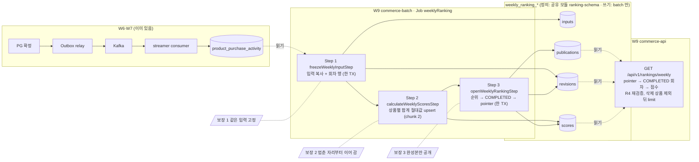
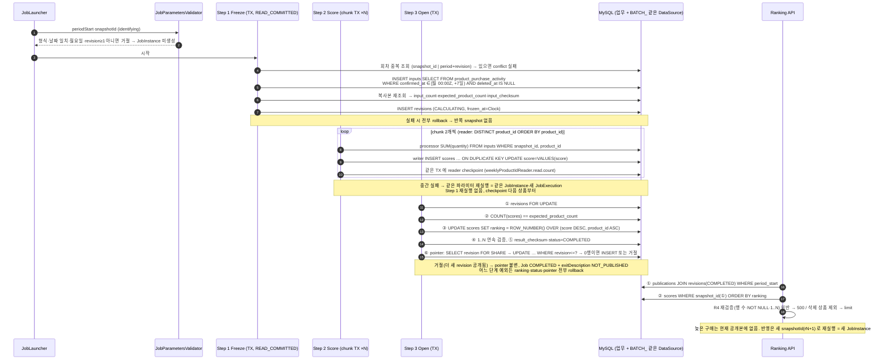
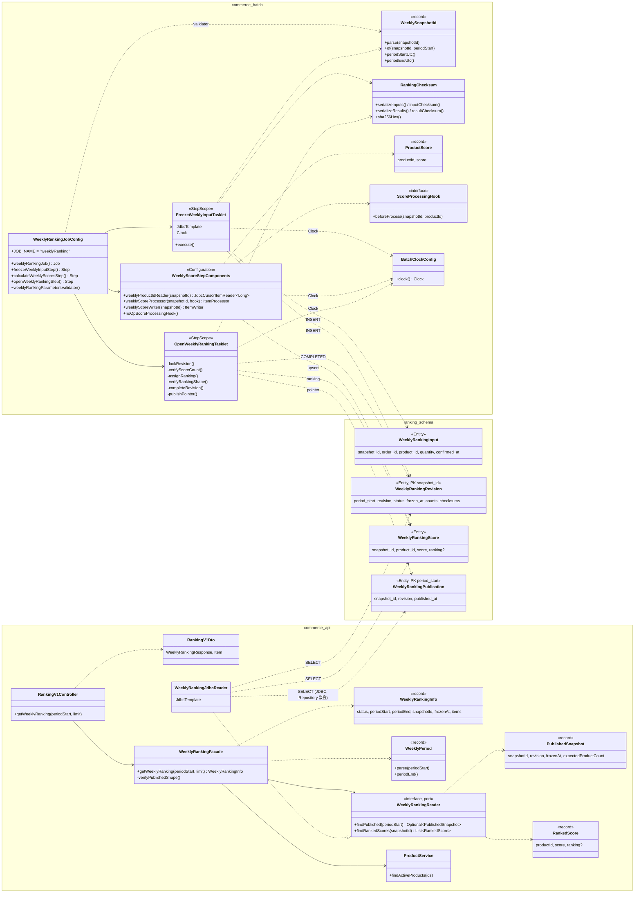

# 9주차 · 주간 구매 랭킹 그림 3장

상세 결정은 [weekly-ranking-design.md](weekly-ranking-design.md), 개요는 [README.md](README.md), 테이블 구성도는 [tables.md](tables.md). 그림은 2026-11-20 구현 기준이다.

## 1. 요약도 — 무엇이 어디로 흐르나

## 2. 구체 흐름도 — 한 번의 실행과 재시작·재계산

## 3. 클래스 다이어그램 — 누가 누구를 쓰나

- 엔티티 4개는 공유 모듈 `modules/ranking-schema` 에 있고 테이블 정의(DDL)의 원본이다. batch·api 가 함께 의존해 어느 쪽 `ddl-auto` 로도 테이블이 생기지만, 쓰기는 batch 의 Tasklet·writer 만 JdbcTemplate 으로 하고 api 는 Repository 없이 JDBC 로 읽기만 한다(R5).
- `ScoreProcessingHook` 은 테스트가 Step 2 중간 실패를 만들기 위한 seam 이며 제품 기본 구현은 no-op 이다.
- 점선은 "SQL 로 접근" 또는 "값 객체 사용", 실선은 빈 주입이다.
