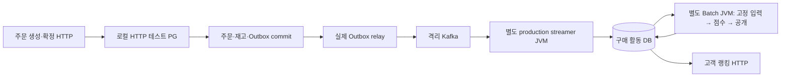

# W9 5단계 — 실제 주문부터 주간 랭킹 HTTP까지

> 이 문서는 해당 단계 당시의 기록이다. 이후 단계와 세 앱 전체 회귀의 최신 판정은 [6단계 최종 검증](final-verification.md)을 따른다.

2026-11-19. [4단계 공개·API 기록](publication-api-tdd-log.md)에 이어 W9-T13의 실제 연결을 검증했다. 이번 변경은 테스트·실행 도구·Gradle 테스트 연결·문서이며 생산 업무 코드는 변경하지 않았다. 사용자 DB·공유 Redis·기존 topic/group은 사용하지 않았다. 최종 전체 회귀와 제출 정리는 6단계에 남긴다.

## 연결한 실제 경로



상품·사용자만 fixture로 준비했다. 주문 확정·결제·Outbox·구매 활동·랭킹 결과는 실제 경로로 생성하며 source를 직접 INSERT하거나 confirmedAt을 사후 수정하지 않았다. API 앱의 Testcontainers DB/Redis, 전용 활동 MySQL, UUID topic/group을 가진 전용 Kafka를 사용했다. 실제 외부 상용 PG를 사용했다는 뜻은 아니다.

## 테스트와 실행 도구

| 파일 | 책임 |
| --- | --- |
| [PgOrderWeeklyRankingEndToEndTest](../../apps/commerce-api/src/test/java/com/loopers/application/order/PgOrderWeeklyRankingEndToEndTest.java) | 실제 HTTP·PG·relay·broker·streamer·Batch·HTTP 순서, DB/offset/checksum/업무 효과 대조 |
| [OwnedRankingBatchProcess](../../apps/commerce-api/src/test/java/com/loopers/support/ranking/OwnedRankingBatchProcess.java) | 별도 Batch JVM 시작·결과 수집·소유 프로세스/임시 파일 정리 |
| [WeeklyRankingProcessProbe](../../apps/commerce-batch/src/test/java/com/loopers/support/ranking/WeeklyRankingProcessProbe.java) | production Job 실행, 테스트 전용 상품 9 직전 실패, JobExplorer의 영속 실행·reader 위치 관찰 |
| [기존 OwnedStreamerProcess](../../apps/commerce-api/src/test/java/com/loopers/support/kafka/OwnedStreamerProcess.java) | 별도 production streamer JVM 재사용, 전용 DB/topic/group·종료 기한 유지 |

API JVM에 Batch 앱 Java 클래스를 의존시키지 않는다. Gradle이 Batch production runtime과 test classes의 위치만 전달하고, helper가 probe 클래스만 따로 복사해 자식 JVM을 실행한다. 다른 Batch 테스트의 설정·JUnit 클래스는 자식에 넣지 않는다. probe 설정은 테스트 전용 property가 명시된 자식에서만 활성화된다.

활동/랭킹 DDL과 라이브러리의 Batch metadata DDL은 최초 한 번 준비한다. 재시작 때 새 JVM을 띄워도 같은 MySQL을 보존하며 `ddl-auto=none`, Batch/SQL 초기화 `never`를 유지한다. Batch와 streamer의 불필요한 Redis 연결은 `127.0.0.1:1`로 지정한다. 실제 기능용 Redis는 API 테스트 fixture의 소유 컨테이너다.

## 손 계산과 실제 진행 순서

모든 주문의 최초 확정 시각은 테스트 Clock의 `2026-08-20T12:34:56.123456Z`다. 대상 기간은 UTC `2026-08-17` 이상 `2026-08-24` 미만이다. 입력 checksum에는 `.123456000Z`의 9자리 나노초 형식을 유지한다.

| 주문 | 실제 구매 품목 | 전달 시점 |
| --- | --- | --- |
| 1 | 상품 7 × 2, 상품 8 × 1 | 처음 relay 실행 |
| 2 | 상품 7 × 3 | 처음 relay 실행 |
| 3 | 상품 9 × 5 | 처음 relay 실행 |
| 4 | 상품 7 × 4 | PG 확정은 먼저 완료하지만 r2 입력 고정·실패 이후 relay 실행 |

| 장면 | source 행 | 고정 입력 | 상품별 점수·저장 순위 | HTTP 공개본 |
| --- | ---: | --- | --- | --- |
| 정상 r1 계산 | 4 | r1: 4행 | 7=5점/1위, 9=5점/2위, 8=1점/3위 | r1 |
| 주문 1 이벤트 재발행·소비 | 4 | r1 불변 | 점수·순위 불변 | r1 |
| r2의 7·8 점수 commit 후 9 직전 실패 | 4 | r2: 4행 | stage는 7=5·8=1, checkpoint=2 | r1 유지 |
| 주문 4의 늦은 전달·소비 | 5 | r2: 4행 그대로 | 미완료 계산은 그대로 | r1 유지 |
| 새 JVM에서 같은 r2 재시작 | 5 | r2: 4행 그대로 | 9부터 재개, 결과 5/5/1 | r2 |
| 새 revision r3 실행 | 5 | r3: 5행 | 7=9점/1위, 9=5점/2위, 8=1점/3위 | r3 |

늦음은 주문의 발생 주가 바뀌었다는 뜻이 아니라, **원래 주의 구매 사실이 snapshot 고정 후 활동 DB에 도착했다는 뜻**이다. r2 실행의 snapshotId·JobInstance는 유지하고 새 JobExecution만 만든다. r3에서만 새 JobInstance·새 입력을 만든다.

## 거짓 통과를 막은 대조

- 중복은 기존 immutable Outbox payload/key/eventId를 실제 sender로 한 번 더 발행해 만들었다. 서로 다른 broker offset과 같은 payload, broker receipt를 확인했다. PUBLISHED 행을 PENDING으로 되돌리거나 주문을 재확정하지 않았다.
- `DUPLICATE` 소비 로그와 해당 offset commit을 기다린 **뒤** 활동·처리 완료의 PK와 모든 필드를 비교했다. 아직 소비되지 않은 상태의 행 수만 보고 통과하지 않는다.
- 중복 이후 r2 계산도 독립 기대 input checksum과 비교한다. 이미 공개한 r1만 조회해 점수가 그대로라고 판단하지 않는다.
- r2의 실패 원인은 주입한 `InjectedBeforeProductFailure`인지 검사한다. DB 연결 실패 등 임의 FAILED를 정상 실패 실험으로 받지 않는다.
- r2 재시작 방문 상품은 `[9]`, 실패의 영속 reader 위치는 `2`다. 입력 행·고정 시각·건수·checksum과 정상 실행의 결과 행·checksum을 비교한다.
- r3 공개 뒤에도 r1/r2 입력과 결과를 재조회해 보존을 확인한다. 실제 HTTP의 snapshot/revision·기간·고정 시각·상품 이름·점수·순위도 함께 assert한다.
- 주문 4의 정상 구매까지 완료한 후 PG·업무 기준값을 따로 잡는다. 이후 Batch·재전달로 PG create/lookup/거래·주문·결제 시도·품목·재고·포인트 추가 변화가 없는지 비교한다. 최종 재고는 7번=11, 8번=19, 9번=15이며 포인트 1,000을 유지한다.
- HTTP·Kafka·JDBC·프로세스 대기에 기한을 둔다. streamer 종료 후에만 API fixture를 정리하며 시나리오 중 활동/입력/stage/metadata를 초기화하지 않는다.

## Red → Green

1. 전체 연결 테스트를 먼저 작성했다. `/private/tmp/w9-full-chain-red.log`에서 실제 주문 3건·구매 활동 4행까지 확인한 뒤 아직 연결하지 않은 Batch child bridge의 `UnsupportedOperationException`으로 1개 실패했다. 이 실패를 기존 생산 랭킹의 업무 버그로 해석하지 않는다.
2. 실제 Batch 앱을 새 JVM으로 실행하는 테스트 도구를 연결했다. `/private/tmp/w9-full-chain-green.log`에서 전체 시나리오 1개가 통과했다.
3. 관찰 JDBC의 유한 timeout을 보완하고 관련 회귀·정적 검사를 실행했다. 최종 결과는 아래에 별도로 기록한다.

## 실제 관찰값

첫 Green 실행은 주문 ID `[1,2,3,4]`, 정상 instance `1`, 실패/재시작 instance `2`, execution `2 → 3`, 새 revision instance `3`이었다. broker에는 원래 사건 4개와 중복 1개, 총 5개 레코드가 있었고 구매 활동은 최종 5행·처리 완료는 4행이었다. 식별값은 격리 실행 관찰값이며 다음 실행에서 고정되는 정책이 아니다.

| 내용 | SHA-256 |
| --- | --- |
| r1/r2 입력 4행 | `919ca445ee4cc3f635beedae5e2d72ab0c567625616253768b58169e980299ad` |
| r3 입력 5행 | `215f1bcff42f4bf59e39b2465c27be2e6f56efa578dcf9354c264893eafc1125` |
| r1/r2 결과 5/5/1 | `745d50bbd2f04a2e8c937f9ebf5f2cddbf75b958540e964934a424903b0a67d2` |
| r3 결과 9/5/1 | `210769764542f291dd603421f23ea3eca287b9d05ec2ed199a827d206b454aa4` |

입력 hash는 실제 주문 ID를 포함하므로 준비 ID가 달라지면 달라질 수 있다. 결과 hash에는 snapshot·실행 식별자를 섞지 않는다. 테스트는 생산 serializer를 호출하지 않고 실제로 요청한 품목·수량과 고정 시각으로 독립 기대값을 만든다.

## 최종 검사 범위

```bash
./gradlew :apps:commerce-batch:check :apps:commerce-api:test \
  --tests '*PgOrderWeeklyRankingEndToEndTest' --tests '*ranking*' --tests '*ArchitectureTest' \
  :apps:commerce-api:checkstyleMain :apps:commerce-api:checkstyleTest --console=plain
```

`/private/tmp/w9-full-chain-check.log` · 집계 `/private/tmp/w9-full-chain-check.json`:

| 검사 | 실제 결과 |
| --- | --- |
| Batch 전체 | 15개 suite·143개 테스트 통과 |
| API 관련 | 5개 suite·36개 테스트 통과: 신규 전체 연결 1개, 랭킹 34개, ArchUnit 1개 |
| 합계 | **179개**, 실패·오류·skip 0 |
| 정적 검사 | 양 앱 ArchUnit 통과, main/test Checkstyle 보고서 4개 위반 0 |
| 실행 종료 | BUILD SUCCESSFUL, 종료 코드 0, 1분 46초. 이는 검사 소요시간이며 서비스 처리량 수치가 아님 |
| 정리 | 소유 자식 JVM 종료 및 임시 실행 파일 정리. 종료 후 Testcontainers 라벨 컨테이너 0개, `git diff --check` 통과 |

최종 실행의 전용 topic은 `w9-ranking-orders-e5c70a43-1ab7-4111-841e-62d04d562220`, group은 `w9-ranking-activity-f73c60de-e61b-4494-9e6f-f02f96d6c675`였다. 중복 대상은 `order-confirmed:v1:1`이며 partition `1`의 원래 offset `0`과 새 offset `2`를 실제 소비했다. 순서 사이에 다른 주문 레코드가 있으므로 중복 offset을 반드시 +1이라고 가정하지 않는다. 위 주문 ID·instance·execution·checksum 결과는 최종 실행에서도 같았다.

API 전체 및 streamer 전체 회귀는 이번 명령의 범위가 아니다. production streamer는 새 E2E에서 실제 실행했으며 이를 streamer 단위·통합 전체 검사와 구분한다. 다음 6단계에서 세 앱의 최종 영향 범위 검사·채점 근거 대조·제출 정리를 수행한다. 커밋·푸시·PR 제출은 하지 않았다.
