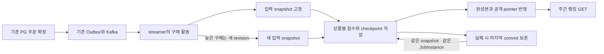

# W9 주간 구매 랭킹 구현 체크리스트

2026-11-17 기준으로 새 [과제 원문](assignment-original.md)과 [학습 원문](learning-original.md)을 읽고 현재 저장소를 조사했다. 조사 기준은 `volume-9`의 `35ad757`이며, W8 PR 병합 이후의 코드다. 2026-11-19에 **1단계 설계 → 2단계 입력 snapshot → 3단계 점수·checkpoint → 4단계 공개·API → 5단계 실제 주문부터의 전체 흐름**으로 구현·검증했고, **6단계 전체 회귀와 원문 9항목 대조까지 완료했다.** `weeklyRanking`은 입력 고정·점수 계산·공개의 세 Step이다. [2단계 기록](snapshot-freeze-tdd-log.md) · [3단계 기록](score-checkpoint-tdd-log.md) · [4단계 구현·실행 기록](publication-api-tdd-log.md) · [5단계 전체 흐름 기록](full-chain-ranking-tdd-log.md). 단계별 실행 결과는 당시 기록으로 보존하며, 세 앱 전체 회귀와 W9-C01~09의 최신 판정은 [6단계 최종 검증](final-verification.md)에 모은다. 제출 완료 여부는 별도로 관리한다.

| 구분 | 현재 합의·설계 |
| --- | --- |
| 사용자 선택 A | 구매 활동 DB에 snapshot·stage·완성 결과·pointer·Batch metadata를 별도 테이블로 함께 저장 |
| 사용자 선택 실행 | 기간·revision 직접 지정, 같은 작업 재시작은 동일 값. 초기에는 전용 실행 주체의 동기 순차 실행, 자동 스케줄 없음 |
| 사용자 선택 API | 미공개 404, 공개된 빈 결과 200. 기본 limit 10·최대 100, 입력 오류 400·DB 연결 장애 503 |
| 기술 설계 | RR 입력 복사·manifest 공동 TX, 상품별 절대 점수와 checkpoint 공동 TX, 공개 pointer 공동 TX, 내용 checksum v1 |
| 현재 단계 | **1~6단계 구현·검증 완료, W9-C01~09 충족**. 세 앱 2,441개 테스트·ArchUnit·Checkstyle 통과. [최종 검증 기록](final-verification.md), PR·기술 글 제출은 별도 |

## 이번 주에 만들어야 할 동작

한 주에 실제로 구매된 상품 수량을 모아 완성된 랭킹을 제공한다. 계산 전에 입력을 고정하고, 계산이 중단되면 마지막으로 commit한 상품 다음부터 이어 간다. 그동안 고객은 기존 공개본을 읽는다. 늦게 도착한 구매는 원래 주의 새 revision으로 다시 계산한다.

이 그림은 원문이 요구한 업무 흐름이다. A에 맞춘 저장·앱 접근 구조는 [전체 설계](../week2/commerce-erd-draft.md#w9-주간-구매-랭킹-설계)의 버드뷰·의존·관계·흐름에 정리했다. [API 계약](../week2/commerce-api-contract.md#w9-주간-랭킹-계약) · [선택과 대안](../week2/commerce-policy-decisions.md#w9-주간-랭킹의-선택) · [구체 TDD 기대값](../week2/commerce-tdd-plan.md#w9-주간-랭킹-테스트-계획)을 함께 따른다.

## 원문 항목별 현재 상태

| 항목 | 최종 판정 | 핵심 검증 근거 |
| --- | --- | --- |
| W9-C01 실제 활동 → 랭킹 API | 충족 | 실제 주문 HTTP·PG·Outbox·Kafka·별도 streamer/Batch JVM·랭킹 HTTP, 중복 소비 추가 효과 0 |
| W9-C02 수량·동점·여러 품목 | 충족 | 실제 주문 3건·활동 4행·상품 3개. 상품 7=5점/1위, 9=5점/2위, 8=1점/3위 |
| W9-C03 늦은 구매·새 revision | 충족 | source 4→5행 뒤에도 r2의 frozen 4행·5/5/1 유지. 새 r3만 5행·9/5/1, 공개 HTTP 대조 |
| W9-C04 동일 instance 재시작 | 충족 | 같은 DB·metadata를 유지한 새 Batch JVM. r2 instance 2, execution 2→3, 영속 위치 2·9번부터 재개 |
| W9-C05 reader·writer·chunk TX | 충족 | productId ASC·절대 점수 재쓰기, 실제 점수/checkpoint 동일 connection·공동 commit/rollback |
| W9-C06 정상/재시작 동일 결과 | 충족 | r1 정상과 r2 재시작의 입력/결과 checksum·손 계산 점수·순위 직접 비교 |
| W9-C07 실패 시 공개본 유지 | 충족 | 실제 공개 SQL 후 rollback의 DB 보존, 계산 실패 후 이전 공개본 HTTP. 공개 commit 뒤 afterChunk 실패·재개는 실제 metadata SQL UNKNOWN 장애와 구분 |
| W9-C08 반복 공개·revision 보호 | 충족 | 동일 공개 불변·오래된 revision의 pointer 후퇴 방지·composite FK. 기본 운영은 한 전용 실행 주체의 순차 실행 |
| W9-C09 조회 경계·회귀·정적 검사 | 충족 | 미공개/빈 주·UTC·삭제/필터 후 limit·순위 간격. 세 앱 총 2,441개·실패/오류/skip 0, ArchUnit 통과·Checkstyle 12개 위반 0, 소유 자원 정리 |

5단계의 실제 전체 흐름은 [실행 기록](full-chain-ranking-tdd-log.md)에 보존한다. [원문 9항목](grading-criteria.md)의 최신 판정과 전체 회귀 결과는 [6단계 최종 검증](final-verification.md)에서 별도로 확인한다.

## 현재 코드에서 이어 사용할 부분

| 책임 | 현재 코드·설정 근거 | W9에서 확인하거나 추가할 부분 |
| --- | --- | --- |
| Batch 앱 | [WeeklyRankingJobConfig](../../apps/commerce-batch/src/main/java/com/loopers/batch/job/weeklyranking/WeeklyRankingJobConfig.java), 기존 DemoJobConfig·DemoJobE2ETest | 주간 입력·계산·공개의 세 Step과 재시작 연결. 기존 데모 유지 |
| 작업 식별·TX | 고정 periodStart(String)·revision(Long)·snapshotId(String), Boot JobRepository·JpaTransactionManager | 같은 DataSource/TM으로 실제 점수/checkpoint 공동 TX 검증. 새 run.id·ResourcelessTransactionManager 없음 |
| 실행·schema 설정 | [weekly-ranking profile](../../apps/commerce-batch/src/main/resources/application-weekly-ranking.yml), 기존 application.yml·jpa.yml | 전용 profile을 명시적으로 마지막에 선택. Batch/SQL 초기화 never·JPA none. 기존 local/test 데모 기본 설정은 유지하므로 profile 생략은 재시작용 설정이 아님 |
| 버전 | [gradle.properties](../../gradle.properties), Batch build | Boot 3.4.4, dependencyInsight에서 실제 Batch 5.2.2·Spring JDBC 6.2.5 확인. 의존 버전 변경 없음 |
| 원본 구매 활동 | [ProductPurchaseActivity](../../apps/commerce-streamer/src/main/java/com/loopers/domain/purchase/ProductPurchaseActivity.java), [소비 구현 기록](../week6/purchase-activity-consumer-tdd-log.md) | orderId·productId별 quantity·confirmedAt을 읽어 입력 복사. 소비자의 중복 방지와 원본 보존 유지 |
| 실제 이벤트 연결 | `PgOrderWeeklyRankingEndToEndTest`, 기존 [W7 재발행 E2E](../week7/outbox-republication-e2e-tdd-log.md) | 실제 PG·Outbox·Kafka·별도 streamer JVM과 구매 활동 DB에 별도 Batch JVM을 연결. API/streamer/Batch 앱 Java classpath를 합치지 않음 |
| API와 현재 공개 조건 | [ProductQueryService](../../apps/commerce-api/src/main/java/com/loopers/application/product/ProductQueryService.java), [CommerceWebConfiguration](../../apps/commerce-api/src/main/java/com/loopers/interfaces/api/commerce/CommerceWebConfiguration.java), [ApiResponse](../../apps/commerce-api/src/main/java/com/loopers/interfaces/api/ApiResponse.java) | 랭킹 경로·응답·입력/오류 매핑 추가. 상품 공개 조건을 적용하고 limit 처리 |
| 시간대·정적 검사 | [공통 build](../../build.gradle.kts), [API ArchitectureTest](../../apps/commerce-api/src/test/java/com/loopers/architecture/ArchitectureTest.java) | 테스트 JVM은 Asia/Seoul. W9의 UTC 기간 판정을 명시하고 Batch 변경의 의존·검사 범위를 확인 |

현재 실제 전체 흐름 테스트는 API와 streamer의 DB를 분리한다. 공통 local 설정의 DB 이름만 보고 두 앱의 실제 운영 DB가 같다고 가정할 수 없다. 선택 A는 이 구분을 유지하면서 Batch 저장을 구매 활동 DB에 모은다. API에는 `RankingReadResource`가 내부 소유하는 랭킹 전용 읽기 pool을 추가하고 기존 main 상품/주문 DataSource와 JPA TX/락을 유지한다. 별도 DataSource·JdbcTemplate·transaction manager bean을 등록하지 않아 기존 자동구성을 대체하지 않는다. 두 DB의 전역 읽기 TX를 보장한다는 뜻은 아니다.

구매 활동은 `confirmed_at_second`와 `confirmed_at_nano`에 시각을 보존한다. 입력 복사와 checksum도 이 정밀도를 고려한다. 현재 원본 DDL에는 주간 기간 조회 전용 인덱스가 없어 실제 조회 방식과 함께 검토한다. 상품 공개 조건은 현재 상품과 브랜드의 `deletedAt`이 모두 없는 경우다. 재고 0을 새 제외 조건으로 추가하지 않는다. 기존 좋아요순의 동점은 상품 ID 내림차순이므로 W9의 productId 오름차순을 별도로 적용한다.

공통 Checkstyle과 함께 Batch 전용 [ArchitectureTest](../../apps/commerce-batch/src/test/java/com/loopers/architecture/ArchitectureTest.java)를 추가했다. domain/application이 바깥 계층·job 조립을 역참조하지 않는지 검사한다. 기존 Batch listener의 일부 로그는 Java 문자열 안에 `${...}`를 그대로 출력하므로 후속 재시작 증거는 JobExplorer와 독립 DB 조회로 확보한다. 해당 listener를 재사용하면 필요한 로그 필드도 확인한다.

## 진행할 6단계

| 단계 | 변경 책임과 작업 | TDD에서 먼저 확인할 결과 |
| --- | --- | --- |
| 1. 저장 위치와 계약 설계 · 문서 완료 | 선택 A·기간/revision 명시 실행·미공개 404 계약, 기술 설계·대안·예상 비용을 전체 설계/API/정책/TDD에 연결 | 원문 4행의 기대값과 실패 지점별 보존 상태를 문서화. 테스트는 아직 미작성·미실행 |
| 2. 입력 snapshot 고정 · 구현 | manifest·입력·유일성 DDL과 한 RR view의 복사·재사용 구현 | [실행 기록](snapshot-freeze-tdd-log.md): 실제 SQL 후 rollback, 여러 품목·UTC 나노 경계·동시 늦은 commit·저장 충돌·기존 입력 재사용 |
| 3. 작은 재시작 실험과 점수 job · 구현 | 원문 probe → 실제 productId reader·합계 processor·절대 점수 writer와 weeklyRanking 연결 | [3단계 기록](score-checkpoint-tdd-log.md): 첫 chunk 7·8과 영속 위치 2, 새 context의 같은 instance에서 9부터 재개. 실제 SQL 뒤 실패·절대 점수 재쓰기·정상 결과 대조 |
| 4. 공개와 고객 API · 구현/증분 검증 | 예상 상품 수 검증·순위 구성·완성 표시·pointer TX, 공개본 조회와 현재 상품 표시 연결 | 이전 공개본 유지, 공개 rollback·반복 공개·오래된 revision, 미공개·빈 주·삭제/비노출·필터 후 limit·순위 간격 |
| 5. 실제 주문부터 늦은 구매까지 · 검증 완료 | 실제 주문 3건의 활동으로 r1 공개. 중복 record 소비와 지연한 네 번째 주문, 실패한 r2의 새 Batch JVM 재개 및 새 r3를 같은 격리 실행에서 연결 | r1/r2는 5/5/1, r3만 9/5/1. 중복 소비 효과 0·고정 입력 불변·실행 식별/영속 위치·공개 전후 HTTP·PG/재고 보존 대조. 실제 결과는 [5단계 기록](full-chain-ranking-tdd-log.md) |
| 6. 회귀·증거 정리 · 완료 | 세 앱 전체 check·W9-C01~09 대조, 실제 명령·실행 ID·checksum·공개 revision과 최신 문서 연결 | [최종 검증](final-verification.md): 195개 스위트·2,441개 테스트 통과, 실패/오류/skip 0·ArchUnit/Checkstyle 통과·소유 자원 정리. PR·기술 글 제출은 별도 |

단계 3은 원문이 제시한 절대 점수 writer를 기술 설계로 사용한다. 저장 단위·패키지·테스트 책임은 연결한 설계/TDD 문서에 있으며, 물리 DDL·클래스는 각 증분에서 구현·검증한다. chunk=2는 재시작을 관찰하는 작은 실험값이며 처리량을 측정한 값이 아니다.

## 구현 전에 비교할 선택

| ID | 선택 결과·상태 | 선택이 미치는 영향 |
| --- | --- | --- |
| W9-Q01 | **사용자 선택 A**. 구매 활동 DB에 Batch 업무/실행 저장, API의 별도 랭킹 읽기 연결은 이를 위한 기술 설계 | 원본 읽기·writer/checkpoint 공동 TX를 연결하기 쉬움. DB 자원 공유와 API의 두 DB 접근 비용은 남고 앱 간 클래스 직접 의존은 추가하지 않음 |
| W9-Q02 | **사용자 선택: 기간·revision 직접 지정 실행**. 안정된 snapshotId와 단일 동기 실행은 기술 설계 | 재시작에는 동일 parameter, 새 입력에는 증가 revision. 자동 스케줄은 넣지 않음. 다중 Batch JVM의 동시 운영까지 자동 조율한다고 주장하지 않음 |
| W9-Q03 | **사용자 선택: 응답 예시 확인 후 미공개만 404로 변경**. `RANKING_NOT_PUBLISHED`/FAIL/data 생략, 공개 빈 결과 200/PUBLISHED, 기본10·최대100, 잘못된 입력400·DB연결장애503 | 원문 상태명은 예시이며 이 프로젝트는 기존 오류 envelope로 미공개를 표현. 현재 공개 필터 후 limit·저장 순위와 공개 상품 조회의 식별 규칙 유지 |
| W9-Q04 | **입력·점수 구현**: RR 입력 공동 TX, 입력 checksum v1, 점수 long/BIGINT 절대값 | 입력 정밀도·점수 overflow·writer/checkpoint 공동 connection 검증. 결과 순위/checksum·공개 TX는 4단계 증분으로 연결. 입력 List 메모리 비용과 writer의 합계 재검사 비용을 최적 처리량으로 주장하지 않음 |

UTC 주간, 구매 수량 점수, 동점 productId 오름차순, 저장된 순위 유지, 늦은 구매의 새 revision, 동일 instance 재시작은 과제에서 정한 조건이다. 위 선택은 그 조건을 구현할 방법이다. 현재 추가로 답변을 기다리는 제품/운영 질문은 없다. 이후 구현에서 선택한 경계를 바꿀 필요가 생기면 이유·영향을 먼저 설명하고 질문한다.

## 4단계 공개·API의 선택과 실행 경계

- pointer는 기간별 공개 snapshotId·revision을 보관하는 DB 행이다. 완성 결과·checksum·COMPLETE와 같은 TX로 갱신한다. COMPLETE 중 최대 revision 조회나 결과 전체 원자적 교체도 가능한 대안이지만, 이번에는 공개 대상을 명시하고 이전 snapshot을 보존하는 방법을 선택했다. [비교와 이유](../week2/commerce-policy-decisions.md#공개-방식-비교와-현재-선택)
- publisher는 자기 manifest를 먼저 잠그고 고정 입력·stage 전체를 대조한다. 결과를 score DESC/productId ASC로 저장하고 pointer revision은 더 큰 값만 선택한다. 기간/snapshot/revision composite FK는 잘못된 연결을 막는다. 동일 COMPLETE 재실행은 결과와 checksum을 검증하며 새 행을 더하지 않는다.
- API는 기본 OFF이며 `WEEKLY_RANKING_QUERY_ENABLED=true`와 `WEEKLY_RANKING_QUERY_JDBC_URL`·`WEEKLY_RANKING_QUERY_USERNAME`·`WEEKLY_RANKING_QUERY_PASSWORD`로 별도 랭킹 읽기 연결을 설정한다. 비활성의 정상 입력 요청은 503이고 main 상품 DB로 fallback하지 않는다. 전용 pool 최대 3·연결 대기 1초·query 2초·driver connect 1초/socket 2초는 초기 제한값이며 전체 HTTP 시간 상한·성능 개선 수치가 아니다.
- 공개 commit 뒤 최종 Batch 완료 상태 기록 전 `afterChunk` 예외를 발생시키는 검증과 실제 metadata SQL 저장 오류는 구분한다. 전자는 FAILED의 같은 instance 재시작을 검증하며, 후자의 UNKNOWN·JVM 중단 후 STARTED를 자동 재시작 가능하다고 가정하지 않는다. 실제 공개 상태와 실행 종료를 확인하는 경계를 유지한다.
- 구체 파일·테스트 결과·실행 ID·checksum은 [4단계 TDD 기록](publication-api-tdd-log.md)에 남긴다. 전체 회귀의 실제 결과는 [6단계 기록](final-verification.md)에 따로 남기며 W9 제출 완료와 구분한다.

## 5단계 실제 주문·중복 소비·늦은 구매의 대조

아래는 전체 흐름 테스트의 기대값이며 실행 완료 판정·실제 ID·checksum·검사 수는 [5단계 TDD 기록](full-chain-ranking-tdd-log.md)에 따로 남긴다. 원본 활동이나 PG 성공을 SQL로 직접 넣어 정상 경로를 대신하지 않는다.

| 순서 | 실제 경계와 보존할 사실 | 기대 결과 |
| --- | --- | --- |
| 1. 정상 공개 r1 | 고객 주문/confirm HTTP → 로컬 테스트 PG → Outbox relay → Kafka → streamer → Batch → 고객 랭킹 HTTP | 실제 주문 3건에서 활동 4행·상품 3개. 완성 점수 5/5/1과 동점 상품 ID 오름차순. 여러 품목인 주문도 모두 반영 |
| 2. 같은 사건 재발행 | 같은 eventId·payload를 다른 Kafka offset으로 실제 발행하고 streamer의 DUPLICATE 처리까지 확인 | 원본 활동·처리 기록·기존 랭킹 점수의 추가 효과 0. 단순히 broker에 보낸 사실만으로 소비 완료를 판정하지 않음 |
| 3. 지연 구매 준비 | 원래 주에 확정한 네 번째 실제 주문의 Outbox 전달을 테스트에서 보류 | 주문·PG·재고는 이미 정상 처리했지만 streamer source에는 아직 새 활동이 없음. 정상 신규 주문의 효과를 복구 추가 효과와 구분 |
| 4. r2 실패 | 활동 4행으로 r2 입력을 고정하고 chunk=2 commit 뒤 세 번째 상품 직전에 실패 | 입력 4행·stage 2행·reader 위치 2. 공개 API는 r1 유지 |
| 5. 늦은 활동 도착 | 보류한 Outbox를 전달해 같은 구매 활동 DB에 다섯 번째 활동을 저장 | source는 5행이지만 r2 입력·manifest·checksum은 4행 그대로 |
| 6. r2 재개 | 첫 Batch JVM이 끝난 뒤 새 JVM을 같은 DB·같은 JobRepository·같은 식별 parameter로 실행 | 같은 JobInstance·새 JobExecution, 세 번째 상품부터 재개. r1과 같은 5/5/1·입력/결과 checksum, 공개 API는 r2 |
| 7. 새 입력 r3 | 증가 revision·새 snapshot·새 instance로 원래 주를 다시 계산 | 입력 5행에서 9/5/1. r3 공개 전 r2, 공개 후 r3 응답. r1/r2 입력·점수·순위 보존 |

API·streamer·Batch는 각자의 실행 classpath를 유지한다. Batch 실패 전후 JVM은 바뀌어도 구매 활동 DB·snapshot·stage·JobRepository를 바꾸거나 초기화하지 않는다. 주문 DB, 소유 PG fixture·Kafka topic/group·streamer 소비 상태도 같은 실험 안에서 보존한다. 배치·재발행·재시작 때문에 PG create나 주문 확정·재고 소비가 추가로 실행되지 않았는지, 네 번째 정상 주문 준비 전후의 기준값과 나눠 확인한다. 모든 프로세스와 대기에는 기한을 두고 테스트가 소유한 자원만 정리한다.

## 검증 시 남길 값

| 장면 | 함께 기록할 증거 |
| --- | --- |
| 첫 실패 | periodStart·snapshotId·revision, JobInstance/JobExecution/StepExecution ID, FAILED, 영속 reader key/위치, stage 2행, 기존 pointer·HTTP 결과 |
| 같은 작업 재시작 | 같은 instance·새 execution, 첫 처리 상품 9, 입력 불변, 최종 상품별 점수·순위·checksum, COMPLETED |
| 정상 비교 실행 | 별도 snapshot 또는 DB에서 손 계산 기대값과 checksum을 비교. 재시작 대상 데이터 보존 |
| 늦은 구매 | 실제 confirmedAt과 활동 저장 시점, 기존 snapshot의 불변 값, 새 snapshot의 추가 활동과 새 공개 revision |
| 공개 후 metadata 실패 | 공개 TX commit과 실제 pointer·완성본, metadata 상태, 반복 공개 후 결과와 최신 revision 보존 |

원문의 probe key `purchaseProductProbe.read.count`와 실제 랭킹 reader의 key를 각각 확인한다. 로그나 메모리 위치에 더해 JobExplorer와 새 DB 연결에서 관찰한다.

## 현재 작업과 남은 일

- [x] 제공된 원문 두 개를 변경 없이 보존
- [x] 원문 Checklist 9항목과 본문의 검증 조건 연결
- [x] 현재 Batch·streamer·API의 출발점과 미정 설계 조사
- [x] W9 작업 지침과 6단계 작업 순서 작성
- [x] 1단계 선택과 전체 설계·API·정책·TDD 문서 확장 (2026-11-19, 코드·검사 완료와 구분)
- [x] 2단계 입력 고정 코드·추가 DDL·격리 MySQL TDD (실행 범위와 한계는 별도 기록)
- [x] 3단계 실제 reader·JobRepository 재시작, 절대 점수·checkpoint 공동 TX와 Batch 검사
- [x] 4단계 완성 순위·공개 pointer·고객 API 코드와 테스트 연결 (실제 검사 범위·결과는 [별도 기록](publication-api-tdd-log.md))
- [x] 5단계 실제 PG/Outbox/Kafka/streamer부터 랭킹 API까지 전체 흐름 TDD의 최종 실행 확인. Batch143·API 관련36, 실패/오류/skip0·ArchUnit/Checkstyle 통과 ([구현·실행 기록](full-chain-ranking-tdd-log.md))
- [x] 6단계 세 앱 전체 회귀·정적 검사, W9-C01~09 대조와 최신 문서 정리 ([최종 검증 기록](final-verification.md))
- [ ] PR·기술 글 작성 및 제출

1~5단계의 과거 기록은 당시 실행 증거로 보존한다. 6단계는 전체 검사·독립 코드/원문 대조에서 기능 결함을 발견하지 못해 생산 코드·테스트 기대값을 변경하지 않았고, 최종 증거와 현재 문서 상태를 보완했다. 사용자 DB·공유 Redis·기존 Kafka topic/group에 접근하거나 커밋·푸시하지 않았다. 신규 DDL과 Batch schema는 소유 테스트 DB에 최초 한 번 적용했고 재시작 중 보존했다. 원문 9개 채점 항목은 각 단계의 실제 증거에 맞춰 갱신한다.
