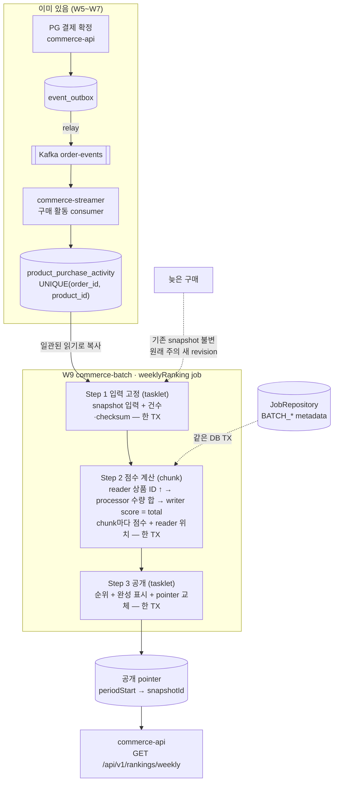

# 9주차 설계 — 주간 구매 랭킹 배치 (중단 뒤 같은 지점에서 이어 가기)

> - 표기: ✅ 합의 · 🔧 AI 기본값 · 🤔 결정 필요
> - 과제 원문: Notion 9주차 발제·실습 (비공개). 아래 "과제 요약"이 원문 정리본 (2026-11-17 읽음)
> - 진행: D-1부터 D-9까지 하나씩 정했다.
> - 브랜치: `volume-9-claude` (기준 `4e7fefa5` = volume-8, upstream PR #127 머지됨). push하지 않는다.

## 한눈에 보기



| 핵심 구분 | 뜻 |
|---|---|
| 재시작 | 같은 JobInstance(같은 식별 parameter)의 새 JobExecution. 같은 입력, 마지막 commit 다음부터 |
| 재계산 | 새 revision snapshot = 새 JobInstance. 입력이 바뀔 수 있음을 명시. 공개 전까지 이전 revision이 보임 |
| 복구가 아닌 것 | 새 run.id·현재 시각 추가, stage·metadata 삭제, 입력 skip |

## 용어집 🔧 (11-18, 이 문서와 코드는 이 말만 쓴다)

예는 모두 발제 fixture의 2026-08-17 주다.

| 말 | 코드·테이블 | 뜻 | 예 |
|---|---|---|---|
| 주 | `periodStart` | UTC 월요일 00:00부터 다음 월요일 00:00 전까지 | 2026-08-17 주 |
| 구매 활동 | `product_purchase_activity` | 원본. 주문·상품별 구매 수량. 늦은 구매가 오면 계속 늘어난다 | 주문 42·상품 7·2개 |
| revision | `revision` | 같은 주를 몇 번째로 계산하는지. 사람이 정해서 넘긴다 | r1 = 정기 계산, r2 = 늦은 구매를 넣은 재계산 |
| snapshot | `snapshot_id` | 한 주·한 revision의 계산 한 벌 (고정 입력 + 점수·순위 + 상태) | `weekly-20260817-r1` |
| 고정 입력 | `ranking_snapshot_input` | 입력 고정 step이 snapshot에 복사해 둔 구매 활동 행. 이후 바뀌지 않는다 | 4행 |
| 점수 | `weekly_ranking.score` | snapshot 안에서 상품별 수량 합 | 상품 7 = 5점 |
| 순위 | `weekly_ranking.rank_no` | 점수 큰 순, 같으면 상품 ID 작은 순. 공개 step이 채운다 | 7→1, 9→2, 8→3 |
| snapshot 상태 | `ranking_snapshot.status` | `FROZEN` 입력만 고정됨 → `COMPLETED` 순위까지 다 매김 (완성본) | |
| 공개 pointer | `ranking_publication` | 주마다 한 행. API가 보여 줄 snapshot을 가리킨다 | 2026-08-17 주 → r1 |
| 공개본 | | 공개 pointer가 지금 가리키는 snapshot | |
| REPLACED | ExitStatus | 더 새 revision이 이미 공개돼(대체돼) 있어, 이 실행은 pointer를 바꾸지 않고 COMPLETED로 끝났다는 표시 (D-5) | r2 공개 뒤 끝난 r1 작업의 실행 |
| 작업 | JobInstance | 주 + revision 한 쌍. 같은 값으로 띄우면 같은 작업이다 | "2026-08-17 주 r1 작업" |
| 실행 | JobExecution | 작업을 한 번 돌린 것. 실패하면 같은 작업에 실행이 하나 더 생긴다 | r1 작업의 1번째 실행(FAILED), 2번째 실행 |
| 재시작 | | 같은 작업의 새 실행. 마지막 commit 다음부터 이어 간다 | |
| 재계산 | 명령의 `--recompute=true` | 새 revision 작업. 다른 작업이고 입력도 새로 고정한다. revision 번호는 commerce-batch가 정한다 (D-8) | r2 작업 |
| 입력 고정 step · 점수 계산 step · 공개 step | Step 1 · 2 · 3 | job 안의 세 단계 | |

- 문장마다 주어를 쓴다. "실행이"가 아니라 "r1 작업의 실행이"처럼 어느 주·어느 revision인지 밝힌다.

## 과제 요약 (원문 정리)

### §1 주간 결과와 조회 계약

| 항목 | 계약 |
|---|---|
| 기간 | UTC 월요일 00:00 ≤ t < 다음 월요일 00:00 |
| 주간 소속 | 활동의 최초 주문 `confirmedAt` |
| 점수 | 상품별 구매 quantity 합, 정수 |
| 순서 | 점수 내림차순, 동점이면 productId 오름차순 |
| 입력 원본 | W6·W7 consumer가 남긴 orderId·productId별 구매 활동 |
| 공개 | 기간별 하나의 완성된 snapshot |

- `GET /api/v1/rankings/weekly?periodStart=…&limit=…` — 날짜·월요일 검증, limit 양수·최대 100 등 명시한 범위.
- 응답: periodStart·periodEnd·snapshotId·입력 고정 시점, 상품별 점수·순위.
- 공개본 없음 → `NOT_PUBLISHED` + 빈 items. 구매 0건 완성본 → `PUBLISHED` + snapshotId + 빈 items. stage나 다른 주를 대신 내주지 않는다.
- 삭제·비노출 상품은 기존 고객 공개 조건으로 제외. 저장된 계산 순위는 유지 → 1·3위처럼 간격이 생길 수 있음을 계약에 적는다. 공개 조건 적용 뒤 limit. 이름 등 표시 정보는 기존 상품 조회 규칙. 과거 활동·점수 행은 지우지 않는다.

### §2 실제 입력 고정

| 저장 단위 | 내용 |
|---|---|
| snapshot 정보 | snapshotId·기간·revision·상태·입력 고정 시점·건수·checksum |
| snapshot 입력 | snapshotId·orderId·productId별 quantity·confirmedAt |
| 점수 stage | snapshotId·productId별 계산 중 절대 점수 |
| 완성 ranking | snapshotId·productId별 점수·계산 순위 |
| 공개 pointer | periodStart별 공개 snapshotId |

- 일관된 DB 읽기에서 원본을 가져와 snapshot 입력과 manifest를 함께 commit. 작은 데이터는 로컬 TX 하나로 가능. 여러 페이지면 같은 읽기 시점·안정된 정렬. `max(id)`만으로 고정했다고 가정하지 않는다.
- 고정 실패 → 반쪽 snapshot을 계산에 쓰지 않는다. 완성된 입력은 재시작 때 다시 복사·추가하지 않는다.
- 한 주문의 여러 상품 모두 포함 (eventId로 두 번째 상품을 버리지 않음). 입력도 orderId·productId 유일.
- 이미 있는 snapshotId의 기간·입력·revision이 다르면 덮어쓰지 않고 충돌.

### §3 Job과 Step

- weeklyRanking = 입력 고정 → 상품별 점수 계산 → 완성본 공개. 식별 parameter는 periodStart, snapshotId 등 업무 값.
- demo의 `RunIdIncrementer`(새 작업용), `ResourcelessTransactionManager`(원자성 없음)를 쓰지 않는다. 영속 JobRepository와 writer가 같은 DB TX. 실행 사이에 metadata를 비우거나 새 DB를 만들지 않는다.
- `spring.batch.job.name`으로 job 선택, 테스트는 자동 실행과 명시적 launch가 겹치지 않게 (`spring.batch.job.enabled=false`). reader의 job parameter는 step scope로.
- 계산 Step 실패 뒤 재시작은 입력을 유지하고 계산을 이어 간다. 완료한 입력 고정 Step을 무조건 다시 돌리게 설정하지 않는다.
- 먼저 해 볼 연결 예시(probe): `batch_restart_probe(snapshot_id, product_id) PK`, `JdbcCursorItemReader name=purchaseProductProbe saveState=true`, chunk 2, 상품 9에서 한 번 실패 → `purchaseProductProbe.read.count=2`, 확인 행 7·8 → 같은 parameter 재실행 = 같은 JobInstance·새 JobExecution, 9만 추가. 실패 스위치는 parameter가 아니다. 기준 버전 Boot 3.4.4 / Batch 5.2.2.

### §4 상품별 Reader·Processor·Writer

| 경계 | 확인할 것 |
|---|---|
| Reader | 고정 입력의 서로 다른 productId 오름차순, 유일·안정 sort key, 영속 재시작 상태. 상품 하나 = item 하나 |
| Processor | 현재 활동 DB가 아니라 같은 frozen snapshot에서 수량 합 |
| Writer | (snapshotId, productId) 절대값 upsert, 실제 DB TX 참여. `score += total` 금지 |
| Chunk | 결과와 reader checkpoint가 같은 commit |

- 증분 합산을 택하면 활동별 적용 기록과 점수 증가가 같은 TX. 절대값·증분을 섞지 않는다. chunk=2는 실험 값이지 측정한 최적값이 아니다.

### §5 완성본만 공개

- 계산 완료 뒤 모든 상품 점수·예상 상품 수 확인 → score DESC, productId ASC 순위. 완성 조건과 pointer 변경을 하나의 DB TX로.
- 계산 중·실패 → 기존 pointer·API 결과 유지. 공개 TX 오류 → 새 pointer·일부 ranking 노출 없음. 같은 snapshot 공개 재실행 → 결과·순위 불변.
- revision은 명시적으로 증가. 같은 기간 동시 계산은 기본 범위에서 직렬로 실행 (원문: "같은 기간의 동시 계산은 기본 범위에서 직렬로 실행합니다"). 더 새 revision이 공개돼 있으면 오래된 실행이 되돌리지 않는다 (조건부 갱신·현재 pointer 검증).
- API는 pointer와 ranking을 한 query(join 등)로 일관되게.
- 공개 TX commit과 최종 Batch metadata 저장은 같은 순간이 아니다. 공개본이 있는데 JobExecution이 실패·미완료면 snapshot·pointer부터 확인. 재실행된 공개는 같은 결과로 수렴, 정상 공개본을 임의 삭제하지 않는다.

### §6 작은 입력으로 재시작 확인 (fixture)

UTC 구간 [2026-08-17T00:00:00Z, 2026-08-24T00:00:00Z)

| orderId | productId | quantity | confirmedAt |
|---|---|---|---|
| 42 | 7 | 2 | 2026-08-17T01:00:00Z |
| 42 | 8 | 1 | 2026-08-17T01:00:00Z |
| 43 | 7 | 3 | 2026-08-18T01:00:00Z |
| 44 | 9 | 5 | 2026-08-19T01:00:00Z |

- 기대: 상품 7 = 5점·1위, 9 = 5점·2위, 8 = 1점·3위. 원본 4행, reader item 3개.
- 순서: 고정 → chunk 2 → 7·8 점수와 reader 위치 commit 확인 → 9 직전 한 번 실패 → FAILED·같은 instance·checkpoint·stage 2행·기존 공개본 유지 확인 → 같은 parameter·같은 metadata로 새 execution → 9부터 완료 → 정상 1회 실행 결과와 비교.
- 실제 reader의 저장 key·위치를 관찰 (항상 `reader.index`라고 가정하지 않음).
- 입력 checksum: orderId·productId 순 정렬, 필드 orderId, productId, quantity, confirmedAt. 결과 checksum: rank 순, productId, score, rank. 필드 사이 TAB·행 사이 LF·마지막 LF, UTC 시각 같은 형식. 실행 ID·시각은 제외하고 따로 기록.
- checksum뿐 아니라 기대 점수·순위도 assert. 비교용 정상 실행은 별도 snapshot/DB로. 재시작 대상의 stage·metadata를 지워 정상 실행처럼 꾸미지 않는다.

### §7 실제 이벤트 입력과 늦은 구매

- **한 연결 테스트**에서 PG 주문 확정 → Outbox relay → 실제 Kafka → 구매 활동 → snapshot 고정 → job → 랭킹 API. ID·시각은 테스트 clock과 생성한 주문으로 기대값 계산.
- W7 같은 이벤트 재발행 → 구매 활동·점수 불변.
- 고정 뒤 같은 주 늦은 구매 → 현재 입력·재시작 결과 불변. 새 revision을 명시적으로 만들어 재계산. 공개 전엔 이전 revision, 공개 후엔 새 revision이 일관되게.
- 구간 시작 포함·끝 제외. 빈 주·미공개·삭제 상품을 API에서 구분.

### §8 회귀와 제출

- 예시 명령: `*RankingJobRestartTest`, `*WeeklyRankingFlowTest` (batch), `*WeeklyRankingApiTest` (api), `:apps:commerce-batch:check :apps:commerce-api:check`.
- JobRepository·업무 DB를 실행·재시작 사이에 보존. 테스트 0건·skip·연결 실패는 성공이 아니다.
- 실제 JobInstance·JobExecution·StepExecution·reader 위치를 새 DB 조회와 비교. writer 같은 상품 재실행, chunk commit 전 실패, 공개 TX rollback 검증. 정리 과정이 기존 공개 결과·다른 실행의 DB·broker를 지우지 않게.
- AI가 run.id 추가·stage 삭제·입력 skip을 제안하면 같은 입력·같은 작업·공개본 보존을 깨는지 검토. checksum이 다르면 기대값보다 실제 차이부터.
- 제출: 입력 고정·주간 job·공개 API 코드, 재시작/연결 테스트, PR, 기술 글. PR에 같은 instance 실패→재시작, 입력·결과 checksum과 기대 점수, 공개 revision·늦은 구매 처리 결과. 처리량·시간은 측정한 경우만.

### Checklist (원문)

| 묶음 | 항목 | 증명 | 상태 |
|---|---|---|---|
| 📊 실제 입력과 결과 | W6·W7의 실제 구매 활동을 주간 snapshot으로 고정해 랭킹 API까지 연결했다. | §7 `docs/week9/c7/run.sh` 1·2막: 실제 주문 → relay → Kafka 3대 → streamer → batch jar(D-8 명령, 종료 코드 0) → API 7·9·8 (`docs/week9/c7/results/w9c7-20261118-181302`) | ✅ |
| | 상품별 수량 합·동점 규칙·같은 주문의 여러 품목을 정확히 반영한다. | 주문 42의 상품 7·8, 7과 9가 5점 동점 → 상품 ID 순: `WeeklyScoreRestartTest` 정상 1회, `PublishStepTest`, run.sh 2막 | ✅ |
| | 늦은 구매는 기존 입력을 바꾸지 않고 원래 주의 새 revision으로 계산한다. | `InputFreezeStepTest`(이미 있음 → 복사 안 함, r2 고정), `WeeklyRankingJobRunnerTest`(`--recompute` → r2), run.sh 3~5막(같은 명령은 거절, r1 4건·11 그대로, r2 공개) | ✅ |
| ♻️ 재시작 | 같은 instance·새 execution·같은 영속 metadata로 마지막 commit부터 이어 간다. | `WeeklyScoreRestartTest`: 상품 9 실패 → `weeklyScoreReader.read.count` = 2 → 같은 instance 새 execution이 readCount 1(상품 9)로 끝냄. STARTED·UNKNOWN은 정리 SQL 뒤 재시작 | ✅ |
| | 안정된 reader 순서와 writer 절대값/중복 보호, 실제 DB TX를 확인했다. | cursor `ORDER BY product_id` + 상품 순 UNIQUE index, upsert(절대값), 입력 고정 TX 하나 rollback·READ COMMITTED 기록, VERSION + 1로 옛 실행 chunk rollback (실제 MySQL) | ✅ |
| | 정상 실행과 실패·재시작의 기대 점수·순위·checksum이 같다. | 결과 checksum `745d50bb…`(셸로 계산)을 정상 1회·실패 후 재시작·멈춘 실행 정리 후 재시작에서 모두 확인, 손으로 계산한 점수·순위도 assert | ✅ |
| 🚪 공개와 보호 | 계산 실패·공개 TX rollback에서는 이전 완성본을 유지하며, commit 뒤 metadata 실패는 실제 공개 상태와 구분한다. | `PublishStepTest`: r2 점수 계산 실패·공개 TX 실패 → pointer r1, r2 순위 없음·FROZEN. 공개 commit 뒤 UNKNOWN → 정리 → 재시작 → 같은 pointer·published_at 유지 | ✅ |
| | 같은 공개 재실행은 안전하고 오래된 revision이 새 공개본을 덮지 않는다. | `PublishStepTest`: #9 수렴, r2 공개 뒤 r1 재시작 → COMPLETED·ExitStatus REPLACED·pointer r2 | ✅ |
| | 미공개·빈 주·삭제 상품 조건과 관련 회귀·lint·ArchUnit을 확인했다. | `RankingApiE2ETest` 12개. 11-18: `:apps:commerce-api:check` 602개·`:apps:commerce-batch:check` 49개 실패·skip 0, `check -x test` 통과 (ArchitectureTest 포함) | ✅ |

## 기존 자산과 함정 (코드 확인 2026-11-17)

| 확인한 것 | 이번 설계에 주는 영향 |
|---|---|
| `product_purchase_activity` (streamer 소유 엔티티): UNIQUE(order_id, product_id), `confirmed_at datetime(6)` UTC 저장(Hibernate `NORMALIZE_UTC`·`jdbc.time_zone: UTC`) | 입력 단위는 이미 맞다. 인덱스는 `(product_id, confirmed_at)`뿐 → 주간 범위 조회는 전체 스캔 |
| batch 앱은 JVM 기본 시간대를 Asia/Seoul로 바꾼다 (`CommerceBatchApplication`) | JdbcTemplate로 시각을 넘기거나 읽을 때 9시간 어긋날 수 있다 — 테스트로 확인할 함정 |
| commerce-batch: Spring Batch 5.2.2, demo job = `RunIdIncrementer` + `ResourcelessTransactionManager`, `@ConditionalOnProperty(spring.batch.job.name)` | 과제가 복사하지 말라고 한 두 가지. job 선택 방식은 따른다 |
| 테스트 DB = 로컬 docker MySQL `loopers_test` (Testcontainers 아님), `ddl-auto: create`, `DatabaseCleanUp`이 엔티티 테이블 전부 TRUNCATE | 재시작 테스트에서 두 실행 사이에 정리 금지. batch 앱 classpath엔 streamer 엔티티가 없어 `product_purchase_activity` 테이블을 batch 테스트가 직접 준비해야 할 수 있다 |
| Kafka 테스트 = `modules/kafka` testFixtures `KafkaCluster` (Testcontainers, 3대) | §7 연결 테스트에서 재사용 후보 |
| 상품 고객 공개 조건 = `deleted_at IS NULL` (`ProductQueryPort.findSellableByIds`) | 랭킹 API의 비노출 제외에 재사용 |
| 참고한 settlement 예제(`자료/9주차batch/settlement`)는 Boot 4 / Spring Batch 6 | 패키지·builder API가 5.2와 다르다. `addLong("time", now)`는 매 실행을 새 JobInstance로 만든다 — 이번 과제가 막는 패턴 |
| Boot 3.4의 `BatchAutoConfiguration`은 `@EnableBatchProcessing`이 있으면 꺼진다 | 붙이면 job 자동 실행·`initialize-schema`·`spring.batch.*`가 사라지고, `dataSourceRef` 기본값 `dataSource`가 우리 bean 이름(`mySqlMainDataSource`)과 달라 직접 맞춰야 한다. 붙이지 않는다 |
| Batch 6은 `@EnableBatchProcessing`·`DefaultBatchConfiguration` 기본이 resourceless(DB 없음), 강제 종료 복구용 `JobOperator#recover` 추가 | 5.2에는 recover가 없다 → 강제 종료로 STARTED에 남은 실행은 SQL로 상태를 고쳐야 한다 (D-7) |

## 설계 항목

| # | 정할 것 | 상태 |
|---|---|---|
| D-1 | "같은 작업"의 식별 — JobParameters·snapshotId·revision | ✅ 11-17 |
| D-2 | 저장 테이블 구성과 소유 (누가 DDL·쓰기·읽기) | ✅ 11-17 |
| D-3 | 입력 고정 — 일관된 읽기 방법, checksum, 이미 있는 snapshot과 충돌 | ✅ 11-17 |
| D-4 | 점수 계산 step — reader 종류·정렬, processor, writer upsert, chunk size | ✅ 11-18 |
| D-5 | 공개 — 완성 조건, 순위, pointer 조건부 교체, 오래된 revision, 같은 기간 동시 실행 | ✅ 11-18 |
| D-6 | 랭킹 API 계약 — 응답·상태·검증·비노출 상품·limit | ✅ 11-18 |
| D-7 | 실패 지도 — 실패 지점별 commit 상태·재시작 동작, retry/skip 정책, 강제 종료로 STARTED에 남은 실행 | ✅ 11-18 |
| D-8 | 실행·스케줄 — 누가 언제 어떤 parameter로 띄우고, 실패하면 누가 재시작하나 | ✅ 11-18 |
| D-9 | 테스트·체크리스트 매핑 — 특히 §7 "한 연결 테스트" 범위 | ✅ 11-18 |

- ✅ 테스트 코드는 `// given` · `// when` · `// then` 세 부분으로 나눈다. 🔧 when이 둘로 나뉘면 테스트도 둘로 나눈다.

**코드 구조 ✅: commerce-batch는 settlement 예제(`자료/9주차batch/settlement`, Batch 6) 구조를 따른다**

```
com.loopers.batch                          settlement 예제
 ├─ domain/                                domain/     Orders, Settlement
 │    WeeklyScore (reader item: 상품 ID + 합) 등
 ├─ job/weeklyranking/                     job/        SettlementJobConfig
 │    WeeklyRankingJobConfig                            Job + Step + reader·processor·writer @Bean을 한 클래스에
 │    InputFreezeTasklet, PublishTasklet   🔧 settlement에는 tasklet이 없어 job 패키지에 함께 둔다
 ├─ listener/                              listener/   JobLoggerListener (@BeforeJob·@AfterJob, FAILED면 log.error)
 │    기존 JobListener + afterJob 알림 (D-5)
 └─ runner/                                scheduler/  JobScheduler (@Scheduled → jobOperator.start)
      WeeklyRankingJobRunner               job을 띄우는 쪽. @Scheduled 대신 명령 인자로 revision을 정해 띄운다 (D-8)
```

- reader는 settlement처럼 `@Bean @StepScope` + `@Value("#{jobParameters['periodStart']}")`로 parameter를 받는다.
- Batch 6 → 이 저장소(5.2.2)에서 바뀌는 것 (5.2.2 소스 확인)

| settlement (Batch 6) | 이 저장소 (Batch 5.2.2) |
|---|---|
| `org.springframework.batch.core.job.Job`, `…infrastructure.item.*` | `org.springframework.batch.core.Job`, `org.springframework.batch.item.*` |
| `.chunk(1000).transactionManager(tm)` | `.chunk(1000, tm)` (`chunk(int)`만 쓰는 형태는 5.0부터 deprecated) |
| `jobOperator.start(job, params)` | `jobLauncher.run(job, params)` (5.2 `JobOperator.start`는 job 이름 + Properties) |
| `addLong("time", now)` | 쓰지 않는다. 매번 새 작업이 되어 재시작이 안 된다 (D-1) |
| `JpaPagingItemReader` + `JpaItemWriter` | `JdbcCursorItemReader` + `JdbcBatchItemWriter` (D-4) |

- commerce-api 쪽 랭킹 API(D-6)는 기존 헥사고날 구조(`com.loopers.{기능}.…`)를 따른다.

### D-1. "같은 작업"의 식별 ✅ 11-17

**결론**: 식별 parameter = `periodStart`(LocalDate, UTC 월요일) + `revision`(Long, 1 이상). 실행할 때 두 값을 다 받는다. snapshotId는 job이 `weekly-{yyyyMMdd}-r{revision}`으로 만든다 (예: `weekly-20260817-r1`).

| 상황 | 실행 | 결과 |
|---|---|---|
| 정기 실행 | `periodStart=<지난주 월요일> revision=1` | 새 JobInstance |
| 실패 뒤 재시작 | 같은 두 값 | 같은 instance의 새 JobExecution, 마지막 commit 다음부터 |
| 늦은 구매 반영 | `revision=2` (사람이 명시) | 새 instance·새 snapshot. 공개 전까지 r1이 보임 |
| COMPLETED instance를 같은 값으로 | 같은 두 값 | Spring Batch가 거절 (`JobInstanceAlreadyCompleteException`) |

- 🔧 periodStart가 월요일이 아니거나 revision < 1이면 `JobParametersValidator`가 시작 전에 거절한다. JobExecution을 만들기 전에 검사하므로 metadata도 남지 않는다.
- 🔧 실패 주입 스위치·chunk size는 식별 parameter가 아니다 (넣으면 다른 instance가 된다). `RunIdIncrementer`를 쓰지 않는다.
- 🔧 새 revision은 그 주의 가장 큰 revision + 1만 받는다 (r2 없이 r3, r2 뒤에 새 r1 금지). 이미 있는 revision은 재시작만. 확인 위치는 D-3 입력 고정 Step.
- ✅ (D-8) 명령에서는 사람이 revision 번호를 넣지 않는다. commerce-batch의 runner가 periodStart와 `--recompute=true` 여부로 revision을 정해 JobParameters에 넣는다. JobInstance 식별은 그대로 periodStart + revision이다.
- 버린 안: A `periodStart + snapshotId` — "어느 주"를 두 번 받아 서로 어긋날 수 있고, 이를 막는 검증이 하나 더 필요하다. B는 같은 snapshotId·다른 기간 충돌이 구조상 생기지 않는다.
- 여기서 죽으면? validator 거절은 아무것도 기록하지 않는다. 값을 고쳐 다시 실행하면 된다.

### D-2. 저장 테이블 구성 ✅ 11-17

**결론**: 테이블 4개. 과제 §2의 "점수 stage"와 "완성 ranking"을 한 테이블 `weekly_ranking`으로 합친다. `rank_no`가 NULL이면 계산 중, 채워져 있으면 순위가 매겨진 행이다. 완성 여부는 행마다 보지 않고 `ranking_snapshot.status` 하나로 본다.

| 테이블 | 키 | 쓰는 쪽 | 읽는 쪽 |
|---|---|---|---|
| `ranking_snapshot` (snapshot 정보) | PK snapshot_id, UNIQUE(period_start, revision) | Step 1이 만들고 Step 3이 status를 바꾼다 | batch, API(입력 고정 시점) |
| `ranking_snapshot_input` (고정 입력) | PK id, UNIQUE(snapshot_id, product_id, order_id) — 상품 순 index (D-4) | Step 1 | Step 2 |
| `weekly_ranking` (점수·순위) | PK id, UNIQUE(snapshot_id, product_id), 인덱스(snapshot_id, rank_no) | Step 2가 score upsert, Step 3이 rank_no를 채운다 | API |
| `ranking_publication` (공개 pointer) | PK period_start | Step 3 | API |

용어

| 말 | 뜻 |
|---|---|
| 점수 stage (과제 용어) | `weekly_ranking`에서 아직 순위가 없는(rank_no NULL) 계산 중 행 |
| 완성 ranking (과제 용어) | 같은 테이블에서 Step 3이 rank_no를 채운 행. 공개는 pointer가 그 snapshot을 가리킬 때 |

- 🔧 행마다 상태 컬럼을 두지 않는다. snapshot status와 행 상태가 서로 어긋날 수 있는 곳이 두 군데가 되기 때문이다.
- 🔧 `rank`는 MySQL 8 예약어라 컬럼 이름을 `rank_no`로 한다.
- 🔧 API는 pointer → 그 snapshot의 행만 읽는다. 계산 중인 snapshot은 pointer가 가리키지 않으므로 "stage를 대신 내주지 않는다"(§1)를 지킨다.
- 🔧 Step 3은 같은 테이블의 rank_no를 UPDATE한다 (ROW_NUMBER로 계산한 결과와 join). 같은 snapshot을 다시 공개해도 같은 값이 들어간다.
- 🔧 DDL과 쓰기는 batch가 한다. api는 snapshot·ranking·publication을 읽기 전용 엔티티로 매핑한다 (W8 선례). batch 테스트는 fixture를 넣기 위해 `product_purchase_activity`를 매핑한다.
- ✅ 그 매핑은 batch **테스트 소스에만** 둔다 (테스트 전용 엔티티, 출처는 streamer `ProductPurchaseActivity`). 운영 batch는 이 테이블을 SQL로 읽기만 하므로 클래스가 필요 없다. 로컬 실행(`local` 프로필)은 `ddl-auto: none`이라 엔티티가 있어도 테이블을 만들지 않는다 → 로컬 DB에는 W6 `docs/week6/schema.sql`(원본)과 W9 `docs/week9/schema.sql`(새 테이블 4개)을 한 번 실행한다.
- ✅ 네 테이블 모두 `created_at`·`updated_at`을 둔다. batch는 JDBC로 써서 JPA의 시각 자동 기록(`@PrePersist`·`@PreUpdate`)이 돌지 않는다. 그래서 행을 만들 때는 둘 다, 고칠 때는 `updated_at`을 SQL에 직접 넣는다. 값은 앱이 만든 UTC 시각을 바인딩한다. DB 기본값(`CURRENT_TIMESTAMP`)은 연결의 시간대를 따르므로 쓰지 않는다. 같은 값으로 다시 써도 `updated_at`은 바뀐다. 업무 값이 아니므로 checksum에는 넣지 않는다.
- 🔧 지난 snapshot의 행은 지우지 않는다. 보관 정책은 과제 범위 밖이다. 실패한 실행의 행은 재시작의 근거라 절대 지우지 않는다.
- 실측 (11-17, MySQL 8.4 임시 컨테이너, 상품 1M개): 점수 1M행 쓰기 3.4초, 순위 계산 + 1M행 쓰기 7.2초(한 TX), 상위 100 조회 0.9ms, 크기 약 100MB + 순위 인덱스 36MB. 주 1회 배치에서 문제 되는 크기·시간이 아니다. 고정 입력은 상품마다 1행 이상이라 언제나 이 테이블보다 크다.
- 버린 안: 나눔(stage 테이블과 완성 ranking 테이블을 따로) — 완성 테이블에 `rank_no NOT NULL` 제약을 걸 수 있지만 같은 점수를 한 벌 더 저장하고 테이블·엔티티가 하나 더 생긴다. 계산 중 행이 API 테이블에 섞이는 위험은 pointer와 snapshot status로 막는다.
- 여기서 죽으면?
  - Step 2 도중 실패 → `weekly_ranking`에 rank_no NULL 행이 일부만 있다. pointer는 이전 공개본 그대로라 API는 영향이 없다. 재시작은 이 행들 위에 이어 쓴다.
  - Step 3 TX 실패 → rank_no UPDATE, status 변경, pointer 교체가 함께 rollback된다. 모든 행이 rank_no NULL 그대로 남는다.

### D-3. 입력 고정 (Step 1) ✅ 11-17

**결론**: Step 1은 tasklet 하나, **TX 하나**. 원본에서 그 주 구매를 SQL 한 문장(`INSERT … SELECT`)으로 `ranking_snapshot_input`에 복사하고, 같은 TX에서 snapshot 정보(건수·checksum)를 저장한다. 격리 수준은 **READ COMMITTED**로, 복사하는 동안 원본을 잠그지 않는다.

```
Step 1 (tasklet, 한 TX, READ COMMITTED)
 ① revision 확인: snapshot이 없으면, 새 revision은 그 주의 가장 큰 revision + 1이어야 한다 (D-1)
 ② snapshot이 이미 있나?
    있다 → 저장된 입력으로 건수·수량 합·checksum을 다시 계산해 snapshot 정보와 비교
           같으면 복사 없이 통과 / 다르면 FAILED (사람이 원인 확인, D-7)
    없다 → ③
 ③ INSERT INTO ranking_snapshot_input (snapshot_id, order_id, product_id, quantity, confirmed_at, created_at, updated_at)
    SELECT :snapshotId, order_id, product_id, quantity, confirmed_at, :now, :now
      FROM product_purchase_activity
     WHERE confirmed_at >= :periodStart AND confirmed_at < :periodEnd AND deleted_at IS NULL
 ④ 복사한 입력을 (order_id, product_id) 순으로 한 행씩 읽어 건수·수량 합·checksum 계산
 ⑤ ranking_snapshot 저장 (status=FROZEN, frozen_at, input_count, input_quantity_sum, input_checksum)
```

- 복사하는 이유: 재시작이 원본을 다시 읽으면, 실패와 재시작 사이에 들어온 늦은 구매가 일부 상품에만 반영된다. 또 reader가 "앞에서 N행 읽었음"만 기억하므로, 앞쪽에 새 상품이 끼면 그 상품을 건너뛴다. 발제 Step 표·"입력 고정" 절, 실습 §2 저장 단위, 체크리스트 첫 줄이 모두 요구한다.
- ②에서 원본과 다시 비교하지 않는다. 늦은 구매가 들어왔다면 원본과 다른 게 정상이고, 그건 다음 revision 몫이다.
- ✅ 사람이 읽을 요약으로 **건수 + 수량 합**을 checksum 옆에 함께 저장한다 (`input_quantity_sum`). checksum은 기계가 "같은 입력인가"를 판단하는 값이고, 사람은 건수·합과 고정 입력 행을 본다. 건수·합만으로는 값이 옮겨 간 변경을 못 잡는다 (예: 42/7 2→1개, 44/9 5→6개 → 4건·합 11 그대로, 순위는 7·9·8 → 9·7·8). 불일치로 FAILED일 때 메시지에 저장값과 다시 계산한 값(건수·합·checksum 앞 8자)을 함께 적는다.
- 🔧 checksum은 SHA-256(hex). 직렬화는 §6 규칙을 따른다: orderId TAB productId TAB quantity TAB confirmedAt, 행마다 LF, 마지막에도 LF, confirmedAt은 UTC `yyyy-MM-dd'T'HH:mm:ss.SSSSSS'Z'`. 구매 0건이면 건수 0, 빈 문자열의 hash.
- 🔧 ④는 결과를 한 행씩 받는다. MySQL 드라이버는 기본값이면 결과 전체를 메모리에 올리므로 `fetchSize = Integer.MIN_VALUE`로 streaming하고, List에 모으지 않는다.
- 🔧 JPA 엔티티를 거치지 않는다 (JdbcTemplate). 행이 앱으로 오지 않아서 입력이 커져도 앱 메모리는 그대로다.
- 🔧 기간 경계는 UTC로 바인딩한다. batch 앱의 JVM 기본 시간대가 Asia/Seoul이라 9시간 밀릴 수 있다. 월요일 00:00 포함, 다음 월요일 00:00 제외를 테스트로 확인한다.
- 🔧 `deleted_at IS NULL`은 BaseEntity의 논리 삭제 규칙을 따른 것이다. 지금은 구매 활동을 지우는 코드가 없어서 결과는 같다.
- 🔧 frozen_at = 복사 직전의 앱 시각(UTC). API의 "입력 고정 시점"으로 보인다.
- 🔧 status 이름은 D-5에서 확정한다 (지금은 FROZEN).
- 🔧 원본에 `confirmed_at`으로 시작하는 인덱스가 없어서 복사가 원본 전체를 훑는다. 과제 규모에서는 그대로 둔다. 인덱스를 추가하려면 W6 소유 테이블을 바꿔야 해서 하지 않는다.

**TX 범위: 한 TX vs 페이지로 나눈 여러 TX**

| | 한 TX (선택) | 페이지마다 TX |
|---|---|---|
| 죽으면 | 남는 것 없음 → 재시작 때 처음부터 (수 초) | 일부만 복사된 snapshot이 남음 → "복사 중" 상태와 이어 복사하는 처리가 필요 |
| 읽기 시점 | 문장 하나 = 시점 하나 | 페이지마다 달라짐 → 같은 시점을 유지하는 장치가 필요 (`max(id)`로는 부족) |
| 앱 메모리 | 행이 앱으로 오지 않음 | 페이지 크기만큼 |
| DB 부담 | 큰 TX 하나 (undo log, 커지면 복제 지연) | 작은 TX 여러 개 |

- 실습 §2가 작은 데이터는 로컬 TX 하나를 허용한다. 아주 커질 때 어떻게 판단하는지는 멘토 질문 Q1로 남겼다.
- 메모리 때문에 chunk로 나누던 경험은 JPA에서 온 것이다. 한 TX 안에 엔티티가 영속성 컨텍스트에 계속 쌓인다. SQL 한 문장 복사에는 해당하지 않는다.

**격리 수준 트레이드오프**

| | A. REPEATABLE READ (MySQL 기본) | B. READ COMMITTED (선택) |
|---|---|---|
| 원본 잠금 | INSERT…SELECT가 훑은 원본 행에 공유 next-key 잠금. 원본 전체를 훑으므로 사실상 테이블 전체 | 잠그지 않음 (consistent read) |
| 복사 중 streamer가 새 구매를 저장하면 | 복사 TX가 끝날 때까지 기다림. 길어지면 lock wait timeout(기본 50초) → consumer 재시도 | 기다리지 않음 |
| 복사되는 범위 | 잠금으로 막은, commit 시점 기준의 일관된 모음 | 문장이 시작될 때 commit돼 있던 것 |
| 설정 | 없음 | Step 1의 TX 속성에 격리 수준 지정 |
| 주의 | 복사가 길어질수록 구매 저장 전체가 밀림 | 한 TX 안이라도 **문장마다** 읽기 시점이 새로 잡힌다. 원본을 두 번 읽으면(예: 복사 따로, 원본 건수 세기 따로) 둘이 어긋날 수 있다 → 건수·checksum은 원본이 아니라 복사한 입력에서 계산한다 |
| 전제 | — | binlog가 ROW 형식이어야 한다 (MySQL 8 기본값). STATEMENT 형식이면 RC에서 데이터 변경 문장이 거절된다 |

- 둘 다 입력은 한 시점 기준으로 일관되고, 그 뒤에 도착한 구매는 늦은 구매(다음 revision)가 된다. 차이는 복사하는 동안 streamer가 기다리느냐다.
- A의 잠금 범위는 MySQL 문서 기준이다.
- ✅ 입력 고정 tasklet이 TX 안에서 `SELECT @@transaction_isolation`을 읽어 step ExecutionContext(`transactionIsolation`)에 남긴다. 테스트는 그 값이 `READ-COMMITTED`인지 본다. 운영 기록에도 어떤 격리 수준으로 돌았는지 남는다.

- 여기서 죽으면?
  - TX 도중에 죽음 → 전부 rollback된다. 한 TX라서 반쪽 snapshot이 생기지 않는다. 재시작하면 그 시점의 원본에서 다시 복사한다. 첫 시도와 입력이 다를 수 있지만, 첫 시도는 아무것도 고정하지 못했으니 문제없다.
  - commit 뒤 Batch metadata 저장 전에 죽음 → 재시작 때 Step 1이 다시 돌고, ②에서 "이미 있음, 일치"로 통과한다.
  - ②에서 불일치 → FAILED. 재시작해도 같은 결과라 사람이 원인을 봐야 한다 (D-7, 사람이 원인을 고치는 층).
  - ① revision 규칙 위반 → 아무것도 쓰지 않고 FAILED. 값을 고쳐 다시 실행한다.

### D-4. 점수 계산 (Step 2) ✅ 11-18

**결론**: chunk step 하나. reader는 **cursor**로, 고정 입력을 상품별로 **GROUP BY**해서 (상품, 합)을 하나씩 흘려 받는다. item = 상품 하나. writer는 점수를 절대값으로 덮어쓴다.

```
Step 2 (chunk, chunk마다 TX)
 reader     JdbcCursorItemReader, @StepScope, saveState=true, 이름 고정 (weeklyScoreReader)
            SELECT product_id, SUM(quantity) AS total FROM ranking_snapshot_input
             WHERE snapshot_id = ? GROUP BY product_id ORDER BY product_id
            fetchSize = Integer.MIN_VALUE (흘려 받기)
 processor  합이 0 이하면 예외 → 점수 행 (snapshot_id, product_id, score)
 writer     JdbcBatchItemWriter
            INSERT INTO weekly_ranking (snapshot_id, product_id, score, created_at, updated_at)
            VALUES (?, ?, ?, ?, ?) AS new
            ON DUPLICATE KEY UPDATE score = new.score, updated_at = new.updated_at   ← rank_no는 건드리지 않는다
 chunk      설정값 (테스트 2, 기본 1000). 식별 parameter가 아니다
 chunk 하나의 TX = 점수 행 쓰기 + reader 위치(weeklyScoreReader.read.count) 저장
```

용어: **item**은 Spring Batch 용어다. reader가 `read()`로 한 번에 하나씩 돌려주는 처리 단위이고, chunk는 item을 정해진 개수만큼 모은 것이다. 여기서 item은 상품 하나(상품 ID + 합)이고, `read.count`는 읽은 item 수다.

**reader: cursor vs paging**

| | cursor (선택) | paging (`JdbcPagingItemReader`) |
|---|---|---|
| 쿼리 | 한 번 실행하고 한 행씩 흘려 받는다 | 페이지마다 다시 실행 |
| 상품이 많아지면 | 집계를 한 번만 한다 | 페이지마다 남은 입력 전체를 다시 집계한다 (아래) |
| 재시작 위치 | `read.count` (읽은 item 수) | `start.after` (마지막 product_id) |
| 재시작할 때 | 같은 쿼리를 다시 실행하고 앞의 N행을 읽어서 버린다 | 마지막 값 다음부터 |
| 주의 | MySQL은 흘려 받기를 켜야 한다 (안 켜면 결과 전체가 메모리로 온다). step 내내 DB 연결 하나를 잡는다 | 고유한 sort key가 필요하다 |

- OFFSET paging(`LIMIT n OFFSET m`)은 뒤 페이지일수록 느려진다. `JdbcPagingItemReader`는 keyset(`WHERE sort_key > 마지막 값`)이라 보통은 괜찮다. 하지만 GROUP BY가 있으면 2페이지부터 `SELECT * FROM (… GROUP BY …) AS MAIN_QRY WHERE product_id > ? ORDER BY … LIMIT n`을 만든다. LIMIT이 안쪽 집계까지 내려가지 않아서 페이지마다 남은 입력 전체를 다시 묶는다 (5.2.2 `SqlPagingQueryUtils.generateLimitGroupedSqlQuery`에서 확인).
- cursor의 약점은 재시작 때 앞의 N행을 버리며 넘어가는 비용이다. 실패했을 때 한 번만 든다.

**상품별 합: GROUP BY vs 메모리**

| | GROUP BY (선택) | 메모리 Map |
|---|---|---|
| 메모리 | DB도 앱도 한 번에 상품 하나 | 전부 읽고 나서 쓰면 상품 수에 비례 |
| 재시작 | item = 상품이라 chunk가 상품 중간에서 잘리지 않는다 | 구매 행을 item으로 읽으면 chunk가 상품 중간에서 잘린다. 재시작 때 Map이 사라져 일부 합만 쓴다 |
| 쿼리 수 | 1번 | 1번 (구매 행 전부를 앱으로 받음) |

- 실행 계획 (11-18, 임시 MySQL 8.4, 10만 행, PK `(snapshot_id, product_id, order_id)`): `Group aggregate ← Index lookup on ranking_snapshot_input using PRIMARY`. 임시 테이블도 정렬도 없다. PK 순서대로 읽다가 상품이 바뀌면 합을 하나 내보낸다.
- 메모리 Map이 틀리는 예 (구매 행이 item, chunk size 2):
  - 구매 행(상품 순): `7:2 7:3 │ 7:4 8:1 │ 9:5`
  - chunk 1 commit: 7=5
  - chunk 2에서 죽음 → 재시작은 빈 Map으로 시작 → 7=4 저장 (정답은 9)
- 메모리 합이 나은 경우는 SQL로 표현하기 어려운 계산(시간대별 가중치, 외부 조회 등)이다. 그때도 상품 순으로 읽어 상품이 바뀔 때마다 내보내는 reader를 직접 만들어야 한다. 이번 과제는 수량을 더하기만 해서 해당하지 않는다.
- 버린 안: processor가 상품마다 SUM을 조회 (과제 그림 그대로) — 상품 수만큼 쿼리를 보낸다. 핵심인 "현재 원본이 아니라 고정 입력에서 합한다"는 GROUP BY로도 지킨다.

- 🔧 고정 입력의 상품 순 key를 `(snapshot_id, product_id, order_id)`로 둔다 (D-2 표도 고침). 그래서 D-3 ④의 checksum 읽기(order_id, product_id 순)는 정렬이 한 번 필요하다. Step 1에서 한 번이라 그대로 둔다.
- ✅ (구현 ①) 여러 컬럼 PK 대신 **일반 id PK + 원하는 순서의 UNIQUE index**로 바꾼다 (`ranking_snapshot_input`, `weekly_ranking`). 엔티티는 JPA 관례대로 둔다.
  - 계기: Hibernate가 테이블을 만들 때 복합 PK 컬럼을 이름순으로 바꿨다 (실제 DDL: `PRIMARY KEY (order_id, product_id, snapshot_id)`). 그러면 위 GROUP BY가 테이블 전체를 훑는다.
  - 실측 (11-18, 임시 MySQL 8.4, 1M행): 복사 5.2초 → 6.6초, 상품별 GROUP BY 0.8초 → 6.1초. B도 정렬·임시 테이블 없이 상품 순으로 흐른다 (`Group aggregate ← Index lookup using uk`). 느린 이유는 index로 찾은 뒤 행마다 본 테이블을 다시 읽어 수량을 가져오기 때문이다. 주 1회 batch라 받아들인다.
  - 장점: commerce-api 읽기 전용 엔티티가 `Long id` 하나로 단순해진다 (복합 키 `@IdClass` 불필요).
- 🔧 cursor는 Spring Batch 기본값대로 chunk TX와 다른 별도 연결로 읽는다 (`useSharedExtendedConnection=false`). 흘려 받는 동안에는 그 연결로 다른 쿼리를 보낼 수 없기 때문이다.
- 🔧 앱이 cursor를 오래 읽지 않으면 MySQL이 연결을 끊는다 (`net_write_timeout`, 기본 60초). 그러면 reader 예외 → FAILED → 재시작으로 처리한다 (D-7).
- 🔧 재시작 때 같은 쿼리가 같은 순서로 같은 행을 돌려준다는 전제는 입력을 고정했기 때문에 성립한다 (D-3).
- 🔧 재시작할 때 chunk size를 바꿔도 `read.count`(item 수) 기준이라 이어진다.
- 🔧 같은 값으로 다시 쓸 때 MySQL이 변경 행 수를 0으로 셀 수 있다. 그러면 writer의 `assertUpdates`가 실패한다. Connector/J 기본값(found rows)에서는 1로 센다. 같은 상품 재실행 테스트로 확인한다.
- 🔧 `VALUES()` 함수는 MySQL 8.0.20부터 deprecated라 row alias(`AS new`)를 쓴다.
- 🔧 실패 주입은 processor에서 특정 상품(테스트에서는 9) 직전에 한 번 예외를 던지는 방식이다. 스위치는 job parameter가 아니라 테스트용 설정이다 (D-9).
  - 구현 ②: 운영 코드에 스위치를 두지 않고, 테스트가 processor bean을 `@MockitoSpyBean`으로 감싸 상품 9에서 한 번만 던진다.
- 구현 ② 관찰 (11-18, 실제 MySQL):
  - MySQL 흘려 읽기(fetchSize MIN_VALUE) 결과 집합은 `getRow()`를 지원하지 않아, cursor reader의 기본 위치 확인이 "Operation not allowed for a result set of type ResultSet.TYPE_FORWARD_ONLY"로 실패했다. → `verifyCursorPosition(false)`. 이 확인은 row mapper가 cursor를 옮기지 않았는지 보는 것인데, 우리 row mapper는 컬럼만 읽는다.
  - reader 위치의 실제 key는 `weeklyScoreReader.read.count`, 값은 Integer다. 상품 9에서 실패한 첫 실행 뒤 2, 재시작이 끝난 뒤 **4**다 (item 3개 + "더 없음"을 확인한 마지막 읽기 1). 재시작한 실행의 readCount는 1(상품 9만).
- 여기서 죽으면?
  - chunk 처리 중 예외 → 그 chunk의 점수 행과 `read.count`가 함께 rollback → FAILED. 재시작은 마지막 commit 다음 item부터다. 실패한 chunk의 상품은 다시 처리되지만 절대값이라 점수가 같다.
  - commit 직후에 죽음 → 재시작하면 다음 chunk부터.
  - 프로세스 강제 종료 → JobExecution이 STARTED로 남는다 → D-7.
  - 합 ≤ 0 → 재시작해도 같은 결과라 사람이 원인을 봐야 한다 (D-7).

### D-5. 공개 step ✅ 11-18

```
job:  .start(입력 고정 step).next(점수 계산 step).next(공개 step).listener(afterJob 알림)

공개 step (tasklet, tasklet 한 번 = TX 하나)
 ① 완성 확인     이 snapshot의 점수 행 수 = 고정 입력의 상품 수 (fixture: 3 = 3)   다르면 FAILED
 ② 순위 매기기   score DESC, product_id ASC → rank_no                            7→1, 9→2, 8→3
 ③ snapshot     status FROZEN → COMPLETED
 ④ pointer      그 주 pointer 행을 잠그고(SELECT … FOR UPDATE) revision을 비교
                  pointer 없음             → INSERT (이 snapshot을 가리킴)
                  pointer의 revision < 나  → UPDATE (이 snapshot으로 바꿈)
                  pointer가 이미 이 snapshot → 아무것도 안 함 (같은 공개를 다시 실행)
                  pointer의 revision > 나  → 바꾸지 않음, ExitStatus REPLACED
 tasklet이 FINISHED를 반환 → Spring Batch가 step 기록을 저장하고 commit ← API가 새 snapshot을 보기 시작하는 순간
```

예 (2026-08-17 주)

| 시각 | 일 | pointer | API가 보여 주는 것 |
|---|---|---|---|
| 09:00 | r1 작업 공개 step commit | r1 | 7·9·8 |
| 09:30 | 늦은 구매 도착 (주문 45, 상품 8, 10개) | r1 | 7·9·8 (r1 snapshot은 고정이라 그대로) |
| 10:00 | r2 작업 입력 고정·점수 계산 중 (r2 행이 일부만 있음) | r1 | 7·9·8 (반쪽 r2를 보여 주지 않음) |
| 10:05 | r2 작업 공개 step commit | r2 | 8·7·9 (늦은 구매 반영) |

- API는 pointer가 가리키는 snapshot의 행만 읽는다 (`ranking_publication JOIN weekly_ranking`, D-6). "가장 큰 revision"을 바로 읽지 않는다. 계산 중인 snapshot은 행이 일부만 있기 때문이다.
- r1 행은 지우지 않는다. r2 행이 새로 생긴다.

**✅ 더 새 revision이 이미 공개돼 있으면, 공개 step에 온 실행은 pointer를 바꾸지 않고 COMPLETED로 끝난다**

예: r1 작업의 1번째 실행이 09:00에 실패 → 10:05 r2 공개 → 11:00 누군가 r1 작업을 재시작 → r1 작업의 2번째 실행이 공개 step에 도착.
- pointer를 r1으로 바꾸면 늦은 구매가 API에서 사라진다. 그래서 바꾸지 않는다 (과제: "다른 revision이 이미 공개됐다면 오래된 실행으로 덮어쓰지 않습니다").
- r1 작업의 실행은 COMPLETED, ExitStatus `REPLACED`로 끝난다. r1 snapshot은 순위까지 매긴 완성본(COMPLETED)이 되지만 pointer가 가리키지 않는다.
- FAILED로 두지 않는 이유: D-7에서 FAILED는 "사람이 원인을 고친다"는 뜻인데, 이 경우는 고칠 것이 없는 올바른 동작이다. FAILED로 두면 r1 작업은 몇 번을 재시작해도 같은 FAILED가 된다.
- 5.2.2 소스 확인: 기본 job(`SimpleJob`)은 마지막 step의 ExitStatus를 job의 ExitStatus로 쓴다. `ExitStatus.and`는 사용자 정의 코드를 COMPLETED보다 심각한 것으로 보므로 `REPLACED`가 남는다.

**🔧 pointer 교체는 listener가 아니라 공개 step(세 번째 step) 안에서 한다**

| | 공개 step 안 (선택) | afterStep·afterJob listener |
|---|---|---|
| TX | step의 TX 안. 순위·상태·pointer와 step 기록이 한 번에 commit된다 | step TX가 끝난 뒤 따로 돈다 |
| 실패하면 | 공개 step이 FAILED → 재시작하면 공개 step만 다시 | 로그만 남고 상태는 그대로 (5.2.2 `AbstractStep`·`AbstractJob`이 예외를 잡아 로그만 남긴다) → job이 COMPLETED인데 공개가 안 된 채로 끝날 수 있고, COMPLETED 작업은 재시작도 거절된다 |
| 쓰기 좋은 일 | 업무 데이터 변경 | 알림처럼 실패해도 업무 데이터가 틀어지지 않는 일 |

- ✅ 알림은 afterJob listener에서 한다 (FAILED면 알림, REPLACED는 로그). 자세한 건 D-8.
  - 주의: 프로세스가 kill되면 afterJob도 돌지 않는다 (실패 지도 #6). 이 경우를 알아챌 방법은 D-8에서 정한다.
- 🔧 snapshot 상태 이름은 `FROZEN`(입력만 고정됨) → `COMPLETED`(순위까지 매김) 둘이다. 지금 공개 중인지는 pointer만 말한다 (상태와 pointer가 어긋날 곳을 만들지 않는다).
- 🔧 pointer 행에 revision도 저장해 ④에서 비교한다.

**✅ 같은 주의 작업은 한 번에 하나만 돌린다. 운영 규칙으로 지키고 코드로 막지 않는다**

- 원문: "같은 기간의 동시 계산은 기본 범위에서 직렬로 실행합니다." 동시 실행을 지원하라는 뜻이 아니라, 기본 범위에서는 하나씩 돌리면 된다는 뜻이다. 체크리스트에도 동시 실행 항목은 없다. 있는 것은 "오래된 revision이 새 공개본을 덮지 않는다"이고, 위 ✅(REPLACED)로 해결된다.
- 운영: 사람은 r1 작업의 실행이 끝난 것(COMPLETED 또는 FAILED)을 확인한 뒤 r2 작업을 띄운다. 절차는 D-8에서 정한다.
- 규칙을 어겨 r1 작업과 r2 작업이 겹쳐 돌아도, 공개 step의 pointer 잠금 + revision 비교 때문에 최종 pointer는 큰 revision(r2)으로 끝난다. 추가 코드는 없다.
- 같은 작업(같은 주·같은 revision)이 겹치는 것은 Spring Batch가 막는다 (`JobExecutionAlreadyRunningException`).
- 버린 안: 입력 고정 step에서 "같은 주의 다른 revision 작업이 실행 중이면 거절". 확인과 시작 사이의 틈 때문에 잠금용 행이 더 필요하고, 과제 기본 범위 밖이다.

**여기서 죽으면?**
- 공개 step TX 도중 → ①~④가 모두 rollback된다. pointer는 이전 snapshot 그대로이고 API는 영향이 없다 (실패 지도 #8). 재시작하면 공개 step만 다시 돈다.
- commit 뒤, step 기록 저장 전 → pointer는 이미 새 snapshot이다. 멈춘 실행 정리 → 재시작 → ④에서 "이미 이 snapshot"이라 그대로 → 같은 결과로 끝난다 (실패 지도 #9).

### D-6. 랭킹 API ✅ 11-18

```
GET /api/v1/rankings/weekly?periodStart=2026-08-17&limit=3
```
```json
{
  "status": "PUBLISHED",
  "periodStart": "2026-08-17",
  "periodEnd": "2026-08-24",
  "snapshotId": "weekly-20260817-r2",
  "frozenAt": "2026-08-24T10:00:03Z",
  "items": [
    { "rank": 1, "productId": 8, "score": 11, "name": "상품8", "price": 12000, "brand": { "id": 1, "name": "브랜드1" } },
    { "rank": 2, "productId": 7, "score": 5,  "name": "상품7", "price": 9000,  "brand": { "id": 1, "name": "브랜드1" } },
    { "rank": 3, "productId": 9, "score": 5,  "name": "상품9", "price": 30000, "brand": { "id": 2, "name": "브랜드2" } }
  ]
}
```

| 상황 | status | snapshotId | items |
|---|---|---|---|
| 그 주에 공개된 snapshot이 없음 | `NOT_PUBLISHED` | null | `[]` |
| 공개됐지만 그 주 구매가 0건 | `PUBLISHED` | `weekly-…-r1` | `[]` |
| 상품 7이 삭제됨 | `PUBLISHED` | `weekly-…-r2` | 1위 8, 3위 9 (순위 번호는 그대로라 2위가 빈다) |

- ✅ `periodStart`는 필수다. 없으면 400. 기본값(지난주)을 두지 않는다 — UTC 기준이라 한국 시간 월요일 오전 9시 전에는 2주 전 주가 되고, 아직 공개 전이면 `NOT_PUBLISHED`가 나와 헷갈린다.
- ✅ 항목마다 순위·상품 ID·점수 + 이름·가격·브랜드(id, name)를 담는다. 기존 고객 상품 응답(`ProductDto.ProductResponse`)의 표시 정보와 같은 규칙. 좋아요 수는 넣지 않는다 (집계가 하나 더 필요하고 랭킹과 관계없다).
- 🔧 (구현 ④에서 바꿈) 조회는 두 번: ① `ranking_publication` + `ranking_snapshot`(frozen_at)으로 그 주 공개 snapshot을 찾고 ② **그 snapshotId의** `weekly_ranking` → `product`(`deleted_at IS NULL`, PRD-06) → `brand`를 순위 순으로 limit만큼 읽는다. 삭제 상품을 먼저 빼고 `ORDER BY rank_no LIMIT`를 적용한다.
  - 한 query로 하지 않은 이유: 상품이 모두 삭제된 공개 주를 한 query(LEFT JOIN + 삭제 조건)로 읽으면 행이 0개가 되어 NOT_PUBLISHED로 잘못 보인다.
  - 섞이지 않는 이유: ②는 ①이 돌려준 snapshotId로 읽고, 공개된 snapshot의 행은 바뀌지 않는다. 그사이 pointer가 r2로 바뀌어도 응답은 r1의 snapshotId와 r1의 행으로 일관된다 (`@Transactional(readOnly = true)` 한 TX 안이기도 하다).
- 응답에서 null 필드는 빠진다 (JacksonConfig `NON_NULL`). NOT_PUBLISHED면 `snapshotId`·`frozenAt`이 없다.
  - 삭제된 브랜드의 상품은 BRD-02(살아 있는 상품이 있으면 브랜드 삭제 거절) 때문에 따로 거를 필요가 없다.
- 🔧 periodStart가 날짜 형식이 아니거나 월요일이 아니면 400. limit는 1~100, 기본 20 (상품 목록 size 규칙 P-08과 같음), 범위 밖이면 400.
- 🔧 `NOT_PUBLISHED`도 200이다. 오류가 아니라 정상 응답의 한 상태다. 미래의 주도 공개본이 없으니 `NOT_PUBLISHED`.
- 🔧 periodEnd = periodStart + 7일 (그 시각은 포함하지 않는다). frozenAt = 입력 고정 step이 기록한 시각(UTC).
- 🔧 commerce-api의 기존 헥사고날 구조를 따른다 (`com.loopers.ranking.{domain · application.port.in/out · adapter.in/out}`, 읽기는 `RankingQueryService`). 랭킹 테이블은 읽기 전용으로 매핑한다 (D-2).
- 여기서 죽으면? API는 읽기만 한다. 공개 step이 rollback되면 pointer가 그대로라 API 결과도 그대로다.

### D-7. 실패·retry 지도 ✅ 11-18

Step 이름: **입력 고정 step**(Step 1, tasklet) → **점수 계산 step**(Step 2, chunk) → **공개 step**(Step 3, tasklet).

**실패가 났을 때 생각하는 순서**

```
실패가 났다
 Q1. 같은 입력으로 다시 하면 결과가 달라질 수 있나?
     아니오 (데이터 오류, 버그, 규칙 위반) → retry도 재시작도 같은 실패 → 멈추고 사람이 원인 확인
     예 (잠금 경합, 잠깐의 timeout, 프로세스 죽음) → Q2
 Q2. 다시 해도 안전한가? (같은 일을 두 번 반영하지 않나, 즉 멱등한가)
     아니오 → 먼저 멱등하게 만든다
     예 (점수를 절대값으로 덮어쓰니 예) → Q3
 Q3. 몇 초 안에 풀릴 만한가?
     예 (deadlock, lock wait timeout)          → chunk 안 retry 후보 (이번에는 두지 않음, 아래)
     아니오 (DB가 한동안 다운, kill, OOM, 배포)  → 같은 parameter로 재시작 (새 JobExecution)
```

**결과가 달라질 수 있는 경우 = 원인이 입력·코드 바깥에 있을 때**

| 원인이 있는 곳 | 예 | 다시 하면 |
|---|---|---|
| 바깥 (다른 TX, DB 상태, 네트워크, 프로세스) | 다른 TX가 잠금을 잡고 있었다 (그 TX가 끝나면 풀림), DB가 잠깐 바빠 timeout, 네트워크가 순간 끊김, kill·OOM·배포로 프로세스가 죽음 | 성공할 수 있다 |
| 안 (입력, 코드) | 고정 입력에 합이 0 이하인 상품, 코드 버그(NPE 등), revision 규칙 위반, snapshot 불일치 | 매번 같은 실패 |

- 입력을 고정했기 때문에 "안"은 바뀌지 않는다. 다시 해서 성공했다면 원인은 바깥에 있었다는 뜻이다. 입력을 고정하지 않으면 입력이 바뀌어 우연히 성공할 수 있고, 그러면 원인이 가려진다.
- 늦게 도착한 결제도 고정 입력을 바꾸지 않는다. 재시작 결과는 그대로이고, 반영하려면 새 revision을 만든다 (§7). 단, 확정 시각(confirmedAt) 자체가 늦은 결제는 늦은 데이터가 아니다. 확정된 주의 계산에 정상적으로 들어간다.

**세 층**

| 층 | 누가 다시 하나 | Batch 기록 | 예 |
|---|---|---|---|
| chunk 안 retry | Spring Batch가 그 chunk를 바로 다시 | 같은 execution, `rollbackCount`만 늘어남 | deadlock (이번에는 두지 않음) |
| 재시작 | 사람이 같은 parameter로 (D-8) | 새 JobExecution, 마지막 기록 다음부터 | 프로세스 죽음, 잠깐의 실패 |
| 사람이 원인 고침 | 원인을 고친 뒤 재시작 (코드 버그) 또는 원본을 고친 뒤 새 revision (입력 데이터 문제) | FAILED로 남음 | 합 ≤ 0, snapshot 불일치 |

**실패 지도**

| # | 언제 | DB에 남은 것 | Batch 상태 | 처리 |
|---|---|---|---|---|
| 1 | validator 거절 | 없음 | 기록 없음 | 값을 고쳐 실행 |
| 2 | 입력 고정 step TX 도중 | 없음 | FAILED | 재시작 → 그 step 처음부터 복사 |
| 3 | 입력 고정 step commit 뒤, 최종 metadata 저장 전 | snapshot 완성 | STARTED 또는 UNKNOWN | 멈춘 실행 정리 → 재시작 → "이미 있음, 일치"로 통과 |
| 4 | 입력 고정 step의 snapshot 불일치, revision 규칙 위반 | 기존 그대로 | FAILED | 사람이 원인 고침 |
| 5 | 점수 계산 step 중 잠깐 실패, DB 연결 끊김 | 마지막 commit까지 | FAILED | 재시작 → 다음 chunk부터 |
| 6 | 점수 계산 step 중 kill·OOM·배포 | 마지막 commit까지 | STARTED로 남음 | 멈춘 실행 정리 → 재시작 |
| 7 | 점수 계산 step에서 합 ≤ 0 | 마지막 commit까지 | FAILED | 사람이 원인 고침 |
| 8 | 공개 step TX 실패 | 이전 공개본 그대로 | FAILED | 재시작 → 공개 step만 다시 |
| 9 | 공개 step commit 뒤, 최종 metadata 저장 전 | 새 공개본 | STARTED 또는 UNKNOWN | 멈춘 실행 정리 (공개 상태부터 확인) → 재시작 → 같은 공개는 그대로 성공 (D-5) |

- #3·#9는 과제의 "공개 TX commit과 최종 Batch metadata 저장은 같은 순간이 아니다"에 해당한다. 5.2.2 소스(`AbstractStep`)를 보면, 업무 commit 뒤 step 최종 상태 저장에 실패하면 상태를 `UNKNOWN`으로 둔다. 그 저장조차 DB에 못 하면 `STARTED`로 남는다.

**재시작은 언제나 "마지막 기록 다음부터"**

| 재시작할 때 그 step이 | 동작 |
|---|---|
| 이미 COMPLETED | 건너뛴다 |
| 입력 고정 step (TX 하나)이 실패했었다 | 그 step 처음부터 (기록이 "다 했다 / 안 했다" 둘뿐이라 처음부터처럼 보인다) |
| 점수 계산 step (chunk)이 실패했었다 | 마지막 commit 다음 chunk부터 |
| 공개 step (TX 하나)이 실패했었다 | 그 step 처음부터 |

- "전체를 처음부터"는 재시작이 아니라 새 작업이다 (run.id·현재 시각 추가, metadata 삭제). 과제가 "복구가 아닌 것"으로 꼽는다.

**retry: 두지 않는다 ✅** — 잠깐의 실패도 FAILED로 끝내고, 알림을 받은 사람이 재시작한다.

| | 둔다 | 두지 않는다 (선택) |
|---|---|---|
| 잠깐의 deadlock | 같은 실행 안에서 넘어감. 로그에만 남음 | FAILED → 알림 → 사람이 재시작 |
| 원인 파악 | retry가 문제를 가릴 수 있다 | 모든 실패가 드러난다 |
| 설정·테스트 | retry 설정 + 잠깐 실패 주입 테스트 | 없음 |
| 사람 부담 | 적음 | 잠깐의 실패에도 사람이 움직인다 |

- 🔧 skip도 쓰지 않는다. 상품 하나를 건너뛰면 순위에서 조용히 빠진다. 과제도 "입력 skip"을 복구가 아닌 것으로 꼽는다.
- 우리 설계에서는 점수 계산 step의 writer와 같은 행을 다투는 쓰기가 거의 없다 (같은 snapshot을 동시에 도는 실행은 Spring Batch가 막는다). 그래서 retry를 둬도 실제로 도는 일은 드물다.
- 알림과 누가 재시작하는지는 D-8에서 정한다.

**멈춘 실행 정리 ✅: SQL 절차 문서 + 재현 테스트 (A안)**

- 무엇을 정리하나: Spring Batch metadata 테이블(`BATCH_JOB_EXECUTION`·`BATCH_STEP_EXECUTION`)의 상태 값이다. 업무 데이터(snapshot·점수·pointer)는 건드리지 않는다.
- 왜 필요한가: 프로세스가 갑자기 죽으면 아무도 FAILED를 쓰지 못해 상태가 `STARTED`로 남는다. 5.2.2는 마지막 실행이 STARTING·STARTED·STOPPING이면 `JobExecutionAlreadyRunningException`, UNKNOWN이면 `JobRestartException`으로 재시작을 거절한다 (`SimpleJobRepository`). step이 UNKNOWN이어도 거절한다 (`SimpleStepHandler`). 5.2에는 Batch 6의 `JobOperator#recover`가 없다.

| | A. SQL 절차 문서 + 재현 테스트 (선택) | B. 정리 명령을 코드로 |
|---|---|---|
| 운영에서 | 사람이 확인 SQL → 정리 SQL | 명령 하나 |
| "정말 죽었나" 확인 | 사람이 한다 | 코드도 판단할 수 없어 결국 사람이 한다 |
| 만들 것 | 문서 + 테스트 | 명령 + 인자 검증 + 테스트 |

운영 절차 (사람이 한다)

```sql
-- 0. 프로세스가 정말 죽었는지 확인한다 (프로세스 목록, 배포 기록, 로그 마지막 줄).
--    LAST_UPDATED가 chunk 하나 걸리는 시간보다 훨씬 오래 멈춰 있으면 죽었을 가능성이 높다.
SELECT e.JOB_EXECUTION_ID, i.JOB_NAME, e.STATUS, e.START_TIME, e.LAST_UPDATED
  FROM BATCH_JOB_EXECUTION e JOIN BATCH_JOB_INSTANCE i ON i.JOB_INSTANCE_ID = e.JOB_INSTANCE_ID
 WHERE e.STATUS IN ('STARTING', 'STARTED', 'STOPPING', 'UNKNOWN');

-- 1. 업무 상태를 확인한다 (이미 공개됐는지, 실패 지도 #9)
SELECT snapshot_id, status FROM ranking_snapshot WHERE period_start = '2026-08-17';
SELECT snapshot_id FROM ranking_publication WHERE period_start = '2026-08-17';

-- 2. 그 실행을 FAILED로 바꾼다 (한 TX)
UPDATE BATCH_STEP_EXECUTION
   SET STATUS = 'FAILED', EXIT_CODE = 'FAILED', END_TIME = NOW(6), VERSION = VERSION + 1
 WHERE JOB_EXECUTION_ID = :id AND STATUS IN ('STARTING', 'STARTED', 'STOPPING', 'UNKNOWN');
UPDATE BATCH_JOB_EXECUTION
   SET STATUS = 'FAILED', EXIT_CODE = 'FAILED', END_TIME = NOW(6), VERSION = VERSION + 1
 WHERE JOB_EXECUTION_ID = :id;

-- 3. 같은 parameter로 재시작한다
```

- `VERSION + 1`은 안전장치다. 죽은 줄 알았던 프로세스가 살아 있으면, 그 프로세스는 다음 chunk를 commit하기 직전에 같은 TX 안에서 step 기록을 저장한다 (`TaskletStep`의 `getJobRepository().update(stepExecution)`). VERSION이 달라 이 저장이 실패하면 "JobRepository failure forcing rollback"으로 그 chunk의 점수 쓰기까지 rollback된다. 두 실행이 동시에 쓰지 못한다.
  - 조건: `BATCH_*`와 업무 테이블이 같은 DataSource·TransactionManager를 쓴다. 구현할 때 확인하고 아래 세 번째 테스트로 동작을 본다.
- 🔧 정리 SQL은 구현할 때 파일 하나로 뺀다. 테스트가 그 파일을 실행하므로 문서와 테스트의 SQL이 어긋나지 않는다.
  - 구현 ②: `apps/commerce-batch/src/main/resources/runbook/mark-execution-failed.sql` (`:jobExecutionId`). 테스트 도우미 `StuckExecutionRecovery`가 이 파일을 그대로 실행한다.
  - VERSION + 1 확인 (11-18, `WeeklyScoreRestartTest`): 옛 실행이 상품 9를 처리하는 동안 정리 SQL을 돌리자, 옛 실행의 chunk commit이 "Attempt to update step execution id=… with wrong version (2), where current version is 3" → "JobRepository failure forcing rollback"으로 실패했다. 상품 9 점수는 남지 않았고 옛 실행은 UNKNOWN으로 끝났다. 설계대로다.
- 🔧 진짜 `kill -9`는 batch 앱을 따로 띄워 직접 죽여 보는 손 실험으로 한다 (선택). 자동 테스트는 상태만 흉내 낸다.

재현 테스트 (given / when / then)

```java
@Test
void 강제_종료로_STARTED에_남은_실행이_있으면_재시작이_거절된다() throws Exception {
    // given: 상품 9 직전에 실패한 실행을, kill -9처럼 아무도 FAILED를 쓰지 못한 상태로 되돌린다
    failureSwitch.failOnceBefore(9L);
    JobExecution first = jobLauncherTestUtils.launchJob(params("2026-08-17", 1L));
    leaveAsStarted(first.getId());   // STATUS='STARTED', END_TIME=NULL

    // when
    Throwable thrown = catchThrowable(() -> jobLauncherTestUtils.launchJob(params("2026-08-17", 1L)));

    // then
    assertThat(thrown).isInstanceOf(JobExecutionAlreadyRunningException.class);
}

@Test
void 멈춘_실행을_정리하면_같은_JobInstance로_이어서_끝나고_점수는_정상_1회_실행과_같다() throws Exception {
    // given: STARTED에 남은 실행
    failureSwitch.failOnceBefore(9L);
    JobExecution first = jobLauncherTestUtils.launchJob(params("2026-08-17", 1L));
    leaveAsStarted(first.getId());

    // when: 문서의 정리 SQL을 돌리고 같은 parameter로 다시 실행한다
    stuckExecutionRecovery.markFailed(first.getId());
    JobExecution second = jobLauncherTestUtils.launchJob(params("2026-08-17", 1L));

    // then
    assertThat(second.getStatus()).isEqualTo(BatchStatus.COMPLETED);
    assertThat(second.getJobInstance().getId()).isEqualTo(first.getJobInstance().getId());
    assertThat(scores("weekly-20260817-r1")).containsExactly(entry(7L, 5L), entry(8L, 1L), entry(9L, 5L));
}

// 세 번째 (VERSION + 1 확인, 구현할 때 모양을 정한다)
// given: 옛 실행이 chunk 하나를 처리하는 도중 멈춰 있다 (processor에서 latch로 기다리게 한다)
// when:  정리 SQL로 VERSION을 올린 뒤 옛 실행을 풀어 준다
// then:  옛 실행의 그 chunk commit이 실패하고, 그 chunk의 점수 행은 남지 않는다
```

### D-8. 실행·스케줄 ✅ 11-18

**✅ 실행기(Jenkins·cron·Temporal·k8s CronJob 등)가 명령으로 job 하나를 띄우고, job이 끝나면 앱이 종료된다 (지금 commerce-batch 방식)**

```
실행기 (스케줄 시각은 여기에 있다)
   │  명령: --job.name=weeklyRankingJob periodStart=2026-08-17 [--recompute=true]
   ▼
commerce-batch (시각을 모른다)
   │  종료 코드: 0 = COMPLETED, 5 = FAILED, 137 = kill
   ▼
실행기가 성공·실패를 보고 알린다
```

**✅ 사람은 revision 번호를 넣지 않는다. 명령은 periodStart와 "재계산인가"만 받고, revision은 commerce-batch가 정한다. 타입 표시(`,java.time.LocalDate`)도 쓰지 않는다**

| 언제 | 명령 | commerce-batch가 정하는 revision |
|---|---|---|
| 정기 실행 | `--job.name=weeklyRankingJob periodStart=2026-08-17` | 그 주 작업이 없음 → 1 |
| 실패 뒤 재시작 | 똑같은 명령 | 그 주의 가장 큰 revision(1) 그대로 → Boot가 FAILED를 보고 재시작 |
| 늦은 구매 재계산 | `--job.name=weeklyRankingJob periodStart=2026-08-17 --recompute=true` | 가장 큰 revision + 1 = 2 |

revision을 정하는 규칙. "가장 큰 revision"은 그 주의 Batch 기록에서 찾는다 (입력 고정 step 전에 죽으면 snapshot 행이 없을 수 있기 때문).

```
재계산 아님
  그 주 작업 없음                        → 1
  있음                                   → 가장 큰 revision 그대로
                                            마지막 실행 FAILED → 재시작
                                            COMPLETED         → "이미 끝난 작업"으로 거절 (Spring Batch)
                                            실행 중·멈춤        → 거절 → 멈춘 실행 정리 (D-7)
재계산 (--recompute=true)
  그 주 작업 없음                        → 거절 ("재계산할 원래 작업이 없음")
  가장 큰 revision 작업이 실행 중·멈춤     → 거절 (D-5: 같은 주의 작업은 하나씩)
  가장 큰 revision 작업이 COMPLETED·FAILED → 가장 큰 revision + 1
```

| 사람이 실수하면 | 결과 |
|---|---|
| 재시작하려다 `--recompute=true`를 붙임 (r1 작업이 입력 고정 뒤 FAILED) | r2 작업이 새로 시작된다. r1 작업은 FAILED로 남고 다시 돌지 않는다. r2가 최신 원본으로 계산하므로 결과는 틀리지 않는다 |
| 재시작하려다 `--recompute=true`를 붙임 (r1 작업이 입력 고정 **전에** FAILED, snapshot 없음) | 🔧 거절하고 "재계산이 아니라 --recompute 없이 재시작하세요"라고 안내한다 (영속성 리뷰 11-18: r2로 가면 입력 고정 step이 "가장 큰 revision + 1"로 계속 거절해 그 주가 막힌다) |
| 재계산하려다 `--recompute=true`를 빠뜨림 (r1 작업이 COMPLETED) | "이미 끝난 작업"으로 거절 → 붙여서 다시 실행 |
| revision 번호를 틀림 (r2 없이 r3 등) | 번호를 넣지 않으므로 생기지 않는다 |

- 🔧 구현: Boot의 `JobLauncherApplicationRunner`를 상속한 runner를 bean으로 둔다. Boot는 이 타입의 bean이 있으면 자기 것을 만들지 않는다 (`@ConditionalOnMissingBean`). `execute(job, params)`를 override해 문자열 periodStart를 `LocalDate`로 바꾸고 revision을 정해 넣은 뒤 `super.execute`를 부른다. 재시작 판단과 종료 코드는 Boot 원래 동작을 그대로 쓴다 (Boot 3.4.4 소스 확인). 위치는 settlement `JobScheduler`(job을 띄우는 쪽) 자리인 `runner/`.
- 타입 표시를 빼면 명령의 값은 문자열이 된다 (5.2.2 `DefaultJobParametersConverter`: 타입이 없으면 String). 버전 문제가 아니라 표기 규칙이다. runner가 바꿔 넣으므로 JobInstance의 parameter는 그대로 `periodStart`(LocalDate) + `revision`(Long)이다 (D-1).
- `--recompute=true`는 `--`가 붙은 Spring 설정 값이라 job parameter가 되지 않는다. Boot runner는 `--` 없는 인자만 job parameter로 바꾼다. 그래서 작업 식별에 섞이지 않는다.
- 입력 고정 step의 "가장 큰 revision + 1" 검사(D-1)는 안전장치로 남긴다.
- 🔧 periodStart는 실행기가 넘긴다 (정기 실행이면 지난주 월요일, UTC). 정기 실행 시각은 월요일 01:00 UTC(한국 10:00)처럼 주가 끝난 뒤 여유를 둔다.

**✅ 스케줄 시각은 실행기에 둔다. 우리 DB에 두지 않는다**

| | 실행기가 가짐 (선택) | 우리 DB가 가짐 |
|---|---|---|
| 누가 그 값을 읽나 | 실행기 자신 | 누군가 DB를 계속 읽다가 그 시각에 job을 띄워야 한다 → 앱을 띄워 두고 스케줄러를 직접 만드는 셈 |
| 실행기를 바꾸면 | 새 실행기에 시각만 다시 등록 | 새 실행기마다 "우리 DB를 읽는" 연동을 따로 만들어야 한다 |
| 예 | cron, Temporal Schedule, Jenkins trigger | Quartz JDBC store, `@Scheduled` + DB의 cron 값 |

- 실행기를 바꿀 수 있게 하는 것은 시각을 우리 DB에 두는 게 아니라, **명령과 종료 코드라는 약속을 고정**하는 것이다.
- 🔧 알림: afterJob에서 FAILED면 `log.error`, REPLACED면 `log.info` (settlement `JobLoggerListener`와 같은 방식). 실제 발송은 실행기의 실패 알림이 맡는다. 실행기 설정은 문서로만 남긴다.
- 종료 코드: Boot의 `JobExecutionExitCodeGenerator`가 BatchStatus 순서 값을 돌려준다 (COMPLETED 0, FAILED 5). kill되면 셸이 137을 받는다. afterJob이 돌지 못하는 kill도 실행기가 잡는다.
- 🔧 배치 서버는 한 대 기준이다 (한 번에 프로세스 하나). 실수로 두 대가 같은 작업을 띄워도 JobRepository가 하나만 돌게 한다 (같은 작업 → `JobExecutionAlreadyRunningException` 또는 JobInstance 중복 키). 재시작은 다른 서버에서 해도 된다. 진행 상태(reader 위치 포함)가 전부 DB에 있기 때문이다. 한 작업을 여러 대에 나눠 돌리는 remote partitioning은 이 크기(1M행 7초대, D-2 실측)에 필요 없다.

**어떻게 돌려 보나 (settlement와 다른 점)**

| | settlement | commerce-batch |
|---|---|---|
| 자동 실행 | 끔 (`spring.batch.job.enabled: false`) | 켬. `--job.name`으로 고른 job 하나를 시작할 때 돌림 |
| 누가 job을 띄우나 | `@Scheduled` | runner (Boot `JobLauncherApplicationRunner`를 상속) |
| job이 끝나면 | 앱이 계속 떠 있음 | 앱 종료, 종료 코드 반환 |

- 섞으면 아무도 job을 띄우지 않는다. 자동 실행을 끄고 `@Scheduled`도 빼면, job을 띄울 주체가 없다.

| 무엇을 | 어떻게 | 언제 |
|---|---|---|
| 자동 테스트 | `@SpringBatchTest` + `JobLauncherTestUtils.launchJob(params)`. main·종료·실행기와 상관없이 테스트가 직접 job을 띄운다 (기존 `DemoJobE2ETest`와 같음). revision 규칙은 runner 단위 테스트로 따로 본다 | 구현 단계마다 |
| 로컬 손 실행 | 인프라(docker compose)를 띄우고 `./gradlew :apps:commerce-batch:bootRun --args='--job.name=weeklyRankingJob periodStart=2026-08-17'` → 끝나면 종료되는 게 정상 → DB 확인 | 실행기가 할 일을 손으로 흉내 낼 때 |
| 실행기 | 만들지 않는다. 위 명령을 그대로 쓴다고 문서에 적는다 | — |

- 🔧 자동 테스트는 `spring.batch.job.enabled=false`를 준다 (기존 `CommerceBatchApplicationTest`와 같음). runner bean도 같은 조건일 때만 만든다. 주지 않으면 테스트 context가 뜰 때 runner가 parameter 없이 job을 돌리려다 거절되어 context가 뜨지 않는다 (구현 때 확인).

### D-9. 테스트·체크리스트 매핑 ✅ 11-18

구현 결과 (11-18): commerce-batch 49개 + commerce-api 랭킹 12개. §7은 `docs/week9/c7/run.sh` + `W9ConnectionRun`(isolatedRun).

| 테스트 클래스 | 무엇을 |
|---|---|
| `InputSummaryTest` (TDD) | 빈 입력·fixture checksum, 한 줄 형식 |
| `WeeklyRankingJobParametersValidatorTest` | 월요일·revision·누락·문자열 타입 |
| `InputFreezeStepTest` (launchStep) | 고정·빈 주·UTC 경계·이미 있음·checksum만 다른 불일치·revision 규칙(r2 정상, r2 없이·r3 거절)·TX 하나·READ COMMITTED·validator가 job에 붙어 있음 |
| `ProductScoreTest` | 점수 = 수량 합, 0 이하 거절 |
| `WeeklyScoreRestartTest` | 정상 1회 결과 checksum, 상품 9 실패 뒤 위치 2, 같은 작업 재시작(9부터), STARTED 거절·정리 후 재시작, VERSION + 1, 실패 지도 #3(UNKNOWN 거절·정리 후 재시작) |
| `PublishStepTest` | 공개, 새 revision 계산 실패 시 이전 공개본, 공개 TX rollback, 공개 step만 재시작, #9 수렴, REPLACED, 완성 조건 |
| `WeeklyRankingJobRunnerTest` | 명령 그대로: r1·재시작·`--recompute` r2·끝난 작업 거절·snapshot 없으면 재계산 거절·멈춤 거절·형식 오류 |
| `RankingApiE2ETest` | NOT_PUBLISHED·PUBLISHED·빈 주·삭제 상품 순위 유지·limit은 삭제 뒤·계산 중 r2 안 보임·다른 주 안 냄·400 |

모든 테스트는 `// given` · `// when` · `// then`으로 나눈다 (설계 항목 표 아래 규칙).

| 체크리스트 | 증명할 테스트 | 위치 |
|---|---|---|
| 실제 구매 활동 → snapshot → API 연결 | §7 한 연결 실행 (아래) | 스크립트 |
| 상품별 합·동점·같은 주문의 여러 품목 | fixture job 테스트: 주문 42에 상품 7·8, 상품 7과 9가 5점 동점 → 7·9·8 | commerce-batch |
| 늦은 구매 → 새 revision | `--recompute=true`로 r2 작업 → r1 snapshot 그대로, 공개 전 r1 · 공개 뒤 r2 | commerce-batch + 스크립트 |
| 같은 작업·새 실행으로 마지막 commit부터 | §6 재시작 테스트 (상품 9 직전에 한 번 실패, reader 저장 key·위치 관찰) | commerce-batch |
| reader 순서, writer 절대값, 실제 DB TX | reader 위치 관찰, 같은 점수 두 번 쓰기, `@@transaction_isolation` 확인 | commerce-batch |
| 정상 실행 = 실패 후 재시작 | 별도 snapshot으로 정상 1회 실행 → 점수·순위·checksum 비교 | commerce-batch |
| 실패·rollback 때 이전 공개본 유지, commit 뒤 metadata 실패 구분 | 공개 step 실패 주입, 멈춘 실행 정리 테스트 (D-7) | commerce-batch |
| 같은 공개 재실행, 오래된 revision이 못 덮음 | 공개 step 두 번, r2 공개 뒤 r1 작업 → REPLACED | commerce-batch |
| 미공개·빈 주·삭제 상품 + 회귀·lint·ArchUnit | 랭킹 API E2E + `./gradlew check` | commerce-api |
| (D-8) revision 자동 결정 | runner 규칙 테스트: 없음 → 1, FAILED → 같은 revision, `--recompute` → +1, 실행 중 → 거절 | commerce-batch |

**✅ §7 한 연결 테스트는 W7처럼 스크립트가 진짜 프로세스를 이어 붙인다 (`docs/week7/c7/run.sh` 방식)**

```
run.sh (격리 자원의 수명주기를 소유: MySQL 1 · Kafka 3대 · PG 시뮬레이터 · streamer)
 1막 연결   commerce-api 실행: 주문 확정(PG) → outbox relay → Kafka
            streamer(java -jar)가 구매 활동 저장 → 기다림
            commerce-batch(java -jar, D-8 명령 그대로) → 종료 코드 0 확인
            commerce-api 실행: 랭킹 API 호출 → 기대 점수·순위와 비교
 2막 재발행  같은 이벤트 다시 발행 → 구매 활동·점수 불변
 3막 늦은 구매  고정 뒤 같은 주 구매 추가 → r1 재실행 결과 불변 → --recompute=true → 공개 전 r1, 공개 뒤 r2
 결과       docs/week9/c7/results/<실행 ID>/*.json
```

- 장점: 앱 셋이 실제로 다른 JVM이고, D-8 명령까지 진짜로 검증한다. W7 스크립트를 다시 쓴다.
- 비용: 느리고 `./gradlew test`에 들어가지 않는다. 따로 실행한다.
- 🔧 기대값의 ID·시각은 테스트 clock과 스크립트가 만든 주문으로 계산한다 (과제 §7).
- 버린 안: JUnit 하나에서 세 앱 context를 함께 띄움. 앱 모듈끼리 의존시키는 Gradle 설정과 bean·설정 충돌 정리가 필요하고, 실제 명령(D-8)은 검증하지 못한다.

## 변경 이력

| 날짜 | 내용 |
|---|---|
| 2026-11-17 | 과제 원문 정리, 기존 자산 확인, 설계 항목 목록 |
| 2026-11-17 | D-1 ✅ B안: 식별 parameter = periodStart + revision, snapshotId는 job이 만든다 |
| 2026-11-17 | D-2 ✅ 합침: 점수 stage와 완성 ranking을 `weekly_ranking` 한 테이블로 (rank_no NULL = 계산 중), 완성 여부는 snapshot status로. 1M행 실측 추가 |
| 2026-11-17 | D-3 ✅ Step 1은 TX 하나 + INSERT…SELECT 한 문장, READ COMMITTED(원본을 잠그지 않음). TX 범위와 격리 수준 트레이드오프 기록 |
| 2026-11-18 | D-4 ✅ reader = cursor + GROUP BY(item = 상품 하나), writer = 절대값 upsert. 고정 입력 PK를 (snapshot_id, product_id, order_id)로 바꿈 (D-2 표 수정). paging·메모리 합과의 비교, EXPLAIN 결과 기록 |
| 2026-11-18 | D-2 보강 ✅ 네 테이블에 created_at·updated_at, JDBC라 SQL에서 직접 넣음 (D-3·D-4 SQL 수정). D-7 일부 ✅ chunk 안 retry·skip 안 둠, 실패 지도·재시작 동작 기록. 멈춘 실행 정리는 🤔 |
| 2026-11-18 | 용어집 🔧 추가 (주어·공통 용어가 없어 헷갈림)|
| 2026-11-18 | D-7 ✅ 멈춘 실행 정리 = SQL 절차 문서 + 재현 테스트(A안), 정리 SQL에 VERSION + 1. 테스트는 given / when / then 형식 ✅ |
| 2026-11-18 | D-5 일부 ✅ 더 새 revision이 공개돼 있으면 pointer를 바꾸지 않고 COMPLETED + ExitStatus REPLACED. pointer 교체는 공개 step 안(listener 아님), 알림은 afterJob |
| 2026-11-18 | 코드 구조 ✅ settlement 예제(domain·job·listener·scheduler)를 따른다, Batch 5.2.2 차이 기록. ExitStatus 이름 SUPERSEDED → REPLACED (쉬운 영어) |
| 2026-11-18 | D-5 ✅ 같은 주의 작업은 한 번에 하나만 (운영 규칙, 코드로 막지 않음). §5 요약에 빠졌던 원문 "기본 범위에서"를 복원 |
| 2026-11-18 | D-6 ✅ periodStart 필수(없으면 400), 항목에 이름·가격·브랜드 포함(좋아요 수 제외). 한 query로 pointer → 점수·순위 → 상품·브랜드 |
| 2026-11-18 | D-8 일부 ✅ Jenkins가 명령으로 job 하나를 띄우고 종료 코드로 실패를 본다. 자동 테스트·로컬 손 실행 방법 기록 |
| 2026-11-18 | D-8 ✅ 사람은 revision 번호를 넣지 않음(runner가 periodStart + --recompute로 정함), 타입 표시 제거, 스케줄 시각은 실행기(Jenkins·cron·Temporal 등)에. 코드 구조의 scheduler/ → runner/ |
| 2026-11-18 | D-9 ✅ 체크리스트 → 테스트 매핑, §7 한 연결 테스트는 W7처럼 스크립트가 진짜 프로세스를 이어 붙임. D-8에 배치 서버 한 대 기준 추가. 설계 항목 전부 ✅ |
| 2026-11-18 | D-3 보강 ✅ snapshot에 사람이 읽을 요약 input_quantity_sum 추가 (건수 + 수량 합 + checksum), 불일치 메시지에 세 값을 함께 |
| 2026-11-18 | 구현 ① 결정 ✅ InputSummary 기대값 a·b·c 확정, 원본 테이블 매핑은 batch 테스트 소스에만, 격리 수준은 step ExecutionContext에 기록 |
| 2026-11-18 | D-2·D-4 수정 ✅ 고정 입력·점수 테이블을 일반 id PK + 상품 순 UNIQUE index로 (Hibernate가 복합 PK 순서를 이름순으로 바꿈). 1M 실측: GROUP BY 0.8초 → 6.1초 |
| 2026-11-18 | 구현 ①~⑤. 리뷰 반영(테스트: 주석 정정·checksum만 다른 불일치·r2 정상·validator 연결·given/when/then / 영속성: checked 예외도 rollback, enum length 제거, `--recompute` 출처 불일치 → 🔧 snapshot 없으면 거절). 관찰: MySQL 흘려 읽기는 `verifyCursorPosition(false)` 필요, read.count 2 → 4, VERSION + 1이 옛 실행의 chunk를 rollback. D-6 조회를 두 번으로 바꿈(전부 삭제된 주를 NOT_PUBLISHED로 오인하지 않게) |
